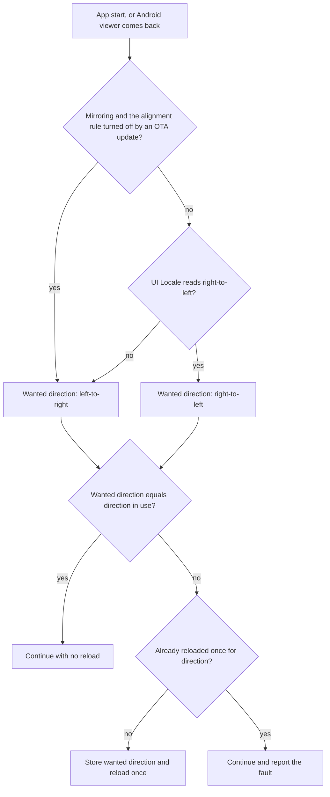
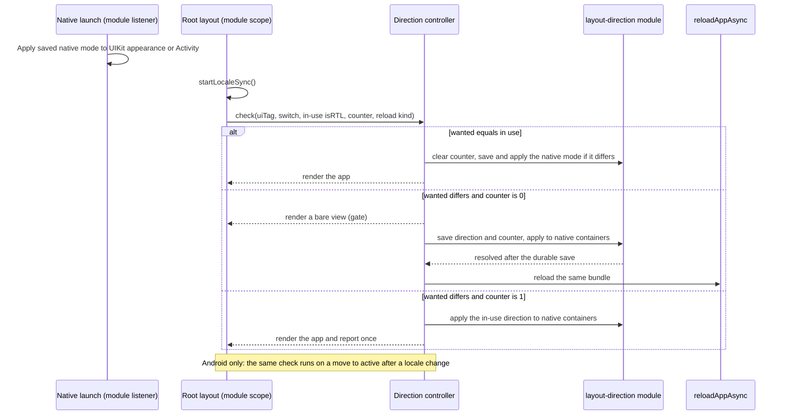
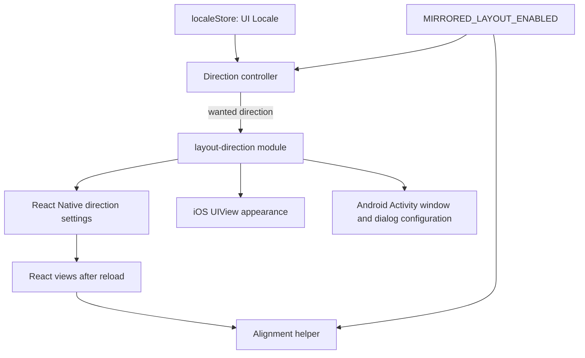

# Mobile Mirrored Right-to-Left Layout - Plan

## Goal Capsule

- **Objective:** A viewer whose mobile app language reads right-to-left sees every screen arranged in the reading direction of that language.
- **Means:** A JavaScript direction controller decides the direction from the UI Locale, and a small local native module saves it and applies it to native parts before one reload (KTD2, KTD3).
- **Product authority:** This Product Contract. For layout direction and text alignment, it supersedes KD3, R6, the right-to-left parts of KTD4, KTD13, and U14 of `docs/plans/2026-09-28-1016-feat-mobile-ui-localization-plan.md`. `apps/tv`, `apps/web`, and `apps/admin` are not active scope.
- **Execution profile:** `ce-work` on branch `feat/mobile-rtl-layout`. The change moves the fingerprint runtime version, so device checks need new dev-client or preview builds on both platforms.
- **Stop conditions:**
  - Stop and ask when the U1 Android check finds no way to give native dialogs the wanted direction without recreating the Activity after the first render.
  - Stop when a device check shows a reload that repeats.
  - Stop before any change to `apps/admin`, `apps/web`, or `apps/tv`.
  - Never publish an OTA update to any channel, including `preview` (owner decision, 2026-10-12). Off-switch checks use a second local build instead (U2).
- **Who finishes:** the owner reviews and merges the PR and starts the production native build.
- **Open blockers:** None.

---

## Product Contract

**Product Contract preservation:** changed: R4 — its rule now holds while mirroring is on, because R10 defines the off state as today's screens, where Android dialogs follow the phone language (confirmed at plan synthesis, 2026-10-12). R5 now names link-started sessions, and Scope Boundaries now names the losses that the owner accepted at the same synthesis. R8 and AE7 now allow one retry after a new update or native build (confirmed at the same synthesis; applied at plan review). The Outstanding Questions were resolved in place by the Planning Contract.

### Summary

The mobile app mirrors every screen and every native part when its UI Locale reads right-to-left. The app decides the direction from the language that it shows, and it reloads once when the direction in use is wrong. An over-the-air (OTA) update can turn mirroring off and return the app to today's screens. One alignment rule decides the edge for text whose language reads in the other direction from the layout.

### Problem Frame

PR #2604 (merged 2026-10-08) gave the app 12 translated right-to-left catalogs. KD3 of the localization plan kept a left-to-right layout on purpose: viewers got their language first, and mirrored layout became later work. Today an Arabic viewer reads right-aligned Arabic text, but the screen order goes against that reading direction. The back chevron is at the left, rails start at the left, the tab order runs left to right, and swipes move in the left-to-right sense.

The app serves a worldwide audience, so right-to-left viewers are an expected group, not an edge case. No viewer or partner has reported the problem. This work is the planned follow-up to KD3.

### Key Decisions

- **Mirroring ships on in the native build, and an OTA update can turn it off.** (session-settled: user-approved — chosen over shipping it off and turning it on by OTA, and over shipping with no switch: without a switch, a broken mirrored screen needs a native build and store review to revert, and nobody on the team reads these languages.) Governs R9, R10.
- **The app decides the direction, and the platform applies it.** (session-settled: user-approved — chosen over platform-decided mirroring and over JavaScript-only mirroring: platform-decided mirroring stops the OTA switch from working and mirrors English-only `ks` phones; JavaScript-only mirroring leaves the tab bar, sheets, alerts, push animations, and the back-swipe left-to-right.) Governs R1, R2, R3, R4, R8.
- **On Android, a direction change applies by a reload when the viewer returns.** (session-settled: user-approved — chosen over applying it at the next launch and over a Restart prompt: iOS already restarts an app when its language changes, and a prompt adds UI text that all 166 catalogs must translate.) Governs R5, R6, R7.
- **Short text aligns with the layout, and paragraphs align by their own language, in both directions.** (session-settled: user-approved — chosen over own-language alignment for all text, layout alignment for all text, and this rule in mirrored screens only: Apple's right-to-left guidance gives the same rule, because a right-aligned English paragraph is hard to read and a left-aligned short title breaks a mirrored grid.) Governs R15, R16, R17.
- **The release check is an agent sweep of every screen in simulators, in right-to-left and left-to-right languages.** (session-settled: user-directed — chosen over a team device check, a check plus a reader review before release, and a reader review after release.) See Success Criteria.
- **Order flips, playback does not.** Platform guidance agrees on both points: UIKit puts play, rewind, fast-forward, and scrubbers in a `playback` category that does not flip, and Material says not to mirror media playback buttons or the media progress indicator. Governs R11, R12, R13, R14.
- **A source check blocks new direction-bound code that the layout does not mirror.** The one-time sweep cannot catch screens added later, and nobody on the team reads these languages. Governs R19.

### Requirements

**Direction**

- R1. Unless an OTA update has turned mirroring off (R9), the layout direction is right-to-left when the UI Locale is a translated catalog whose language reads right-to-left, and left-to-right for every other UI Locale. Today the right-to-left catalogs are `ar`, `az-Arab`, `ckb`, `dv`, `fa`, `he`, `ms-Arab`, `ps`, `sd`, `ug`, `ur`, and `uz-Arab`.
- R2. The phone language alone never sets the direction. A phone whose right-to-left language has only an English-only catalog (`ks`) stays left-to-right. A phone with a right-to-left language whose app language is set to English also stays left-to-right.
- R3. On a fresh install with a right-to-left UI Locale, the first screen the viewer sees is already mirrored. A reload behind the splash screen is allowed.
- R4. While mirroring is on, React views and native parts always use the same direction. The native parts are the tab bar order, form sheets, menus, alerts, navigation push and pop animations, and the back-swipe edge.

**Changing direction**

- R5. When an Android viewer comes back to the app after a language change that changes the direction, the app reloads once and opens on Home in the new direction, also when a link or a push notification started the session. Playback stops.
- R6. A language change that keeps the direction changes only the text, as today, with no reload.
- R7. A reload keeps downloads in the same way as a cold start: downloads in progress continue, and queued series episodes stay queued.
- R8. The app never reloads for direction more than once in a row on the same bundle. If the direction is still wrong after one reload, the app continues in the direction it has and reports the fault through the existing error reporting. After a new update or native build, a device that is still wrong retries once.

**Off switch**

- R9. One OTA update can turn off both mirroring and the alignment rule of R15–R17 for every viewer, with no native build. A viewer gets today's screens after the update downloads and the app reloads once.
- R10. With mirroring off, every viewer gets exactly today's shipped screens: a left-to-right layout, and each text aligned by its own language.

**What mirrors**

- R11. Everything that shows an order or a direction of movement mirrors. Horizontal rails and the hero pager start at the right edge. Directional chevrons and arrows point the other way. Row content reverses. The mini player's default corner moves to the other side, including the Bible reader's own default corner.
- R12. Playback controls do not mirror. The video scrubber, the Explore clip progress bar, and the play, pause, skip, and seek buttons keep their left-to-right direction.
- R13. Images, logos, video frames, and icons without a direction do not mirror.
- R14. Bible reader navigation follows the layout direction, not the language of the Bible text. In a right-to-left layout, a swipe to the right opens the next chapter, also for a left-to-right Bible.

**Text alignment**

R15, R16, and R17 state the rule, and the rule is the same in both layout directions. The table shows it.

| Text                                                                                                | Aligns to                                               |
| --------------------------------------------------------------------------------------------------- | ------------------------------------------------------- |
| Text whose language reads in the same direction as the layout                                       | The layout's start edge                                 |
| Short text (titles, labels, list rows) whose language reads in the other direction                  | The layout's start edge, with its own writing direction |
| Paragraphs (descriptions, Bible passages, long notices) whose language reads in the other direction | The start edge of its own language                      |

- R15. Text whose language reads in the same direction as the layout aligns to the layout's start edge.
- R16. Short text whose language reads in the other direction aligns to the layout's start edge and keeps its own writing direction. In an English layout, a short Arabic card title moves to the left edge.
- R17. A paragraph whose language reads in the other direction aligns to the start edge of its own language. The rule applies per component type, not per line count at run time.

**Protection and records**

- R18. Docs that describe the left-to-right layout as current get a dated supersession note in the same change. These include `apps/mobile/CLAUDE.md` "Native configuration and the native-build window", the localization plan's KD3, R6, KTD4, KTD13, and U14, the right-to-left row of `docs/roadmap/platform/feat-604-mobile-ui-translation-run-and-device-checks.md`, and `docs/solutions/ui-bugs/ios-natural-text-alignment-follows-native-localization.md`.
- R19. A mobile source check fails when new code adds direction-bound code that React Native does not mirror: a hard-coded directional icon name, a horizontal transform or a transform origin that names a side, horizontal gesture or scroll math on x values, and measured x positions or safe-area insets written into left or right styles. Plain left and right style props need no check, because React Native swaps them in a right-to-left layout. A reviewed exception list covers deliberate cases, such as playback controls.

### Key Flows

The diagram shows how the app decides the direction at a start and when an Android viewer comes back.

- F1. First launch on a right-to-left phone
  - **Trigger:** A viewer installs the app on a phone whose first language is Arabic.
  - **Steps:** The app resolves the UI Locale to `ar`. If the direction in use is not right-to-left, the app stores the direction and reloads once behind the splash screen.
  - **Outcome:** The first screen the viewer sees is mirrored.
  - **Covered by:** R1, R3, R8
- F2. Android language change
  - **Trigger:** An Android viewer has the app open in the background in English and sets the app language to Arabic.
  - **Steps:** The viewer comes back to the app. The text is now Arabic and the direction in use is left-to-right, so the app reloads once.
  - **Outcome:** Home opens mirrored. Playback stopped, and downloads continue.
  - **Covered by:** R5, R6, R7, R8
- F3. Mirroring turned off
  - **Trigger:** The team publishes an OTA update that turns mirroring off.
  - **Steps:** A right-to-left viewer's app downloads the update. At the next start, the wanted direction is left-to-right, so the app reloads once.
  - **Outcome:** The viewer sees today's shipped screens, as R10 states.
  - **Covered by:** R9, R10

### Acceptance Examples

- AE1. **Covers R1, R3.** Given a fresh install on a phone whose first language is Arabic, when the app opens, then the first screen is mirrored: the tab order runs right to left, and rails start at the right edge.
- AE2. **Covers R2.** Given a phone whose languages are `ks` and then `en`, when the app opens, then the UI Locale is English and the layout is left-to-right.
- AE3. **Covers R2.** Given an Arabic phone with the app language set to English, when the app opens, then the layout is left-to-right.
- AE4. **Covers R6.** Given an Android viewer in Arabic, when the viewer changes the app language to Farsi and comes back, then the text changes to Farsi with no reload.
- AE5. **Covers R16, R17.** Given an Arabic layout, an English card title "Who Is Jesus?" aligns to the right edge, and an English video description aligns to the left edge. Given an English layout, an Arabic card title aligns to the left edge, and an Arabic description aligns to the right edge.
- AE6. **Covers R12, R14.** Given an Arabic layout, the video scrubber fills from left to right, and a swipe to the right in the Bible reader opens the next chapter.
- AE7. **Covers R8.** Given a device where the stored direction does not take effect, when the app starts, then it reloads once, continues in the direction it has, and reports the fault, with no second reload on the same bundle. When a new update arrives, the device retries once.
- AE8. **Covers R9, R10.** Given a right-to-left phone on a build with mirroring on, when an update that turns mirroring off is applied, then after one reload each screen matches the same screen in the current release build.

### Success Criteria

- Before release, an agent goes through every screen of the app on an iOS Simulator and an Android emulator, in Arabic, in one more right-to-left language, and in English. The agent records a screenshot of each screen in each direction and confirms that each screen is laid out correctly.
- In each direction, the agent also performs and records each direction-sensitive motion, with a frame capture or with before-and-after screenshots: a back-swipe from the screen edge, a push and a pop, a swipe on a horizontal rail and on the hero pager, a chapter swipe in the Bible reader, and a scrubber drag.
- Before release, the agent repeats the Arabic and English sweep on both platforms with mirroring turned off, and compares each screen with a screenshot from the current release build.
- Surfaces that the simulators cannot show get a physical-device check, or the verification record lists them as not checked. These are the Cast expanded controls, the Local Network alert, and picture-in-picture on an iPhone (an iPad simulator shows picture-in-picture).
- A first launch on a left-to-right phone gets no extra reload. A first launch on a right-to-left phone adds at most one reload behind the splash screen, and the cold-start time is measured on a release build, per `docs/solutions/conventions/frontend-change-page-load-performance-verification.md`.

### Scope Boundaries

- `apps/tv`, `apps/web`, and `apps/admin` do not change. Web's Watch has its own right-to-left work (`docs/roadmap/content-discovery/feat-659-watch-language-index-rtl.md`).
- Number shapes, date formats, and translation quality do not change.
- No in-app language picker. The phone and per-app language settings stay the only controls.
- The off switch has one setting for all right-to-left languages. A switch per language is deferred.
- The animated splash is off since 2026-09-15 and is not mirrored. If it is turned on again, it needs its own check.
- A review by a person who reads these languages is not a release condition. It can be added later.
- An Android direction reload ends in-memory work, as it stops playback (R5). The owner accepted these losses on 2026-10-12: an unsent feedback draft, an open sheet, a raw file export in progress, and the app's side of a Cast session. Downloads are not in this list (R7).
- On a `ks` phone, text that does not use the alignment helper keeps today's right alignment on iOS, because natural alignment follows the native localization (`docs/solutions/ui-bugs/ios-natural-text-alignment-follows-native-localization.md`). A fix needs a product decision: remove `ks` from the native language list, or give all text an explicit alignment.

### Dependencies / Assumptions

- The change moves the fingerprint runtime version, so mirroring reaches viewers only in a new native build. The OTA switch works only in builds that contain it.
- iOS restarts an app when its language changes ([WWDC19 session 403](https://developer.apple.com/videos/play/wwdc2019/403/), [Apple forum thread 734483](https://developer.apple.com/forums/thread/734483)), so iOS needs no return-time reload. The sweep confirms this on iOS 26.
- Risk for R7: a JavaScript reload is not a cold start for the native background downloader, which stays alive through the reload. KTD3 and KTD4 keep iOS reloads before the downloader starts, and U2 proves the Android case.
- Assumption: no viewer or partner report started this work. The worldwide audience is the reason for it.

### Sources / Research

- Today's left-to-right enforcement: `supportsRTL: false` at `apps/mobile/app.json:368`, `apps/mobile/plugins/withIosLeftToRightAppearance.js:14-15`, `apps/mobile/app/(tabs)/_layout.ios.tsx:52`, and the guard in `apps/mobile/app/__tests__/localizationConfig.guard.test.js:69-77`.
- `expo-localization` 57.0.2 `ios/LocalizationModule.swift:23-31, 62-77` calls `setRTLPreferences` at every runtime start, which includes each JavaScript reload, when a `supportsRTL` or `forcesRTL` key is present. It does nothing when neither key is present. React Native 0.86.3 `React/Modules/RCTI18nUtil.m:32-77` stores `allowRTL` and `forceRTL` in `NSUserDefaults`, and `allowRTL` defaults to on.
- The plugin's `supportedLocales` list in `apps/mobile/app.json` copies `apps/mobile/i18n/native-locales.json` and includes `ks`. So a platform-decided direction would mirror a `ks` phone.
- Right-to-left catalogs and English-only tags: `apps/mobile/src/i18n/resolveLocale.ts:63-93`, `apps/mobile/src/i18n/catalogs.generated.ts:236-295`, `apps/mobile/src/i18n/localeStore.ts:189-222`. Nothing reloads the app on a language change today.
- Per-text direction today: `apps/mobile/src/i18n/textDirection.ts` (KTD13), imported by 23 files with about 32 helper calls.
- Direction-sensitive code:
  - The scrubber and the clip progress bar fill from the left: `apps/mobile/src/components/watch/Scrubber.tsx:283` and `apps/mobile/src/components/explore/ClipProgressBar.tsx:324`.
  - The Bible reader says "left is the next chapter": `apps/mobile/src/lib/bible/movement/gesture.ts:94-95`.
  - The back-swipe owns a 24 pt strip on the left edge: `apps/mobile/src/lib/backSwipe.ts:6-11`.
  - The mini player starts at `bottomRight`, and the reader starts it at `topRight` on phones: `apps/mobile/src/lib/miniPlayer/layout.ts:66-73, 225`.
- Downloads after a restart: `apps/mobile/src/contexts/DownloadsProvider.tsx:424-480` and `apps/mobile/src/lib/downloadReconciliation.ts:64-70` re-attach live tasks and requeue queued placeholder records. The in-memory batch queue restarts empty.
- React Native 0.86.3 swaps left and right styles in a right-to-left layout by default: `swapLeftAndRightInRTL:true` in `React/Modules/RCTI18nUtil.m:20`, a `true` default in Android `I18nUtil.kt:47-48`, and the swap in Fabric's `YogaLayoutableShadowNode.cpp`. So playback controls that must stay left-to-right need their own left-to-right direction, not only physical styles.
- A source-scanning guard to follow for R19: `apps/mobile/src/i18n/__tests__/noHardcodedCopy.guard.test.js`.
- Platform guidance: [Apple HIG, Right to left](https://developer.apple.com/design/human-interface-guidelines/right-to-left) (paragraph alignment), [UISemanticContentAttribute](https://developer.apple.com/documentation/uikit/uisemanticcontentattribute) (`playback`), [Material bidirectionality](https://m1.material.io/usability/bidirectionality.html) (media controls).
- Related learning: `docs/solutions/ui-bugs/ios-natural-text-alignment-follows-native-localization.md`.

---

## Planning Contract

### Key Technical Decisions

- KTD1. **Remove both right-to-left keys from the `expo-localization` plugin, and remove `withIosLeftToRightAppearance.js`.** With either `supportsRTL` or `forcesRTL` present, the module rewrites React Native's direction settings at every runtime start and every JavaScript reload, so the app's own choice cannot persist (expo-localization 57.0.2 `ios/LocalizationModule.swift:23-31, 57-77`; Android `LocalizationModule.kt:55-72`). Keep `supportedLocales` and `allowDynamicLocaleChangesAndroid`. The Expo template already sets `android:supportsRtl="true"`, which React Native needs before anything mirrors on Android. Governs R1, R2, R4, R9.
- KTD2. **A small local Expo module, `apps/mobile/modules/layout-direction`, owns the native side.** (session-settled: user-directed — chosen over a JavaScript-plus-plugin design with no module: the module is exact in every case. The other design leaves iOS sheets, alerts, and menus in the old direction for one session after an upgrade, on a `ks` first launch, and after the off switch, and it cannot order the iOS direction save before the reload.) It has four jobs:
  1. It saves the direction durably before it resolves: React Native's `allowRTL` off, `forceRTL` set to the wanted value, the reload counter and reload kind (KTD4), and a native mode of `rtl`, `ltr`, or `none`. The JavaScript `I18nManager.forceRTL` call is asynchronous on iOS, and nothing orders it before a reload (RN `RCTTurboModule.mm:441-480`).
  2. It applies the direction to native containers on the main thread: iOS `UIView.appearance().semanticContentAttribute`, and the Android Activity window and the configuration that native dialogs read.
  3. At launch, it applies the saved native mode before any native container exists: through an Expo app-delegate subscriber on iOS and an Expo activity-lifecycle listener on Android. The mode `none`, or no saved mode, keeps the platform default.
  4. On Android, it applies the direction again after a configuration change, because `onConfigurationChanged` re-derives the direction from the locale.

  JavaScript loads the module through an optional lookup, so Expo Go, older dev clients, and Jest get no module and the controller does nothing. Governs R1, R2, R3, R4, R8, R9.

- KTD3. **A JavaScript controller, `apps/mobile/src/i18n/layoutDirection.ts`, decides, and `reloadAppAsync` from `expo` reloads.** The decision is a pure function of the UI Locale, the off switch (KTD5), a failed locale read, the direction in use, and the reload counter. The direction in use is `I18nManager.getConstants().isRTL` from the current runtime's start. It is never the saved value, which already holds the new direction after a save. Timing:
  1. The start check runs at module scope right after `startLocaleSync()` in the guarded block of `apps/mobile/app/_layout.tsx`.
  2. While a direction reload is pending, the root layout renders a bare view and mounts no provider. The cache-restore gate is off by default (`app/_layout.tsx:353`), so without this gate the downloader, reminders, sign-in refresh, and Datadog could start in the runtime that is about to end.
  3. On Android, the check also runs when the app moves to `active` after a locale change. It never runs on the locale event alone, so picture-in-picture, background audio, and split screen never trigger a reload. In split screen, the reload waits for the next move to `active`.
  4. A failed locale read keeps the direction in use and reports, so an English fallback cannot cause a reload.
  5. At module scope, the controller reads the counter and the reload kind once, before any clear, and keeps an in-memory `afterReturnReload` flag for the rest of the runtime.
  6. At every check, including a matched start, the controller sends the decided native mode. While mirroring is on, the mode is the wanted direction on both platforms. While it is off, the mode is `ltr` on iOS and `none` on Android (KTD5). When only the native mode differs, the module saves and applies it with no reload and no counter change. This keeps native parts in line on a `ks` phone, where React Native's Android in-use value never mismatches (`I18nUtil.kt:63-69`).

  `Updates.reloadAsync` was rejected: it loads the newest downloaded update, which can change the direction decision under the counter, and it throws in development builds (expo-updates `src/Updates.ts:130-143`). Governs R1, R3, R5, R6, R8.

- KTD4. **The reload counter counts consecutive direction reloads and clears on a matched start.** The module increments it in the same durable save as the direction, together with the reload kind: `start` or `return` (an Android return reload). A start where the direction in use equals the wanted direction clears it. When the counter is 1 and the direction is still wrong, the app does not reload. It applies the direction in use to the native containers, so that React and native parts match, and it reports once per pair of wanted direction and bundle. Each counter value records the update id, or the native build number for an embedded bundle. A new update or build resets the counter, so a stuck device retries once. Developer reloads never touch the counter. Governs R8.
- KTD5. **The off switch is a literal constant, `MIRRORED_LAYOUT_ENABLED`, in `apps/mobile/src/i18n/mirroredLayout.ts`.** It follows `ANIMATED_SPLASH_ENABLED` (`src/lib/splash/animatedSplashEnabled.ts`), and a guard pins it to a bare `true` or `false` literal (`src/lib/splash/__tests__/splashKillSwitch.guard.test.js`). Off means: the wanted direction is left-to-right for every viewer, the alignment helper uses today's own-language rule, iOS native containers are forced left-to-right (native mode `ltr`, today's plugin behavior), and Android native containers get no override (native mode `none`, today's behavior). Governs R9, R10.
- KTD6. **One alignment helper owns R15–R17.** `apps/mobile/src/i18n/textDirection.ts` takes a text kind, short or paragraph, and returns the writing direction and an explicit alignment edge for the current layout. Text inputs count as short text. iOS Fabric swaps `textAlign` left and right inside a right-to-left text node (`RCTAttributedTextUtils.mm:200-206`), so the helper maps the physical edge per platform. The device matrix in U4 confirms that mapping. Governs R15, R16, R17, R10.
- KTD7. **Playback controls and layers that use measured window x positions render inside a left-to-right container.** A `direction: "ltr"` container keeps their physical math unchanged. This covers the scrubber, the clip progress bar, the player transport and the fullscreen bar, the player frame and mini player layer in `PlaybackHost`, the clip caption boxes, and the curated-home mute button. Only R11's explicit changes, such as the mini player default corner, mirror these surfaces. Governs R11, R12.
- KTD8. **Directional icons and gesture signs read one layout source.** A helper maps `chevron-back`, `chevron-forward`, `arrow-back`, and `arrow-forward` by the layout direction. A layout-sign helper flips horizontal swipe math. Both read `I18nManager.getConstants().isRTL`. Playback icons are not directional icons (R12). Governs R11, R14, R19.
- KTD9. **After an Android return reload, an `app/+native-intent.tsx` redirect sends the first route to Home.** The redirect, the push-replay guard, and the U2 telemetry tag read only the in-memory `afterReturnReload` flag (KTD3), never the stored counter, which the same start clears. In expo-router 57 the root layout runs before the redirect, so a counter read there would already be 0. A start reload keeps its launch link and push response, because the reloaded runtime is the first one to read them. Governs R5.
- KTD10. **The R19 guard is an AST source scan with an exact exception list.** It copies the shape of `noHardcodedCopy.guard.test.js`: the TypeScript compiler walks `app` and `src`, every exception names a file, rule, text, and reason, every exception must be used, and positive and negative controls prove each rule. Governs R19.

### High-Level Technical Design

Startup and the Android return path:

Ownership across the layers:

### Assumptions

- `reloadAppAsync` keeps the running bundle, so a direction reload never loads a newly downloaded update. The source supports this: expo-updates returns the current launcher's asset URL on a plain React reload (`ios/EXUpdates/ReactDelegateHandler/ExpoUpdatesReactDelegateHandler.swift:79-81`). No device check is planned, because the owner ruled out preview-channel updates. If the assumption is wrong, R8's counter still limits the reloads.
- The native splash stays up through a reload at module scope. expo-splash-screen does not show the splash again on a reload (`ios/SplashScreenManager.swift:82-84` has no registered listener), but a splash that was never hidden should stay. U2 proves this on both platforms. If it fails, the bare-view gate still keeps the left-to-right first screen out of view.
- The Android Activity can take the wanted direction without a recreation after the first render. U1 proves this first (see Stop conditions).

### Deferred to Implementation

- The exact Android mechanism that makes React Native `Alert`, react-native-screens bottom sheets, and the JavaScript tabs follow the wanted direction. Candidates: a decor-view direction plus a configuration override at Activity creation, or a configuration update at run time. U1 decides it on the emulator.
- Exact helper names and the final shape of the text-kind argument in `textDirection.ts`.
- Whether the Android `pagingEnabled` carousel (`sections/BibleQuotesCarouselRenderer.tsx:745-755`) needs `snapToInterval` instead in a right-to-left layout. React Native counts pages from the left edge there (`ReactHorizontalScrollView.java:1265-1300`).

---

## Implementation Units

### U1. Layout-direction native module and native configuration

- **Goal:** The app owns its layout direction natively. The `expo-localization` plugin no longer overwrites it, and native containers follow it at launch and on demand.
- **Requirements:** R1, R2, R3, R4, R9 (KTD1, KTD2)
- **Dependencies:** None
- **Files:**
  - Create `apps/mobile/modules/layout-direction/expo-module.config.json`, `apps/mobile/modules/layout-direction/index.ts`, `apps/mobile/modules/layout-direction/ios/LayoutDirectionModule.swift`, `apps/mobile/modules/layout-direction/ios/LayoutDirectionAppDelegateSubscriber.swift`, `apps/mobile/modules/layout-direction/android/src/main/java/org/jesusfilm/layoutdirection/LayoutDirectionModule.kt`, `apps/mobile/modules/layout-direction/android/src/main/java/org/jesusfilm/layoutdirection/LayoutDirectionPackage.kt`, and the module's `build.gradle` and podspec
  - Modify `apps/mobile/app.json`: remove `supportsRTL`, and remove `./plugins/withIosLeftToRightAppearance` from the plugin list
  - Delete `apps/mobile/plugins/withIosLeftToRightAppearance.js` and `apps/mobile/plugins/withIosLeftToRightAppearance.test.js`
  - Modify `apps/mobile/app/__tests__/localizationConfig.guard.test.js`
  - Test: `apps/mobile/modules/layout-direction/__tests__/index.test.ts`
- **Approach:**
  1. Start with an Android emulator spike. Prove which mechanism gives React Native `Alert`, a bottom sheet, and the JavaScript tabs the wanted direction on a `ks` phone, before any other native code lands.
  2. Build the module with the Expo Modules API. Expose one async function on the main queue that saves the direction, native mode, counter, and reload kind durably, then applies the mode to native containers. Expose one that reads the counter, one that clears it, and one that applies a direction without saving it (used by the stuck-device path, KTD4).
  3. Register the iOS app-delegate subscriber and the Android activity-lifecycle listener in `expo-module.config.json`. Apply the saved native mode at launch. With no saved mode, or with `none`, keep the platform default.
  4. On Android, write preferences with `commit`, not `apply`, so a process kill after the save cannot lose them.
  5. The JavaScript entry uses `requireOptionalNativeModule` and returns an inert object when the module is missing.
- **Execution note:** The Android spike comes first, because its result can trigger a stop condition.
- **Patterns to follow:** the defensive load in `apps/mobile/plugins/withIosLeftToRightAppearance.js:3-8`, and the lazy `require` of `expo-localization` inside `try` blocks in `apps/mobile/src/i18n/localeStore.ts`.
- **Test scenarios:**
  - The guard passes when the `expo-localization` options have neither `supportsRTL` nor `forcesRTL`.
  - Negative control: the guard fails when `supportsRTL` is present with `true` and again with `false`.
  - Negative control: the guard fails when `forcesRTL` is present with any value, in the options, in `expo.extra`, or as an `ios.infoPlist` key.
  - The guard fails when the plugin list contains `withIosLeftToRightAppearance`.
  - The JavaScript entry returns the inert object when the native module is missing, and calling it does not throw.
- **Verification:** A clean prebuild has no `ExpoLocalization_supportsRTL` or `ExpoLocalization_forcesRTL` key in `Info.plist` or `strings.xml`. The Android manifest keeps `android:supportsRtl="true"`. Dev clients build on both platforms.

### U2. Direction controller, off switch, reload counter, and start gate

- **Goal:** Each start and each Android return ends with the wanted direction in use, through at most one reload.
- **Requirements:** R1, R2, R3, R5, R6, R7, R8, R9 (KTD3, KTD4, KTD5, KTD9); covers F1, F2, F3
- **Dependencies:** U1
- **Files:**
  - Create `apps/mobile/src/i18n/layoutDirection.ts`, `apps/mobile/src/i18n/mirroredLayout.ts`, and `apps/mobile/app/+native-intent.tsx`
  - Modify `apps/mobile/app/_layout.tsx` (start check after `startLocaleSync()`, render gate)
  - Modify `apps/mobile/src/lib/lapseReminders/notificationsAdapter.ts` if the push-response replay needs a direction-reload check
  - Test: `apps/mobile/src/i18n/__tests__/layoutDirection.test.ts`, `apps/mobile/src/i18n/__tests__/mirroredLayoutKillSwitch.guard.test.js`, `apps/mobile/app/__tests__/nativeIntent.test.ts`
  - Modify the guards that pin the startup block: `apps/mobile/app/__tests__/localeStartup.guard.test.js` and `apps/mobile/app/__tests__/splashHostOwnership.guard.test.js`
- **Approach:**
  1. Write the decision as a pure function. Its inputs are platform, UI tag, switch, read failure, in-use direction, and counter. Its result is no action, reload, or stuck.
  2. Read the in-use direction, the counter, and the reload kind once at module scope, before any save or clear, and set `afterReturnReload` (KTD3).
  3. Wrap the start check in the existing guarded block. A failure keeps the in-use direction and reports with `reportDatadogError`; it never reaches the Startup Error panel.
  4. If the reload promise rejects, the controller applies the in-use direction again through the module, clears the counter, and reports.
  5. Tag the runtime that starts after a direction reload in the existing launch telemetry, so cold-start numbers do not mix the two cases.
- **Execution note:** Implement the decision function test-first. Hold one fixture per axis and change one axis at a time, so each branch has a test that only it can satisfy.
- **Patterns to follow:** the literal-leaf guard in `apps/mobile/src/lib/splash/__tests__/splashKillSwitch.guard.test.js`, `localeResolutionAttributes` in `apps/mobile/src/i18n/localeStore.ts:364-380` for attribute names, and `src/test-utils/uiLocaleFixture.ts`.
- **Test scenarios:**
  - Covers AE1. iOS, UI `ar`, switch on, in-use RTL, counter 0: no reload, and the counter clears.
  - Covers AE1. Android, UI `ar`, switch on, in-use LTR, counter 0: reload, and the save happens before the reload call.
  - Covers AE2. UI `en` from a `[ks, en]` phone, in-use RTL: reload to left-to-right.
  - Covers AE3. UI `en`, in-use LTR on an Arabic phone: no reload.
  - Covers AE4. Android, `ar` to `fa` while in the background, then a move to `active`: no reload.
  - Covers F2. Android, `en` to `ar` while in the background, then a move to `active`: one reload.
  - Android locale event while in picture-in-picture or with background audio: no reload until the next move to `active`.
  - Covers AE7. Counter 1 and still wrong: no reload, the in-use direction goes to native containers, and one report for this wanted direction and bundle.
  - A second stuck start on the same bundle: no second report.
  - A new update id with counter 1 and still wrong: one retry reload.
  - Failed locale read: no reload, the in-use direction stays, and one report.
  - Covers AE8. Switch off, UI `ar`, in-use RTL: reload to left-to-right.
  - The reload promise rejects: the in-use direction is applied again, the counter clears, and a report is sent.
  - Module missing: no reload, no throw, and the app renders.
  - While a reload is pending, the root layout renders the bare view and no provider mounts.
  - After a return reload with a launch link, the redirect returns `/`.
  - After a start reload with a launch link, the redirect keeps the link, and the push response is not suppressed.
  - `afterReturnReload` stays set after the counter clears on the same start.
  - A normal cold start with a link keeps the link.
  - Android `ks` phone, UI `en`, in-use LTR (matched): native mode `ltr` is saved and applied, with no reload and no counter change.
  - iOS `ks` upgrade, in-use LTR from the old build's settings (matched): native mode `ltr` is saved and applied, with no reload.
  - Switch off on Android: native mode `none`, so the Activity gets no override.
  - The switch guard fails on a non-literal value, such as an expression or an import.
- **Verification:** A release-type build on each platform passes F1 and F2 on a simulator or emulator. F3 and AE8 run on a second local release-type build with `MIRRORED_LAYOUT_ENABLED` set to `false`, installed over a mirrored install without removing its data (`xcrun simctl install`, `adb install -r`). That replaces the bundle as an off-switch update would, with no OTA publish. The native splash stays up through the start reload. An Android direction reload with a running download keeps the download and its record.

### U3. Native navigation surfaces

- **Goal:** The tab bar, the native stack, and the back-swipe edge follow the layout direction, and the JavaScript scrub guard keeps clear of the moved edge.
- **Requirements:** R4, R11 (KTD8)
- **Dependencies:** U2
- **Files:**
  - Modify `apps/mobile/app/(tabs)/_layout.ios.tsx` (pass `"rtl"` or `"ltr"` from the layout direction; never remove the prop, because `inherit` follows the native localization)
  - Modify `apps/mobile/src/lib/scrubber.ts` (`mayStartScrub` keeps clear of the right edge in a right-to-left layout)
  - Modify `apps/mobile/app/__tests__/localizationConfig.guard.test.js` (the iOS tab direction suite)
  - Test: `apps/mobile/src/lib/__tests__/scrubber.test.ts`, `apps/mobile/app/__tests__/backSwipeGesture.guard.test.js`, `apps/mobile/app/__tests__/tabBarLayout.test.tsx`
- **Approach:** The native stack, push and pop animations, and the 24 pt back-swipe strip already follow `I18nManager` through expo-router and react-native-screens (`NavigationContainer.js:34`, `RNSScreenStack.mm:1019-1022`). This unit only connects the two places that do not.
- **Patterns to follow:** the existing guard shapes in `backSwipeGesture.guard.test.js` and the iOS tab direction suite in `localizationConfig.guard.test.js`.
- **Test scenarios:**
  - In a right-to-left layout, `mayStartScrub` declines a touch inside the right 24 pt strip and accepts one inside the left strip.
  - In a left-to-right layout, the old behavior stays: it declines the left strip.
  - The iOS tab layout passes `"rtl"` when the layout is right-to-left and `"ltr"` otherwise.
  - The guard fails when the tab direction is a hard-coded literal or is removed.
- **Verification:** In the sweep, the iOS tab order runs right to left in Arabic, a back-swipe starts from the right edge, and a scrub that starts at the left edge of the scrubber is not taken by the back-swipe.

### U4. Two-way text alignment rule

- **Goal:** Every helper-styled text follows R15–R17 in both layout directions, and follows today's rule when the switch is off.
- **Requirements:** R10, R15, R16, R17 (KTD6); covers AE5
- **Dependencies:** U2
- **Files:**
  - Modify `apps/mobile/src/i18n/textDirection.ts`
  - Modify the paragraph components: `src/components/watch/VideoDescription.tsx`, `src/components/explore/ClipDescription.tsx`, `src/components/sections/BibleQuotesCarouselRenderer.tsx` (the quote), `src/components/sections/RelatedQuestionsRenderer.tsx`, `app/mission.tsx`, and the notice in `src/components/feedback/FeedbackSheetContent.tsx`
  - Modify the Bible verse view: `src/components/bible/VerseView.tsx:492-494` (physical `textAlign`)
  - Modify the inputs: the search box in `src/components/sheets/SearchableListSheet.tsx` and the message input in `src/components/feedback/FeedbackSheetContent.tsx`
  - Modify the short-text call sites in the 23 files that import the helper today
  - Test: `apps/mobile/src/i18n/__tests__/textDirection.test.ts`
- **Approach:** Change the helper first and keep its old behavior behind the switch. Then move each call site to the short or paragraph kind. Paragraph components are the four description and passage components, the mission screen paragraphs, the feedback notice, and the Bible verse view. All other helper-styled text is short.
- **Execution note:** Confirm the iOS and Android edge mapping on a device with one test screen that renders the 2 × 2 × 2 matrix (layout direction × text direction × kind), before changing call sites.
- **Patterns to follow:** today's `useTextDirection` hook and its tests.
- **Test scenarios:**
  - Covers AE5. Arabic layout, short English text: start edge of the layout, with left-to-right writing direction.
  - Covers AE5. Arabic layout, English paragraph: left edge, with left-to-right writing direction.
  - Covers AE5. English layout, short Arabic text: left edge, with right-to-left writing direction.
  - Covers AE5. English layout, Arabic paragraph: right edge.
  - Same direction as the layout: start edge, for both kinds.
  - Unknown language: no direction style, as today.
  - Switch off: the helper returns today's own-language result for every input.
  - Centered text: no alignment change, as today.
- **Verification:** The device matrix screen matches the table in R15–R17 on both platforms. The sweep shows AE5 on Home and on a video screen.

### U5. Order mirroring on Home, lists, and icons

- **Goal:** Rails, the hero pager, row chevrons, and directional icons follow the layout direction.
- **Requirements:** R11, R13 (KTD8)
- **Dependencies:** U2
- **Files:**
  - Create the directional-icon and layout-sign helpers in `apps/mobile/src/i18n/layoutDirection.ts` or a sibling file
  - Modify the directional icon sites: `app/_layout.tsx`, `app/more.tsx`, `src/components/ui/FloatingBackButton.tsx`, `src/components/ui/ScreenTopBar.tsx`, `src/components/feedback/FeedbackSheetContent.tsx`, `src/components/watch/PlayerSettingsSheet.tsx`, `src/components/watch/PlaybackHost.tsx`, `src/components/profile/MyWatchHeader.tsx`, `src/components/profile/MyWatchScreen.tsx`, `src/components/bible/ReaderTopBar.tsx`, and `src/components/bible/sheets/ReaderSheetHeader.tsx`
  - Modify the hero swipe in `src/components/home/HomeScreen.tsx` and the pager offset math in `src/components/home/HomeHeroPager.tsx` and `src/components/home/HomeHeroSelectorRail.tsx`
  - Modify the carousel index math and accessibility actions in `src/components/sections/BibleQuotesCarouselRenderer.tsx`
  - Test: a new `apps/mobile/src/i18n/__tests__/directionalIcon.test.ts`, plus a pure hero-swipe helper with its test
- **Approach:** Snap rails need no code, because React Native lists already start at the right edge in a right-to-left layout. Move the hero-swipe sign into a pure helper so a unit test can prove it. Check `contentOffset.x`, `scrollToOffset`, and `getItemLayout` on both platforms for the three offset-math sites.
- **Patterns to follow:** Ionicons names passed as string literals today.
- **Test scenarios:**
  - The icon helper returns `chevron-forward` for `chevron-back` in a right-to-left layout, and returns it unchanged in a left-to-right layout.
  - The icon helper never maps `play-back` or `play-forward`.
  - Hero swipe: in a right-to-left layout, a drag to the right moves to the next hero, and a drag to the left moves back.
  - Hero swipe: the left-to-right behavior stays as today.
- **Verification:** In the sweep, every rail starts at the right edge in Arabic, the hero pager advances in the reading direction, and every back chevron points to the right.

### U6. Bible reader and mini player

- **Goal:** Reader navigation and the mini player default corner follow the layout direction.
- **Requirements:** R11, R14 (KTD8); covers AE6 (chapter swipe)
- **Dependencies:** U2, U5
- **Files:**
  - Modify `src/components/bible/ReaderGestures.tsx` (chapter direction, preview pill chevrons)
  - Modify `src/lib/bible/movement/gesture.ts` (`releaseSwipe`, and the comment that cites R32)
  - Modify `src/lib/bible/movement/verseStage.ts` and `src/components/bible/VerseSlider.tsx` (slide sign)
  - Modify `src/components/bible/SwipeDemo.tsx` and `src/lib/bible/onboarding/swipeDemoTimeline.ts` (demo travel)
  - Modify `src/components/bible/VerseScrubber.tsx` (a verse-order scrubber, so it mirrors under R11)
  - Modify `src/lib/miniPlayer/layout.ts` (corner preference and `readerCornerPolicy`)
  - Test: `src/lib/bible/movement/__tests__/gesture.test.ts`, `src/lib/bible/movement/__tests__/verseStage.test.ts`, `src/lib/bible/onboarding/__tests__/swipeDemoTimeline.test.ts`, `src/lib/miniPlayer/__tests__/layout.test.ts`
- **Approach:** Pass the layout sign into the pure gesture and stage functions instead of reading it inside them, so the tests set the direction without a mock. The mini player corner order mirrors left and right. The snap math stays physical, because the player layer renders inside a left-to-right container (KTD7).
- **Test scenarios:**
  - Covers AE6. Right-to-left layout: a release with a positive x distance is "forward" (next chapter).
  - Left-to-right layout: today's mapping stays.
  - The verse slide moves in the reading direction in both layouts.
  - The swipe demo travels toward the reading direction's end in a right-to-left layout.
  - The mini player default corner is bottom-left in a right-to-left layout and bottom-right in a left-to-right layout.
  - The reader's phone default corner is top-left in a right-to-left layout.
  - Snap-to-corner still picks the nearest physical corner in both layouts.
- **Verification:** In the sweep, a right swipe in the Arabic reader opens the next chapter, and the mini player first appears at the bottom left.

### U7. Playback controls and physical-coordinate layers

- **Goal:** Playback controls keep their left-to-right direction, and layers that use measured window positions draw in the right place in both layouts.
- **Requirements:** R12, R13 (KTD7); covers AE6 (scrubber)
- **Dependencies:** U2
- **Files:**
  - Modify `src/components/watch/Scrubber.tsx`, `src/components/explore/ClipProgressBar.tsx`, `src/components/watch/PlayerControls.tsx` (transport row and fullscreen bar insets), and `src/components/watch/VideoPlayer.tsx` (seek flash)
  - Modify `src/components/watch/PlaybackHost.tsx` (player frame and mini player layer), `src/components/explore/ClipOverlay.tsx`, `src/components/watch/SubtitleOverlay.tsx`, and `src/components/sections/CuratedHomeLayout.tsx`
  - Test: the existing component tests for these files, plus a direction-container assertion for each
- **Approach:** Wrap each surface in a `direction: "ltr"` container at the closest common parent. Inside the clip caption boxes and subtitles, the text keeps its own writing direction from the helper (U4).
- **Test scenarios:**
  - Covers AE6. With `I18nManager.isRTL` mocked to true, the scrubber renders inside a left-to-right container, and its fill origin stays at the left.
  - The clip progress bar renders inside a left-to-right container in a right-to-left layout.
  - The player frame layer renders inside a left-to-right container, so a measured x of 0 draws at the physical left edge.
  - Test expectation for `CuratedHomeLayout`: covered by the sweep, because the mute button position needs real layout.
- **Verification:** In the Arabic sweep, the scrubber fills left to right, a drag follows the finger, the mini player opens on its own frame, clip captions sit over the clip, and the curated-home mute button sits over its video.

### U8. Source guard for direction-bound code

- **Goal:** New code that React Native does not mirror fails CI unless a reviewed exception names it.
- **Requirements:** R19 (KTD10)
- **Dependencies:** U5, U6, U7
- **Files:**
  - Create `apps/mobile/src/i18n/__tests__/directionBoundCode.guard.test.js`
- **Approach:** The rules are: a directional icon name literal outside the icon helper; a `translateX` or `scaleX` transform key; a `transformOrigin` value that names left or right; a read of `dx`, `moveX`, `x0`, `pageX`, `locationX`, or `contentOffset.x`; and a measured `x` or a safe-area inset written into a `left` or `right` style. Seed the exception list from the state after U5–U7, with a reason for each entry.
- **Patterns to follow:** `apps/mobile/src/i18n/__tests__/noHardcodedCopy.guard.test.js` (AST walk, exact exception list, controls, every exception used, every named file exists).
- **Test scenarios:**
  - Each rule has a positive control that fails and a negative control that passes.
  - The inset form has its own controls: `left: insets.left` fails, and a symmetric inset such as `paddingHorizontal: Math.max(insets.left, insets.right)` passes.
  - The guard fails when an exception entry is unused.
  - The guard fails when an exception names a file that does not exist.
  - The guard passes on the current tree.
- **Verification:** Adding a test file with a raw `chevron-back` literal makes the guard fail. Removing it makes the guard pass.

### U9. Supersession notes and the off-switch runbook

- **Goal:** No doc describes the left-to-right layout as current, and the team has a written off-switch procedure.
- **Requirements:** R18 (KTD5)
- **Dependencies:** U1–U8
- **Files:**
  - Modify `apps/mobile/CLAUDE.md` (the native configuration section, the KTD13 text section, and a new mirrored-layout section with the off-switch runbook)
  - Modify `docs/solutions/ui-bugs/ios-natural-text-alignment-follows-native-localization.md`
  - Modify `docs/plans/2026-09-28-1016-feat-mobile-ui-localization-plan.md` (KD3, R6, KTD4, KTD13, U14)
  - Modify `docs/plans/2026-09-24-1251-feat-mobile-native-bible-reader-plan.md` (R32)
  - Modify `docs/plans/2026-08-12-001-feat-mobile-mini-player-plan.md` (corner preference)
  - Modify `docs/roadmap/platform/feat-604-mobile-ui-translation-run-and-device-checks.md` (the right-to-left row) and `docs/roadmap/platform/feat-694-mobile-rtl-mirrored-layout.md` (status)
- **Approach:** Add dated notes next to the old text and do not rewrite it, per the retired-mechanism prose sweep in the root `CLAUDE.md`. The runbook says that any later update, or an `eas update:rollback` to an update from before the off update, turns mirroring back on. Run `git grep -niE 'supportsRTL|forceLeftToRight|layout never mirrors|left-to-right layout' -- '*.md'` and classify each hit.
- **Test expectation:** none -- documentation only. `npx prettier --check` passes on every edited file.
- **Verification:** The grep finds no forward-looking instruction that still describes the left-to-right layout as current.

---

## Verification Contract

| Gate                 | Command or check                                    | Proves                                            |
| -------------------- | --------------------------------------------------- | ------------------------------------------------- |
| Unit and guard tests | `pnpm --filter @forge/mobile test`                  | Decision function, helpers, and guards (U1–U8)    |
| Lint                 | `pnpm --filter @forge/mobile lint`                  | Package lint, which differs from the root hook    |
| Types                | `pnpm --filter @forge/mobile typecheck`             | Module entry and helper types                     |
| Docs format          | `npx prettier --check` on each edited markdown file | CI `format` job                                   |
| Prebuild             | A clean prebuild on both platforms                  | KTD1 keys gone; `android:supportsRtl="true"` kept |
| Builds               | A dev client or preview build on both platforms     | The module links and launches                     |

The device record (Success Criteria) runs on those builds. Set the iOS language with `xcrun simctl spawn <udid> defaults write -g AppleLanguages -array ar en`, then relaunch. Set the Android app language with `adb shell cmd locale set-app-locales <package> --locales ar`. The record also covers these cases:

- Every screen with its sheets, menus, alerts, empty, error, and offline states, download progress, and the fullscreen player, in Arabic, Hebrew, and English.
- AE2 (`ks` phone) and AE3 (Arabic phone with the app in English). On an Android fresh install on a `ks` phone, an alert and a sheet are left-to-right.
- A share link that opens the first launch after an upgrade keeps its target.
- An upgrade over the current store build, for an Arabic viewer.
- The Android return reload with picture-in-picture, background audio, the fullscreen player, an open alert, an open sheet, a running download, a running raw export, a Cast session, and a link-started session.
- The iOS in-process flip after an upgrade and after the off switch: the back chevron (react-native-screens issue #4395), a form sheet, an alert, and the native video controls in `app/video/[sectionKey].tsx`.
- The off-switch sweep against the current release build (AE8), on the second local build that U2 describes.
- Cold start on release builds: an English phone with no reload, and Arabic phones on both platforms with at most one reload.

---

## Definition of Done

- Every unit's test scenarios exist and pass, and the Verification Contract gates pass.
- The device record covers every Success Criteria item and every case in the Verification Contract, with screenshots or frame captures, and lists any surface that it did not check.
- R1–R19 and AE1–AE8 each trace to a passing test or a device record entry.
- The docs in U9 carry dated supersession notes, and feat-694 shows its status.
- No code from abandoned attempts stays in the diff, such as a spike branch in the module or a mechanism that U1 did not choose.

---

## System-Wide Impact

- **Native build and OTA reach.** The runtime version moves, so an `eas update` published before the new native build ships reaches no installed build, and the command still exits 0 (`apps/mobile/CLAUDE.md` publish rules). The off switch works only after that build is live.
- **Startup path.** The start check joins the guarded block in `apps/mobile/app/_layout.tsx`, next to the splash session and the Datadog buffer. A failure there must report and continue, and never reach the Startup Error panel (U2).
- **Downloads.** The iOS background session and the Android download service react to a JavaScript reload differently from a cold start (Risks). R7 is the bar, and U2 holds the proof.
- **Deep links and push notifications.** After a reload, `src/lib/deepLinkOrigin.ts` reads the initial URL again, and the push adapter can read the last response again. KTD9 sends a direction reload to Home, and a normal cold start keeps its link.
- **Work on a move to `active`.** The sign-in refresh in `AuthProvider` and the watch-progress queue flush run on the same `active` change as the Android reload. U2 checks that a flush cut by the reload sends no duplicate progress on the next start.
- **Telemetry.** `js_tti` and the locale log fire once per JavaScript runtime, not once per process. U2 tags the runtime after a direction reload, so cold-start numbers stay comparable.
- **Lists.** Every horizontal list is a React Native `FlatList` or `ScrollView`, which already supports right-to-left. FlashList is not in use.

---

## Risks

| Risk                                                                                                       | Mitigation                                                                                                                               |
| ---------------------------------------------------------------------------------------------------------- | ---------------------------------------------------------------------------------------------------------------------------------------- |
| react-native-screens issue #4395: a stale back chevron after a JavaScript reload that flips the direction. | The in-process flip happens only after an upgrade or the off switch. The Verification Contract checks it; the next cold start clears it. |
| The iOS background downloader opens a second session after a reload.                                       | iOS reloads only at start, behind the render gate, before the downloader starts (KTD3).                                                  |
| An Android reload clears download notifications and unbinds the service.                                   | U2 verifies that downloads and records survive; R7 is the bar.                                                                           |
| Android `pagingEnabled` counts pages from the left edge.                                                   | U5 checks the carousel; the fallback is `snapToInterval` (Deferred to Implementation).                                                   |
| The iOS `textAlign` swap makes the helper's edge mapping wrong on one platform.                            | The U4 device matrix runs before call sites change.                                                                                      |
| Cold-start telemetry mixes runtimes after a reload.                                                        | U2 tags those runtimes.                                                                                                                  |

## Alternatives Considered

- **JavaScript plus a changed iOS plugin, with no module.** Rejected by the owner (KTD2): it is exact in fewer cases.
- **`Updates.reloadAsync` for the reload.** Rejected (KTD3): it changes the bundle and throws in development builds.
- **A reload counter keyed only by wanted direction and bundle.** Rejected (KTD4): with no reset on a matched start, a key that comes back (an update rollback, or Android `ar` to `en` to `ar`) locks out a legal reload. KTD4 counts consecutive reloads instead, clears on a matched start, and allows one retry per new update or build, as R8 states.
- **A mirrored copy of the playback controls instead of a left-to-right container.** Rejected (KTD7): it doubles the math that must stay physical.
