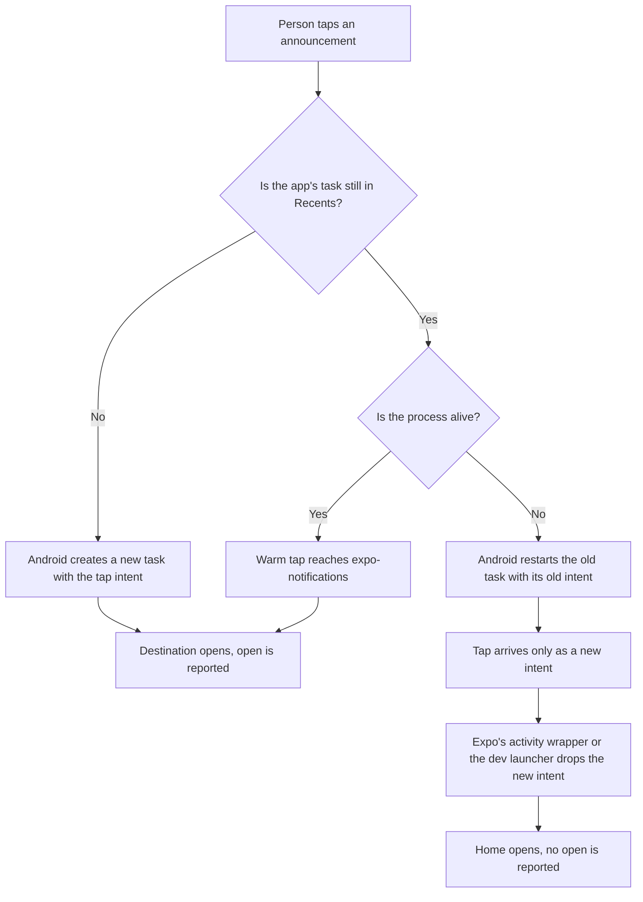
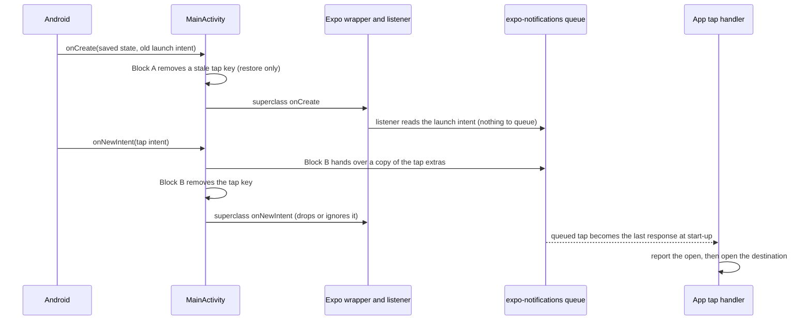

# Android Cold Push Tap - Plan

## Goal Capsule

- **Objective:** On Android, a tap on a campaign announcement opens the announcement's destination in every app state. These app states include the state after Android has stopped the app's process (a cold tap, R1). The campaign report counts each of these opens.
- **Means:** A new config plugin in `apps/mobile` adds two generated steps to the app's main Android activity (KTD1).
- **Product authority:** The `apps/mobile` owner, who also owns feat-524. The Product Contract wins on behavior, and the Planning Contract wins on mechanism. This plan covers Android announcement taps only. Lapse reminder fixes, iOS, and admin are not active scope.
- **Stop conditions:** Stop the work if U3 shows that Android does not call the activity's new-intent hook during a task restart. The approach decision then returns to a brainstorm. Stop also if a fix needs a change that R9 rules out.
- **Execution profile:** Code in `apps/mobile` (one config plugin, its tests, one guard test, and docs), then a device pass on a physical Android phone. The Samsung Galaxy S20 (Android 13) was used for the 2026-10-12 diagnosis.
- **Who finishes and ships:** The implementing agent builds, tests, and runs the device pass, then opens one pull request from this branch. The owner merges.

---

## Product Contract

### Summary

A new config plugin in `apps/mobile` adds two generated steps to the Android main activity. At start-up, one step removes a stale tap from a restored launch intent. When a new intent arrives, the other step gives the re-delivered announcement tap to expo-notifications, so the existing tap handler opens the destination and reports the open. The fix ships with the Firebase config, per R10.

### Problem Frame

On 2026-10-12, a Samsung Galaxy S20 (Android 13) received test announcements through Expo and FCM. The test used a dev-client build and a release build. Delivery worked in every app state. A tap failed in one state. The app was not on screen when the announcement arrived. Then Android stopped the app's process, and the app's task stayed in Recents.

In that state, the tap opened Home, not the destination, and the app sent no `ReportPushOpen`. The window event log points to the cause. The tap logged `wm_new_intent` and then `wm_restart_activity` on the old task. Android restarts the old task with its old launch intent. In the S20 run, that intent carried no tap extras, so the tap reached the activity only as a new intent.

In a release build, Expo's activity wrapper drops a new intent while the app is still loading (`ReactActivityDelegateWrapper.kt:306-309` in `expo@57.0.27`). In a dev-client build, the dev launcher also drops the new intent. So `Notifications.getLastNotificationResponse()` returns null, and the tap handler has nothing to open. The upstream issue expo/expo#49254 (open) describes the same sequence.

A control run confirmed that the kept task triggers the failure. The tester first removed the task from Recents. Then the tap logged `wm_create_activity` with the tap intent, and the app opened the destination. A warm tap, with the process still alive, also opened the destination.



A cold tap (R1) is probably the usual case for a campaign. An announcement arrives at the person's local morning hour, often hours after the last use. By then, Android has usually stopped the process. Low-end Android phones stop background processes sooner, and `PRODUCT.md` names these phones as an inclusion concern.

The defect has two costs. First, the person does not reach the video, series, or experience. Second, the campaign report undercounts Android opens and the watching that the report attributes to those opens.

No Android build with working push has reached users. Commit `6ca9e8de1` on this branch adds the Firebase config file `apps/mobile/google-services.json`, and that commit is not in `main` yet.

### Key Decisions

- **Catch the re-delivered tap in the app's main activity through a new config plugin.** (session-settled: user-directed — chosen over a pnpm patch to Expo's activity wrapper and over a data-only Expo push message for every announcement: it is the smallest change that works in release and dev-client builds, and it leaves the notification look, admin, and iOS unchanged.) Governs R1, R2, R5, R6, R7, R9.
- **Ship the fix in the first Android push build.** (session-settled: user-directed — chosen over releasing push first with a fix in a later build, and over releasing the build but holding Android campaigns: no Android user ever gets the defect, and the campaign report counts Android opens from the first campaign.) Governs R10.
- **Cover cold taps on announcements that Firebase posted and on announcements that arrived while the app was on screen. Test lapse reminder taps. Do not fix lapse reminder taps in this work.** (session-settled: user-directed — chosen over also fixing lapse reminders and over covering only the Firebase-posted case: both announcement kinds serve the campaign goal, while lapse reminders are a separate feature.) Governs R1, R3, R11.
- **Check the Recents replay (R8) on the device. Prevent the replay only if the device pass finds the replay.** (session-settled: user-directed — chosen over always preventing it and over leaving it out: nobody has seen the replay, and the device pass checks it at low cost.) **Conflict found in planning:** R5 needs the same start-up step that guards the replay (KTD4), and an external report (expo PR #49117) saw the replay on a release build. So the guard ships with the R5 fix, and the device pass confirms that the guard works. Governs R8.
- **Treat the fix as temporary.** It depends on an undocumented expo-notifications object, and Expo can fix the cause upstream. Governs R12.

### Requirements

**Cold taps**

- R1. A cold tap is a tap after Android has stopped the app's process, while the app's task stays in Recents. A cold tap on an announcement that Firebase posted opens that announcement's destination.
- R2. The app reports the open of a cold tap by the same rule as a warm tap (U8 in `docs/plans/2026-09-18-1540-feat-localized-push-campaigns-plan.md`).
- R3. A cold tap on an announcement that arrived while the app was on screen also opens its destination. If the device pass shows a failure here, this work fixes it.
- R4. Cold taps open every destination kind: video, series, and experience.
- R5. When an earlier announcement tap created the app's task, a newer cold tap opens the newer announcement's destination, not the earlier one.

**No regressions**

- R6. A warm tap is a tap while the app's process is alive. A warm tap still opens its destination once, and the app still reports the open as before the fix.
- R7. When no app task is in Recents, a tap that creates the app's task still opens its destination once, and the app still reports the open as before the fix.
- R8. The person can open the app again after Android has stopped the app's process, from Recents or from the launcher icon. In both cases, the app does not open an earlier tap's destination again. This repeated open is the Recents replay. The guard ships with the fix for R5, and the device pass confirms that the guard works.
- R9. iOS, admin, the Expo push message, and the look of Android notifications do not change.

**Release and upkeep**

- R10. No Android release has push without this fix. The fix ships in the same native build as the Firebase config.
- R11. The device pass tests cold taps on lapse reminders. A failure there becomes a separate follow-up and does not block this work.
- R12. Each Expo SDK upgrade includes a re-check of the fix against expo/expo#49254.

### Key Flows

- F1. Cold tap on an announcement that Firebase posted
  - **Trigger:** A person makes a cold tap (R1) on an announcement that Firebase posted.
  - **Steps:** Android restarts the old task and re-delivers the tap as a new intent. The app's main activity catches the tap before Expo's activity wrapper or the dev launcher can drop it. The activity gives the tap to expo-notifications. At start-up, the tap handler reads the tap, reports the open, and opens the destination.
  - **Outcome:** The destination opens, and the app reports the open for that delivery.
  - **Covered by:** R1, R2, R4, R5

### Acceptance Examples

- AE1. **Covers R1, R2, R4.** Given: the person opens the app and then goes to the Home screen. Android then stops the app's process, and the app's task stays in Recents. When: an announcement for the video `birth-of-jesus` arrives, and the person taps it. Then: the watch page for `birth-of-jesus` opens, and the app reports the open for that delivery. The same holds for a series destination and an experience destination.
- AE2. **Covers R6.** Given: the app's process is alive in the background. When: the person taps an announcement. Then: the destination opens once, and the app reports the open as before the fix.
- AE3. **Covers R3.** Given: the app is on screen when an announcement arrives, and the person leaves the announcement in the notification shade. Android later stops the app's process, and the app's task stays in Recents. When: the person taps the announcement. Then: the destination opens, and the app reports the open.
- AE4. **Covers R8.** Given: an announcement tap creates the app's task. The person then goes to the Home screen, and Android stops the app's process. When: the person reopens the app from Recents. In a second run, the person opens the app from the launcher icon instead. Then: in both runs, the app does not open that earlier destination again.
- AE5. **Covers R5.** Given: an earlier announcement tap created the app's task. Android then stops the app's process, and the task stays in Recents. When: a newer announcement arrives, and the person taps it. Then: the newer announcement's destination opens, and the open report names the newer delivery.
- AE6. **Covers R7.** Given: the person has removed the app's task from Recents. When: the person taps an announcement. Then: the destination opens once, and the app reports the open.

### Success Criteria

- On a physical Android phone, the device pass shows AE1 to AE6 in a release build. AE1 also holds in a dev-client build.
- In the release runs of AE1, AE3, and AE5, the window event log shows that Android restarted the kept task: `wm_restart_activity` for the main activity, and no `wm_create_activity` for the main activity. In the dev-client run of AE1, `wm_restart_activity` comes before any `wm_create_activity`, because the dev launcher always starts a second main activity.
- In every example that opens a destination, one Back press leaves the destination screen. A second copy of the same screen means that the app navigated twice.
- The device pass records the lapse reminder result for R11.

### Scope Boundaries

- Fixes to cold taps on lapse reminders, per R11.
- Any change that R9 rules out.
- A change to the main activity's launch mode.
- A pnpm patch to Expo's activity wrapper, or a data-only Expo push message for every announcement. The owner rejected both options. They return only if the unproven assumption in Dependencies / Assumptions is false and the approach decision returns to a brainstorm.
- Removal of the fix after Expo fixes expo/expo#49254. The re-check in R12 finds that point.
- A fix contributed upstream to Expo.

### Dependencies / Assumptions

- **Unproven on a device:** Android calls the main activity's new-intent hook during the task restart. The S20 event log supports this assumption, because `wm_new_intent` came before `wm_restart_activity` on 2026-10-12. The Android client code in versions 13 to 16 delivers a pending new intent after `onCreate` and before `onResume`. U3 proves it on the phone. If the assumption is false, the chosen approach cannot work, and the approach decision returns to a brainstorm.
- Android restarts a task with the task's original launch intent, and the S20 log supports this for a task that the launcher created. **From the code, not seen on a device:** if an earlier announcement tap created the task, that intent still carries the earlier tap. expo-notifications reads the earlier tap again at start-up (`ExpoNotificationLifecycleListener.kt:22-34`). This re-read can cause the Recents replay in R8. This re-read can also open the earlier destination in place of the newer one in R5.
- While no expo-notifications listener is registered, the queue keeps the first tap and drops each later tap (`NotificationManager.kt:116-117`). The queue is never cleared, and each new listener receives it (`NotificationManager.kt:43-47`). After the module registers its listener (`NotificationsEmitter.kt:29-32`), a later tap goes straight to the listener and replaces the last response (`NotificationsEmitter.kt:75-79`).
- expo-notifications posts an announcement itself when the announcement arrives while the app is on screen. A tap on that announcement reaches the app by broadcast through `NotificationForwarderActivity`, not through the activity's tap extras. This path might already work after Android stops the app's process. Only the device pass for R3 can show whether this path works.
- Admin stores at most one open per delivery and answers `DUPLICATE` to a repeated open report (`apps/admin/src/services/push/open-report.service.ts:110-121`). So a replay cannot add a second open to the campaign report. A replay can only send the person to an old destination again.
- expo-notifications 57.0.22 ships as a prebuilt AAR, and its `NotificationManager` is a public Kotlin `object`. The `expo` package compiles from source.
- A config plugin change moves the fingerprint runtime version. So the fix needs a native build and cannot ship by an OTA update. The Firebase config needs the same native build.

### Sources / Research

- Upstream issue: expo/expo#49254 (open, no maintainer reply). Related: expo PR #49117 (open; it reports the replay and the double warm delivery on a Galaxy S24+, Android 16) and expo PR #47615 (merged for SDK 58; it drains the tap queue, which is not in expo-notifications 57.0.22).
- `expo@57.0.27`: `ReactActivityDelegateWrapper.kt:306-309`, where Expo's activity wrapper drops a new intent while the app is still loading.
- expo-notifications 57.0.22: `ExpoNotificationLifecycleListener.kt:22-58`, which checks for `google.message_id`, and `NotificationManager.kt:101-119`, the tap queue.
- App tap handler: `apps/mobile/src/lib/lapseReminders/tapHandler.ts` reads the launch tap once at attach. The code and U8 call this read `cold`, and that meaning is wider than the cold tap in R1. The handler waits up to 3 seconds (`LAPSE_REMINDER_TAP_DEADLINE_MS`) for the experience selection before it opens a destination. The adapter is `apps/mobile/src/lib/lapseReminders/notificationsAdapter.ts`.
- Open-report rule: U8 in `docs/plans/2026-09-18-1540-feat-localized-push-campaigns-plan.md`. Device pass: U9 in the same plan. Ticket: `docs/roadmap/platform/feat-524-localized-push-campaigns.md`.
- Device evidence, 2026-10-12, Samsung Galaxy S20, Android 13: with the task kept, `wm_new_intent`, then `wm_restart_activity`, then Home. With the task removed from Recents, `wm_create_activity`, then the destination.

---

## Planning Contract

**Product Contract preservation:** changed: R8 — the replay guard now always ships, because R5 needs the same start-up step (KTD4); Key Decision 4 carries the conflict note. Clarified: the Success Criteria event-log check applies to release runs, with a separate dev-client rule, and the unproven assumption cites the Android client code. Resolved: the Product Contract's deferred planning questions are answered here and removed from it. No other scope change.

### Key Technical Decisions

- KTD1. **Add two generated steps to `MainActivity` through one config plugin.** Block A runs in `onCreate` before the call to the superclass `onCreate`, and removes a stale tap from a restored launch intent (KTD4). Block B overrides `onNewIntent`, gives the tap to expo-notifications, and makes the delivery single (KTD3). Block B fixes the cold tap (R1). Block A is what lets a newer tap win (R5), and it is also the replay guard (R8). (session-settled: user-directed — chosen over a pnpm patch to Expo's activity wrapper and over a data-only Expo push message for every announcement: it is the smallest change that works in release and dev-client builds, and it leaves the notification look, admin, and iOS unchanged.) Covers R1, R2, R5, R6, R7, R8, R9.
- KTD2. **Fail loudly at prebuild, never skip silently.** The plugin requires `expo/config-plugins` directly and uses `withMainActivity` with `CodeGenerator.mergeContents`. It throws when the main activity is not Kotlin, when an anchor is missing, or when another `onNewIntent` override exists. The other mobile plugins warn and skip when their dependency does not load, but a skip here would ship the defect and break R10. The two blocks carry content-hash markers, so a changed block replaces the old one when prebuild reuses `android/`.
- KTD3. **Make delivery single by construction (R6).** Block B reads the intent extras (Android returns a copy) and skips an intent that carries Expo's own response keys, because the forwarder broadcast already delivers that tap (R3). It hands the copy to `NotificationManager.onNotificationResponseFromExtras`, then removes `google.message_id` from the intent before it calls the superclass `onNewIntent`. Expo's listener then ignores the tap in every app state. Block B never calls `setIntent`, so an in-process recreation cannot replay the tap. A JavaScript dedupe by nonce was rejected: it adds stored state and changes the iOS path (R9).
- KTD4. **Key Block A on a restore.** Block A removes `google.message_id` from the activity's own intent when `savedInstanceState` is not null, or when the intent carries `FLAG_ACTIVITY_LAUNCHED_FROM_HISTORY`. A tap that creates a new activity record has no saved state and no history flag, so Block A never removes a fresh tap (R7). The history clause covers a task that has no activity record left, for example after a force stop or an app update.
- KTD5. **Pin the upstream facts in a tripwire test (R12).** A guard test reads the installed Expo sources and pins the exact versions of `expo`, `expo-notifications`, and `expo-updates`. Any version change, or a change to a pinned fact, fails the suite with a message that names expo/expo#49254 and expo PR #47615.
- KTD6. **Verify on the phone with two build types.** The dev-client build points at the fake admin, which counts open reports (R2). The release build proves routing and the window events, because it cannot reach a cleartext local server. Announcements go through Expo's push API with admin's message shape. The process stops with `am kill` after Home. A force stop is used only for the history-clause case, and that case runs last.
- KTD7. **Ship in one pull request with the Firebase config.** This branch already carries commit `6ca9e8de1`. (session-settled: user-directed — chosen over releasing push first with a fix in a later build, and over releasing the build but holding Android campaigns: no Android user ever gets the defect, and the campaign report counts Android opens from the first campaign.) Covers R10.

### High-Level Technical Design

The sequence below shows a cold tap after the fix. The task was created earlier, its process has stopped, and Android restarts it.



| Block | Condition                                                 | Action                                                                  |
| ----- | --------------------------------------------------------- | ----------------------------------------------------------------------- |
| A     | Saved state present, or history flag set                  | Remove `google.message_id` from the activity's own intent               |
| A     | No saved state and no history flag                        | Do nothing, so a fresh tap stays (R7)                                   |
| B     | Extras carry `google.message_id` and no Expo response key | Hand a copy to the queue, then remove the key, then call the superclass |
| B     | Extras carry an Expo response key, or no tap key          | Call the superclass only                                                |

### Assumptions

- Block A keeps the history clause. The device pass tests it with a force stop, as the last case.
- A live process with a destroyed activity (for example, with the "Don't keep activities" option) fails today in release builds. The Objective covers it, and the device pass tests it. No R text changes.
- The plugin changes the app config, so it moves the fingerprint runtime version for Android and iOS. The pull request states that iOS needs a native build before the next OTA update.
- The dev-client runs of V1, V2, V3, and V6 prove the open-report counts (R2). The release runs prove routing, the window events, and the native hand-off. A dev-client build cannot reproduce V4, V5, or V9, because the dev launcher restarts the task with `FLAG_ACTIVITY_CLEAR_TASK` and so drops the restored launch intent. Those cases run in release only. The JavaScript open-report path is the same in both builds.
- A device clock jump into the 09:00 to 21:00 window triggers a lapse reminder for R11. The pass records the result only.
- The series and experience destinations use real published slugs that the implementer picks.
- Each test announcement carries a fresh nonce. Production admin does not know these nonces, so only the fake admin counts them.
- The device pass runs on Android 13 only. Android 14 to 16 rely on the Android client code and the external report.

### Risks and Dependencies

- **Expo SDK 58 changes the tap queue** (expo PR #47615). The tripwire fails on that upgrade, and the re-check decides whether the plugin stays.
- **An upstream fix could deliver a tap twice** together with Block B. The tripwire pins the wrapper gate, so an upstream change fails the suite first.
- **The Kotlin signature can fail to compile** if the superclass expects a nullable parameter. The first Gradle build in U1 proves it.
- **A dev-client JavaScript reload replays the queue.** This is existing Expo behavior. Testers must not reload during the pass, and a reload replay is not a regression.
- **Two taps before JavaScript loads keep only the first.** This is accepted.
- **A tap that a crash prevented from routing is dropped at the next restore.** This is accepted, because R8 prefers a lost tap to a replay.
- **No production OTA update may publish between the merge and the native build** (`apps/mobile/CLAUDE.md`, native-build window).

### System-Wide Impact

The change touches only the Android main activity and the mobile test suite. The app config change moves both fingerprint runtime versions, so both platforms need a native build before the next OTA update. Admin, the Expo push message, iOS behavior, and lapse reminder scheduling do not change.

### Considered and Not Built

- **A JavaScript dedupe of consumed nonces.** Block B and Block A remove the duplicate paths by construction. The release cases V4, V5, and V9, with the Block A log line, detect a replay regression, and the fake admin's `DUPLICATE` count detects a double warm delivery. Reconsider if a new replay path appears.
- **Reflection to clear Expo's private queue.** It is brittle across Expo releases, and Block A makes it unnecessary.
- **Device checks for a tap during start-up, a tap in picture-in-picture, and an Android 15 or 16 emulator.** These are optional, because the fix does not change those paths or the Android client order.

### Deferred to Implementation

- The plugin's tag names, the log wording, and the exact block placement inside the anchors.
- Whether the Kotlin override compiles with a non-null intent parameter (expected).
- The series and experience slugs for the device pass.

---

## Implementation Units

### U1. Add the tap-relay config plugin

**Goal:** Every Android prebuild generates Block A and Block B in `MainActivity`, and `app.json` registers the plugin.

**Requirements:** R1, R2, R5, R6, R7, R8, R9, R10; KTD1, KTD2, KTD3, KTD4.

**Dependencies:** None.

**Files:**

- Create `apps/mobile/plugins/withAndroidPushTapRelay.js`
- Create `apps/mobile/plugins/withAndroidPushTapRelay.test.js`
- Modify `apps/mobile/app.json` (add the plugin after `./plugins/withAndroidNavigationBar`)
- Modify `apps/mobile/src/lib/__tests__/appJsonNotifications.guard.test.js` (the plugin is registered whenever `android.googleServicesFile` is set)

**Approach:**

1. Use `withMainActivity` and `CodeGenerator.mergeContents` from `expo/config-plugins`; `@expo/config-plugins` does not resolve from `apps/mobile`.
2. Throw for a non-Kotlin main activity. Remove this plugin's own blocks first, then throw if any `onNewIntent` override is still present.
3. Insert Block A directly before the line that calls the superclass `onCreate`. Insert Block B as the first class member, anchored on the class declaration line.
4. Use fully qualified class names, so the plugin adds no imports. Use the `NotificationsService` key constants, so a rename upstream fails the compile.
5. Never write the text `super.onCreate(` inside a generated block or comment, because expo-splash-screen and react-native-google-cast anchor on the first line that holds it.
6. Each block logs one fixed line with the tag `ForgePushTap` and no payload content. Block A names the clause that fired and whether a tap key was present.
7. Export the pure transform for the tests.

**Execution note:** When the transform passes its first tests, run U3 before the rest of the suite. U3 can stop the approach.

**Technical design** (directional guidance, not implementation specification):

```text
Block A (in onCreate, before the superclass call):
  if saved state is present or the launch intent has the history flag:
    remove google.message_id from the activity's intent; log which clause fired
Block B (new onNewIntent override):
  extras = copy of the intent extras
  if extras has google.message_id and no Expo response key:
    hand extras to NotificationManager; remove google.message_id from the intent; log
  call the superclass onNewIntent
```

**Patterns to follow:**

- `apps/tv/plugins/withAndroidStartupLoading.js` and its test: the repo's only `withMainActivity` plugin, which throws on a missing seam.
- `apps/mobile/plugins/withCastUIStyle.js`: content-hash markers.
- `apps/mobile/plugins/withoutAndroidResourceConfigurations.test.js`: a test of the real mod chain with a negative control.
- `apps/mobile/plugins/withAndroidNavigationBar.test.js`: composition with the real expo-splash-screen plugin.
- `apps/mobile/plugins/withCastPluginWiring.test.js`: an entry-point test that proves `modResults.contents` changes.
- `docs/solutions/best-practices/expo-config-plugin-withappdelegate-mod-reverse-order.md`: mods run in reverse plugin order; throw, stay idempotent, and use real-producer fixtures.
- Do not copy `apps/mobile/plugins/withBackgroundDownloaderAppDelegate.js`: it skips silently when its dependency does not load.

**Test scenarios:**

- On the SDK 57 template `MainActivity`, the transform inserts Block A directly before the superclass `onCreate` line and Block B inside the class braces.
- On the current generated `MainActivity` (with the splash and cast blocks), the transform inserts both blocks, and each vendor block stays next to the superclass `onCreate` line.
- Applying the transform twice gives the same text as applying it once.
- A changed block replaces the old block, and no second copy remains.
- No generated line contains the text `super.onCreate(`.
- A main activity that already overrides `onNewIntent` makes the transform throw, with a message that names the conflict.
- A Java main activity makes the plugin throw.
- A main activity with no class declaration or no superclass `onCreate` line makes the transform throw.
- Through the real mod chain, with expo-splash-screen and react-native-google-cast in `app.json` order, the generated file holds both vendor blocks and both new blocks. The reversed order also gives a valid file.
- The entry point with a mocked `withMainActivity` changes `modResults.contents`.
- The `app.json` guard fails when `android.googleServicesFile` is set and the plugin is missing (negative control included).

**Verification:**

- The plugin and guard suites pass.
- A local Android prebuild writes both blocks into `MainActivity.kt`.
- Debug and release Gradle builds compile the Kotlin call into the expo-notifications library.

### U2. Pin the upstream facts in a tripwire test

**Goal:** An Expo version change, or a change to a fact the fix depends on, fails the mobile test suite (R12).

**Requirements:** R12; KTD5.

**Dependencies:** None.

**Files:**

- Create `apps/mobile/src/lib/__tests__/androidPushTapUpstream.guard.test.js`

**Approach:**

1. Resolve each package from `apps/mobile` and read the installed sources, as `appJsonNotifications.guard.test.js` does with its `readInstalled` helper.
2. Pin the exact installed versions of `expo`, `expo-notifications`, and `expo-updates`.
3. Pin these facts: the wrapper's `onNewIntent` returns early while the app is still loading; the expo-notifications key constants; the listener's `onCreate` reads the activity's intent extras; the tap queue keeps only the first bundle; expo-updates uses a delay-load handler outside developer support.
4. Each failure message tells the reader to re-check expo/expo#49254 and the plugin from U1, and names expo PR #47615 as the known SDK 58 change.

**Patterns to follow:** `apps/mobile/src/lib/__tests__/appJsonNotifications.guard.test.js` (installed-source reads and negative controls).

**Test scenarios:**

- Each pinned fact holds for the installed SDK 57 sources.
- Each matcher fails on a copy of the source text with the pinned line changed (negative control).
- The installed versions equal the pinned versions.

**Verification:** The suite passes on the current install, and each negative control fails as expected.

### U3. Prove the restart hand-off on the S20

**Goal:** Show on a physical phone that Block B runs during a task restart and that a cold tap opens its destination, before the full pass.

**Requirements:** R1; KTD1, KTD6; the unproven assumption in Dependencies / Assumptions.

**Dependencies:** U1.

**Files:** None committed.

**Approach:**

1. Build a release APK from a fresh prebuild that includes U1, and install it on the S20.
2. Open the app, go Home, and stop the process with `am kill`. Confirm that the process is gone and the task is still in Recents.
3. Send one announcement through Expo's push API with admin's message shape, and tap it.
4. Read the `ForgePushTap` log lines and the window events.

**Execution note:** This unit is a gate. If Block B's log line never appears during the restart, stop the run, because the approach decision returns to a brainstorm.

**Test expectation:** none -- this is device verification; the logs are the evidence.

**Verification:** Block B logs a hand-off after `wm_restart_activity`, the destination opens, and the log shows no `wm_create_activity` for the main activity.

### U4. Run the device pass

**Goal:** The S20 passes every case in the Verification Contract, and the results go into the pull request.

**Requirements:** R1 to R8, R11; Success Criteria.

**Dependencies:** U3.

**Files:** None committed. The results go in the pull request description.

**Approach:**

1. Run the dev-client cases (V1 for the video, V2, V3, and V6) against the fake admin, which counts open reports. Run V4, V5, and V9 in release only, because the dev launcher restarts the task with `FLAG_ACTIVITY_CLEAR_TASK`.
2. Run the release cases for routing and the window events.
3. Run the force-stop case last, because a force stop blocks push delivery until the next launch.
4. Do not reload JavaScript during the pass.

**Test expectation:** none -- this is device verification; the pass record is the evidence.

**Verification:** Every case passes. The fake admin shows exactly one `ReportPushOpen` per tap and no `DUPLICATE` outcome. The lapse reminder result is recorded.

### U5. Document the Android restart path

**Goal:** `apps/mobile/CLAUDE.md` explains the restart path, the plugin, the tripwire, and the device recipe in the announcement-tap section.

**Requirements:** R12; KTD1, KTD5, KTD6.

**Dependencies:** U1, U2, U4.

**Files:**

- Modify `apps/mobile/CLAUDE.md` (the "Announcement taps, the foreground banner, and the open report (U8)" section)

**Approach:** Add a short entry that names the restart path, the two blocks, the tripwire test, and the `am kill` recipe. Write it in plain, short sentences, and keep the facts the same as the U4 results.

**Test expectation:** none -- documentation.

**Verification:** `npx prettier --check` passes on the edited file, and the text matches the U4 results.

---

## Verification Contract

| Check                  | Command or method                                                                                                 | Units  |
| ---------------------- | ----------------------------------------------------------------------------------------------------------------- | ------ |
| Plugin and guard tests | `pnpm --filter @forge/mobile test -- withAndroidPushTapRelay appJsonNotifications androidPushTapUpstream`         | U1, U2 |
| Full mobile suite      | `pnpm --filter @forge/mobile test`                                                                                | All    |
| Lint                   | `pnpm --filter @forge/mobile lint` (the package lint, not only the root hook)                                     | U1, U2 |
| Typecheck              | `pnpm --filter @forge/mobile typecheck`                                                                           | All    |
| Prebuild output        | `npx expo prebuild --platform android --no-install` in `apps/mobile`, then read `MainActivity.kt` for both blocks | U1     |
| Kotlin compile         | Gradle `app:assembleDebug` and `app:assembleRelease` for `arm64-v8a` in `apps/mobile/android`                     | U1, U3 |
| Markdown format        | `npx prettier --check` on every edited `.md` file                                                                 | U5     |
| Device pass            | The case table below, on the S20                                                                                  | U3, U4 |

Device cases. "Stop the process" means Home, then `adb shell am kill org.jesusfilm.forgewatch`, then a check that `pidof` is empty and the task is still in Recents. V4, V5, and V9 run in release builds only.

| Case | Covers              | Setup and action                                                                                                                                                                | Passes when                                                                                                                                                           |
| ---- | ------------------- | ------------------------------------------------------------------------------------------------------------------------------------------------------------------------------- | --------------------------------------------------------------------------------------------------------------------------------------------------------------------- |
| V1   | AE1, R1, R2, R4     | Open the app, stop the process, then tap a Firebase-posted announcement. Repeat for a video, a series, and an experience. Release build, plus one dev-client run for the video. | The destination opens. Block B logs a hand-off. The event-log rule in Success Criteria holds. The dev-client run shows one `ReportPushOpen`.                          |
| V2   | AE2, R6             | With the process alive in the background, tap an announcement. Also tap one from the shade while the app is on screen.                                                          | The destination opens once, one Back press leaves it, and the dev-client run shows one `ReportPushOpen`.                                                              |
| V3   | AE3, R3             | Keep the app on screen while an announcement arrives. Leave it in the shade, stop the process, then tap it.                                                                     | The destination opens, and the dev-client run shows one `ReportPushOpen`.                                                                                             |
| V4   | AE4, R8             | Remove the task from Recents, tap an announcement, go Home, and stop the process. Reopen from Recents. Repeat and reopen from the launcher icon.                                | The earlier destination does not open again, and Block A logs the saved-state clause.                                                                                 |
| V5   | AE5, R5             | An earlier announcement tap created the task. Stop the process. Send a newer announcement with a different destination and tap it.                                              | Release build only. The newer destination opens, and Block A logs that it removed a tap key. The open report uses the nonce from the same payload as the destination. |
| V6   | AE6, R7             | Remove the task from Recents, then tap an announcement.                                                                                                                         | The destination opens once, and Block A logs nothing.                                                                                                                 |
| V7   | Objective           | Turn on "Don't keep activities", go Home with the process alive, then tap an announcement. Turn the option off after the case.                                                  | The destination opens once.                                                                                                                                           |
| V8   | R11                 | Watch a video, go Home, move the device clock into the next day's 09:00 to 21:00 window, then stop the process and tap the lapse reminder.                                      | The result is recorded. A failure becomes a follow-up.                                                                                                                |
| V9   | KTD4 history clause | An announcement tap created the task. Force-stop the app, or reinstall the same build. Reopen from Recents. Run this case last.                                                 | The earlier destination does not open, and Block A logs the history clause.                                                                                           |

---

## Definition of Done

- U1 to U5 meet their Verification lines.
- The plugin, guard, and full mobile test suites, the package lint, and the typecheck pass.
- The device pass record (V1 to V9) is in the pull request description.
- One pull request carries the Firebase config commit and the fix (KTD7). It states the iOS runtime version move and the conflict note on Key Decision 4.
- No generated `android/` or `ios/` file is committed, and no code from an abandoned approach stays in the diff.
