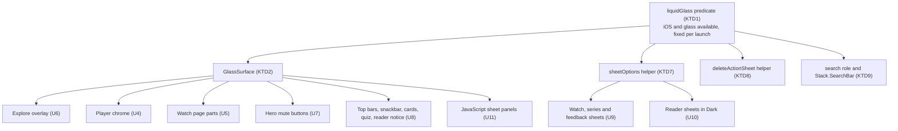
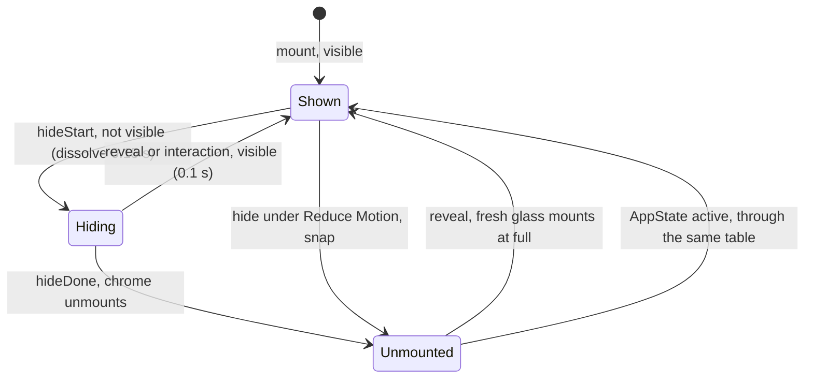
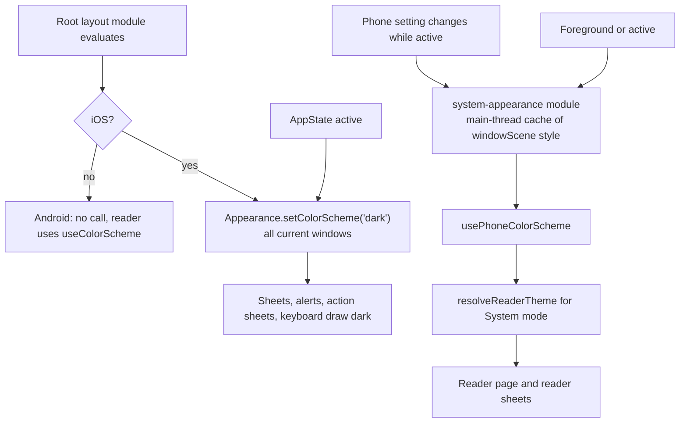

# Mobile Native Liquid Glass - Plan

## Goal Capsule

- **Objective:** On iOS 26, the app reads as one native app. Every floating control shows the native Liquid Glass material, every sheet is the native iOS 26 sheet, and every native system part shows the app's dark look. Search uses the native iOS 26 search tab.
- **Means:** One shared glass surface with one availability check (KTD1, KTD2), a runtime dark override with a native read of the phone's setting (KTD3, KTD4), and the native form sheet, action sheet and search tab (KTD7, KTD8, KTD9).
- **Product authority:** The `apps/mobile` owner. The Product Contract wins on behavior, and the Planning Contract wins on mechanism. Android, iOS versions before 26, and the mini player controls are not active scope, except where R2 changes the whole iOS app.
- **Stop conditions:**
  - Stop U13 and return to the owner if the route check shows that `app/(tabs)/watch/` cannot live beside `app/watch/` without breaking `/watch/<slug>` or the Discover deep links.
  - Stop U2 if the simulator shows that the runtime override does not reach native form sheets or alerts. Then the dark-style decision returns to the owner.
  - Stop U13 and return to the owner if, in the app, the native search field does not appear at the bottom (an empty capsule or a top placement) after the documented placement settings.
  - Stop any unit that would change Android's look. Scope Boundaries rule it out.
- **Execution profile:** JavaScript and TypeScript in `apps/mobile`, one new local Expo module (`modules/system-appearance/`), docs, then simulator passes on iOS 26.5 and iOS 18.6 and one Android emulator pass. A new dev client build is needed for U2, because the module is native.
- **Who finishes and ships:** The implementing agent builds, tests and runs the simulator passes. It renames the branch to `feat/mobile-native-liquid-glass` and opens one pull request. The owner merges and ships the TestFlight build.
- **Roadmap ticket:** `docs/roadmap/platform/feat-699-mobile-native-liquid-glass-consistency.md`.

---

## Product Contract

### Summary

Every floating control in `apps/mobile` changes to native Liquid Glass on iOS 26, every sheet becomes the native iOS 26 sheet, and the app sets a dark interface style so that all system parts match its dark screens. Controls that fade today keep their fade: the glass dissolves and returns with them. The Discover tab becomes the native iOS 26 search tab, and the Downloads delete confirmation becomes the native iOS action sheet. The whole scope ships together in one native build.

### Problem Frame

The owner is refining the app for delight. On iOS 26 the app mixes two visual languages. Five parts use native glass: the tab bar, the Home header, the floating back button, the Bible reader's buttons and the Downloads selection bar. Every other floating control draws its own surface: a flat black fill, an `expo-blur` blur or an opaque panel. One screen can show both, for example the glass back button beside the blurred Cast and AirPlay buttons on the watch page.

The native parts that iOS draws also break the look. The app sets `userInterfaceStyle: "automatic"` in `apps/mobile/app.json`, but every React Native screen is dark. So on a phone in light mode, system alerts such as "Offline download" show as light glass with black text over the dark app. The spike on 2026-10-15 showed that native glass sheets have the same problem.

The audit on 2026-10-14 (`docs/design-qa/mobile-liquid-glass-audit/index.html`) listed the non-glass elements by reading code. A systematic sweep on 2026-10-15 found six more, which R6, R8 (Experience hero), R9 (Select pill), R11, R12 and R13 now cover.

### Key Decisions

- **One plan covers the glass work and the native search tab.** Both change how the app looks on iOS 26, and the owner wants them reviewed and shipped together. (session-settled: user-directed — chosen over a separate ticket and brainstorm for the search tab: the owner chose to keep both in one plan.) Governs R20, R21, R22.
- **The whole app shows a dark interface style.** One switch makes every native part dark. (session-settled: user-directed — chosen over a per-sheet style setting, glass only on dark-mode phones, and light glass that follows the phone: one switch matches every system part to the dark app.) Governs R2, R14, R15.
- **The reader's System mode keeps following the phone.** (session-settled: user-directed — chosen over "System means Dark" and over removing the System mode: readers who use System keep a light reader on a light-mode phone.) Governs R3.
- **Reader sheets get glass only in the Dark theme.** True Dark stays pure black. Light stays solid, because the dark app style would put dark glass behind a light page. (session-settled: user-directed — chosen over glass in both Dark and True Dark: True Dark keeps its pure black look.) Governs R15.
- **The delete confirmation becomes the native iOS action sheet.** The owner chose it after comparing today's card, the card with glass, and the native sheet on the simulator. (session-settled: user-directed — chosen over today's card with a glass panel: the owner preferred the system sheet after seeing both.) Governs R17, R18, R19.
- **On the native delete sheet, Cancel and a tap outside both report as cancel.** The native sheet cannot tell the two apart. (session-settled: user-directed — chosen over reporting both as dismiss: on iOS 26 a tap outside counts as a cancel; Android and older iOS keep all three names.) Governs R18.
- **Search uses the full iOS 26 pattern, on iOS 26 and later only.** The pattern has a separate search circle and a native search field at the bottom. (session-settled: user-directed — chosen over the search circle alone with Discover unchanged: the bottom field is the native iOS 26 search experience the owner asked for.) Governs R20, R21, R22.
- **The mini player controls get no glass.** (session-settled: user-directed — chosen over glass controls in the floating window: the window is small.)
- **The whole scope ships in one build.** (session-settled: user-directed — chosen over a smaller first build with later follow-ups: the owner holds the full plan as the first tester build.)
- **No glass inside a layer whose opacity fades.** Fading controls keep the glass outside the fade, and the material dissolves with the `'none'` glass style. On `expo-glass-effect` 57.0.4, glass inside the player's fading layer drew on only some reveals. The `'none'` dissolve outside a fade worked on 5 of 5 changes. Governs R6, R7, R8, R10.

### Requirements

**Platforms and appearance**

- R1. The glass changes in R4-R16 and the search changes in R20-R21 apply only where iOS 26 Liquid Glass is available. On earlier iOS versions and on Android, each element keeps its current look.
- R2. The iOS app shows a dark interface style, so iOS draws every native part dark on every iOS version: form sheets, alerts, action sheets, menus, the keyboard and the native search field. Android does not change.
- R3. The Bible reader's System mode still follows the phone's own light or dark setting after R2.

**Floating controls**

- R4. On Explore, these show glass: the Mute and Share circles, the Keep watching circle (a glass rim around the thumbnail), the paused play glyph, the message pill and the scrub time pill.
- R5. On the watch page, the skip-amount pill and the "Keep watching" offer card show glass.
- R6. All eight player controls with a frosted backplate show glass: Cast, AirPlay, settings, play/pause, back 10 s, forward 10 s, the time label and fullscreen. They keep today's show and hide timing: the glass dissolves and returns with the controls, and the glyphs fade.
- R7. The watch page's scroll-to-top button shows glass. The glass dissolves and returns as the button hides and shows.
- R8. The Home hero mute button and the Experience video hero mute button show glass. Where a hero hides its controls as the page scrolls, the glass dissolves at the point where the button stops taking taps.
- R9. On the Downloads, More and Account screens, the top bar's back button shows the same glass as the floating back button. The Downloads "Select" pill also shows glass.
- R10. The snackbar shows glass and slides in and out with no fade. This covers Downloads messages and push notices, which use the same snackbar.
- R11. The export report card that appears after "Save to Files" shows glass.
- R12. The quiz window's close button shows glass.
- R13. The Bible reader's notice pill above the footer uses the same glass treatment as the reader's other buttons, in every reader theme.

**Sheets**

- R14. The watch and series language, subtitle and download sheets, and the feedback sheet, show the native iOS 26 sheet: glass at a partial height, and iOS's own solid dark sheet at full height.
- R15. The Bible reader's passage, translation and settings sheets show the native sheet of R14 only in the reader's Dark theme. In the Light and True Dark themes they keep today's solid fill.
- R16. The JavaScript sheets show glass in place of their solid or near-solid panel: player settings, player feedback, the download sheet and the quiz window. Each keeps its current open and close motion.

**Delete confirmation**

- R17. On iOS 26, the Downloads delete confirmation is the native iOS action sheet in the dark style. It shows today's title, today's message with the size the delete frees, a destructive Delete action and Cancel. A tap outside the sheet cancels.
- R18. Datadog keeps the delete action names. On iOS 26, Delete reports `library-delete-confirm`, and both Cancel and a tap outside report `library-delete-cancel`. On Android and on iOS before 26, the card keeps all three names, including `library-delete-dismiss`.
- R19. On Android and on iOS before 26, the delete confirmation keeps today's card.

**Search**

- R20. On iOS 26, the Search tab is the system search tab: a separate glass circle at the end of the tab bar, with no label.
- R21. On iOS 26, when the search tab is open, the search field is the native field at the bottom of the screen, and Discover does not show its own top field. Browse categories, results and today's search behavior stay.
- R22. On iOS before 26 and on Android, the Search tab and the Discover screen stay as they are today.

**Accessibility**

- R23. Every new glass surface keeps text contrast at 4.5:1 or more and icon contrast at 3:1 or more, over the brightest content it can sit on.
- R24. With Reduce Motion on, a material change snaps instead of dissolving, and a slide snaps.

### Acceptance Examples

- AE1. **Covers R6.** **Given** a video plays on iOS 26 with the controls shown, **when** the controls hide, **then** each backplate's glass dissolves and its glyph fades. **When** the viewer taps the video, the glass returns with the glyphs on every reveal, including after the app returns from the background.
- AE2. **Covers R15, R3.** **Given** a phone in light mode and the reader in System mode, **when** the viewer opens the translation sheet, **then** the reader page is light and the sheet keeps today's solid light fill. **Given** the same phone with the reader in Dark, **then** the sheet is dark glass. **Given** True Dark, **then** the sheet is solid black.
- AE3. **Covers R2, R14.** **Given** a phone in light mode, **when** the viewer opens the audio language sheet on iOS 26, **then** the sheet is dark glass with today's white text. The "Offline download" alert is dark too.
- AE4. **Covers R17, R18, R19.** **Given** two downloads selected on iOS 26, **when** the viewer taps Delete, **then** the native dark action sheet shows "Delete 2 videos?" and the size freed. A Delete tap removes both and reports `library-delete-confirm`. A tap outside reports `library-delete-cancel` and deletes nothing. **Given** the same steps on Android, **then** today's card shows.
- AE5. **Covers R20, R21, R22.** **Given** iOS 26, **when** the viewer taps the search circle, **then** the native search field shows at the bottom and the browse categories show above it. Typing shows today's results. **Given** iOS 18, **then** the tab bar and Discover look as they do today.
- AE6. **Covers R8.** **Given** the Home hero on iOS 26, **when** the viewer scrolls until the hero controls are half faded, **then** the mute button's glass dissolves and the button stops taking taps. Scrolling back to the top brings the glass back.

### Success Criteria

- The owner, using the iOS 26 build on a device, finds no floating control or sheet in the old look, apart from the exclusions in Scope Boundaries.
- No glass surface draws empty or flickers on show, hide or remount. A temporary loud tint proves each changed surface on the simulator first.
- The Android build and an iOS 18 build look the same as before, except for R2's dark system parts on iOS 18.

### Scope Boundaries

- The mini player controls stay as they are (no glass).
- The Bible reader's passage, translation and settings sheets stay solid in the Light and True Dark themes (R15).
- Page content stays as it is: card badges and duration labels, captions, scrims, the hero scroll blurs, the red Watch Now and insert buttons, the Home pager dots, the Bible quote card and its "Read full passage" button, the watch page sign-in banner, the My Watch header cards, the casting label on the player and the reader's first-run swipe demo.
- The four places that already show glass keep their current code: `TabBarBackground`, `ReaderGlassButton`, `FloatingBackButton` and `HomeHeader`.
- The Cast SDK dialogs stay as they are, because the SDK draws them.
- Android gets no visual change. Do not add `expo-system-ui`, because it would apply the dark style to Android too.
- There is no light version of the app.
- Deferred for later: the Explore 2× cue lives only on the unmerged `Ur-imazing/mobile-app-polish` branch. When it merges, it takes the paused glyph's treatment from R4.
- Deferred for later: a separate bug, where a deep link to Downloads from a watch page leaves the video player drawn over the Downloads screen. It is logged as `todos/026-pending-p2-player-drawn-over-root-route-opened-from-watch-deep-link.md`.

### Dependencies / Assumptions

- R3 adds a small native module, so the work moves the fingerprint runtime version. It reaches testers in a native TestFlight build, not by an over-the-air update.
- On iOS 18, R2 also turns alerts, the keyboard and menus dark. That matches the dark app and is accepted.
- The installed versions: `expo-glass-effect` 57.0.4, `react-native-screens` 4.26.2, `expo-router` 57.0.26, React Native 0.86.3.
- Spike evidence (2026-10-15, iPhone Air simulator, iOS 26.5):
  - Glass inside the player's fading layer drew on some reveals only: AirPlay on 5 of 5, Back 10 on 1 of 5, the others on none.
  - The `'none'` style with animation dissolved and restored the glass on 5 of 5 changes.
  - Removing `sheetCornerRadius: 16` and the solid `contentStyle` showed UIKit's glass sheet, but in the phone's own light or dark appearance. The solid `contentStyle`, not the corner radius, is what hides the glass.
  - At full height, an iOS 26 form sheet drops the glass and shows iOS's own solid dark sheet, rgb(28,28,30). Today's fill is rgb(28,25,23).
  - On iOS 26, the native action sheet shows as a centered dark card with Cancel and Delete side by side.
  - `role: "search"` alone gives the separate search circle with no label, and Discover then opens unchanged.

### Sources / Research

- Audit and verdicts: `docs/design-qa/mobile-liquid-glass-audit/index.html`
- Session handoff: `docs/handoffs/2026-10-14-mobile-liquid-glass-consistency-handoff.md`
- Glass rules: `docs/solutions/best-practices/expo-glass-effect-glassview-invisible-under-animated-opacity-ancestor.md` (measured on `expo-glass-effect` 0.1.10; see the spike evidence above for 57.0.4) and `docs/solutions/best-practices/expo-glass-effect-interactive-flash-2026-04-08.md`
- Reference glass patterns: `apps/mobile/src/components/ui/TabBarBackground.tsx`, `apps/mobile/src/components/ui/FloatingBackButton.tsx`, `apps/mobile/src/components/bible/ReaderGlassButton.tsx`
- Constraints: `apps/mobile/CLAUDE.md` — "Tab bar — UIKit's own bar on iOS, a flush JS bar on Android" (no test can see the rendered material; Fast Refresh does not reliably apply material changes), "Two RN Modals from one player", and "Mini player and the root-owned playback session" (sheet suppression)
- Accessibility floor: `PRODUCT.md`, "Accessibility & Inclusion"

---

## Planning Contract

**Product Contract preservation:** changed: R18 — owner decision on 2026-10-15, because the native action sheet reports a tap outside as Cancel. Restructured, no scope change: the Outstanding Questions were answered in place by research and moved into the KTDs and units below. R2 now says "shows a dark interface style" instead of "declares", because KTD3 sets the style at run time. Clarified after review, no scope change: R14 and R15 name the native iOS 26 sheet, which is glass at a partial height and solid at full height (simulator test, 2026-10-15), so the full-height feedback sheet shows the solid system sheet. The Objective and Summary say "native iOS 26 sheet" for the same reason. R15 and AE2 keep today's solid fill, not today's whole sheet, because KTD7 gives every iOS 26 sheet the system corner. Scope Boundaries now list the solid Light and True Dark reader sheets.

### Key Technical Decisions

- KTD1. **One availability check, fixed per launch.** A cached predicate in `apps/mobile/src/lib/liquidGlass.ts` returns true only on iOS when `isLiquidGlassAvailable()` and `isGlassEffectAPIAvailable()` are both true. Every glass surface, the sheet options, the delete sheet and the search role read it. It must not change during a launch, because a change to a `NativeTabs.Trigger` `role` remounts the whole navigator. Governs R1.
- KTD2. **One shared glass surface owns the gate, the dissolve, the fallback, the fade and the press look.** A new `GlassSurface` in `apps/mobile/src/components/ui/` takes a `visible` input and maps it to `glassEffectStyle` `'regular'` or `'none'`. It animates with an explicit `animationDuration` and snaps under Reduce Motion. When KTD1 is false it renders the element's current look. It also takes an optional fade value. In the fallback it applies the fade to itself, as today. On glass it applies the fade to its children only. Press feedback is a small scale on glass and today's dim in the fallback, because an opacity below 1 on any ancestor breaks the glass. It sets `colorScheme="dark"` and never sets `isInteractive`. Governs R4-R13, R16, R23, R24.
- KTD3. **The dark style is a runtime window override on iOS, not an Info.plist key.** The app calls React Native's `Appearance.setColorScheme('dark')` on iOS only. It makes the call while the root layout module evaluates, and again on each AppState "active". `app.json` keeps `userInterfaceStyle: "automatic"`. Research showed that the Info.plist `Dark` key makes every UIKit trait source report dark, so no code could read the phone's real setting, which would break R3. The window override reaches presented sheets, alerts and action sheets, and the window scene still reports the real setting. Known gaps: a second alert stacked on a first one, and a window from a reconnected scene, follow the phone. (session-settled: user-directed — chosen over a per-sheet style setting, glass only on dark-mode phones, and light glass that follows the phone: one switch matches every system part to the dark app.) Governs R2.
- KTD4. **The reader reads the phone's setting from a small local Expo module.** A new `apps/mobile/modules/system-appearance/` follows the `modules/layout-direction/` pattern:
  - The module caches `windowScene.traitCollection.userInterfaceStyle` on the main thread. It registers for trait changes on iOS 17 and later.
  - It re-reads the setting on foreground and on active, on all iOS versions.
  - It ignores trait changes while the app is in the background, as React Native does, because iOS flips traits for app-switcher snapshots.
  - A synchronous getter returns the cache, so the first reader render is correct.
  - A missing module returns null, which resolves to Dark. This happens in Expo Go, on old dev clients and in Jest.
  - On Android the reader keeps `useColorScheme()`, because KTD3 does not run there.

  (session-settled: user-directed — chosen over "System means Dark" and over removing the System mode: readers who use System keep a light reader on a light-mode phone.) Governs R3.

- KTD5. **The pure controls table's `visible` value drives the glass.** `apps/mobile/src/lib/controlsVisibility.ts` already returns `visible`: `reveal` sets it true, `hideStart` sets it false and `hideDone` keeps it. That is exactly when the glass should show, so no new flag is added. The AppState "active" path in `useControlsVisibility` goes through the same table, or the controls come back with no glass after the app returns. The hook publishes the table's `visible` value through a small store that `PlayerControls` reads, so `VideoPlayer` does not re-render at hide start. Dissolve durations match the glyph fades: 0.15 s out and 0.1 s in. A reveal after the chrome unmounted mounts fresh glass, which shows at once while the glyphs fade in over 100 ms. The owner accepted that at the scoping review. Governs R6.
- KTD6. **Push the fade down to the parts; do not move views.** On the glass path, the player's controls container and the Home hero chrome stop applying opacity themselves. Each part takes the same fade value instead: glyphs, the scrubber, the AirPlay picker and the hero's text and buttons. On the fallback path the containers keep today's opacity. So Android and iOS before 26 keep today's fade and layout. Governs R1, R6, R8.
- KTD7. **Native form sheets: drop the solid fill on iOS 26, and drop the custom corner on every iOS 26 form sheet.**
  - On iOS 26, sheet screens get `contentStyle` with a transparent background. The watch and series `[slug]` screens keep `BG_COLOR` and their back-swipe options.
  - `sheetCornerRadius: 16` goes on iOS 26 for all form sheets, reader sheets included, so every sheet takes the system shape. The corner radius does not control the glass, so this keeps the reader options static. A theme change while a sheet is open then needs no option change. The solid Light and True Dark reader sheets take the system corner too, and keep today's fill (R15).
  - Reader sheets go transparent only when the resolved reader theme is `dark`. `useReaderSheetTheme` returns the theme name, because Dark and True Dark share `scheme: "dark"`.
  - One helper in `apps/mobile/src/lib/sheetOptions.ts` builds the iOS 26 and fallback options for the three layouts and the reader options.

  Governs R14, R15.

- KTD8. **The delete sheet is `ActionSheetIOS` behind a small helper.**
  - `apps/mobile/src/lib/library/deleteActionSheet.ts` presents the sheet from the press handler, never from an effect.
  - It always passes `cancelButtonIndex`, so a tap outside cancels (R17), and `userInterfaceStyle: "dark"`.
  - It uses `t(...)` text and snapshots the selected slugs, count and size when the sheet opens.
  - An in-flight guard stops a double present.
  - When selection ends while the sheet is open, the helper calls `ActionSheetIOS.dismissActionSheet()`, ignores any late callback and reports nothing.
  - It reports actions through `reportDatadogAction`, so they arrive as CUSTOM actions, not TAP actions (R18).
  - It counts as a new non-inline sheet id for mini player suppression, because the native sheet draws above the root host the way a `Modal` does.

  Governs R17, R18, R19.

- KTD9. **Search moves Discover into a folder with a nested stack, on `react-native-screens` 4.26.2.**
  - `app/(tabs)/watch.tsx` becomes `app/(tabs)/watch/index.tsx`.
  - A default `_layout.tsx` renders a `Slot`, so Android gets no new navigator.
  - `_layout.ios.tsx` renders a `Stack`. Its header is shown only when KTD1 is true: transparent, with no title.
  - On KTD1, the trigger gets `role="search"`, and the screen mounts `Stack.SearchBar` with `placement: "automatic"`. Keep `allowToolbarIntegration` at its default, because `stacked` or `false` gives an empty capsule.
  - The native field is uncontrolled. Its change events feed today's debounced `search()` path. A topic tap calls the bar's `setText`. Cancel calls `handleClear` at once. A result tap blurs the bar before navigating.
  - `Stack.SearchBar` sets `autoCapitalize: "none"`. Autocorrect cannot be turned off in this library version. The owner accepted that change to today's search behavior at the scoping review on 2026-10-15.

  (session-settled: user-directed — chosen over upgrading `react-native-screens` to 4.30 now and over holding the search tab until the next Expo SDK: build on today's version and upgrade when the app moves to Xcode 27.) Governs R20, R21, R22.

- KTD10. **Tests prove branches and states; the simulator proves the material.**
  - Render suites mock `GlassSurface` or the KTD1 predicate.
  - `GlassSurface` gets its own branch tests: glass, iOS before 26, and Android.
  - The five suites that mock `expo-glass-effect` with `GlassView` only gain the two availability functions, or they would throw.
  - Contrast tints are derived over the real glass on the simulator, not over a reference backdrop. Each tint is pinned in a test that fails one step below its floor.
  - Jest cannot see the material, so every surface also gets a loud-tint simulator check with video.

  Governs R23.

### High-Level Technical Design

How the check and the shared surface reach every change:

The player chrome's states with the published `visible` value (KTD5). The value changes at hide start, before React state changes at hide done:

The dark style and the reader's read of the phone setting (KTD3, KTD4):

The search route after U13:

- `app/(tabs)/watch/_layout.tsx` renders a `Slot` (Android and the default).
- `app/(tabs)/watch/_layout.ios.tsx` renders a `Stack`. Its header is hidden unless KTD1 is true.
- `app/(tabs)/watch/index.tsx` holds `DiscoverScreen`. It mounts `Stack.SearchBar` only when KTD1 is true.
- `app/watch/` (the root watch player and its sheets) does not change.

### System-Wide Impact

- **Every native part on iOS turns dark (KTD3).** This includes parts this plan does not edit:
  - the "Offline download" and reader translation-switch alerts
  - the series page action menu
  - the share sheet and the "Save to Files" folder picker
  - the hosted sign-in browser sheet
  - the AirPlay route picker
  - the keyboard

  Check each one once on a light-mode simulator. The Cast SDK dialogs already set every color, so they do not change.

- **Only the reader reads the color scheme.** After KTD3, `useColorScheme()` always returns `"dark"` on iOS. The U2 guard test keeps any new reader off it.
- **The fingerprint runtime version moves (U2).** No over-the-air update reaches installed builds until the TestFlight build is installed. The Risks table names this window.
- **Datadog.** The delete actions on iOS 26 become CUSTOM actions (KTD8). The Discover clear action on iOS 26 also becomes a hand-reported CUSTOM action (KTD9). The RUM view name for Discover must stay `(tabs)/watch` (U13 route test).
- **Mini player.** A new non-inline sheet id joins the suppression counter (U12). The player chrome can stay mounted under `PlaybackHost` opacity changes (Risks table).
- **Routes.** `app/(tabs)/watch` becomes a folder. These readers must keep working: `TAB_ROOT_ROUTE_PATTERNS`, `isTabGroupRoute`, the HomeHeader search button, the `/watch` deep links and the clearance guard (U13).
- **Tests.** Five suites need the availability functions in their `expo-glass-effect` mocks (U1). Suites that render iOS without that mock take the iOS 26 path, because jest-expo reports glass as available.

### Deferred to Implementation

- The exact `GlassSurface` props, and whether it is one component or a small family. KTD2 fixes only the behavior.
- The tint for each surface family. Derive it over the real glass on the simulator (KTD10).
- The Discover top padding and bottom clearance with the native field shown. Measure them on iOS 26, then pin the measured numbers.
- Whether `focus()` on the search bar when the tab gains focus opens the keyboard. It is not required, and the library cannot do it reliably.
- Whether the dissolve durations in KTD5 need tuning after a video review with 3 trials.
- Keyboard appearance under the override, and the iPad placement of the search field. Check both on the simulator.

### Risks & Dependencies

| Risk                                                                                                                                                         | Mitigation                                                                                                                                                                                                           |
| ------------------------------------------------------------------------------------------------------------------------------------------------------------ | -------------------------------------------------------------------------------------------------------------------------------------------------------------------------------------------------------------------- |
| A future build with Xcode 27 may draw the search tab as a labelled tab in the main bar (`react-native-screens` issue #4671, not reproduced).                 | Check the first TestFlight build on a device. If it fails, pin the EAS build image to Xcode 26. The upgrade to `react-native-screens` 4.30 or later is follow-up work.                                               |
| The folder `app/(tabs)/watch/` may clash with the root `app/watch/` folder.                                                                                  | U13 starts with a route test, and the Goal Capsule's stop condition applies.                                                                                                                                         |
| Fabric can apply a native-driven fade value late after a stop, so glyphs may stay dim while the glass returns at full.                                       | Test a control press during the 150 ms fade, with video and 3 trials. If glyphs stay dim, apply the fix in `docs/solutions/ui-bugs/native-animated-stop-report-overwrites-immediate-setvalue.md` to the glyph value. |
| `PlaybackHost` hides the player frame with opacity while the chrome can stay mounted (for example, under a reader cover). Installed glass may not come back. | Simulator check: open the reader from a watch page with the controls shown, return, and check each plate with a loud tint.                                                                                           |
| The over-the-air channel is dark between the merge and the TestFlight install.                                                                               | Publish no `eas update` to production in that window (`docs/solutions/architecture-patterns/kill-switch-reach-follows-its-slowest-artifact-channel.md`).                                                             |
| The native delete sheet reports CUSTOM actions, so a Datadog query that filters on the TAP type misses them.                                                 | U12 lists the change in the pull request, and the owner checks Datadog dashboards and monitors.                                                                                                                      |

---

## Implementation Units

| U-ID | Title                                                | Key files                                                                                                                       | Depends on |
| ---- | ---------------------------------------------------- | ------------------------------------------------------------------------------------------------------------------------------- | ---------- |
| U1   | Availability check and shared glass surface          | `src/lib/liquidGlass.ts`, `src/components/ui/GlassSurface.tsx`                                                                  | —          |
| U2   | Dark override and the phone-setting module           | `modules/system-appearance/`, `src/lib/appearance/`, `app/_layout.tsx`, reader theme hooks                                      | —          |
| U3   | Visible value from the controls table                | `src/lib/controlsVisibility.ts`, `src/hooks/useControlsVisibility.ts`                                                           | —          |
| U4   | Player chrome glass                                  | `src/components/watch/PlayerControls.tsx`, `src/components/watch/VideoPlayer.tsx`                                               | U1, U3     |
| U5   | Watch page parts                                     | `VideoPlayer.tsx` seek pill, `KeepWatchingOffer.tsx`, `app/watch/[slug].tsx`                                                    | U1         |
| U6   | Explore overlay glass                                | `ClipOverlay.tsx`, `ClipProgressBar.tsx`, `ExploreStates.tsx`                                                                   | U1         |
| U7   | Hero mute buttons                                    | `HomeScreen.tsx`, `VideoHeroRenderer.tsx`                                                                                       | U1         |
| U8   | Top bars, snackbar, cards, quiz close, reader notice | `ScreenTopBar.tsx`, `LibraryDownloads.tsx`, `Snackbar.tsx`, `ExportReportHost.tsx`, `QuizButtonRenderer.tsx`, `BibleReader.tsx` | U1         |
| U9   | Native form sheets                                   | `src/lib/sheetOptions.ts`, `app/watch/_layout.tsx`, `app/series/_layout.tsx`, `app/_layout.tsx`                                 | U1, U2     |
| U10  | Reader sheets in Dark                                | `src/lib/bible/sheets/`, `app/reader-*.tsx`, sheet bodies                                                                       | U2, U9     |
| U11  | JavaScript sheet panels                              | `PlayerSettingsSheet.tsx`, `FeedbackModal.tsx`, `DownloadSheet.tsx`, `QuizButtonRenderer.tsx`                                   | U1, U2     |
| U12  | Native delete sheet                                  | `src/lib/library/deleteActionSheet.ts`, `LibraryDownloads.tsx`, `src/lib/miniPlayer/suppression.ts`                             | U1, U2     |
| U13  | Native search tab                                    | `app/(tabs)/watch/`, `app/(tabs)/_layout.ios.tsx`                                                                               | U1, U2     |
| U14  | Docs, roadmap and follow-up ticket                   | `apps/mobile/CLAUDE.md`, feat-699 ticket, a new roadmap ticket                                                                  | U1-U13     |

All paths in the units below are relative to `apps/mobile/` unless they start with `docs/`.

### U1. Availability check and shared glass surface

**Goal:** One predicate and one surface give every new glass element the same gate, dissolve, fallback, fade and press look.

**Requirements:** R1, R23, R24; KTD1, KTD2, KTD10.

**Dependencies:** None.

**Files:**

- Create `src/lib/liquidGlass.ts` and `src/lib/__tests__/liquidGlass.test.ts`.
- Create `src/components/ui/GlassSurface.tsx` and `src/components/ui/__tests__/GlassSurface.test.tsx`.
- Modify the five `GlassView`-only mocks: `app/__tests__/missionText.test.tsx`, `src/components/watch/__tests__/MiniPlayerWindow.test.tsx`, `src/components/watch/__tests__/PlaybackHost.test.tsx`, `src/hooks/__tests__/useManagedVideoPlayer.test.tsx`, `src/hooks/__tests__/useManagedVideoPlayer.recommendations.test.tsx`.

**Approach:**

1. Cache the predicate on the first call. On Android it returns false without calling the native functions.
2. `GlassSurface` renders `GlassView` with `colorScheme="dark"` and a `glassEffectStyle` config object built from `visible`, Reduce Motion (`useReduceMotion`) and a duration input.
3. The fallback renders the element's current look: a `PlatformBlur` configuration or a plain fill style, chosen by the caller.
4. The optional fade value goes to the surface itself in the fallback, and to an inner wrapper around the children on glass.
5. Press feedback: on glass, a scale like `FloatingBackButton`; in the fallback, `feedback.pressed`.

**Patterns to follow:** `src/components/ui/TabBarBackground.tsx` (gate and fallback), `src/components/bible/ReaderGlassButton.tsx` (dim the content, not the glass), `src/components/ui/__tests__/TabBarBackground.test.tsx` (branch-flip mock with a `__state` object).

**Test scenarios:**

- On iOS with both availability functions true, the predicate is true. On iOS with either function false, it is false. On Android it is false and does not call the native functions.
- A second call returns the cached value after the mock changes.
- With the predicate true and `visible` true, `GlassSurface` renders `GlassView` with `glassEffectStyle.style` `"regular"`, `animate` true, `colorScheme` `"dark"`, and no `isInteractive`.
- With `visible` false, the style is `"none"`.
- With Reduce Motion on, `animate` is false.
- With the predicate false on iOS, it renders the caller's `PlatformBlur` fallback with the caller's props. On Android it renders the caller's fill.
- With a fade value: in the fallback the value reaches the outer style, and on glass it reaches only the children's wrapper.
- A pressed state scales the glass path and applies `feedback.pressed` in the fallback.
- The five suites still pass with the availability functions added to their mocks.

**Verification:** The new suites pass. No existing suite throws on the new predicate.

### U2. Dark override and the phone-setting module

**Goal:** The iOS app shows a dark interface style everywhere, and the reader's System mode still reads the phone's real setting.

**Requirements:** R2, R3; KTD3, KTD4; AE2, AE3.

**Dependencies:** None.

**Files:**

- Create `modules/system-appearance/` with `expo-module.config.json`, `index.ts`, `ios/SystemAppearanceModule.swift`, `ios/SystemAppearance.podspec`, `__tests__/index.test.ts` and `__tests__/nativeContract.guard.test.js`.
- Create `src/lib/appearance/darkInterfaceStyle.ts` and `src/lib/appearance/__tests__/darkInterfaceStyle.test.ts`.
- Create `src/hooks/usePhoneColorScheme.ts` and `src/hooks/__tests__/usePhoneColorScheme.test.tsx`.
- Modify `app/_layout.tsx` (the call next to `startLocaleSync()` in the guarded block), `src/components/bible/BibleReader.tsx` and `src/components/bible/sheets/useReaderSheetData.ts` (read `usePhoneColorScheme`).
- Create `app/__tests__/colorSchemeReaders.guard.test.js`.

**Approach:**

1. `applyDarkInterfaceStyle()` calls `Appearance.setColorScheme('dark')` on iOS only. It is idempotent. An AppState "active" listener calls it again.
2. The Swift module caches the window scene's style on the main thread at launch and scene connect, and updates the cache on each trait change, foreground and active. It ignores changes while backgrounded. It exposes a synchronous getter and a change event.
3. `index.ts` loads the module through `requireOptionalNativeModule` inside `try`, with an inert fallback. This follows `modules/layout-direction/index.ts`.
4. `usePhoneColorScheme()` returns the module value on iOS and `useColorScheme()` on Android.
5. The guard test fails on any new `useColorScheme` or `Appearance.getColorScheme` call under `app/` and `src/` outside `usePhoneColorScheme.ts`. It also fails if `app.json` sets `userInterfaceStyle` or `ios.userInterfaceStyle` to `"dark"`.

**Execution note:** This unit adds a native module. Build a new dev client (`npx expo run:ios`) before any simulator check, and record the fingerprint before and after with `npx expo-updates fingerprint:generate --platform ios`.

**Patterns to follow:** `modules/layout-direction/` (module shape, inert loader, contract guard, `appDelegateSubscribers`), `src/lib/bible/theme/palettes.ts` `resolveReaderTheme` (unchanged; it takes a scheme value).

**Test scenarios:**

- On iOS the override calls `Appearance.setColorScheme` with `"dark"`. On Android it does not call it.
- An AppState "active" event calls it again.
- The module loader returns the inert object when the native module is missing and when loading throws.
- The hook returns the module's value on iOS, then re-renders with the new value on a change event.
- With the inert module, the hook returns null on iOS, so `resolveReaderTheme("system", null)` gives `"dark"`.
- On Android the hook returns the `useColorScheme()` value.
- Covers AE2. With the hook mocked to `"light"` and the reader in System mode, `BibleReader` renders light tokens. With `"dark"` it renders dark tokens.
- The guard test fails on a fixture with a stray `useColorScheme` call, and on an `app.json` fixture with `"dark"`. It passes on the real tree.
- The native contract guard pins the module registration and the Swift class name.

**Verification:**

- On the iOS 26.5 simulator in light mode: Discover, a native sheet and an alert draw dark. The reader in System mode is light, and it turns dark when the simulator switches to dark mode while the app is open.
- The same checks pass on the iOS 18.6 simulator.
- Android shows no change.

### U3. Visible value from the controls table

**Goal:** The player knows when the glass should show, on every path that shows or hides the controls.

**Requirements:** R6, R24; KTD5; AE1.

**Dependencies:** None.

**Files:**

- Modify `src/lib/controlsVisibility.ts` and `src/lib/__tests__/controlsVisibility.test.ts`.
- Modify `src/hooks/useControlsVisibility.ts`, and create `src/hooks/__tests__/useControlsVisibility.test.tsx`.
- Modify the two hand-built hook shapes in `src/components/watch/__tests__/videoPlayerDirection.test.tsx` and `src/components/watch/__tests__/videoPlayerFeedbackDoor.test.tsx` only if the hook's return type changes.

**Approach:**

1. Keep the table's existing `visible` field as the glass signal. Add no new field.
2. Route the AppState "active" path through `nextControlsState` instead of setting the ref and state directly.
3. Publish the table's `visible` value, set at hide start and reveal, through a small subscribable store read with `useSyncExternalStore`. A change does not re-render `VideoPlayer`.
4. Restore every ref that a cleanup mutates in the matching setup, per the StrictMode rule in the root `CLAUDE.md`.

**Test scenarios:**

- `reveal` from hidden gives a shown state with `visible` true.
- `hideStart` gives `visible` false while the state stays mounted, and the store publishes false at once.
- `hideDone` after `hideStart` unmounts the chrome and keeps `visible` false.
- `reveal` during the fade gives `visible` true and keeps the chrome mounted.
- Covers AE1. With the chrome hidden and unmounted, an AppState "active" event shows the chrome, and the store publishes `visible` true.
- Under Reduce Motion, a hide snaps to unmounted with `visible` false in one step.
- Under `<StrictMode>` (`reactStrictMode: true`), the hook still reveals and hides correctly after the double effect cycle.

**Verification:** The table and hook suites pass, and the two hand-built hook shapes still compile.

### U4. Player chrome glass

**Goal:** The eight frosted player controls show glass that dissolves and returns with the controls.

**Requirements:** R6, R1, R23, R24; KTD2, KTD5, KTD6; AE1.

**Dependencies:** U1, U3.

**Files:**

- Modify `src/components/watch/PlayerControls.tsx`, `src/components/watch/VideoPlayer.tsx` and `src/components/ui/PlatformBlur.tsx` (update the doc comment that says glass is never a drop-in in a fade).
- Modify `src/components/watch/__tests__/PlayerControls.test.tsx` and `src/components/watch/__tests__/PlayerControls.locale.test.tsx`.

**Approach:**

1. Replace `Frosted` with `GlassSurface` for Cast, AirPlay, settings, play/pause, back 10 s, forward 10 s, the time label and fullscreen. Keep each control's size, tap name and position.
2. On the glass path, `VideoPlayer` stops applying `controls.opacityAnim` to the controls container. `PlayerControls` passes the same value to each `GlassSurface` as its fade, and to the scrubber and the AirPlay picker wrapper.
3. On the fallback path, the container keeps today's fade, so Android and iOS before 26 do not change.
4. Each `GlassSurface` reads the `visible` value that U3 publishes, with 0.15 s out and 0.1 s in.
5. The veil route row (`awaitingAutostart`) keeps `visible` true.
6. Keep exactly two `{chromeMounted && (` blocks (`videoPlayerAutostart.test.ts`) and the back-swipe edge expression that `backSwipeGesture.guard.test.js` pins.
7. Derive the player glass tint over a bright frame on the simulator, and pin it in a contrast test (KTD10).

**Patterns to follow:** `src/components/bible/ChapterPill.tsx` (the glyph changes while the material stays), the `expo-blur` children-rendering mock in `PlayerControls.test.tsx`.

**Test scenarios:**

- With the predicate true, each of the eight controls renders inside a `GlassSurface`, and the AirPlay, cast-platform and time-label cases still find their children.
- With the published `visible` value false, every control's `GlassSurface` gets `visible` false. With true, each gets true.
- With the predicate true, the controls container has no animated opacity, and the fade value reaches the scrubber and each surface's children.
- With the predicate false, the container keeps `opacity: controls.opacityAnim`, and no `GlassSurface` takes the glass path.
- The veil route row renders `visible` surfaces while `awaitingAutostart` is true.
- The tap names `player-cast`, `player-settings`, `player-skip-back`, `player-skip-forward`, `player-fullscreen-enter` and `player-${centerControl}` are unchanged.
- The tint contrast test fails one step below the derived floor.

**Verification:**

- Simulator, iOS 26.5, with a loud tint and video, 10 trials per path, with the pass count recorded per path:
  - every plate shows glass on each reveal;
  - every plate shows glass after a return from the background;
  - every plate shows glass after the reader cover returns;
  - the glass dissolves on each hide;
  - a press during the fade leaves no dim glyphs.
- iOS 18.6 and Android show today's blur or fill with today's fade.

### U5. Watch page parts

**Goal:** The skip-amount pill, the "Keep watching" offer card and the scroll-to-top button show glass on the watch page.

**Requirements:** R5, R7, R23, R24; KTD2.

**Dependencies:** U1.

**Files:**

- Modify `src/components/watch/VideoPlayer.tsx` (seek flash pill) and `src/components/watch/KeepWatchingOffer.tsx`, with `src/components/watch/__tests__/KeepWatchingOffer.test.tsx`.
- Create `src/components/watch/ScrollTopButton.tsx` and `src/components/watch/__tests__/ScrollTopButton.test.tsx`.
- Modify `app/watch/[slug].tsx`.

**Approach:**

1. The seek flash pill and the offer card use `GlassSurface` with `visible` true. They have no fade ancestor.
2. Extract the scroll-to-top button into `ScrollTopButton`. It stays mounted after its first show, and `visible` follows `showScrollTop`, so the glass can dissolve.
3. While hidden, the button takes no touches (`pointerEvents="none"`) and is hidden from VoiceOver and TalkBack.
4. In the fallback it keeps today's 200 ms opacity fade on itself.

**Test scenarios:**

- The offer card renders inside `GlassSurface` with the predicate true, and keeps its `SURFACE_COLOR` fill with the predicate false.
- The offer card's buttons keep their tap names and labels.
- `ScrollTopButton` with `visible` false has `pointerEvents` `"none"`, `accessibilityElementsHidden` true and `importantForAccessibility` `"no-hide-descendants"`.
- With `visible` true it takes touches and is announced.
- A tap calls the scroll-to-top handler.
- The button is not mounted before the first show.
- The seek pill text, the offer card text and the scroll-to-top glyph each pass a contrast test against their pinned tint (KTD10).

**Verification:** Simulator: the scroll-to-top glass dissolves on scroll up and returns on scroll down. The offer card and the seek pill show glass with a loud tint.

### U6. Explore overlay glass

**Goal:** The Explore rail circles, the Keep watching rim, the paused play glyph, the message pill and the scrub pill show glass.

**Requirements:** R4, R23; KTD2.

**Dependencies:** U1.

**Files:**

- Modify `src/components/explore/ClipOverlay.tsx`, `src/components/explore/ClipProgressBar.tsx` and `src/components/explore/ExploreStates.tsx`.
- Modify `src/components/explore/__tests__/ClipOverlay.test.tsx`, `src/components/explore/__tests__/ClipProgressBar.test.tsx` and `src/components/explore/__tests__/ExploreStates.test.tsx`.

**Approach:**

1. `railCircle`, the paused `glyph` and the `failedText` pill use `GlassSurface` with `visible` true.
2. `thumbCircle` becomes a glass rim: the thumbnail sits inside a `GlassSurface` with padding.
3. The scrub pill keeps `GlassSurface` `visible` false until its width is known. The text alone keeps the hide by opacity.
4. Keep the tab bar clearance line in `ClipOverlay` (`tabBarClearance.guard.test.js`).
5. Check each Explore surface on the simulator during a swipe and a scrub. The overlay has no known fade ancestor, but the pager moves it.

**Test scenarios:**

- With the predicate true, the Mute and Share circles, the paused glyph and the failure message render inside `GlassSurface`.
- The Keep watching thumbnail renders inside a `GlassSurface`, and the button keeps the `explore-keep-watching` tap name.
- The scrub pill's surface gets `visible` false while its measured width is 0, then true after a layout event with a width.
- With the predicate false, each element keeps its `hexToRgba(BLACK, …)` fill.
- The message pill text, the scrub pill time and the rail and paused glyphs each pass a contrast test against their pinned tint (KTD10).

**Verification:** Simulator, with a loud tint: each surface shows glass on a playing clip, on a paused clip, during a swipe and during a scrub.

### U7. Hero mute buttons

**Goal:** The Home hero and Experience hero mute buttons show glass, and the Home one dissolves where it stops taking taps.

**Requirements:** R8, R1, R23; KTD2, KTD6; AE6.

**Dependencies:** U1.

**Files:**

- Modify `src/components/home/HomeScreen.tsx` and `src/components/home/__tests__/homeScreenText.test.tsx`.
- Modify `src/components/sections/VideoHeroRenderer.tsx` and `src/components/sections/__tests__/videoHeroRendererYield.test.tsx`.

**Approach:**

1. On the glass path, `HeroChrome` stops applying `opacity` to its root `View`. It passes the opacity to each child, and the mute `GlassSurface` gets `visible` equal to `opacity >= 0.5`. The `pointerEvents` gate stays at the same 0.5 cut.
2. On the fallback path, `HeroChrome` keeps today's root opacity.
3. The Experience hero's visible mute glyph (`VideoHeroRenderer`) gets a static `GlassSurface`. Its tap target stays the separate overlay in `CuratedHomeLayout`, and its measured rect must not change.
4. Keep `useMiniPlayerHoldsVideo` in both heroes (`rootPlayerOwnership.guard.test.js`).

**Test scenarios:**

- Covers AE6. With the predicate true and a chrome opacity of 0.6, the mute surface is `visible` and the chrome takes touches. At 0.4 the surface is not `visible` and `pointerEvents` is `"none"`.
- With the predicate true, the chrome root has no opacity style, and the Watch Now button receives the opacity.
- With the predicate false, the chrome root keeps the numeric opacity.
- The Experience hero's mute glyph renders inside `GlassSurface`, and the measured layout callback still fires.
- Both mute glyphs pass a contrast test against their pinned tint over a bright hero frame (KTD10).

**Verification:** Simulator: on a Home scroll the mute glass dissolves at the half-fade point and returns at the top, in 10 of 10 trials with a loud tint. The Experience hero mute shows glass, and the overlay tap still mutes.

### U8. Top bars, snackbar, cards, quiz close and reader notice

**Goal:** The remaining floating controls show glass.

**Requirements:** R9, R10, R11, R12, R13, R23, R24; KTD2.

**Dependencies:** U1.

**Files:**

- Modify `src/components/ui/ScreenTopBar.tsx` and `src/components/ui/__tests__/ScreenTopBar.test.tsx`.
- Modify `src/components/library/LibraryDownloads.tsx` (Select pill) and `src/components/library/__tests__/LibraryDownloads.locale.test.tsx`.
- Modify `src/components/ui/Snackbar.tsx` and `src/components/ui/__tests__/Snackbar.test.tsx`.
- Modify `src/components/ExportReportHost.tsx` and `src/components/__tests__/ExportReportHost.test.tsx`.
- Modify `src/components/sections/QuizButtonRenderer.tsx` (close button).
- Modify `src/components/bible/BibleReader.tsx` (notice pill) and `src/components/bible/__tests__/BibleReader.test.tsx`.

**Approach:**

1. The top bar back button uses the same glass as `FloatingBackButton`. It keeps its 44 pt target and `screen-top-bar-back` tap name.
2. The Select pill keeps `library-select`.
3. On the glass path, the snackbar drops its opacity animation and keeps the `translateY` slide. The slide distance is the snackbar's bottom offset plus its measured height, so it starts and ends fully below the screen edge and never crosses the tab bar in view. Push notices sit 111 pt above the screen bottom. The slide snaps under Reduce Motion (`useReduceMotion`). The glass stays `visible` while mounted. On the fallback path (Android and iOS before 26), the snackbar keeps today's opacity and slide. Keep the tab bar clearance line.
4. The export card keeps its clearance line.
5. The quiz close button keeps `section-quiz-close`.
6. The reader notice pill uses `ReaderGlassSurface`, so it follows the reader theme like the reader's other buttons.

**Test scenarios:**

- The top bar back button renders inside `GlassSurface` with the predicate true. It keeps a 44 pt target and its tap name.
- The Select pill renders inside `GlassSurface` and keeps `library-select`.
- With the predicate true, the snackbar's animated style has a `translateY` and no `opacity`. Its start offset is at least its bottom offset plus its height, including with the 111 pt push-notice offset.
- With the predicate false, the snackbar keeps today's opacity and `translateY` animation.
- With Reduce Motion on, the snackbar shows at its final position with no animation.
- Text in the snackbar, the export card and the Select pill, and the top bar and quiz close glyphs, each pass a contrast test against their pinned tint (KTD10).
- The snackbar keeps its `bottom` clearance.
- The export card renders inside `GlassSurface` and keeps its clearance.
- The quiz close button renders inside `GlassSurface` and keeps `section-quiz-close`.
- The reader notice renders inside `ReaderGlassSurface` in each of the three themes, with `testID` `bible-reader-notice`.

**Verification:** Simulator: each surface shows glass with a loud tint. The snackbar slides with no fade on Downloads, on the watch page and for a push notice.

### U9. Native form sheets

**Goal:** The watch, series and feedback form sheets show the system glass sheet on iOS 26.

**Requirements:** R14, R2, R23; KTD7; AE3.

**Dependencies:** U1, U2.

**Files:**

- Create `src/lib/sheetOptions.ts` and `src/lib/__tests__/sheetOptions.test.ts`.
- Modify `app/watch/_layout.tsx`, `app/series/_layout.tsx` and `app/_layout.tsx` (`FEEDBACK_SHEET_OPTIONS`).
- Check `src/components/sheets/SearchableListSheet.tsx` and `src/components/feedback/FeedbackSheetContent.tsx` for fills that cover the whole sheet.

**Approach:**

1. `sheetOptions.ts` exports the base form-sheet options. On iOS 26 they omit `sheetCornerRadius`. In the fallback they keep `16`.
2. It also exports a sheet `contentStyle`: transparent on iOS 26, `BG_COLOR` otherwise.
3. The three layouts use these helpers for their sheet screens. The `[slug]` screens keep `BG_COLOR` and `gestureResponseDistance`.
4. Rows and fields inside the sheets keep their fills. Only full-sheet fills are removed.
5. Keep the list height wrapper from the detent (`useSheetListHeight`).

**Test scenarios:**

- With the predicate true, the base options have no `sheetCornerRadius`, and the sheet `contentStyle` is transparent.
- With the predicate false, `sheetCornerRadius` is 16 and `contentStyle` is `BG_COLOR`.
- `backSwipeGesture.guard.test.js` still finds `gestureResponseDistance` on each `[slug]` screen.
- The language, subtitle, download and feedback screens use the helper's options.

**Verification:** Covers AE3. On the simulator in light mode, the language, subtitle and download sheets are dark glass with readable text over a bright video at the first detent. Measure contrast over that frame. Each turns into iOS's solid dark sheet when dragged to full height. The feedback sheet opens at full height, so it shows the solid system sheet. iOS 18.6 shows today's solid sheets.

### U10. Reader sheets in Dark

**Goal:** The reader's three sheets show the system glass sheet only in the Dark theme.

**Requirements:** R15, R3; KTD7; AE2.

**Dependencies:** U2, U9.

**Files:**

- Modify `src/lib/bible/sheets/screenOptions.ts` (use the U9 base options) and `src/components/bible/sheets/useReaderSheetData.ts` (return the resolved theme).
- Modify `app/reader-passage.tsx`, `app/reader-translation.tsx` and `app/reader-settings.tsx`.
- Modify the sheet bodies `PassagePicker.tsx`, `TranslationPicker.tsx`, `ReaderSheetMessage.tsx` and `ReaderSettingsSheet.tsx` under `src/components/bible/sheets/`.
- Modify `src/components/bible/sheets/__tests__/readerSheetRoutes.test.tsx`.

**Approach:**

1. `useReaderSheetTheme` returns `{ settings, tokens, theme }`.
2. When the predicate is true and `theme` is `"dark"`, each route sets `contentStyle` to transparent, and the bodies and loading placeholders skip their `tokens.background` fill.
3. In `light` and `trueDark` they keep today's fill.
4. The reader sheets keep their detents and stay in the suppression route list (`readerSheetRoutes.guard.test.js`).

**Test scenarios:**

- Covers AE2. With the predicate true and the Dark theme, the route's `contentStyle` background is transparent, and the body has no background fill.
- With True Dark, the background is the True Dark token. With Light, it is the Light token.
- With the predicate false and the Dark theme, the background is the Dark token.
- A theme change from Dark to True Dark with the sheet open re-renders the route with a solid background.

**Verification:** Simulator, light phone, System mode: the sheets are solid light. The Dark theme gives dark glass sheets, and True Dark gives solid black sheets. Check the grabber and scroll indicators on Light sheets under the dark override.

### U11. JavaScript sheet panels

**Goal:** Player settings, player feedback, the download sheet and the quiz window show glass panels.

**Requirements:** R16, R23; KTD2.

**Dependencies:** U1, U2.

**Files:**

- Modify `src/components/watch/PlayerSettingsSheet.tsx`, `src/components/feedback/FeedbackModal.tsx`, `src/components/watch/DownloadSheet.tsx` and `src/components/sections/QuizButtonRenderer.tsx`.
- Modify `src/components/watch/__tests__/PlayerSettingsSheet.test.tsx`, `src/components/feedback/__tests__/FeedbackModal.test.tsx` and `src/components/watch/__tests__/DownloadSheet.test.tsx`.

**Approach:**

1. The settings and feedback panels use `GlassSurface` in place of the `BG_COLOR` fill. The panel only slides (`useSlideUpSheet`); the scrim keeps its own fade as a sibling.
2. The download sheet and the quiz window use a full-panel `GlassSurface` with a dark tint in place of the 90% black overlay. Derive the tint for contrast over a bright frame (KTD10).
3. Every `Modal` keeps `supportedOrientations={["portrait", "landscape"]}` and its `animationType`.
4. The settings-to-feedback hand-off keeps the close-then-mount commit order.

**Test scenarios:**

- With the predicate true, each panel renders inside `GlassSurface`, and no ancestor of the panel has an animated opacity.
- With the predicate false, each panel keeps today's fill.
- Each `Modal` keeps `supportedOrientations` and `animationType`.
- `videoPlayerFeedbackDoor.test.tsx` still proves the commit order.
- The download sheet and quiz tint constants pass their contrast tests and fail one step below.

**Verification:** Simulator: each sheet shows a glass panel over a bright frame, in portrait and in fullscreen landscape for the player sheets.

### U12. Native delete sheet

**Goal:** On iOS 26, the Downloads delete confirmation is the native dark action sheet, with Datadog names per R18.

**Requirements:** R17, R18, R19; KTD8; AE4.

**Dependencies:** U1, U2.

**Files:**

- Create `src/lib/library/deleteActionSheet.ts` and `src/lib/library/__tests__/deleteActionSheet.test.ts`.
- Modify `src/components/library/LibraryDownloads.tsx`, `src/lib/miniPlayer/suppression.ts` and `src/lib/miniPlayer/__tests__/suppression.test.ts`.
- Modify `app/__tests__/downloadsScreen.test.tsx`.

**Approach:**

1. On the predicate, `handleDeletePress` calls the helper instead of opening the card.
2. The helper snapshots the slugs, count and bytes, guards against a second present, and calls `ActionSheetIOS.showActionSheetWithOptions`:
   - `title` from `t("deleteTitle", { count })`
   - `message` from `t("deleteBody", { size })`
   - options `[t("delete"), t("cancel")]`, with `destructiveButtonIndex: 0` and `cancelButtonIndex: 1`
   - `userInterfaceStyle: "dark"`
3. Index 0 deletes the snapshot through today's `bulkDelete` path and reports `library-delete-confirm`. Index 1 reports `library-delete-cancel`.
4. When selection ends or the screen blurs while the sheet is open, call `ActionSheetIOS.dismissActionSheet()`, drop the token and report nothing.
5. Add `libraryDeleteActionSheet` as a non-inline `NonRouteSheetId`. `libraryDeleteConfirm` stays inline for the card path.
6. Android and iOS before 26 keep `DeleteConfirmSheet` and its `dd-action-name` tap names.

**Patterns to follow:** `src/lib/actionMenu.ts` (`presentActionMenu`, `userInterfaceStyle: "dark"`), `app/(tabs)/watch.tsx` (a context built inside `try` before `reportDatadogAction`).

**Test scenarios:**

- Covers AE4. The helper calls `showActionSheetWithOptions` with the localized title and message, `destructiveButtonIndex` 0, `cancelButtonIndex` 1 and `userInterfaceStyle` `"dark"`.
- Callback index 0 runs the delete with the snapshot slugs and reports `library-delete-confirm` once.
- Callback index 1 reports `library-delete-cancel` and deletes nothing.
- A second press while the sheet is open does not present again.
- A selection exit while the sheet is open calls `dismissActionSheet`. A later callback is ignored and reports nothing.
- The snapshot is used even when the selection changed after the sheet opened.
- `libraryDeleteActionSheet` counts in `count` and not in `inlineCount`.
- On iOS with the predicate true, the Downloads screen does not mount `DeleteConfirmSheet` on Delete. On Android it does, and the card's `onConfirm` still deletes.
- The Datadog contexts contain no reserved attribute names (`datadogReservedAttributes.guard.test.js`).

**Verification:** Simulator, iOS 26.5, two real downloads:

- the native sheet is a dark centered card;
- Delete removes both;
- a tap outside and Cancel delete nothing;
- the mini player window stays under the dim.

iOS 18.6 and Android show today's card. Note the change from TAP to CUSTOM actions in the pull request.

### U13. Native search tab

**Goal:** On iOS 26, Search is the system search tab with the native field at the bottom, and other platforms keep today's Discover.

**Requirements:** R20, R21, R22; KTD9; AE5.

**Dependencies:** U1, U2.

**Files:**

- Move `app/(tabs)/watch.tsx` to `app/(tabs)/watch/index.tsx`.
- Create `app/(tabs)/watch/_layout.tsx` (renders a `Slot`) and `app/(tabs)/watch/_layout.ios.tsx` (renders a `Stack`).
- Modify `app/(tabs)/_layout.ios.tsx`.
- Modify `app/(tabs)/__tests__/discoverStrings.test.tsx`, `app/__tests__/tabBarLayout.test.tsx` and `app/__tests__/tabBarClearance.guard.test.js` (the file path).
- Create `app/__tests__/discoverRoute.test.tsx`.

**Approach:**

1. Start with the route test, using expo-router's testing library (`renderRouter`). It must show that:
   - `/(tabs)/watch` and the HomeHeader search button open Discover;
   - `/watch/<slug>` still opens the root player;
   - Discover's segments are still `["(tabs)", "watch"]`, which the mini player back handler (`TAB_ROOT_ROUTE_PATTERNS`) and the Datadog view name read.

   If the folder clashes with `app/watch/`, stop (Goal Capsule).

2. On the predicate, the trigger gets `role="search"`. The label element stays for iOS before 26 and for the tests.
3. On the predicate, `DiscoverScreen` mounts `Stack.SearchBar`:
   - `placement` `"automatic"`
   - `placeholder` from `t("searchPlaceholder")`
   - `autoCapitalize` `"none"`
   - `onChangeText` wired to `handleChangeText`
   - `onCancelButtonPress` reports `discover-search-clear` as a custom action, then calls `handleClear`; `handleClear` itself reports nothing, so today's clear button keeps its single tap action

   It hides its own `TextInput` row. The header is transparent with no title.

4. A topic tap calls the bar ref's `setText(term)` and searches at once. A result tap blurs the bar ref before navigating.
5. Measure the top padding and the results clearance on iOS 26 with the field shown, and pin the numbers.
6. Check that `useIsFocused` still turns false on a tab switch, because it stops the preview fetches.

**Test scenarios:**

- The route test covers the HomeHeader navigation, the `/watch/<slug>` deep link and Discover's segments, as described in step 1.
- With the predicate true, the `watch` trigger has `role` `"search"` and still renders its catalog label. With the predicate false, it has no `role`.
- With the predicate true, `DiscoverScreen` renders `Stack.SearchBar` with the catalog placeholder and no `TextInput`. With the predicate false, it renders today's `TextInput` and no search bar.
- A change event from the search bar runs the debounced search with the typed text.
- A cancel event clears the query and shows the browse categories without waiting for the debounce, and reports `discover-search-clear` once.
- With the predicate false, a press on today's clear button calls `reportDatadogAction` zero times.
- A topic tap calls `setText` with the topic and runs the search once.
- `tabBarClearance.guard.test.js` passes with the new file path. `tabBarLensOrder.guard.test.js` accepts the folder.

**Verification:**

- Covers AE5. On the iOS 26.5 simulator:
  - the search circle shows with no label;
  - tapping it shows the field at the bottom and the categories above;
  - typing shows results;
  - Cancel returns to the categories;
  - a result opens the video, and Back returns without raising the keyboard.
- Leave the search tab with an active query and come back: the field text and the results agree.
- iOS 18.6 and Android show today's tab and screen.
- Check one iPad simulator for the field's position.

### U14. Docs, roadmap and follow-up ticket

**Goal:** The project notes match the new glass rules, and the follow-up work is tracked.

**Requirements:** Supports R1-R24.

**Dependencies:** U1-U13.

**Files:**

- Modify `apps/mobile/CLAUDE.md`:
  - In the "Tab bar" section, replace the "A fade is not available on the material" bullet with the `'none'` dissolve rule and the 57.0.4 facts.
  - Add a short "Liquid Glass (feat-699)" section on `GlassSurface`, the predicate, the dark override and the reader module.
- Modify `docs/roadmap/platform/feat-699-mobile-native-liquid-glass-consistency.md`: set the status, link this plan and mark the answered owner questions.
- Create a new roadmap ticket under `docs/roadmap/platform/` for the `react-native-screens` upgrade to 4.30 or later with Xcode 27. Allocate its ID by scanning every `origin` branch.
- Force-add `todos/026-pending-p2-player-drawn-over-root-route-opened-from-watch-deep-link.md` with the plan, because `todos/*.md` is gitignored and the existing todos are force-added.

**Approach:** Write the docs in the repo's plain style. Run `npx prettier --check` on each changed markdown file. Do not commit a regenerated `docs/roadmap/README.md` from this machine.

**Test expectation:** none — documentation only.

**Verification:** Prettier passes on the changed markdown, and the new ticket ID does not collide with any `origin` branch.

---

## Verification Contract

| Check                        | Command or method                                                                                                                                                                                                                                                                                                       | Applies to       |
| ---------------------------- | ----------------------------------------------------------------------------------------------------------------------------------------------------------------------------------------------------------------------------------------------------------------------------------------------------------------------- | ---------------- |
| Unit and render tests        | `pnpm --filter @forge/mobile test -- <changed test paths>`, then the full `pnpm --filter @forge/mobile test`                                                                                                                                                                                                            | U1-U13           |
| Types                        | `pnpm --filter @forge/mobile typecheck`                                                                                                                                                                                                                                                                                 | All code units   |
| Lint                         | `pnpm --filter @forge/mobile lint` (the package lint, not only the root hook)                                                                                                                                                                                                                                           | All code units   |
| Markdown format              | `npx prettier --check <changed .md files>`                                                                                                                                                                                                                                                                              | U14 and the plan |
| Fingerprint move             | `npx expo-updates fingerprint:generate --platform ios`, before and after U2                                                                                                                                                                                                                                             | U2               |
| Native dev client            | `npx expo run:ios` after U2, then confirm that the module loads                                                                                                                                                                                                                                                         | U2 onward        |
| Material proof               | Simulator, iOS 26.5, a temporary loud `tintColor` on each `GlassSurface`, video with 3 trials for each dissolve, and 10 trials per path for the player chrome and the Home hero mute; remove the tint after. U9, U10, U12 and U13 draw system glass that takes no tint, so their own unit Verification steps prove them | U4-U8, U11       |
| Contrast                     | Sample pixels through the shipped glass over the brightest real frame, compute with the full `rgba()`, for every glass surface that carries text or an icon                                                                                                                                                             | U4-U11           |
| No change on other platforms | iOS 18.6 simulator and the Pixel 9a emulator, screenshots of each changed screen against `main`                                                                                                                                                                                                                         | U2-U13           |
| Device check                 | The first TestFlight build on a physical iPhone: the search tab is the separate circle, and the delete sheet and the dark sheets look right                                                                                                                                                                             | U12, U13         |
| Load performance             | Release builds of `main` and the branch: compare the Datadog `js_tti` and `home_feed_ready` timings over 3 cold launches each, record the iOS bundle size from `npx expo export --platform ios`, and put the result in the pull request                                                                                 | U2, U13          |

---

## Definition of Done

- Every unit's tests pass, and the full mobile test suite, typecheck and lint pass.
- Every `GlassSurface` surface was proven on the iOS 26.5 simulator with a loud tint and video, and the tints are removed. The system-drawn sheets, delete sheet and search tab passed their unit checks.
- iOS 18.6 and Android show no change, apart from R2's dark system parts on iOS 18.
- Contrast was measured over real glass for every glass surface that carries text or an icon, and each tint is pinned in a test.
- No experimental or abandoned code from the spikes or dead-end approaches remains in the diff.
- Load-performance evidence (release-build `js_tti`, `home_feed_ready` and iOS bundle size against `main`) is in the pull request.
- A Tier-2 `/ce-code-review` ran before the push, because this change exceeds 1,000 lines across more than three directories.
- The branch is renamed to `feat/mobile-native-liquid-glass` before the pull request. The pull request names the TAP-to-CUSTOM change for the delete actions and the over-the-air dark window. Only the owner merges.
- After the merge, `ce-compound` records the new glass rules (57.0.4 behavior under fades, native sheet glass and `contentStyle`, the dark override against the reader read, `ActionSheetIOS` telemetry, the iOS 26 search tab). The two stale glass solution docs are refreshed.
