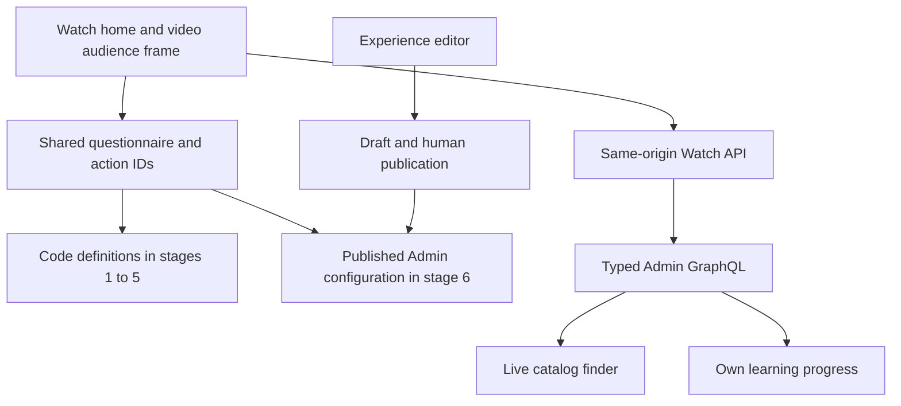
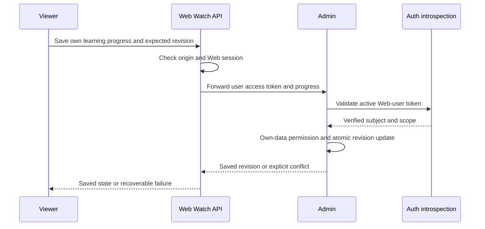
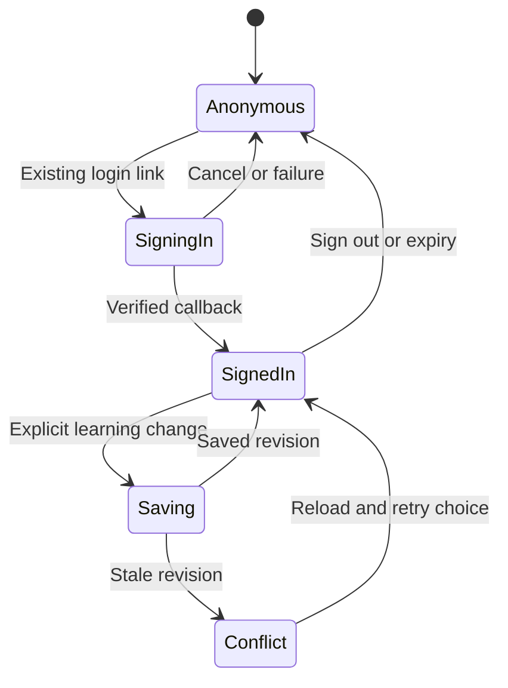
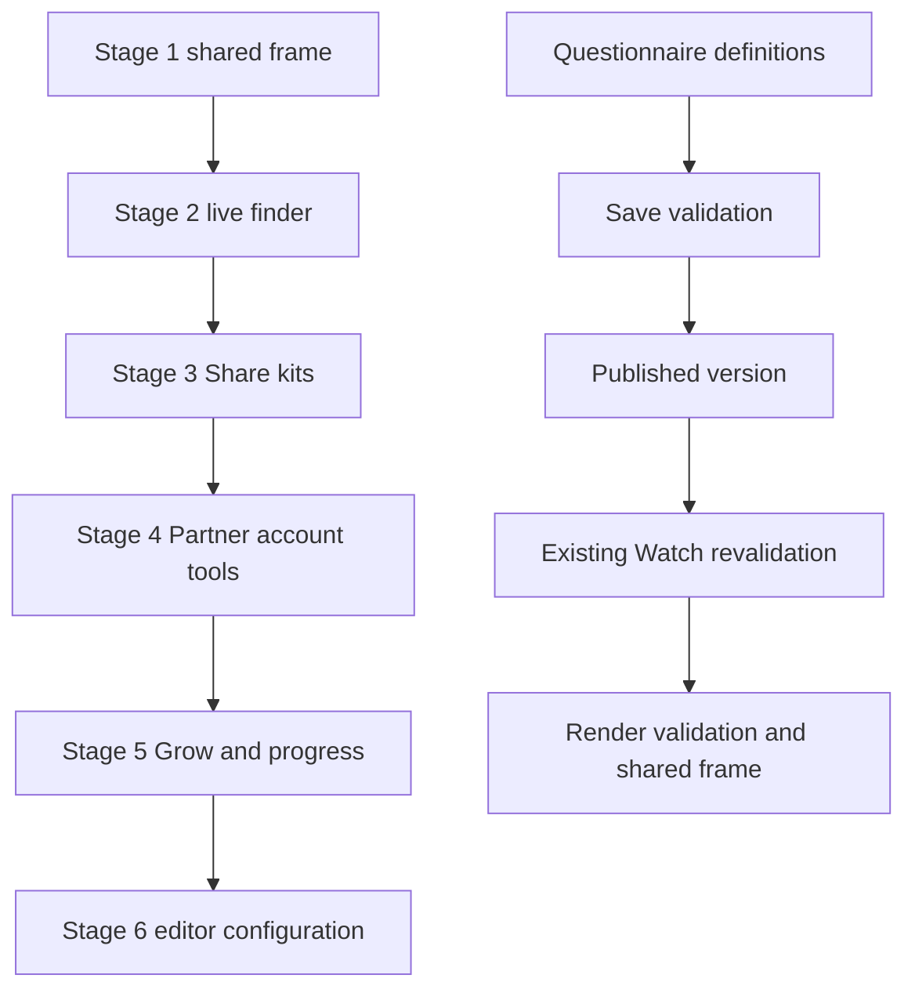

# Watch Audience Six-Stage Stack - Plan

## Goal Capsule

- **Objective:** People arriving at Watch can find a useful next step for exploring faith, growing, sharing, or ministry work, and return to their own learning progress.
- **Means:** Ship the shared audience frame first, then deepen one capability per stacked PR (KTD1–KTD3).
- **Authority:** The six stages in the current user brief govern scope. Current repository instructions and `docs/analytics-and-recommendation-policy.md` govern integration. The preserved prototype and September research are evidence, not a requirement to ship every historical idea.
- **Execution profile:** Autonomous implementation and independent parallel coding are authorized. The implementation owner finishes each scoped PR, validates it, and opens six linked PRs. No merge, deployment, production migration, or LaunchDarkly dashboard change is authorized.
- **Stop conditions:** Stop the affected unit on an actual security-contract contradiction, missing required local infrastructure, or unavailable included agent capacity. Partial catalog coverage alone is not a blocker. Preserve all prototype files and other workers' edits.

---

## Product Contract

### Summary

Introduce four audience tabs on Watch home and video pages using one short questionnaire component and real destinations. Replace Explore's harvested film inventory with live Admin data, add Share kits and ideas, connect Partner tools to real accounts, and make Grow's course progress durable. Finally let editors own the questionnaire and recommendation configuration in Admin.

### Problem Frame

Watch serves visitors with different intentions through a common film catalog. The preserved prototype shows how audience-specific next steps and a benefit-first lesson story can work, but its catalog snapshots, simulated account state, invented participants, and browser-only progress cannot provide the production capabilities requested here.

### Requirements

**Shared experience**

- R1. Stage 1 exposes Explore, Grow, Share, and Partner on both Watch home and eligible video pages, with a remembered browser role and an easy way to switch.
- R2. Every role uses the same simple three-question interaction pattern, with role-specific copy/options and a ranked next step plus alternatives.
- R3. Stage 1 keeps copy and recommendation rules in code and sends every action to an existing real destination or working Watch control.
- R4. Audience changes preserve the shared player, authored content identity/order, route language, canonical/SEO behavior, recommendation slot, and configured GA/Datadog behavior.

**Capability stages**

- R5. Stage 2 provides an Explore film finder using live Admin collection/video metadata and actual language/playability/duration eligibility instead of harvested display constants.
- R6. Stage 3 offers actionable film-sharing ideas and kits, including a language-specific film link, discussion prompts, and real guide destinations.
- R7. Stage 4 provides real sign-in/signup entry and a Partner resource library, language selection, and bulk-download controls using existing supported account and download capabilities.
- R8. Stage 5 provides Grow plans, the Beginning With Jesus course, the 26-card lesson-1 story, and dated prayer material, with account-backed learning progress.
- R9. Stage 6 makes questionnaire text, options, weights/order, explanations, and recommendation destinations editor-owned in Admin and consumed by the same viewer components.

**Trust and ownership**

- R10. No simulated sign-in, `unlocked` bypass, SMS/access-code fiction, fake groups/participants, or fabricated poll percentages ship.
- R11. Public viewing and Grow content remain available anonymously; signed-in identity enables durable learning progress and Partner account tools.
- R12. Account data is private to the authenticated subject and survives another signed-in device, with correct sign-out, account-switch, reset, and account-deletion behavior.
- R13. The original dirty prototype and recovery evidence remain unchanged; each stage is a separate reviewable PR and only its own roadmap ticket changes implementation status.

### Actors and acceptance examples

- A1. A visitor selecting an audience without an account.
- A2. A signed-in Watch viewer using Partner tools or saving learning progress.
- A3. An Admin editor configuring the questionnaire.

- AE1. **Covers R1–R3.** A visitor selects Share, answers three questions, opens a real suggested destination, and sees Share selected on another Watch page and after reload.
- AE2. **Covers R4–R5.** A Spanish-audio visitor opens the finder, sees eligible Admin-backed films, and follows a canonical Watch route retaining the selected audio language. Empty supply is explained without inventing a film or changing audio silently.
- AE3. **Covers R7, R10.** A signed-out Partner visitor signs in through the existing hosted Auth flow and returns to the same Watch page. Adding `unlocked=1` does not grant any capability.
- AE4. **Covers R8, R11–R12.** A visitor can open lesson 1 without login; after real sign-in, explicitly recorded learning completion and the story position reappear on a second device. Merely reaching card 26 never completes the lesson.
- AE5. **Covers R9.** An editor previews a questionnaire change without changing live content, publishes through existing human controls, and both home and synthetic video pages use that published configuration after normal revalidation.

### Scope boundaries

The September research is an idea inventory. This plan selects the six requested stages rather than its three historical waves. Families and Deaf viewers use existing catalog/language capabilities within these stages; no fifth audience tab is added.

Considered and not built: a new identity provider, verified ministry entitlement, SMS delivery, an access-code bypass, a ZIP assembly service, a new search page, AI-generated finder ranking, behavioral inference from referrers, public answer rooms, group matchmaking, and prayer submission. Existing identity/download systems already serve the requested behavior, while community/communications services require a different product contract. New evidence of a required capability can justify separate scope later.

The nine-lesson course is available; only lesson 1 is required to have the demonstrated 26-card story adaptation. Other lessons keep the interactive lesson-sheet form. Private free-text reflection drafts stay on the current device and are clearly labelled; account progress covers structured completion and resume state, not a promise to sync every journal answer.

### Success criteria

All six stage outcomes have behavior and integration evidence. On home and video entry, the audience additions cause no material initial-load or player-readiness regression under the matched comparison in the Verification Contract. Source dates, licenses, and adaptation provenance remain attached to reused materials.

---

## Planning Contract

### Current evidence and single-pass behavior trace

Implementation base is fresh main `abc71bbb8ba5e7345e24b5fc3e8c335c09f3d18d`. It is a different source tree from the September prototype baseline `c28a7fd115a6b7108bb5f83564192fe25de36a7b`.

The original checkout holds the prototype at the same repo-relative component paths, `docs/brainstorms/2026-09-15-watch-audience-tabs-content-recommendations.md`, and `outputs/watch-persona-recovery/`. Those untracked files are reference inputs, not files already present in this clean implementation tree. `browser/acceptance.md` establishes bounded desktop/phone navigation and story behavior, not auth, downloads, completion, or production performance. Its `integration-assessment.md` identifies overlapping upstream renderer/header changes.

A role click in prototype `apps/web/src/components/watch/watch-role.ts` updates a browser store and `watch.role`; an explicit valid `as` hint wins at initialization. `apps/web/src/components/watch/WatchRoleJourney.tsx` holds ephemeral answers and ranks action indexes. Production replaces indexes with stable action IDs and avoids that module's cached-snapshot cross-tab weakness. No role selection establishes identity or recommendation-profile consent.

Real Watch auth follows `apps/web/src/app/api/auth/login/route.ts` → hosted Auth → callback → encrypted host-only Web session → `api/auth/session`. `apps/web/src/components/watch/AccountControl.tsx` already handles this flow. Admin resolves Web-user tokens in `apps/admin/src/auth/web-user-token.ts`; a Consumer Bearer alone is not a user. `WatchProgress` stores video positions under an external Auth subject rather than an editorial User relation. Learning is a new own-data domain, not another use of video playback progress.

Existing downloads resolve opaque IDs through `apps/web/src/lib/download-target.ts` and the download route. Collection selection and the sequential browser queue already exist; queue completion means a browser download was initiated, not that the OS saved the file. PDF resources in the prototype are public external links, not protected assets.

### Key Technical Decisions

- KTD1. **One client audience frame across both surfaces.** Keep the role store, action registry, and questionnaire renderer shared, and integrate the smallest audience boundary around the existing body. Governs R1, R4. (session-settled: user-directed — chosen over a single-audience launch: establish the shared frame first.)
- KTD2. **Three questions first, with stable semantic IDs.** Use one role-specific definition shape and deterministic scoring with authored-order tie breaks; the longer film finder remains a separate opt-in flow in stage 2. Governs R2, R5. (session-settled: user-directed — chosen over the longer film-finder launch: release incrementally.)
- KTD3. **Code configuration, then the existing editorial pipeline.** Extract serializable definitions from React components in stage 1; stage 6 replaces their source through an Experience block and WatchSetting projection. Governs R3, R9. (session-settled: user-directed — chosen over initial Admin authoring: keep the first release scoped.)
- **Rollout assumption (autonomous implementation):** `forge.watch.audience` defaults off for every independently mergeable stage. R1 describes the enabled experience. The release owner enables the flag only after the relevant stage is deployed and its normal release checks pass; no dashboard change or deployment is part of this implementation. The stage-2 finder GET uses the same gate. Review advisory #9 records this assumption and requires no code behavior change.
- KTD4. **Deterministic role preference without shared-cache variation.** Valid explicit `as` → valid saved role → Explore. Persist only explicit choices; answers are ephemeral and reset when the role changes. Read storage safely through an external store that recomputes on storage events. SSR uses Explore with stable reserved layout; public ISR does not read cookies, headers, or sessions. This avoids cache leakage and preserves crawlable film content (R1, R4).
- KTD5. **Keep source block identity and existing order.** Put audience modules beside the shared Watch body rather than copying the prototype's role-dependent reorder. Source block keys and manifest offsets remain tied to original authored blocks, including exposure boundaries and player viewability callbacks. Home keeps its current category rail (R4).
  - _Superseded 2026-10-17 (user prototype-parity correction):_ while the audience frame is shown, the video page uses the prototype's composition — tabs after WatchBody, a full-width persona band holding the frame and the remaining sections, and the prototype per-role body order — with each block keeping its incoming index (key, manifest, placement). Home uses the prototype's compact role line + pills instead of the questionnaire. Flag-off and rejected-config pages render exactly as before. Provenance: `prototype-parity/core-r1/MANIFEST.md` (external evidence store).
- KTD6. **Finder uses Admin, without another search product.** Add a bounded public Admin resolver for a code-allowlisted collection set and duration/audio filters. Web calls it server-side through gql.tada and exposes a same-origin GET under `/watch/api/film-finder`. Requested audio must be playable; missing inventory yields a partial/empty result. Return route identity, localized title, duration, poster, and eligible Dub identity; derive canonical hrefs in Web. No embeddings, provider calls, browser bearer, or all-Dub projection are needed (R5).
- KTD7. **Account tools use real existing identity.** Reuse `AccountControl` and session results, never prototype signup components. Any real signed-in account qualifies; Partner is an audience choice, not an authorization role. Public PDF links stay external, and the general download rollout flag retains its current product default. Do not widen `apps/web/src/lib/download-allowlist.ts` or turn public PDFs into supposedly protected content (R7, R10–R11). The hosted authorization-code/PKCE model matches [Better Auth's provider contract](https://better-auth.com/docs/plugins/oauth-provider).
- KTD8. **Extend own-data authorization for learning.** Add read/write/delete learning-progress permissions for the checked Web-user principal, reusing the existing `web:watch-events:write` token scope. Web forwards that user's access token server-side; Admin derives subject from `ctx.user`, not a request argument. No new editorial User or ministry grant is created. Pin issuer, environment, accepted client IDs, active token, expiry, and existing scope checks; protect mutations against cross-origin requests (R12). This follows [OWASP's per-request authorization guidance](https://cheatsheetseries.owasp.org/cheatsheets/Authorization_Cheat_Sheet.html).
- KTD9. **A separate progress record with server revisions.** Add `WatchLearningProgress` keyed by Auth subject, course ID, content version, and lesson ID. Store completed movement/step IDs, explicit completion, resume card ID, and server revision/time. Writes carry an expected revision and conflict instead of overwriting newer state silently; the UI reloads progress and retains pending edits for explicit retry. A reset retains an empty progress row and increments its revision, so an older pending write cannot recreate the cleared state. Account deletion alone removes the row through the existing erasure lifecycle. Sign-out/account switch clears account state and cancels in-flight writes. Do not auto-import the prototype's unscoped local progress (R8, R12).
- KTD10. **Bound the lesson adaptation to demonstrated behavior.** Preserve benefit-first presentation, Looking Back/Up/Forward, shared story/sheet local drafts, keyboard navigation, close/focus/scroll restoration, reduced motion, and explicit completion. Remove fabricated social data entirely; reflection prompts and factual teaching replace simulated results. Retain the source PDF attribution and the date of each prayer guide (R8, R10).
- KTD11. **One published config source for home and synthetic video.** Add a top-level `watchAudience` block to the existing Experience schema. WatchSetting exposes the published default-template block with the same deterministic locale policy to every surface; a homepage instance can use the common projection rather than drifting into a separate definition. The editor uses existing draft/preview/publish and revalidation. Validate semantic IDs, exactly three questions per role, references, supported actions, and safe destinations at save and render. Missing/new schema during a staggered rollout uses a narrowly matched compatibility query; after a locale has a valid published configuration, do not silently replace it with baked-in questions. Empty/rejected authored destinations are omitted (R9).

The main architectural alternatives did not require a bake-off: Auth, public Watch API routing, collection downloads, and Experience publication already have direct local contracts. Introducing parallel systems would widen ownership without improving the agreed result.

### High-Level Technical Design

### Assumptions

English copy ships first using the current message-catalog workflow. Other locales keep their working Watch content and show explicitly labelled English audience resources until reviewed translations are added; a language switch must never imply that an English guide or course is translated. Stage 6 uses strict published-locale config and the existing documented language fallback, with a visible resource-language label.

The Partner library can use reviewed code metadata and public source links in stage 4; stage 6 moves questionnaire/recommendation configuration only, not all course or resource-library content into a new CMS. Language choices in stage 4 affect that tool session and are not promised as a new cross-device profile preference.

Source licenses and source dates are provenance to retain. They do not block writing requested implementation code or PRs. Fresh external link checks happen during each stage's validation; a broken optional resource is omitted with a working hub alternative rather than blocking the whole stack.

### Stack and parallel ownership

| PR  | Ticket   | Branch                        | Base | Exact diff scope                                                                                          |
| --- | -------- | ----------------------------- | ---- | --------------------------------------------------------------------------------------------------------- |
| 1   | feat-739 | `feat/watch-audience-frame`   | main | U1–U2; shared tabs, remembered role, simple questionnaires, existing destinations, home/video integration |
| 2   | feat-740 | `feat/watch-audience-explore` | PR 1 | U3–U4; bounded Admin catalog resolver and Explore finder                                                  |
| 3   | feat-741 | `feat/watch-audience-share`   | PR 2 | U5; Share ideas, language-aware links, kit view and real guides                                           |
| 4   | feat-742 | `feat/watch-audience-partner` | PR 3 | U6–U7; real account surface, resource library, language/bulk-download tools                               |
| 5   | feat-743 | `feat/watch-audience-grow`    | PR 4 | U8–U10; Grow plans/prayer/course, own progress persistence, lesson-1 story                                |
| 6   | feat-744 | `feat/watch-audience-editor`  | PR 5 | U11–U12; editor configuration and common published consumer source                                        |

The explicit stack requirement overrides the root default of targeting main for every PR. Each PR targets its predecessor and presents only its stage delta. No PR is merged in this task. Update the relevant ticket to in-progress only when implementation begins, then complete when its scoped implementation and verification are finished; complete does not claim production deployment.

Parallel work is safe after the parent records contracts: U3 backend versus U5 Share presentation; U8 persistence versus U9 course content; U11 schema/editor versus U12 consumer adapter after the schema contract is fixed. A single integrator owns `apps/web/src/components/watch/WatchSectionRenderer.tsx`, `apps/web/src/components/home/WatchHomeExperiencePage.tsx`, `apps/web/src/components/FloatingSearchProvider.tsx`, migrations, schema/codegen artifacts, and stack assembly. Independent worktrees start at committed parent checkpoints; uncommitted work is not copied automatically. Do not let parallel workers edit the same shared shell or allocate roadmap IDs.

### Prerequisites and operational boundaries

Use the already-created clean stack checkout and installed dependencies. Original prototype files remain reference-only. Before every worker assignment, run `agent-quota` and verify included allowance; no paid API inference or extra-usage fallback. Before branch/worktree creation, fetch/install, build or broad tests, run the foreground operation under `agent-io-guard`; never bypass a busy/unverifiable result and never nest guards. Propagate these requirements to every worker.

A local isolated Admin database and normal Auth test path are needed for DB/auth integration evidence. Follow `apps/admin/docs/worktree-preview-setup.md`; never migrate a shared or deployed database. Required Web/Auth/Admin environment configuration must be checked without printing secrets. Missing local prerequisites block the affected check, not unrelated implementation. Production configuration and deployment remain outside this task.

---

## Implementation Units

| Unit | Outcome                           | Primary files                                                                                                 | Dependencies |
| ---- | --------------------------------- | ------------------------------------------------------------------------------------------------------------- | ------------ |
| U1   | Audience state and definitions    | `apps/web/src/components/watch/watch-role.ts`, `apps/web/src/lib/watch-audience-config.ts`                    | None         |
| U2   | Home/video frame                  | `apps/web/src/components/watch/WatchRoleTabs.tsx`, `apps/web/src/components/watch/WatchRoleJourney.tsx`       | U1           |
| U3   | Live finder contract              | Admin finder service/type                                                                                     | U1           |
| U4   | Explore finder UI/API             | `apps/web/src/components/watch/WatchFindFlow.tsx`, film-finder route                                          | U2, U3       |
| U5   | Share kits                        | `WatchShareIdeas.tsx`, `apps/web/src/components/watch/WatchShareKit.tsx`                                      | U2           |
| U6   | Real Partner account view         | `apps/web/src/components/watch/WatchPartnerResources.tsx`, `apps/web/src/components/watch/AccountControl.tsx` | U2           |
| U7   | Partner language/bulk tools       | Partner tool, collection download helpers                                                                     | U6           |
| U8   | Learning storage and own-data API | Admin progress service/schema, Web progress API                                                               | U6           |
| U9   | Grow course/plans/prayer          | Grow components and course definitions                                                                        | U2           |
| U10  | Durable story/course integration  | `apps/web/src/components/watch/WatchGrowStory.tsx`, learning client                                           | U8, U9       |
| U11  | Editorial config contract         | Experience block/editor/WatchSetting                                                                          | U1           |
| U12  | Published config adapter          | Web audience config resolver/integration                                                                      | U2, U11      |

Files marked **new** below are planned additions, including prototype-named files absent on main. Paths in the index are shortened for navigation; the unit file lists govern scope.

### U1. Shared role preference and serializable definitions

**Goal:** Establish the stable audience/configuration boundary for stage 1.

**Requirements:** R1–R3; KTD1–KTD4.

**Dependencies:** None.

**Files:** New `apps/web/src/components/watch/watch-role.ts`, `apps/web/src/lib/watch-audience-config.ts`, `apps/web/src/lib/watch-audience-config.test.ts`, `apps/web/src/components/watch/watch-role.test.tsx`.

**Approach:** Separate copy/rules from icons and rendering. Define role, question, option and action IDs plus action kind/target, integer weights, and stable order. Validate code definitions with the same invariants needed by stage 6. Use a hydration-safe external store with explicit initialization and reliable storage-event recomputation.

**Patterns:** Existing Watch preference stores and route builders in `apps/web/src/lib/routes.ts`; prototype `apps/web/src/components/watch/watch-role.ts` is behavior reference only.

**Test scenarios:**

1. A valid explicit role wins over a saved different role; malformed hints fall back to a valid saved role, then Explore.
2. A blocked localStorage access still allows switching for the current session without hydration mismatch.
3. A second-tab storage update changes the role; deleting the saved preference restores Explore.
4. Each role has exactly three questions; dangling action IDs and malformed weights fail definition validation.
5. Equal scores preserve authored action order and cannot index outside the action set.

**Verification:** All four role definitions validate; no identity/token or questionnaire answers enter persistent role storage.

### U2. Integrate the audience frame on home and video

**Goal:** Deliver the first PR's complete user-visible shared frame.

**Requirements:** R1–R4, R10, R13; AE1; KTD1–KTD5.

**Dependencies:** U1.

**Files:** New `apps/web/src/components/watch/WatchRoleTabs.tsx`, `apps/web/src/components/watch/WatchRoleJourney.tsx`, `apps/web/src/components/watch/WatchNextSteps.tsx`, `apps/web/src/components/home/WatchHomeRoleBand.tsx`; modify `apps/web/src/components/home/WatchHomeExperiencePage.tsx`, `apps/web/src/components/watch/WatchSectionRenderer.tsx`; optional minimal chip integration in `apps/web/src/components/FloatingSearchProvider.tsx`; new colocated `apps/web/src/components/watch/WatchRoleTabs.test.tsx`, `apps/web/src/components/watch/WatchRoleJourney.test.tsx`, `apps/web/e2e/watch-audience.spec.ts`.

**Approach:** Integrate the existing home/video body boundaries without transcribing the old renderer. Reuse current playable route context and working share/download/language controls. Stage-1 actions use canonical JESUS/conversation-starters/current-film routes, existing history/language pages, and reviewed external resource hubs. No `href="#"`, fabricated local resource route, chat staffing promise, future-stage control, or mock gate remains. One tab panel owns its IDs/focus; all tabs support arrow/Home/End navigation and labelled controls. Keep unavailable later tools out of stage-1 imports.

**Execution note:** Characterize current source-block/manifests and player behavior before editing this heavily changed renderer.

**Test scenarios:**

1. Covers AE1. All roles run the same three-question flow on home and video, with back/change/reset and a real result action.
2. Switching roles resets answers while preserving playback, source block identity and recommendation placement.
3. Keyboard tab selection updates `aria-selected` and the associated panel without duplicate DOM IDs.
4. Unavailable film/language context omits the action rather than yielding a dead link.
5. A direct non-English entry and client navigation retain canonical audio-language URLs and configured analytics.
6. A matched production-build cold entry does not fetch later course/finder chunks or account state before intent.

**Verification:** Desktop and 390px mobile behavior, canonical/page-source parity, player continuity, and initial-load comparison are recorded for both surfaces.

### U3. Bounded Admin film-finder projection

**Goal:** Replace the harvested film display inventory with an authoritative query.

**Requirements:** R5; KTD6.

**Dependencies:** U1's semantic lane IDs; no UI dependency.

**Files:** New `apps/admin/src/services/watch-film-finder.service.ts`, `apps/admin/src/services/watch-film-finder.service.test.ts`, `apps/admin/src/services/watch-film-finder.service.db.test.ts`, `apps/admin/src/graphql/types/watch-film-finder.ts`, `apps/admin/src/graphql/types/watch-film-finder.test.ts`; modify `apps/admin/src/graphql/context.ts`, `apps/admin/src/graphql/schema.ts`; regenerate `apps/admin/schema.graphql` and `packages/admin-graphql/src/admin-graphql-env.d.ts`.

**Approach:** Map the prototype's eight collection slugs to stable allowlisted lane IDs in Admin code. Read canonical relation order and a bounded candidate window, then apply published/nondeleted/nonrestricted Watch visibility and exact playable audio selection. Accept lane IDs, public language slug, duration bucket, and cursor; cap lane IDs at 8 and returned cards at 24 per page. Return localized title/poster/duration and Video/Dub identity without every Dub/download. Deduplicate by Video ID. Keep subtitle-only fallback explicit rather than pretending it is requested audio. Add the public query through normal service/context/Pothos registration.

**Patterns:** `apps/admin/src/services/search-watchability.ts`, `apps/admin/src/services/video.service.ts`, `apps/admin/src/graphql/loaders.ts`, existing collection/download resolvers.

**Test scenarios:**

1. Published collection children retain canonical relationship order and current localized fields after a catalog change.
2. Hidden, deleted, unpublished and Watch-restricted intermediate/leaf nodes cannot enter results.
3. Exact audio and duration filter exclude a too-long or unavailable Dub; empty supply returns valid empty data.
4. Duplicate membership yields one card, and cursors/page bounds do not skip eligible cards within the declared candidate window.
5. An unknown lane or oversized input is rejected before a catalog fan-out.
6. DB-backed fixture proves the resolver reaches the service's actual visibility path and does not fetch thousands of Dubs.

**Verification:** Typed query/codegen and DB contract pass; existing public video/search clients retain their contracts.

### U4. Explore finder over the same-origin Watch API

**Goal:** Deliver a working optional finder after the stage-1 questionnaire.

**Requirements:** R4–R5; AE2; KTD6.

**Dependencies:** U2, U3.

**Files:** New `apps/web/src/lib/watch-film-finder.ts`, `apps/web/src/lib/watch-film-finder.test.ts`, `apps/web/src/app/api/film-finder/route.ts`, `apps/web/src/app/api/film-finder/route.test.ts`, `apps/web/src/components/watch/WatchFindFlow.tsx`, `apps/web/src/components/watch/WatchFindFlow.test.tsx`, `apps/web/src/components/watch/WatchFindLauncher.tsx`, `apps/web/e2e/watch-film-finder.spec.ts`; modify `apps/web/src/proxy.ts` only if the existing `/watch/api/*` mapping needs an explicit entry.

**Approach:** Define gql.tada operations in the Web data module. Expose a bounded GET with the current API rewrite, validate inputs, keep bearer handling server-only, and use no-store browser responses. Load finder code/data on open; represent loading, retry, empty and partial outcomes honestly. Carry selected audio and time filter, cancel obsolete requests, and derive links through canonical route helpers. Remove harvested titles/artwork/runtimes and the prototype's fake timed matching beat.

**Test scenarios:**

1. Covers AE2. A Spanish request returns current Spanish-playable cards and correctly built links.
2. Changing filters rapidly cannot display a stale earlier response.
3. Admin timeout shows retry while player and questionnaire remain usable.
4. Empty/partial inventory is distinguishable from server failure and offers a working catalog destination.
5. The client bundle/response contains no Admin bearer or raw download URL.
6. Closing/reopening and keyboard navigation restore focus without a new search URL.

**Verification:** Real local Admin query → Web GET → finder → playable route proof; finder chunks/network work begin only after opening.

### U5. Share ideas and film kits

**Goal:** Make the Share audience useful beyond the initial links.

**Requirements:** R6; KTD2–KTD3.

**Dependencies:** U2; assembled as PR 3 after PR 2.

**Files:** New `apps/web/src/components/watch/WatchShareIdeas.tsx`, `apps/web/src/components/watch/WatchShareKit.tsx`, colocated tests, `apps/web/src/lib/watch-share-kit.ts`, `apps/web/src/lib/watch-share-kit.test.ts`, `apps/web/e2e/watch-share-kit.spec.ts`; reuse `apps/web/src/lib/share.ts` and current Share controls.

**Approach:** Use the current film and recipient audio choice to compose a copyable canonical link and invitation. Include factual conversation prompts, host-a-gathering guidance and real source PDFs/pages. A downloadable kit may be an accessible print view of the selected film/link/prompts, with native print/save; do not advertise an unbuilt ZIP or email delivery. Home offers an existing collection until a film is selected.

**Test scenarios:**

1. Recipient language changes link audio without changing the sender's page language.
2. Missing authored study prompts use explicitly original editorial suggestions, never claims that a guide exists.
3. Clipboard/share API refusal offers selectable text and preserves the kit.
4. Print view includes title, link, source attribution and prompts with no hidden controls or private answers.
5. All guide/film actions resolve, and unavailable resources are removed without breaking Share.

**Verification:** Mobile/desktop copy/native-share/print behavior and language URLs work with real local catalog data.

### U6. Real account entry and Partner resource library

**Goal:** Connect Partner presentation to real identity without creating a second auth system.

**Requirements:** R7, R10–R11; AE3; KTD7.

**Dependencies:** U2; assembled as PR 4 after PR 3.

**Files:** New `apps/web/src/components/watch/WatchPartnerResources.tsx`, `apps/web/src/components/watch/WatchPartnerAccount.tsx`, colocated tests, `apps/web/src/lib/watch-partner-resources.ts`, `apps/web/src/lib/watch-partner-resources.test.ts`; reuse `apps/web/src/components/watch/AccountControl.tsx`, `apps/web/src/app/api/auth/session/route.ts`; new `apps/web/e2e/watch-partner-account.spec.ts`.

**Approach:** Show library metadata and public links honestly. Real account entry is a normal hosted Auth login/signup link with a safe return target; only supported hosted methods appear. Use any real signed-in account to enable the account tools under KTD7. Include resource categories, source language, source date, destination and optional PDF. Never import prototype `use-watch-account.ts`, `WatchPartnerSignup`, SMS/access-code UI, or modified prototype DownloadButton.

**Test scenarios:**

1. Covers AE3. Login and cancel/error return preserve the page and audience without claiming an account was created.
2. `unlocked=1`, forged local storage, and simulated browser events leave the real session unchanged.
3. Expiry/logout switches tools back to signed-out state; public resource links remain real external links.
4. Resource filtering and a missing PDF show the source page rather than a false download.
5. Session/network failure cannot unlock account-only tools and never disrupts the player.

**Verification:** Real local/approved Auth test-account round trip, sign-out and expiry evidence; no new provider credentials or public-account bypass.

### U7. Partner language selection and bulk-download tools

**Goal:** Use existing catalog and queue capabilities for ministry use.

**Requirements:** R7; KTD7.

**Dependencies:** U6.

**Files:** New `apps/web/src/components/watch/WatchPartnerDownloadTools.tsx`, `apps/web/src/components/watch/WatchPartnerDownloadTools.test.tsx`; reuse/extend `apps/web/src/components/watch/LanguageCombobox.tsx`, `apps/web/src/lib/search-language-actions.ts`, `apps/web/src/lib/watch-collection-download-actions.ts`, `apps/web/src/components/watch/collection-download-options.ts`, `apps/web/src/components/watch/collection-download-queue.ts` and their tests; extend `apps/web/e2e/watch-partner-account.spec.ts`.

**Approach:** Load language options on intent, then lazily resolve selected collection/language downloads and use the sequential queue with cancellation/retry. Keep opaque IDs, actual availability, Terms, filenames, account-gate rollout, safe download resolver and existing limits. Multiple selected languages become ordered queue groups; do not fetch the entire catalog's assets. Describe initiated/failed/cancelled states accurately and explain the browser's multiple-download permission if it intervenes.

**Test scenarios:**

1. Two selected languages generate only eligible ordered downloads and retain canonical relation order.
2. Cancel stops future initiation; failed-item retry does not restart already initiated items.
3. A language lacking downloads yields a clear unavailable state rather than a stream URL used as a file.
4. A direct anonymous request still follows the existing download rollout flag; audience state cannot override it.
5. Public PDF URLs never enter the media proxy/allowlist, and a disallowed supplied URL is rejected.

**Verification:** Local small-fixture bulk flow preserves existing download security and accurately labels browser initiation rather than saved-file completion.

### U8. Account-owned learning progress backend

**Goal:** Add durable learning state with enforceable subject ownership.

**Requirements:** R8, R12; KTD8–KTD9.

**Dependencies:** U6's real identity integration.

**Files:** Modify `apps/admin/prisma/schema.prisma`, add one forward-only migration under `apps/admin/prisma/migrations/`; new `apps/admin/src/services/watch-learning-progress.service.ts`, `apps/admin/src/services/watch-learning-progress.service.test.ts`, `apps/admin/src/services/watch-learning-progress.service.db.test.ts`, `apps/admin/src/graphql/types/watch-learning-progress.ts`, `apps/admin/src/graphql/types/watch-learning-progress.test.ts`; modify `apps/admin/src/auth/permissions.ts`, `apps/admin/src/graphql/context.ts`, `apps/admin/src/graphql/schema.ts`; regenerate SDL/introspection; new `apps/web/src/lib/watch-learning-progress.ts`, `apps/web/src/lib/watch-learning-progress.test.ts`, `apps/web/src/app/api/learning-progress/route.ts`, `apps/web/src/app/api/learning-progress/route.test.ts`; extend `apps/auth/src/services/account-deletion.service.ts` and its tests, plus the existing Admin account-deletion erasure seam.

**Approach:** Implement KTD8–KTD9 with validated known course/version/lesson/step IDs and bounded structured payloads, without arbitrary free text or userId arguments. Add own-data permissions only, and cover principal distinctions. GET/POST/DELETE are dynamic private/no-store; Web checks same-origin mutation requests and forwards the verified user's token to Admin using a request-scoped client. Integrate learning erasure transactionally with the existing account deletion path. Deleting progress and deleting an Auth account must not resurrect stale in-flight state.

**Execution note:** Start with cross-user and reset/conflict integration cases before wiring UI.

**Test scenarios:**

1. User A saves and reads their lesson; user B, anonymous, Consumer Bearer and unrelated editorial principal cannot read or mutate A's record.
2. Inactive/expired/wrong-client/wrong-environment tokens and cross-origin mutations are denied.
3. Same expected revision racing twice yields one update and one explicit conflict; a stale pre-reset write cannot recreate reset progress.
4. Unknown course/version/step and oversized state are rejected without a partial write.
5. Database errors return an actionable failure rather than empty successful progress.
6. Account deletion removes learning records with the existing erasure contract; failure does not claim full deletion.

**Verification:** Real isolated DB and checked-token GraphQL → Web route integration prove ownership, persistence, conflict and erasure. Security review explicitly approves the additive own-data permission set.

### U9. Grow content and course definition

**Goal:** Port useful Grow content with accurate provenance and no simulated community.

**Requirements:** R8, R10–R11; KTD10.

**Dependencies:** U2; content work can run alongside U8.

**Files:** New `apps/web/src/components/watch/WatchGrow.tsx`, `apps/web/src/components/watch/WatchGrowPlans.tsx`, `apps/web/src/components/watch/WatchGrowCourse.tsx`, `apps/web/src/components/watch/WatchGrowPrayer.tsx`, colocated tests, `apps/web/src/lib/watch-grow-content.ts`, `apps/web/src/lib/watch-grow-content.test.ts`, `apps/web/src/lib/beginning-with-jesus.ts`, `apps/web/src/lib/beginning-with-jesus.test.ts`.

**Approach:** Port nine lessons from the source-backed prototype into versioned stable lesson/movement/step IDs. Keep plans as real external destinations and prayer as dated guides with attribution. Lesson first view explains its benefit. Use an accessible lesson sheet for all lessons. Keep draft reflection text browser-local with a clear label; use the same draft store in sheet and story. Source images use `next/image`, current approved hosts, and optimized derivatives. Do not port generated presence/counts, fake answers, group join, sponsor claims, or notification promises.

**Test scenarios:**

1. All nine lessons have stable IDs, benefits, valid source references and usable lesson navigation.
2. An anonymous visitor opens course and prayer without a login wall.
3. A September guide remains labelled September in October and links to its actual source.
4. A missing/failed external image or optional guide leaves readable content and a working source hub.
5. Local reflection drafts are labelled device-only and contain no fabricated social response.

**Verification:** Content/source audit plus responsive sheet behavior; no unrequested subscription, prayer or group submission.

### U10. Lesson story and durable progress integration

**Goal:** Deliver the demonstrated 26-card lesson-1 experience with honest saved progress.

**Requirements:** R8, R10–R12; AE4; KTD9–KTD10.

**Dependencies:** U8, U9.

**Files:** New `apps/web/src/components/watch/WatchGrowStory.tsx`, `apps/web/src/components/watch/WatchGrowStory.test.tsx`, `apps/web/src/lib/watch-learning-progress-client.ts`, `apps/web/src/lib/watch-learning-progress-client.test.tsx`, `apps/web/e2e/watch-grow-progress.spec.ts`; integrate `apps/web/src/components/watch/WatchGrowCourse.tsx`.

**Approach:** Use a real modal/dialog portal with focus containment, Escape and restored body scroll. Acquire shared Watch modal activity at open intent, before lazy content resolves, and release through the existing close lifecycle; never add dialog-local player resume logic. Keep all 26 semantic cards and both story/sheet edit views against shared draft/progress adapters. Persist structured progress only after signed-in changes; debounce resume writes within the active session, flush safely on close, and visibly report save failures/conflicts. Versioned step identity maps stored progress; unknown retired steps are ignored without marking new content complete. Explicit completion is independent of navigation or a timer. While anonymous, label progress as unsaved and offer the existing hosted sign-in only when the visitor asks to save; a safe return restores the same lesson/card without automatically completing it. Require a fresh explicit save/completion action after verified sign-in. Cancelling login returns to the open lesson with no saved-progress claim.

**Test scenarios:**

1. Covers AE4. Card 1 explains benefit; all 26 cards can be reached; card 26 alone creates no completion.
2. Story/sheet draft edits agree, but account progress sync never sends free-text drafts.
3. Escape/close returns focus and scroll; arrows do not intercept typing; reduced motion and 390px layout stay usable.
4. A second signed-in device resumes saved progress; sign-out/account switch drops the old user's cached state and ignores late responses.
5. Offline/error state keeps visible unsaved progress and offers retry, never a false Saved label.
6. Concurrent/reset/content-version conflicts follow KTD9 and cannot silently complete or erase another version's lesson.
7. Anonymous save intent offers real sign-in; success returns to the same lesson/card and requires explicit confirmation, while cancellation leaves navigation usable and progress visibly unsaved.

**Verification:** Real signed-in two-context browser proof, persistence after reload, modal accessibility, and initial-load plus story-mount performance evidence.

### U11. Editor-owned questionnaire block and public projection

**Goal:** Make questionnaire/recommendation definitions editable through existing Admin publication.

**Requirements:** R9; AE5; KTD3, KTD11.

**Dependencies:** U1's stable semantic contract; assembled as PR 6 after PR 5.

**Files:** Extend `packages/experience-schema/src/` owning block schemas, `apps/admin/src/domain/blocks.ts`, `apps/admin/src/graphql/types/blocks.ts` and its union registration, `apps/admin/src/graphql/types/watch-setting.ts`, `apps/admin/src/services/watch-setting.service.ts`, `apps/admin/src/services/experience.service.ts`, `apps/admin/src/app/dashboard/experiences/experience-editor/` block library/controls/preview; new `watch-audience` colocated schema/editor/service tests; update shared block fragments in `packages/admin-graphql/src/fragments/`, regenerate SDL/introspection.

**Approach:** Follow KTD11 and the existing admin-authored/Web-owned block pattern. Add an editor for all four roles, exactly three questions, options, action definitions, score mappings and reason copy. Use semantic action kinds with catalog identity or safe resource destination, not React component names or raw HTML. Limit label/copy lengths, weights and list cardinality to bound persisted payload/render work. Publish validation rejects unknown action references and unsafe destinations. Existing revisions preserve history and human publish controls. Normal MCP experience editing can draft the same schema through existing validators; no agent publish route is added.

**Test scenarios:**

1. Valid definitions round-trip through save, draft preview, publication and shared fragments.
2. A fourth question, duplicate/unknown ID, dangling score target or unsafe destination is rejected with an editor-local error.
3. Editing a draft leaves published reads unchanged; a published default-template change updates the common WatchSetting projection.
4. A locale with no published configuration follows the declared locale fallback, never another editor's draft.
5. The block is admitted only in the intended top-level schema and does not break older Experience readers.

**Verification:** Schema/editor and isolated DB publication tests; generated SDL/types and existing Experience compatibility checks pass. No production content is published during implementation.

### U12. Switch both Watch surfaces to published configuration

**Goal:** Complete the replacement of baked-in questionnaire/recommendation data.

**Requirements:** R4, R9; AE5; KTD3, KTD11.

**Dependencies:** U2, U11.

**Files:** New `apps/web/src/lib/watch-audience-content.ts`, `apps/web/src/lib/watch-audience-content.test.ts`, `apps/web/src/components/watch/WatchAudienceBlock.tsx`, `apps/web/src/components/watch/WatchAudienceBlock.test.tsx`; update `apps/web/src/lib/content.ts`, `apps/web/src/lib/watch-home.ts`, `apps/web/src/lib/watch-audience-config.ts`, relevant shared fragments and home/video adapters; extend `apps/web/src/app/api/revalidate/route.test.ts`, `apps/web/e2e/watch-audience-config.spec.ts`.

**Approach:** Resolve the common published definition during existing public content loading and adapt it into the U1 contract. Match only known schema-lag failures for new fields/types and retry the compatibility selection; ordinary server errors remain diagnosable. Seed equivalent editable configuration through reviewed local fixtures and an idempotent dry-run-first migration/import path; no production write is required. Baked-in data remains only a temporary compatibility fallback until a valid authored locale config exists. Render-time destination checks also cover MCP-written or historical JSON. Preserve source block keys and tags during revalidation.

**Test scenarios:**

1. Covers AE5. Publishing one default configuration changes both home and synthetic video questionnaires after revalidation.
2. An older Admin schema uses the compatibility path; an unrelated GraphQL error does not masquerade as schema lag.
3. Authored action ordering/weights change results with the same saved role and no stale answer IDs.
4. Unsafe `javascript:`, protocol-relative, control-character, or malformed destinations are omitted at render even if stored data bypassed a prior validator.
5. Draft configuration stays private; no session-specific state enters cached HTML or another visitor's role.
6. Older readers continue to render existing Experience content; removing a supported action cannot crash the questionnaire.

**Verification:** Local editor → published projection → revalidation → home/video proof and schema-lag negative control; no permanent duplicate live configuration source.

---

## Verification Contract

These are implementation checks, not tests executed by this planning task. Apply `agent-io-guard` to each build and broad-test foreground command. Use the smallest relevant colocated tests first, then the package/CI scope warranted by the stage. Do not install another dependency set while the parent's installation is active.

| Scope                 | Repository checks                                                                                                                                                            | Completion evidence                                                                      |
| --------------------- | ---------------------------------------------------------------------------------------------------------------------------------------------------------------------------- | ---------------------------------------------------------------------------------------- |
| Every PR              | Existing formatter `pnpm exec prettier --check` over its owned files; relevant package lint/typecheck                                                                        | Stage-only diff, no generated/unrelated dirt, hooks pass                                 |
| Web stages            | `pnpm --filter @forge/web test`, targeted to named tests; `pnpm --filter @forge/web lint`; `pnpm --filter @forge/web typecheck`; production `pnpm --filter @forge/web build` | Correct routes under generated typed-route augmentation; messages parity remains valid   |
| Admin schema stages   | `pnpm --filter @forge/admin schema:print`; `pnpm --filter @forge/admin-graphql generate`; relevant Admin tests/lint/typecheck                                                | SDL/introspection drift checks clean and source/generated artifacts in the same stage PR |
| Persistent/auth stage | Isolated local DB integration suites and relevant `@forge/auth` tests/typecheck/lint if changed                                                                              | Cross-user denial, revision races, reset, real token ownership and account erasure       |
| Browser               | `pnpm --filter @forge/web test:e2e` with the stage's named specs or equivalent product-native browser evidence                                                               | Home/video, English/non-English, desktop/390px, keyboard and real account flows          |
| Editorial             | Existing block schema/Experience editor/preview/publication/revalidation suites                                                                                              | Same definition on home and synthetic video; draft isolation and compatibility fallback  |

For each stage that changes rendering or initialization, compare its production build with its immediate stack parent under the same browser/version, route, cache state, viewport and throttling. Capture at least three cold-entry runs for Watch home and a representative video, plus initial requests/bytes, LCP candidates, long tasks, CLS and player-shell readiness. Compare the median and inspect outliers. Investigate an increase above 10% in median LCP/player-shell readiness or 0.05 added CLS before declaring no regression; do not dismiss new render-blocking work inside normal variance. For finder/course/story, separately measure the actual interaction mount window and prove deferred chunks are absent on initial entry. Never use historical prototype HTTP smoke as current performance proof.

Preserve existing GA page views/navigation/Watch events and Datadog mounting according to `docs/analytics-and-recommendation-policy.md`. Do not log questionnaire answers, reflection drafts, credentials or tokens into new analytics. Coverage limitations remain separate from server failures. No causal recommendation-lift study is required by this stack.

Preview servers must use an owned free port and reachable interface. Share only a verified tailnet URL with the correct port/path. Browser work follows preview_status then preview_open, with the documented connected-Chrome fallback. Real account evidence uses a supported test identity, never a mock local bypass. No private tokens, raw traces with credentials, or user fields enter retained artifacts.

---

## Definition of Done

Each stage has its planned behavior, named tests and boundary integration evidence, a reviewed stage-only PR, and an accurate ticket. Generated artifacts remain producer/consumer aligned. Abandoned implementation experiments are removed from that stage's diff without touching the preserved prototype. Each PR is registered with the T3 thread and links its predecessor/successor.

The full stack is done when R1–R13 and AE1–AE5 are met by the six reviewable PRs, the page-load comparisons are recorded, and no unresolved P0/P1 finding remains. PRs stay open and unmerged. Production deployment, production data changes, live content publication and external configuration are not completion requirements for this task.

### Sources and implementation breadcrumbs

- `AGENTS.md`, `CLAUDE.md`, `apps/AGENTS.md`, package guides for Web/Admin/Auth and `packages/admin-graphql/CLAUDE.md`.
- `CONCEPTS.md`: Video, Dub, Language, App-Local Session, Experience Draft, Watch Modal Activity, Continue Watching.
- Preserved-reference `outputs/watch-persona-recovery/browser/acceptance.md`, `integration-assessment.md`, `preserved-files.json`, and September audience research. These remain in the original checkout; they are not moved into the clean stack tree.
- `docs/solutions/architecture-patterns/admin-authored-web-owned-experience-block-contract-20260826.md` and `widening-a-closed-selection-block-into-an-authored-list-20260827.md`: block pipeline, schema-lag fallback, safe destinations.
- `docs/solutions/best-practices/watch-progress-history-user-isolation-pattern-20260702.md`: user-scoped local state and narrow credentials.
- `docs/solutions/conventions/frontend-change-page-load-performance-verification.md`: initial-load and deferred-mount evidence.
- `docs/solutions/ui-bugs/watch-modal-playback-coordination.md` and `watch-download-modal-safeguards-can-regress-independently.md`: shared modal/player and download constraints.
- `docs/reports/2026-10-02-recommendation-roadmap-closeout.md`: do not revive retired generators/page personalization or equate accepted coverage with failure.
- [Beginning With Jesus source page](https://www.jesusfilm.org/resources/strategies/training/beginning-with-jesus-replace/), [film-gathering guide](https://www.jesusfilm.org/resources/strategies/outreach/how-to-host-a-short-film-festival/), [Amazing Question guide](https://www.jesusfilm.org/resources/strategies/outreach/using-the-amazing-question-to-share-your-faith/): real source destinations inspected during planning; source availability does not establish operational staffing or a new service promise.
