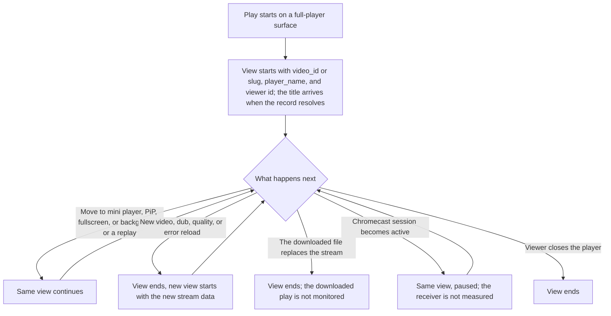
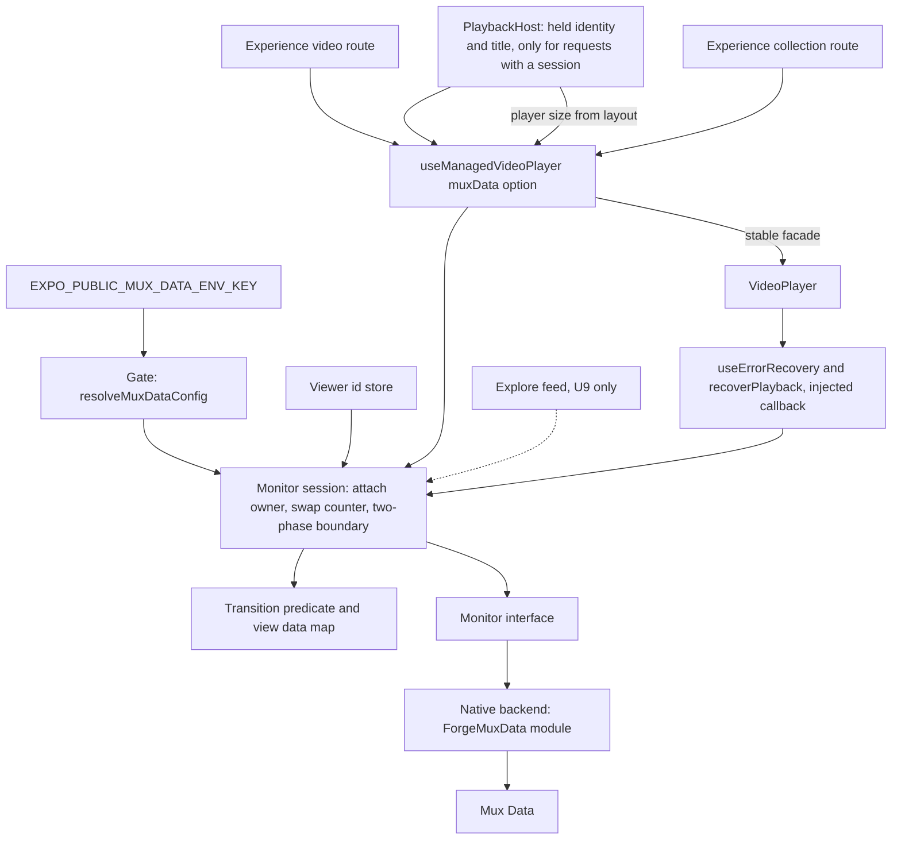
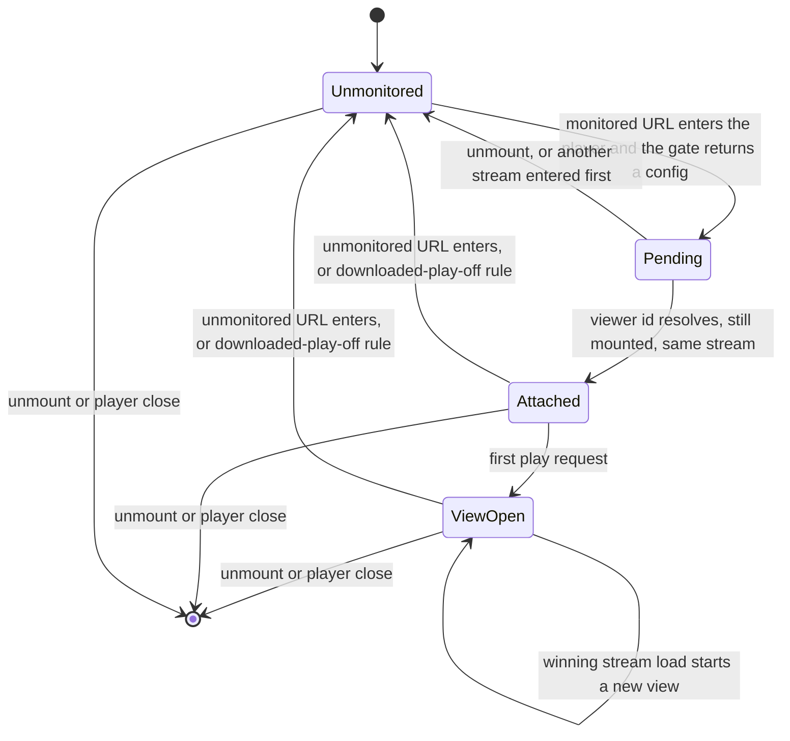
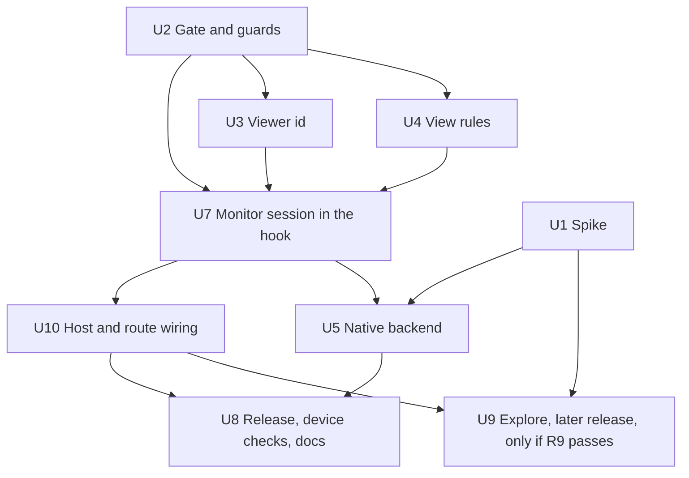

# Mobile Mux Data Playback Quality - Plan

## Goal Capsule

- **Objective:** The product lead, the data team, and the engineers can see mobile playback quality in the same Mux dashboard and environment as web (R23). Playback quality means startup time, stalls, errors, and picture quality.
- **Means:** Mux Data's native SDKs, connected to the existing `expo-video` player through one monitor interface and a local Expo module (KTD1, KTD9). The owner chose the native method on 2026-10-21. A device spike proves it on both platforms before the backend merges (KTD2).
- **Product authority:** The mobile owner (urim) owns `apps/mobile` and this plan. A person with Mux dashboard access, probably the principal engineer, owns the Mux environments, the env keys, the custom field setup, and the billing answers. Web code (`apps/web`), admin code (`apps/admin`), and the TV app (`apps/tv`) are not active scope.
- **Open blockers:** None blocks planning. The spike cannot send data until the Mux test environment and its env key exist (R24). The billing check must finish before the public launch (R26).
- **Stop conditions:** Stop and return to the mobile owner when the native method fails a spike check on either platform (R5), when the spike shows that a settled decision cannot work, or when a change would touch `apps/admin`, `apps/web`, or `apps/tv`.
- **Execution profile:** The spike (U1) runs first on physical phones. The shared base (U2, U3, U4) and the hook's monitor session (U7) need no backend, so they can run beside the spike with a fake monitor. The native backend (U5) follows the spike, and the host and route wiring (U10) follows U7. The mobile owner runs the device checks, and only the mobile owner merges pull requests.

---

## Product Contract

### Summary

The app uses Mux's native SDKs on both platforms. A spike first builds the native method into the full player and proves it on both platforms (R1, R3). Then the native method sends a Mux view from every play on the full-player surfaces (R8) to the same Mux environment as web. Forge sends Mux only the video's id, its slug, the title, a mobile `player_name`, and a Mux-only viewer id for each install (R14, R17, R21, R22). Downloaded plays are not monitored (R20). Explore clips follow in a later release, after five spike checks pass.

### Problem Frame

Web has sent Mux Data from its watch page since the watch-page work in April (`apps/web/src/components/watch/HeroPlayer.tsx:1734-1745`). The mobile app sends nothing to Mux: no Mux Data code or `@mux/` dependency exists in `apps/mobile`. So the Mux dashboard can compare videos, devices, and countries on web, but it cannot show whether the same video starts slowly or stalls on a phone.

The mobile app already measures some playback quality. Datadog `video.qoe` records time to first frame, rebuffer count, and errors for each session (`apps/mobile/src/lib/videoQoe.ts:59`). This data is in an engineering tool, not in the Mux dashboard that this work opens to the product lead and the data team. The GA4 work in progress will show how people use the app and its videos, but it does not measure stalls, startup time, or picture quality.

The principal engineer asked for this work and described it as "a Mux plugin that you integrate". No such plugin exists for `expo-video`. Mux's React Native packages need `react-native-video` or replace the player, and the mini player, PiP, casting, Explore, and downloads all depend on `expo-video`. The principal engineer has not stated which decisions the data will support. This plan assumes that playback quality on the full player comes first.

Only a few closed beta testers use the app now. So the first data proves that the connection works. Trends become useful after the public launch.

### Actors

- A1. Dashboard readers: the product lead, the data team, and the engineers. They read the Mux dashboard after A3 gives them access.
- A2. Viewer: a person who watches video in the mobile app. Today this is a closed beta tester.
- A3. Mux account holder: a person with Mux dashboard access, probably the principal engineer. They supply the env keys, create the test environment, name the custom fields, give the readers access, and answer the billing questions.
- A4. Mobile owner: builds the spike and the integration, runs the device checks, and updates the store privacy forms.

### Key Decisions

- **The app uses the native method.** (session-settled: user-directed, 2026-10-21 — chosen over a device spike that picks between the native method and the JavaScript method. The owner made the call after a review of both methods. Mux's guides point AVPlayer and Media3 apps to the native SDKs, and the JavaScript method cannot see seeks from the native controls or the PiP buttons.) This replaces the earlier decision that the spike decides the method. The spike now proves the native method and picks nothing. Governs R1, R2, R3, R4, R5, R6, R7.
- **Both platforms use the same method.** (session-settled: user-approved — chosen over a different method on each platform: both platforms then send the same kind of data, and the dashboard can compare them.) Governs R4.
- **The full player ships first, and Explore follows its spike checks.** (session-settled: user-directed — chosen over the full player only, and over every surface with the home heroes: the user wants Explore, but only after proof that its two-player feed reports correctly.) Governs R8, R9.
- **Mux collects only what GA4 cannot collect, and GA4 gives the official play counts.** (session-settled: user-directed — chosen over Mux and GA4 reports of the same usage data: the readers must not get two answers to one question.) This is the no-overlap rule. It covers the usage data that Forge sends. The fields in R14 and R17 (the video's identity, the `player_name`, and the Mux-only viewer id), the technical playback context in R21, and the data that Mux collects by itself (R28) are not usage data. Mux must count views to calculate its quality numbers, so a Mux view is a quality session, not a play count. Governs R21.
- **The app does not monitor downloaded plays.** (session-settled: user-directed, 2026-10-22 — chosen over monitoring with a marker, the earlier decision, and over an Android sender that removes local paths. The spike showed that both SDKs send a download's local file path, and every fix would need a new check after each Mux, Expo, or React Native update.) The monitor detaches before a local file loads. Datadog `video.qoe` still records errors for downloaded plays. With this change, the no-overlap rule has no exception. Governs R19, R20, R26.
- **Each install gets a random viewer id that only Mux receives.** (session-settled: user-directed — chosen over the anonymous id that the Mux SDK makes. The account id, the push install id, and the recommendation handle are not candidates, because each one connects Mux data to another system.) Governs R22.
- **The extra per-install id from the iOS native SDK is acceptable.** (session-settled: user-directed — chosen over a rule that excludes the native method on iOS: that rule would force the JavaScript method on both platforms and lose the data that only the native SDKs collect.) The research found that the Mux SDKs also send their own per-install id. On iOS with the native method, no public setting stops it. The extra id connects to no account and to no other system. Governs R22, R28.
- **Mobile uses the same Mux environment as web.** (session-settled: user-directed — chosen over a separate mobile environment: one dashboard then compares the same video on web and mobile.) Governs R23.
- **Only the production profile writes to the shared environment.** The beta testers use `production` builds and the `production` update channel (`apps/mobile/CLAUDE.md:307`). Internal builds would mix test plays into the shared dashboard. Governs R2, R23, R24.
- **A build without an env key starts no monitoring.** A missing key does not stop Mux on web: Mux then finds the environment from the playback id and writes to it. So mobile cannot rely on an absent key. Governs R25.
- **A new view starts on each new stream, and screen moves keep the view.** Mux's iOS SDK starts a new view on every stream swap. A reload inside one view would also show as a false rebuffer. Governs R10, R11.
- **A Chromecast session pauses the phone's view and does not end it.** The phone's player pauses, Mux does not count paused time as watch time, and Mux ends a view by itself after 60 minutes without events. A special cast rule would add spike work and give no gain. Governs R12.
- **The series trailer is not monitored.** The trailer plays on the root player, but it starts by itself, as the home heroes do. It also has no Video `documentId`, and the GA4 plan skips it for the same reason. Governs R8.
- **The billing check happens before the public launch, not before the first release.** (session-settled: user-approved — chosen over a check before the first release: a few beta testers stay far below the 100,000 free views a month.) Governs R26.
- **Datadog `video.qoe` stays unchanged.** (session-settled: user-approved — chosen over a change to it or its removal: the no-overlap rule covers GA4 only.) Governs R29.
- **No ministry security team review.** (session-settled: user-directed — chosen over a security team review like the one that the GA4 work waits for: the owner decided that the team is not involved.)
- **Release timing is not a constraint.** (session-settled: user-directed — chosen over a store build with the native code disabled and a later over-the-air update that enables it. Only a few closed beta testers use the app, and they can install a new build.)

### Requirements

**Spike**

- R1. A spike builds the native method into the full player (R8). It tests it with at least two videos, on the watch page and on an Experience route, on one iPhone and one Android phone.
- R2. The spike sends data only to the Mux test environment (R24).
- R3. The native method works on a platform when it passes these checks on that platform:
  - the view rules (R10, R11)
  - the video data rules (R14, R16)
  - the off rule (R25)
  - the playback rule (R27)
  - the quality values: the test views show a startup time, rebuffer data, a playback failure for a forced error, and a video quality score with a player size that matches the watch page and the mini player
- R4. The spike asks the principal engineer which decisions the Mux data supports. The answer sets which R6 items the spike record must cover. (Changed 2026-10-21: the owner chose the native method, so the answer no longer picks a method.)
- R5. If the native method fails R3 on either platform, the spike stops, and the mobile owner decides the next step. The JavaScript method is not a fallback without a new owner decision.
- R6. The spike records these items for the native method:
  - the separation of seeks from rebuffers (R13)
  - rebuffer accuracy
  - rendition and bitrate data
  - request and CDN data
  - error codes
  - the cost on the JavaScript thread and the UI thread
  - the upgrade cost: what an `expo-video` or Expo SDK upgrade must change, such as the Media3-matched Mux artifact, the Mux pod versions on trunk, the access to the player object, and the `compileSdk` and Kotlin versions
- R7. After R3 passes on both platforms, the spike connects the native method to the Explore feed and runs the checks in R9. The spike record lists the principal engineer's answer (or that no answer arrived) and the R6 items that the answer makes required, each R3 and R6 result, and each Explore result, with evidence.

**Surfaces**

- R8. The first release monitors every play on the full player: the watch page, the mini player, PiP, fullscreen, and the Experience video and collection routes (`apps/mobile/app/video/[sectionKey].tsx` and `apps/mobile/app/collection/[sectionKey].tsx`). The series trailer is not monitored, although it plays on the root player of the watch page, the mini player, and PiP. The Experience routes use their own player from `useManagedVideoPlayer`. Downloaded plays are not monitored (R20).
- R9. The app monitors Explore clips only after all five of these checks pass:
  - Each visit to a clip makes one view.
  - The muted, paused standby player sends no view and no beacon.
  - Clip-start seeks and loops show as seeks, not rebuffers.
  - Explore views carry their own `player_name`.
  - The time from a swipe to the first frame does not get slower (see Success Criteria).

  When all five checks pass, this plan adds Explore after the full player, in a later release. If a check fails, Explore becomes a follow-up roadmap ticket.

**What a view is**

- R10. One video that moves between the watch page, the mini player, PiP, fullscreen, and the background keeps one view. A replay of the same stream stays in that view. The view ends when the viewer closes the player or a new stream starts.
- R11. A new view starts each time the player loads a new stream. These events load a new stream:
  - a new video
  - a dub change
  - a quality change
  - a reload after an error

  Each new view carries the data of the stream that it plays. A download that replaces the stream ends the view and starts none (R20; changed 2026-10-22).

- R12. A Chromecast session does not end the phone's view. The phone's player pauses during the cast, and Mux does not measure the receiver. AirPlay playback also stays in the phone's view.
- R13. Mux shows the seeks that the app starts as seeks, not as rebuffers, such as a saved resume position and the return from a cast. Seeks from the native controls and the PiP buttons also show as seeks when the native SDKs can see them, and the spike record names any gap. When the native SDKs cannot see seeks from the native controls, the Experience routes send their own `forge-mobile` `player_name`, and the spike record states that PiP skips can show as rebuffers.

**Data that Forge sends to Mux**

- R14. Each view carries the Video's `documentId` as `video_id` (the same id that web sends; see R16 and R17), the video title (R15), a mobile `player_name` (R18), and the Mux-only viewer id (R22).
- R15. The title comes only from a resolved Video record. On the watch page, the view carries no title until the record resolves, and a title from a deep-link seed never reaches Mux. The Experience video and collection routes use the record title that the app already loads for each block's video. Their views carry no title until it loads, and never the block's stored title.
- R16. A view that starts before the app knows the Video's `documentId` still carries the correct `video_id`. This happens on every open that plays a seed stream before the record loads: Home tiles, search results, and deep links (`apps/mobile/CLAUDE.md:784-785`, `apps/mobile/src/components/watch/PlaybackHost.tsx:465-467`). The view still starts at the first play request, so that Mux measures the startup time.
- R17. Every view on a surface that has a slug also carries the slug. So a view whose `documentId` the app never learns, for example a seed stream whose record fails to load, still identifies its video, and a view never carries a wrong `video_id`. The Experience routes have no slug, but they know the video id from the start.
- R18. Every mobile `player_name` starts with `forge-mobile`. Explore uses its own value, and the Experience routes use their own value when R13 requires it.
- R19. Removed 2026-10-22: downloaded plays are not monitored, so no marker is needed.
- R20. The app does not monitor downloaded plays. The monitor detaches before a local file loads, so Mux receives no beacon from a downloaded play and never a local file path. (Changed 2026-10-22: the spike showed that both SDKs send the path.)
- R21. Forge sends Mux no app data beyond R14 and R17. Mux does not receive the discovery source of a play (such as Home, search, a share, or a deep link), progress milestones, shares, search text, or account data. Mux may receive the technical playback context that the native SDKs send by themselves: the device model, the OS, the app id and version, the connection type, and the stream address of a streamed play.

**Viewer id**

- R22. The app makes one random Mux-only viewer id for each install, keeps it on the phone, and sends it to Mux as `viewer_user_id`. The id never connects to the account id, the push install id, or the recommendation handle. Where the method allows it, Mux receives no other per-install id; the one exception is the id that the iOS native SDK always sends.

**Environments, the off rule, and cost**

- R23. Only `production` profile builds, and over-the-air updates on the `production` channel, send data to the same Mux environment as web.
- R24. The spike and all other builds (`development`, `preview`, `preview-simulator`, and local release builds) send data only to a separate Mux test environment, or they have no key (R25).
- R25. A build without a Mux env key starts no Mux monitoring and sends no request to Mux Data.
- R26. Before the public launch, the Mux account holder (A3) confirms how Mux bills mobile views. (Changed 2026-10-22: the rule for billable downloaded plays is removed, because downloaded plays are not monitored.)

**Playback safety and disclosure**

- R27. Monitoring never changes playback. Time to first frame does not get slower (see Success Criteria), and a Mux failure never stops, pauses, or delays a video.
- R28. Before the public launch, the mobile owner (A4) updates the App Store privacy details and the Google Play data safety form with the data that Mux receives. The forms include the data that Mux collects by itself, such as the country, the region, and the network provider, and each per-install id that reaches Mux.
- R29. Datadog `video.qoe` and the GA4 events stay unchanged. The Mux numbers do not need to match them.

### Key Flows

- F1. Spike
  - **Trigger:** The Mux test environment and its env key exist.
  - **Actors:** A3, A4
  - **Steps:** A4 builds the native method into the full player (R1). A4 asks the principal engineer which decisions the Mux data supports (R4). A4 runs the checks in R3 and records the items in R6 on an iPhone and an Android phone. If a check fails on either platform, A4 stops and returns the decision to the mobile owner (R5). A4 then connects the native method to the Explore feed and runs the checks in R9.
  - **Outcome:** The native method proven on both platforms and an Explore result of pass or fail, or a stop with evidence.
  - **Covered by:** R1, R2, R3, R4, R5, R6, R7, R9
- F2. One full-player view
  - **Trigger:** A viewer starts a video on a full-player surface (R8).
  - **Actors:** A2
  - **Steps:** A view starts with the video's data (R14, R15, R16). The viewer moves the video to the mini player, PiP, fullscreen, or the background, and the view continues (R10). A new stream starts a new view (R11). A seek that the app starts, such as a saved resume position, shows as a seek (R13). An active Chromecast session pauses the view, and the return from the cast shows as a seek (R12, R13). The view ends when the viewer closes the player.
  - **Outcome:** Mux shows one view for each stream that the viewer played on the phone.
  - **Covered by:** R8, R10, R11, R12, R13, R14, R15, R16

### Acceptance Examples

- AE1. **Covers R10.** **Given** a viewer watches a video on the watch page, **when** they move it to the mini player and then leave the app with PiP, **then** Mux shows one view for that video.
- AE2. **Covers R11.** **Given** a viewer watches a video in English, **when** they change the dub to Spanish, **then** Mux shows a second view with the same `video_id` and the Spanish stream. **When** they change the quality, **then** Mux shows a third view.
- AE3. **Covers R15, R16.** **Given** a Home tile, a search result, or a deep link starts playback before the video record loads, **when** the view arrives in Mux, **then** its `video_id` is the Video's `documentId`, and its title comes from the record, not from the seed.
- AE4. Removed 2026-10-22: downloaded plays are not monitored. AE11 replaces it.
- AE5. **Covers R25.** **Given** a build without a Mux env key, **when** a video plays, **then** a network capture shows no request to a Mux Data host (`*.litix.io`, with `inferred.litix.io`).
- AE6. **Covers R12, R13.** **Given** a viewer casts a video in the middle of playback, **when** the Chromecast session becomes active, **then** the phone's view pauses and does not end. **When** the cast ends and the phone plays again, **then** the same view continues, and the jump to the receiver's position shows as a seek, not a rebuffer.
- AE7. **Covers R9.** **Given** the app monitors Explore, **when** the standby player loads the next clip while muted and paused, **then** Mux receives no view and no beacon for that clip until it becomes the active clip.
- AE8. **Covers R13.** **Given** the native method and a viewer who drags the scrubber forward with the native controls on an Experience route, **when** the video loads at the new position, **then** Mux shows a seek and no rebuffer.
- AE9. **Covers R27.** **Given** the network blocks every Mux Data host, **when** a viewer starts a video, **then** the video plays and the app shows no error.
- AE10. Removed 2026-10-22: downloaded plays are not monitored.
- AE11. **Covers R20.** **Given** a viewer watches a streamed video, **when** the downloaded file of the same video replaces the stream, and later a downloaded video plays from the start, **then** a network capture of every beacon to a Mux Data host shows the streamed view ending, and no beacon after that until a stream plays again. No field contains a `file://` URL, the app's documents path, or the iOS container id.

### Success Criteria

- Production builds on iOS and Android send views to the shared Mux environment under a `forge-mobile` player name. The views come from at least one beta tester phone on each platform.
- On one iPhone and one Android phone with release builds, the spike runs one warm-up start. Then it runs 20 starts with monitoring on and 20 starts with monitoring off, in alternating blocks of five, on the same video and network. The check passes when the monitoring-on median of the time to first frame is at most 100 ms slower than the monitoring-off median. If the interquartile range of the monitoring-off starts is larger than 100 ms, that range is the limit. A failed check runs again once before R3 rejects a method or R9 defers Explore. The check covers the watch page and the Experience routes (R27), and the same rule applies to the Explore swipe check (R9). This follows `docs/solutions/conventions/frontend-change-page-load-performance-verification.md`.
- The spike record exists (R7).
- Before the public launch, R26 and R28 are done, and each dashboard reader (A1) can open the shared Mux environment.
- Not needed for success: the Mux numbers match Datadog or GA4, or the readers use the data to make a decision.

### Scope Boundaries

**Deferred for later**

- Explore, when one of its checks fails (R9).
- A new Mux viewer id when a viewer deletes their account. The id does not connect to the account, so this is optional.
- Mux Data on the TV app.

**Outside this work**

- A replacement of `expo-video` with a Mux player or with `react-native-video`.
- The JavaScript method (`mux-embed`, U6). The owner chose the native method on 2026-10-21. A return to it needs a new owner decision.
- The home heroes, the series trailer, and other autoplay previews.
- Measurement of playback on a Chromecast receiver.
- Changes to Datadog `video.qoe`. A separate follow-up checks one issue. The `statusChange` handler at `apps/mobile/src/hooks/useManagedVideoPlayer.ts:721-740` counts a loading status after the start as a rebuffer unless a source swap is in progress. It has no seek check, and the comment at `apps/mobile/src/lib/videoQoe.ts:49-51` names a `seekTargetRef` that does not exist.
- Changes to web code. The comment at `apps/web/src/env.ts:334-336` says that an unset key stops Mux Data. That claim is wrong. The mobile owner reports the wrong comment to the web owner.
- Changes to GA4 events.
- A ministry security team review.
- Considered and not built: sampling of views by install. A few beta testers stay inside the free tier, so the gate stays without sampling. The R26 billing answer can change this.
- Considered and not built: monitoring of downloaded plays, with a marker or with an Android sender that removes local paths. The owner removed it on 2026-10-22 (R20).
- Considered and not built: a playback-mode or dub-language field. R21 does not allow these app fields, and a dub change already starts a new view with a new playback id.
- Considered and not built: a battery measurement. The spike's thread trace (KTD18) is the proxy, because a battery reading on one phone is too noisy to judge.
- Considered and not built: a filter that keeps Mux beacons out of Datadog RUM resources. Build it only if U1 shows that the extra RUM bytes are large (KTD18).
- Considered and not built: a Datadog warning when Mux cannot run. A Mux failure never affects playback (R27), the U8 production check and the dashboard readers would see missing mobile views, and the warning can be added later at no data or interface cost. A pattern of silent partial loss in the spike or after release would change this call.

### Dependencies / Assumptions

- The Mux account holder (A3) supplies the production env key and the test environment with its key. A3 also gives each dashboard reader (A1) access to the shared environment before the public launch.
- A3 confirms that web views show a Mux Asset ID and a Mux Playback ID. These two IDs show that the web Mux Data environment owns the videos. Because that environment owns the videos, Mux probably counts views of those videos as free.
- Assumption: the Mux account has the pay-as-you-go feature set, with two custom dimensions. Mux pricing lists two, five, or 10 custom dimensions by tier. A3 confirms the count in Settings > Custom Dimensions and names the two fields that this work uses (KTD7).
- Only a few closed beta testers use the app. Their views stay far below the 100,000 free views a month, and they can install a new store build at any time.
- The GA4 plan (`docs/plans/2026-10-19-1023-feat-mobile-ga4-analytics-plan.md`, in the `analytics-setup` worktree, not yet on `main`) also changes `apps/mobile/src/hooks/useManagedVideoPlayer.ts`. The code change that merges second must adapt to the code change that merges first (KTD15).
- Assumption: the principal engineer wants playback quality on the full player first.
- Assumption: someone, probably the principal engineer, uses the web Mux dashboard today.
- Assumption: `docs/analytics-and-recommendation-policy.md:80-91` covers Mux Data as product analytics, so no consent step applies. The policy does not name Mux. Its rule on payload minimization still applies (R20, R21).

### Outstanding Questions

**Resolve Before Planning**

- None.

**Deferred to Implementation**

- For the principal engineer, asked during the spike (R4, U1): which decisions the Mux data will support, and who uses the web Mux dashboard today.
- The Mux account holder or Mux support answers these questions during the spike (U1):
  - Do views in the test environment count toward billing?
  - Does a paused player with no play request count as a view?
  - How many custom dimensions does the account have?
- The Mux account holder answers this question before the public launch (R26): are streamed mobile views free?

### Sources / Research

- Web integration: `apps/web/src/components/watch/HeroPlayer.tsx:1734-1745`, `apps/web/src/lib/viewer-id.ts`, `apps/web/src/env.ts:334-337`, and `docs/plans/2026-04-29-001-feat-watch-page-mux-parity-plan.md:176-177`.
- Mobile player: `apps/mobile/src/components/watch/PlaybackHost.tsx` (the one root player for the watch page, the mini player, and PiP), `apps/mobile/src/hooks/useManagedVideoPlayer.ts` (the shared hook, with source swaps at `:408-490`), and `apps/mobile/src/hooks/__tests__/useManagedVideoPlayer.guard.test.js` (the player-creation guard).
- Error reload: `apps/mobile/src/components/watch/VideoPlayer.tsx:213` calls `useErrorRecovery`, and `apps/mobile/src/hooks/useErrorRecovery.ts:68` is the only caller of `apps/mobile/src/lib/recoverPlayback.ts`.
- Series trailer: `apps/mobile/app/series/[slug].tsx:562-572` (an autostart `PlayerSlot` with no session that plays on the root player).
- Explore: `apps/mobile/src/hooks/useFeedPlayers.ts` (two players at `:723-724`, a clip swap at `:412`, and a loop as a JavaScript seek at `:543-549`). Explore does not use `useManagedVideoPlayer`, so it needs its own connection point.
- Downloads: `apps/mobile/src/hooks/useManagedVideoPlayer.ts:242-251` (a `file://` source is a downloaded play), and `apps/mobile/src/lib/muxThumbnail.ts:127-133` (a `file://` URL gives no playback id).
- Casting: `apps/mobile/src/components/watch/VideoPlayer.tsx:420-434` (the phone's player pauses during a Chromecast session).
- Release: `apps/mobile/eas.json` (build profiles and channels), `apps/mobile/app.json:58-60` (the fingerprint runtime policy), and `apps/mobile/CLAUDE.md:332-344` (a native change needs a store build before an over-the-air update).
- Mux documentation: [monitor AVPlayer](https://www.mux.com/docs/guides/monitor-avplayer), [monitor AndroidX Media3](https://www.mux.com/docs/guides/monitor-androidx-media3), [custom JavaScript integration](https://www.mux.com/docs/guides/data-custom-javascript-integration), [playback events](https://www.mux.com/docs/guides/mux-data-playback-events), [custom metadata](https://www.mux.com/docs/guides/extend-data-with-custom-metadata), [data privacy](https://www.mux.com/docs/guides/ensure-data-privacy-compliance), [Mux Data FAQs](https://www.mux.com/docs/guides/mux-data-faqs), and [Mux Data pricing](https://data.mux.com/pricing).
- Mux iOS SDK source: [muxinc/mux-stats-sdk-avplayer v4.17.0](https://github.com/muxinc/mux-stats-sdk-avplayer/tree/v4.17.0).

---

## Planning Contract

Product Contract preservation: changed: R17 — the slug now goes on every view of a surface that has a slug, not only when the `documentId` is missing, because SDK fields cannot be cleared reliably between views; the Experience routes have no slug and know the id from the start (KTD7, confirmed in the plan's scoping summary). Changed: R4, R15, R21 — document-review fixes that the owner approved on 2026-10-21: R4's pick rule now covers every case, the Experience routes take the record title instead of the block title, and R21 allows the stream address that the SDKs send. The resolved planning questions moved out of Outstanding Questions into KTD6, KTD7, KTD9, and KTD10. Changed 2026-10-21 (owner decision): the app uses the native method. R1, R3 to R7, R13, R20, R21, and F1 no longer describe a pick between methods. KTD11 and U6 are withdrawn, and the iOS Mux pods come from CocoaPods trunk (KTD9). Changed 2026-10-22 (owner decision): KTD10 uses Mux 1.13.4 with `compileSdk` 37. Changed 2026-10-22 (owner decision): the app does not monitor downloaded plays. R19 and AE4 and AE10 are removed; R7, R8, R11, R17, R20, R21, and R26 change; AE11 is new; KTD7 drops `custom_1`.

### Key Technical Decisions

- KTD1. **One monitor interface, and the native backend implements it.** `apps/mobile/src/lib/muxData/` holds a method-neutral monitor interface: attach, stage the next view's data, update the open view, start a new view, set the player size, and release. Staging never touches the open view, so a swap that later loses cannot change it (KTD5). The native backend (U5) implements it. The JavaScript backend (U6) was the other candidate until the owner chose the native method on 2026-10-21. The gate, the viewer id, the view rules, and the monitor session (U2, U3, U4, U7) do not depend on the method, so they ship before the spike and test against a fake monitor. Governs R1, R3, R4.
- KTD2. **The spike lives on a spike branch, and only its record merges.** (session-settled: user-approved — chosen over merging the spike prototypes and tools: a dev-only method switch, capture tools, and an unused backend would stay in the app.) The spike branch holds the native prototype, an on/off switch that also works in release builds (the timing checks use release builds), a test `player_name` suffix, and the beacon capture tools. The record goes to `docs/reports/<date>-mobile-mux-data-spike.md`, because spike evidence in a home directory was lost once (`docs/solutions/integration-issues/mobile-android-picture-in-picture-spike-20260813.md`). Governs R1, R2, R5, R7.
- KTD3. **One gate function decides whether Mux runs.** `resolveMuxDataConfig()` returns a config only when the trimmed `EXPO_PUBLIC_MUX_DATA_ENV_KEY` matches `^[a-z0-9]+$`. Every attach path reads only this function. A null result means no monitor and no SDK call. The format check is needed because the Android SDK sends a malformed key to `img.litix.io` and an empty key to `inferred.litix.io`. The env var stays `.optional()`, so a build without it still boots. Governs R25.
- KTD4. **One rule owns the attach: a monitored URL enters the player.**
  - `useManagedVideoPlayer` takes a new `muxData` option. The hook attaches inside its swap effect, before `replaceAsync`, and on mount only when the creation source is not null. A null-to-URL swap and a non-null creation source are two entries to the same rule, so the first stream attaches once.
  - The same swap effect detaches before an unmonitored URL enters (the series trailer), and before a local file enters (R20). A request that loses its option but brings no URL does nothing until a stream enters.
  - Each attach has a generation number, because the attach waits on the viewer id (KTD8). When the wait resolves, the attach runs only if the hook is still mounted and the same stream is still loaded.
  - The monitor is its own handle, and its release never takes the player, because the player's own release runs first when the hook unmounts.
  - The default attach point is stream entry. If U1 shows that an attached, paused monitor keeps SDK timers running, the attach moves to the first play request.

  Governs R8, R10, R12.

- KTD5. **A view boundary has two phases, and one predicate owns both.**
  - The before-load phase runs for every swap, because the winning swap is unknown when the load starts. It only stages the next stream's data. On the iOS native backend, it passes the staged data to the video change before the item swap (KTD9).
  - The settle phase runs when the load settles. On the Android native backend, it starts the new view with the staged data only when the swap's token is still the latest.
  - The monitor session keeps its own swap counter for adapter swaps and error reloads. The hook's `isSwappingRef` and the QoE session stay unchanged, because R29 forbids a change to Datadog numbers.
  - An id or title update that arrives in the same commit as a new stream goes to the open view first only when the slug is unchanged (a dub or quality swap). For a new video, the update goes to the new view.
  - This boundary differs from the Datadog QoE boundary, which keeps one session across quality and download swaps.

  Governs R10, R11, R16, R29.

- KTD6. **The host owns the view's identity and title; the hook forwards them.** The fields and their rules are in the data map below. The Experience routes read the title from `ExperienceProvider` (`getVideoTitle`), the same source as their visible titles, because the stored block title is often empty or out of date. `PlaybackHost` already holds the identity for each `videoKey` (`holdProgressIdentity`) and computes the gated title as `sessionTitle`. The host also holds that title for each `videoKey`, so a remount's first render cannot downgrade a known title, and the hook forwards both unchanged. `video_id` is set once when known, never as a placeholder. The title is the one that the app shows, so its language follows the viewer, and Mux still groups views by `video_id`. The `player_name` values never change after the first production view, because `player_name` is the dashboard join key (`docs/solutions/performance-issues/watch-hero-muxplayer-to-muxvideo-swap-20260526.md`). Governs R14, R15, R16, R18, R21.
- KTD7. **The slug uses the custom field `custom_2`.** (session-settled: user-approved — chosen over a built-in field or a slug only when the id is missing: SDK fields cannot be cleared reliably between views.) `custom_2` carries the slug on every root-player view. The Experience routes have no slug, so their own players never set `custom_2` and never carry a slug from another surface. A video change resets only the `video_*` fields, and the iOS SDK keeps an old value when a new value is empty, so each root-player view sets the field. `custom_1` is not used: it carried the downloaded marker, which the owner removed on 2026-10-22 with downloaded-play monitoring. U5 removes it from the view data. A3 names `custom_2` in the Mux dashboard. Governs R17.
- KTD8. **The viewer id store follows the push install-id store.** A new AsyncStorage key holds one id. The store reuses `mintInstallId()` from `src/lib/push/store.ts`, which tries `crypto.randomUUID`, then `expo-crypto`, then `randomUUIDCompat`. If that import pulls push startup work, the minter moves to a shared module. The read starts at app launch, and the attach waits on that one promise without delaying `play()`. A failed read keeps one minted id in memory, so a storage fault never makes a second id. `getViewerId()` lasts one launch and goes to admin, so the store does not reuse it. Governs R22.
- KTD9. **The native backend is a local Expo module that returns a monitor object (U5).**
  - The module `ForgeMuxData` lives in `apps/mobile/modules/mux-data/` and returns a monitor `SharedObject`.
  - iOS takes the player as `SharedRef<AVPlayer>`, as expo-router takes expo-image's `SharedRef<UIImage>`. Its podspec depends on Mux-Stats-AVPlayer 4.17.0 and Mux-Stats-Core 5.14.0 from CocoaPods trunk (corrected 2026-10-21; see the appendix). The app stays on CocoaPods, not SPM (owner decision, 2026-10-21).
  - Android takes the expo-video `VideoPlayer` through a `compileOnly` dependency on the prebuilt expo-video AAR, with the version read from `expo-video/package.json`, and on Media3 1.9.0. Mux comes from `android.extraMavenRepos`.
  - Android builds `MuxStatsSdkMedia3` with the full constructor and one shared custom device that returns the Forge id (R22).
  - The video change follows KTD5: before the item swap on iOS, and at the settle phase on Android. Neither uses `sourceChange`.
  - On iOS, each monitor registers with the SDK under its own key, made at attach. The SDK destroys a binding that has the same name, and the root player and an Experience route can play at the same time. The dashboard `player_name` goes only in the customer player data.
  - The player size comes from the set-size operation (KTD1). Android passes it to the SDK's player-size setter in pixels, because the SDK reports 0 by 0 without a player view. iOS binds through the expo-video view's player view controller or layer. That property is internal in expo-video 57, so the module finds it through the view hierarchy (U1 check).
  - Native code wraps every SDK call that the app makes, because a JavaScript try/catch cannot catch a Swift or Kotlin failure. These wrappers do not cover the SDKs' own observers and callbacks, so a fault there can end the app. The rollback lever is in KTD13. Android also releases on Media3 `onPlayerReleased` as a safety net.

  Governs R3, R20, R22, R27.

- KTD10. **Android uses Mux `data-media3-at_1_9` 1.13.4 with `compileSdk` 37.** (session-settled: user-directed, 2026-10-22 — chosen over 1.13.0: 1.13.0 lacks three fixes (a late attach, a video change during a seek, and an Activity leak), and every Android attach is late. This replaces the earlier user-approved choice of 1.13.0.) The spike built 1.13.4 at `compileSdk` 37 on AGP 8.12.0; AGP warns that it was tested up to `compileSdk` 36, so the AGP 9.1.1 upgrade is not needed to build. `targetSdk` stays 36. U5 sets `android.compileSdkVersion` 37 through `expo-build-properties`. The U1 device checks run release builds at `compileSdk` 37, and a failure there returns the choice to the mobile owner. Governs R3.
- KTD11. **Withdrawn 2026-10-21: the JavaScript backend wraps `mux-embed` with React Native fixes (U6).** The owner chose the native method. The text below stays for the record, and no work follows it.
  - `mux-embed` is pinned to an exact 5.18.x version, and only `src/lib/muxData/` imports it.
  - A no-op global `addEventListener` and `removeEventListener` go in place before `mux.init`, because `mux-embed` 5.18.1 and 5.18.2 call them without a guard and React Native defines neither.
  - The options set `disableCookies: true` (which stops the SDK's own id), the gate's key, the Forge viewer id, and a `playbackHeartbeatTime` from the spike (25 ms or 250 ms).
  - The playhead is an estimate from the adapter's existing 1 s tick plus the time since that tick, so the backend adds no native read. The full player sets no `timeUpdate` interval today, and a `currentTime` read blocks the JavaScript thread on Android. U1 compares this estimate with a `timeUpdate` source in the thread trace (KTD18).
  - App-started seeks and play requests go through one announce helper at each site, and a guard pins the sites.
  - Errors pass through `sanitizeVideoErrorMessage` plus local path removal, and a download sends no source URL.
  - Every call that the app makes is wrapped like `safeDatadogCall`. The wrapper does not cover `mux-embed`'s own timer callbacks, so the rollback lever in KTD13 also applies here.

  Governs R13, R20, R22, R27.

- KTD12. **The app keeps its play timing, so Mux startup runs from the play request.** (session-settled: user-approved — chosen over an earlier play request: that would change playback, which R27 forbids.) On the autostart surfaces the app calls `play()` after the source loads, so Mux startup leaves out the load. The web player requests play when the load starts, so mobile and web Mux startup times are not comparable, and Datadog `ttff_ms` stays the mobile startup number that includes the load (R29). U8 records this for the readers. The spike's startup check passes when, for each test view, Mux startup is within the Success Criteria tolerance of the play-request-to-first-frame time that the spike measures in the app for the same play. U1 runs this check on each Android Mux version that it builds, and it also runs a forced load hang. Governs R3, R16, R27.
- KTD13. **Release channels and keys follow the fingerprint rules.** The native backend moves the fingerprint runtime version, so it ships in a store build before any over-the-air update. The production key lives only in the `production` EAS environment. The test key lives in `development`, in `preview`, and in Doppler `forge-mobile/dev`. No key goes in `eas.json`, which is a fingerprint input. To turn Mux off on installed builds, the owner removes the key from the `production` EAS environment and runs `update:production` (R25), which needs no store build. Governs R23, R24, R25, R27.
- KTD14. **Explore follows the feed's role changes (U9).** A swipe makes the preloaded standby player active through `applyRole` and `play`, without `setSource`, and the old active player later loads the next clip as standby. So the monitor follows the role, not the source:
  - When a player becomes standby, its monitor is released before any `setSource` on that player.
  - When a player becomes active, the monitor attaches at its first `play` with that clip's data, which opens the clip's view.
  - In the single-player mode, `setSource` with the active flag starts a new view on the attached monitor.
  - Seek notes come from the feed's `seek` helper, which also carries the loops.

  Governs R9.

- KTD15. **The `muxData` option shares its identity shape with the GA4 recorder option.** GA4 KTD13 adds an option with the surface and the content identity at the same three call sites. Whichever change merges second reuses the first one's identity fields and adds no parallel set. The shape has a form without a slug for the Experience routes. Governs R8, R14, R17.
- KTD16. **The error reload reaches the monitor session through a stable facade.** `useErrorRecovery` runs in `VideoPlayer`, and the monitor session lives in the hook. So the hook returns a stable monitor facade that reads the current session at call time, as `progressFeed` does. The host passes it to `VideoPlayer`, then to `useErrorRecovery`, then to `recoverPlayback` as an injected callback. `recoverPlayback` imports no Mux code. The reload reports the URL that it loads, which is the URL without the quality constraint, on both the `replaceAsync` path and the `replace` fallback. Governs R11.
- KTD18. **The playback-safety evidence covers starts, swaps, thread load, data use, and a slow Mux host.**
  - Starts: the Success Criteria timing check.
  - Swaps: the time from a dub-swap request to the first frame of the new stream, with the same on/off blocks and pass rule, on the low-end Android phone.
  - Thread load: a 2-minute play with an Up Next scroll, traced with monitoring on and off. It passes when no new task is longer than 50 ms, and busy time grows by less than 2 percentage points on the JavaScript thread and the UI thread.
  - Data use: the beacon bytes for 5 minutes at the lowest rendition on a throttled network.
  - A slow Mux host: a 10-minute play with a dub swap and a Home scroll while Mux traffic is dropped, not refused. It passes when the start and swap rules hold, admin queries still load, and memory growth stays bounded. Then the network returns, and the trace records the flush and each SDK's queue cap.

  Governs R27.

### High-Level Technical Design

**Components.** Arrows show calls. The native backend is the only backend.

**Monitor lifecycle for one player.**

**Stream transitions (KTD5).** The predicate returns one action for each row. Downloaded-play monitoring is always off since 2026-10-22, so the rows for `on` are removed. For a new view, the iOS native backend acts in the before-load phase on every swap, and the Android native backend acts in the settle phase only for the latest token.

| Event                                                          | Downloaded-play monitoring | Action                                                   |
| -------------------------------------------------------------- | -------------------------- | -------------------------------------------------------- |
| First monitored URL enters an empty player                     | any                        | Attach; no new view                                      |
| Seed stream and resolved variant share one playback id         | any                        | Nothing                                                  |
| The `documentId` or the record title arrives for the same slug | any                        | Update the open view                                     |
| A new video arrives with its id in one commit                  | any                        | New view with the new id; the open view keeps its own id |
| Dub change or quality change                                   | any                        | New view                                                 |
| Stream becomes a download                                      | off                        | Detach                                                   |
| Download becomes a stream                                      | off                        | Attach                                                   |
| Error reload (the URL without the quality constraint)          | any                        | New view                                                 |
| A newer swap supersedes this swap                              | any                        | No new view at settle                                    |
| An unmonitored URL enters (the series trailer)                 | any                        | Detach before the load                                   |
| A monitored URL follows the trailer                            | any                        | Attach before the load                                   |
| A request loses the option but brings no URL                   | any                        | Nothing                                                  |
| Host move, cast pause, reader cover, sign-out pause, PiP close | any                        | Nothing                                                  |
| Unmount or player close                                        | any                        | Release                                                  |

**View data map (KTD6, KTD7).**

| Mux field          | Value                                                                                                                   | Rule          |
| ------------------ | ----------------------------------------------------------------------------------------------------------------------- | ------------- |
| `video_id`         | The held `documentId` (or the Experience block's `videoId`); unset until known                                          | R14, R16, R17 |
| `video_title`      | Watch page: the held gated title; Experience routes: the record title from the Experience data once it loads            | R15           |
| `player_name`      | `forge-mobile-watch`; `forge-mobile-experience` for the Experience routes only when R13 applies; `forge-mobile-explore` | R13, R18      |
| `viewer_user_id`   | The Forge per-install id                                                                                                | R22           |
| `custom_2`         | The video slug on every root-player view; not set on the Experience routes                                              | R17           |
| `video_source_url` | The stream URL (downloaded plays are not monitored)                                                                     | R20, R21      |
| Env key            | From the gate only                                                                                                      | R25           |
| Not sent           | Dub language, playback mode, discovery source, milestones, account data                                                 | R21           |

### Implementation Constraints

- Never edit `apps/admin`, `apps/web`, or `apps/tv`.
- Player creation stays in `useManagedVideoPlayer` and the files that its guard allows.
- Only `apps/mobile/src/lib/muxData/` and `apps/mobile/modules/mux-data/` import a Mux SDK or `mux-embed`. A guard enforces this (U2).
- No env value goes in `eas.json`.
- The monitor adds no native `currentTime` read on Android beyond the adapter's existing tick.
- The hook's `isSwappingRef` and the QoE session stay unchanged (R29, KTD5).
- Each stateful hook change runs at least one test suite under `<StrictMode>`, as the root `CLAUDE.md` StrictMode rule requires.

### Sequencing

U2, U3, U4, and U7 can run beside U1 with a fake monitor. U5 merges after U1 proves the native method, and its last step connects it to the monitor session. U6 is withdrawn.

### Deferred to Implementation

- Whether the module can reach the expo-video view's player view controller or layer on iOS through the view hierarchy, so that the size is correct on the watch page and in the mini player (U1 check, KTD9). A wrong size fails R3 on iOS, and then R5 applies.
- How the native module binds when it attaches to a player that holds another item (the trailer to an episode). The options are a native bind when the new item becomes current, or an attach before `replaceAsync` that ignores the current item (U1 check).
- Whether `compileSdk` 37 runs correctly on AGP 8.12.0 on a device (U1 check, KTD10). The build passes (spike record).
- Whether the attach stays at stream entry or moves to the first play request (U1 check, KTD4).

### Risks & Dependencies

| Risk                                                                   | Effect                                                                         | Mitigation                                                                                    |
| ---------------------------------------------------------------------- | ------------------------------------------------------------------------------ | --------------------------------------------------------------------------------------------- |
| The iOS native binding cannot report a size change for the mini player | R3 fails on iOS, and R5 returns the decision to the owner                      | KTD9 binds through the view; U1 measures it before U5                                         |
| The view lookup on iOS uses an internal expo-video property            | An expo-video upgrade can break the size path                                  | U1 records it as an upgrade cost (R6), and U5's guard names the expo-video version            |
| Two iOS monitors share one SDK name                                    | The route's attach ends the root view, or the root release ends the route view | KTD9 gives each monitor its own SDK key; U1 opens a route while the mini player floats        |
| A fault in an SDK's own callback                                       | The app can end during playback, and no wrapper catches it                     | The KTD13 rollback lever, and U8 checks the crash reports after the first Mux build           |
| A superseded iOS item starts a view                                    | A short view carries the next video's id                                       | KTD5 sets data before every load, and U1 checks quick collection swipes                       |
| The attach resolves after an unmount or a swap                         | A monitor binds a released player or the old stream                            | KTD4 generation number, and U7 tests with a released fake player                              |
| `compileSdk` 37 on AGP 8.12.0 is not tested by Google                  | A build or runtime fault that a tested toolchain would not have                | The U1 device checks run release builds at `compileSdk` 37; AGP 9.1.1 is the fallback (KTD10) |
| A slow Mux host fills the in-memory beacon queues                      | App responsiveness or memory suffers, though playback continues                | KTD18 slow-host check, and the queue caps go in the spike record                              |
| The GA4 work changes the same hook                                     | Merge conflict or two identity options                                         | KTD15                                                                                         |
| An over-the-air bundle built from the wrong env file                   | Production plays go to the test environment, or Mux turns off for every tester | U8 checks the key in each channel's bundle before publish (KTD13)                             |
| The monitor detaches too late when a download replaces the stream      | The SDK reads the local file URL and sends it (spike record)                   | U5 detaches before the load; AE11 capture in U1 and U8                                        |
| Streamed mobile views are not free                                     | Cost after the public launch                                                   | R26, and A3 checks that web views show a Mux Asset ID                                         |
| An app kill loses the last beacons                                     | Some views end without their last data                                         | Accepted: GA4 gives the official counts                                                       |
| CocoaPods trunk becomes read-only on 2026-12-02                        | A later Mux iOS release may not reach trunk                                    | U5 pins 4.17.0 from trunk; a later release uses its release podspec URL                       |

### System-Wide Impact

- `useManagedVideoPlayer` serves the root host and both Experience routes. The GA4 plan changes it too (KTD15). Its `isSwappingRef` and QoE session stay unchanged (KTD5).
- The error reload path changes across three layers: `VideoPlayer` passes the facade to `useErrorRecovery`, which passes a callback to `recoverPlayback` (KTD16).
- `PlaybackHost` gains a held title beside its held identity (KTD6).
- The native backend changes `app.json` and adds a local module. Both move the fingerprint runtime version, so a store build must ship first (KTD13).
- Beacons add network traffic on constrained networks. The native SDKs send a batch about every 10 seconds while a video plays.
- The host and both Experience routes feed the player size from their layout to the monitor (KTD1, KTD9).
- Privacy: the store forms (R28) and a data map in `docs/observability/` (U8).

---

## Implementation Units

### Phase A: the spike

### U1. Spike: prove the native method, run the checks, and record the results

**Goal:** Produce the device evidence that the native method works on both platforms, and commit the spike record.

**Requirements:** R1, R2, R3, R4, R5, R6, R7, R9, R13, R16, R20, R27; F1; AE5, AE8, AE9, AE11; KTD2, KTD4, KTD5, KTD10, KTD12, KTD18.

**Dependencies:** A3 provides the Mux test environment and its key for the device checks. The build checks and the local capture in steps 1 to 3 need no key.

**Files:**

- Spike branch only, never merged: the native prototype under `apps/mobile/modules/mux-data/` and `apps/mobile/src/lib/muxData/`, a dev-only on/off switch, and capture tools.
- Merged: `docs/reports/<date>-mobile-mux-data-spike.md`.

**Approach:**

1. Run the build-only checks first. On iOS: `pod install` with the trunk pods, a static-linked archive, and App Store Connect validation. On Android: a release build with Mux 1.13.0, then a try of 1.13.4 with `compileSdk` 37.
2. Build the native prototype behind an on/off switch that also works in release builds (KTD2). Give it a test `player_name` suffix.
3. Set up beacon capture that keeps every beacon on the machine: a local collection domain or a proxy for iOS, and a debug `INetworkRequest` logger for Android. Then run the AE4 capture on a downloaded play on the simulator and the emulator, because a leaked path changes R20 before any device work. (Done 2026-10-21; it led to the 2026-10-22 R20 change.)
4. Ask the principal engineer which decisions the Mux data supports (R4).
5. Run the R3 checks on a physical iPhone and a low-end Android phone. Use release builds for the timing checks.
6. Run the KTD18 measurements.
7. Record the R6 items. If a check fails on either platform, stop per R5.
8. Connect the native method to the Explore feed and run the R9 checks.
9. Write the record: each check, its result, its evidence, and each unanswered item.

Extra checks from research, each a named line in the record:

- The KTD12 startup accuracy check on each Android Mux version, Mux startup against Datadog `ttff_ms` for the same plays, and a forced load hang.
- Trailer to episode to series page with no live session: one episode view and no trailer view (KTD4).
- Video A with a known id to video B from a seed, with a beacon capture: no field carries over (KTD7). A stream to its download and back: AE11.
- Three quick dub picks and three quick collection-pager swipes: one view for each stream that played, and no superseded item carries another video's id (KTD5).
- An attached, paused mini player while Home scrolls: do the SDK timers keep running (KTD4)?
- Replay after the end, and the standby player's beacons before any play (R9).
- The player size on both platforms on the watch page, in the mini player, in PiP, and in fullscreen, through the KTD9 size paths. On iOS, whether the view lookup reaches the player view controller or layer.
- An Experience route opened while the mini player floats: both views stay open and release on their own (KTD9).
- AE5 and AE11 on a build that links the SDKs, AE8, and AE9.
- The Mux support and A3 questions under Outstanding Questions.

**Execution note:** Start with the build-only checks, because a build failure stops the native method (R5) without any device work. Take startup and stall evidence only from physical phones, because an emulator can decode slower than it reports.

**Test expectation:** none -- the spike code does not merge. The spike record is the evidence, and each unproven item is a named check with a result.

**Verification:** The record is in `docs/reports/`. It names the R5 stop if one happened, the result of every R3, R6, R9, and KTD18 check on both platforms, and the principal engineer's answer.

### Phase B: the shared base

### U2. Mux Data gate, environment key, and import guard

**Goal:** Add the optional env key, the one gate function that decides whether Mux runs, and the guards that keep both in place.

**Requirements:** R23, R24, R25; KTD3, KTD13.

**Dependencies:** None.

**Files:**

- Modify: `apps/mobile/src/env.ts`, `apps/mobile/.env.example`
- Create: `apps/mobile/src/lib/muxData/config.ts`
- Test: `apps/mobile/src/lib/muxData/__tests__/config.test.ts`, `apps/mobile/src/__tests__/env.test.ts`, `apps/mobile/src/lib/__tests__/muxDataGateWiring.guard.test.js`, `apps/mobile/src/lib/muxData/__tests__/muxImports.guard.test.js`

**Approach:**

- Add `EXPO_PUBLIC_MUX_DATA_ENV_KEY` in the three places that `src/env.ts` needs: the inlined block, the client schema as `.optional()`, and the strict runtime map.
- The gate returns the key and the `player_name` constants, or null (KTD3, KTD6).
- The wiring guard checks the three env entries and that only the gate reads the value, because no type check catches a missing inlined entry.
- The import guard covers `mux-embed`, the Mux SDK names, and `modules/mux-data` for both backends.

**Patterns to follow:** `src/lib/datadog.ts` (a null gate that every consumer checks), `src/lib/__tests__/exploreGateWiring.guard.test.js` (the env wiring guard), `src/lib/cast/__tests__/castImports.guard.test.js` (the single-importer guard), and `src/__tests__/env.test.ts`.

**Test scenarios:**

- A valid lowercase alphanumeric key returns a config with that key.
- A missing key returns null.
- An empty string returns null.
- A key with uppercase letters, a dash, or an inner space returns null.
- A key with outer spaces is trimmed and accepted.
- `env.ts` loads with the variable unset, and the app config still parses.
- The wiring guard fails when the inlined entry is missing, and passes on the real file.
- The import guard fails on a file outside the two allowed folders that imports `mux-embed`, and passes on the allowed folders.

**Verification:** The gate returns null for every invalid key shape, the env tests pass with the variable set and unset, and both guards pass with one falsification run each.

### U3. Mux-only viewer id store

**Goal:** Keep one random id for each install, ready before the first attach.

**Requirements:** R22; KTD8.

**Dependencies:** U2 (the launch read starts only when the gate returns a config).

**Files:**

- Create: `apps/mobile/src/lib/muxData/viewerId.ts`
- Modify: `apps/mobile/app/_layout.tsx` (start the read in the guarded `require` block)
- Test: `apps/mobile/src/lib/muxData/__tests__/viewerId.test.ts`

**Approach:** Copy the shape of the push install-id store: injected storage and minter, a lazy singleton, and a test reset. Use a storage key of its own and reuse `mintInstallId()` (KTD8). The launch function checks the gate itself, so the layout only calls it.

**Patterns to follow:** `src/lib/push/store.ts` (mint once, persist, and hold the id in memory after a failed read).

**Test scenarios:**

- The first read mints an id, persists it, and returns it.
- A later read returns the same id.
- Two callers during one pending read get the same id from one promise.
- A failed read returns one minted id, and a later call writes it without minting a second id.
- The stored key differs from the push install-id key, and the id differs from `getViewerId()`.
- The minted value is a version 4 UUID.
- With the gate off, the launch function does not read storage.

**Verification:** One install keeps one id across restarts, and the id shares no storage or value with other app ids.

### U4. View rules: the transition predicate and the view data map

**Goal:** Put the boundary rules and the data rules in pure functions that both backends use.

**Requirements:** R10, R11, R14, R15, R16, R17, R18, R19, R20, R21; KTD5, KTD6, KTD7.

**Dependencies:** U2 (the `player_name` constants).

**Files:**

- Create: `apps/mobile/src/lib/muxData/streamTransition.ts`, `apps/mobile/src/lib/muxData/viewData.ts`
- Test: `apps/mobile/src/lib/muxData/__tests__/streamTransition.test.ts`, `apps/mobile/src/lib/muxData/__tests__/viewData.test.ts`

**Approach:**

- The predicate takes the current and the next stream (URL, quality constraint, container, monitored flag, slug, swap token) plus the downloaded-play flag. It returns a before-load action and a settle action from the transition table (KTD5).
- Reuse `isSameMuxAsset` (`src/lib/muxThumbnail.ts`) and `sameQualityConstraint` (`src/lib/streamQuality.ts`), which the adapter already uses for the same rows, and `validateLocalMediaUrl` for the container test. Write no second copy of these checks.
- The data builder takes the surface and the identity, and returns exactly the fields in the data map.

**Patterns to follow:** `src/lib/playerSource.ts` (`isDubSwap`, `isOfflineContainerSwap`), `src/lib/miniPlayer/store.ts` (`sameSessionContent`, the slug-tolerant identity rule), and `src/lib/videoQoe.ts` (`sanitizeVideoErrorMessage`).

**Test scenarios:**

- Covers AE2. A dub swap to another asset returns a new view, and a quality change on the same asset returns a new view.
- The first stream into an empty player returns attach, not a new view.
- A seed URL and a resolved URL with one playback id return nothing.
- A late `documentId` for the same slug returns a data update, not a new view.
- An id update and a dub swap in one input, with the same slug, return the update first and then the new view.
- A new video that arrives with its own id returns a new view with that id, and the open view keeps its old id.
- The before-load action sets the next stream's data for every swap, also a swap that later loses.
- The settle action returns no new view when the swap's token is no longer the latest.
- A stream-to-download swap returns a new view when downloaded plays are monitored, and a detach when they are not.
- A download-to-stream swap returns a new view when downloaded plays are monitored, and an attach when they are not.
- An error reload returns a new view for the URL without the quality constraint.
- An unmonitored URL returns a detach, and a lost option with no URL returns nothing.
- Covers AE3. A watch view with no held title has no title, and with a held title has that title.
- An Experience-route view has the record title once it loads and no title before it, and the block's stored title never appears.
- A collection-route view has no slug, and its title follows the same rule as the video route.
- Covers AE10. A root-player view with no `documentId` has no `video_id`, has the slug in `custom_2`, and has `downloaded` in `custom_1`.
- A streamed view has `streamed` in `custom_1`.
- No field of a downloaded view contains `file://` or the offline root path.
- Superseded 2026-10-22: U5 removes `custom_1` and its test cases (KTD7).
- The data builder returns exactly the mapped keys, and no dub language, playback mode, or discovery source.

**Verification:** The predicate covers every row of the transition table, and the data builder covers every row of the data map.

### Phase C: the monitor session, the chosen backend, and the wiring

### U7. Monitor session in the shared player hook

**Goal:** Give `useManagedVideoPlayer` one monitor session that owns the attach, the two-phase boundary, the player size, and the error reload path, tested against a fake monitor.

**Requirements:** R10, R11, R16, R25, R27, R29; AE9; KTD1, KTD4, KTD5, KTD16.

**Dependencies:** U2, U3, U4.

**Files:**

- Create: `apps/mobile/src/lib/muxData/monitorSession.ts`
- Modify: `apps/mobile/src/hooks/useManagedVideoPlayer.ts`, `apps/mobile/src/hooks/useErrorRecovery.ts`, `apps/mobile/src/lib/recoverPlayback.ts`, `apps/mobile/src/components/watch/VideoPlayer.tsx`, `apps/mobile/src/test-utils/expoVideoMock.ts` (a released state)
- Test: `apps/mobile/src/lib/muxData/__tests__/monitorSession.test.ts`, `apps/mobile/src/hooks/__tests__/useManagedVideoPlayer.muxData.test.tsx`, `apps/mobile/src/hooks/__tests__/useErrorRecovery.test.tsx`, `apps/mobile/src/hooks/__tests__/useManagedVideoPlayer.guard.test.js`

**Approach:**

1. Add the `muxData` option to `useManagedVideoPlayer`, mirrored into a ref as the hook's other listener-read options are.
2. Put the attach and the detach inside the swap effect, before `replaceAsync`, and the mount attach only for a non-null creation source (KTD4).
3. Keep the swap counter in the monitor session. Leave `isSwappingRef` and the QoE calls as they are.
4. Return a stable monitor facade with the hook's other return values, and pass it through `VideoPlayer` and `useErrorRecovery` to `recoverPlayback` as a callback (KTD16).
5. Forward the player size from the option to the monitor's set-size operation (KTD1).
6. Extend the guard: no allowlisted raw-player file except the adapter imports `muxData`, with a positive control. Explore is a named later exception (U9).

**Execution note:** Write the first-render fixture in the production shape (a slug-only request with no progress identity) before the other tests, because a recorder in this hook broke on that shape before (`docs/solutions/logic-errors/session-identity-needs-one-slug-tolerant-predicate.md`).

**Patterns to follow:** The recommendation recorder in `useManagedVideoPlayer.ts` (gated factory, late-id priming, dispose in cleanup), the `progressFeed` facade in the same hook, `apps/tv/src/components/watch/useSessionPlayback.ts` (read only; the counted switch token), and `src/hooks/__tests__/useManagedVideoPlayer.castActive.test.tsx` (StrictMode harness).

**Test scenarios:**

- With the gate off, no monitor is created for any URL.
- A non-null creation source attaches once, and a null creation source followed by a URL attaches once.
- The viewer id resolves after unmount: no attach runs.
- The viewer id resolves after a second URL entered: the attach binds only the second stream.
- Three quick swaps: the fake monitor gets a staging call for each swap, no update of the open view, and one settle-phase new view, for the last swap.
- A size change from the option reaches the set-size operation and starts no new view.
- An unmonitored URL detaches before its load, and a monitored URL after it attaches before its load.
- A lost option with no URL causes no detach until a stream enters.
- With downloaded-play monitoring off, a stream-to-download swap detaches, and the swap back attaches.
- An error reload through the facade starts one new view, with the URL that the reload loads, on the `replaceAsync` path and on the `replace` fallback.
- `isSwappingRef` and the QoE summary for a swap sequence are the same with the monitor on and off.
- Under `<StrictMode>`, one monitor is live after mount, and none after unmount.
- Unmount releases the monitor, and the released fake player's getters throw if any release call touches the player.
- Covers AE9. A monitor call that fails leaves the player playing, and no error reaches the screen.
- The guard fails when a raw-player file other than the adapter imports `muxData`, and passes on the adapter.

**Verification:** All monitor-session tests pass against the fake monitor, and the Datadog QoE tests stay unchanged and green.

### U5. Native backend: the `ForgeMuxData` local module

**Goal:** Attach Mux's native SDKs to the expo-video player through the monitor interface.

**Requirements:** R3, R12, R13, R20, R22, R27; AE8; KTD1, KTD9, KTD10, KTD13.

**Dependencies:** U1 (the native method passes R3 on both platforms), U4, U7.

**Files:**

- Create: `apps/mobile/modules/mux-data/expo-module.config.json`, `apps/mobile/modules/mux-data/index.ts`, `apps/mobile/modules/mux-data/ios/ForgeMuxData.podspec`, `apps/mobile/modules/mux-data/ios/ForgeMuxDataModule.swift`, `apps/mobile/modules/mux-data/android/build.gradle`, `apps/mobile/modules/mux-data/android/src/main/java/org/jesusfilm/muxdata/ForgeMuxDataModule.kt`, `apps/mobile/src/lib/muxData/nativeMonitor.ts`
- Modify: `apps/mobile/app.json` (`expo-build-properties`: `android.extraMavenRepos` and `android.compileSdkVersion` 37), `apps/mobile/src/lib/muxData/monitorSession.ts` (connect the backend), `apps/mobile/src/lib/muxData/viewData.ts` (remove `custom_1`)
- Test: `apps/mobile/modules/mux-data/__tests__/index.test.ts`, `apps/mobile/modules/mux-data/__tests__/nativeContract.guard.test.js`, `apps/mobile/src/lib/muxData/__tests__/nativeMonitor.test.ts`, `apps/mobile/src/lib/__tests__/muxDataAppJson.guard.test.js`, `apps/mobile/src/lib/__tests__/muxMedia3Lockstep.guard.test.js`

**Approach:**

- Follow KTD9 for the module shape, and KTD10 for the Android Mux version.
- The JavaScript entry probes with `requireOptionalNativeModule` and returns an inert object when the module is missing, as `modules/layout-direction/index.ts` does.
- The player goes to native code unchanged. A wrapper, a spread copy, or a proxy loses the native state.
- The backend sets `downloadedPlaysMonitored: false` (R20). The merged transition rules then detach before a local file loads.
- Remove `custom_1` from `MuxViewData` and `buildMuxViewData`, and update the U4, U7, and U10 test cases that expect it or a monitored download (KTD7, 2026-10-22).
- The last step connects `nativeMonitor` to the monitor session from U7.

**Patterns to follow:** `apps/mobile/modules/layout-direction/` (module layout, podspec, inert entry, and the native contract guard), `src/lib/appVersion.ts` (probe before require), `src/lib/__tests__/appJsonPictureInPicture.guard.test.js` (an `app.json` guard), and `src/lib/__tests__/betterAuthVersionLockstep.guard.test.js` (a version lockstep guard).

**Test scenarios:**

- The entry returns the inert object when the native module is missing.
- Covers AE11. A stream-to-download swap releases the native monitor before the file loads, and a play that starts from a download creates no monitor.
- The view data has no `custom_1` key.
- The entry returns the inert object when the native lookup throws.
- `nativeMonitor` maps attach, staging, open-view update, new view, set size, and release to the native calls with the data from U4.
- On iOS, the new-view call runs in the before-load phase with the staged data; on Android, it runs in the settle phase.
- Two monitors with one `player_name` get two SDK keys and release on their own.
- A native call that rejects does not throw into the caller.
- The contract guard pins the module name, the class registration, the Mux pod version in the podspec, and the Mux Gradle coordinate.
- The `app.json` guard pins the Mux Maven repository and `compileSdkVersion` 37, and it fails on an iOS pod entry, because the podspec pins the trunk pod versions.
- The lockstep guard fails when expo-video's Media3 version no longer matches the Mux `-at_1_9` artifact.
- The failure messages of the contract guard and the lockstep guard say that a change to the Mux SDK, the Mux artifact, or expo-video runs the AE11 capture again on both platforms before the store build.

**Verification:** A store build passes `pod install`, the archive, and App Store Connect validation. An Android release build passes. On a device, an attach, a video change, and a release show in the test environment, and a memory check shows no leaked player.

### U6. JavaScript backend: the `mux-embed` adapter (withdrawn)

**Status: withdrawn on 2026-10-21.** The owner chose the native method. The text below stays for the record, and no work follows it.

**Goal:** Feed expo-video events into `mux-embed` through the monitor interface.

**Requirements:** R3, R13, R20, R22, R27; KTD1, KTD11.

**Dependencies:** U1 (the pick), U4, U7.

**Files:**

- Modify: `apps/mobile/package.json` (`mux-embed` at an exact version), `apps/mobile/src/lib/muxData/monitorSession.ts` (connect the backend)
- Create: `apps/mobile/src/lib/muxData/embedMonitor.ts`, `apps/mobile/src/lib/muxData/seekAnnounce.ts`
- Modify (seek and play sites): `apps/mobile/src/components/watch/VideoPlayer.tsx`, `apps/mobile/src/components/watch/PlayerControls.tsx`, `apps/mobile/src/components/watch/PlaybackHost.tsx`, `apps/mobile/src/lib/recoverPlayback.ts`, `apps/mobile/src/hooks/useAutostartPlayback.ts`
- Test: `apps/mobile/src/lib/muxData/__tests__/embedMonitor.test.ts`, `apps/mobile/src/lib/muxData/__tests__/seekAnnounce.test.ts`, `apps/mobile/src/lib/muxData/__tests__/seekSites.guard.test.js`

**Approach:**

- Follow KTD11.
- Map expo-video events to `mux-embed` events: `playingChange`, `statusChange`, `playToEnd`, and `sourceLoad`.
- A loading status within the seek grace after an announced seek is not a rebuffer, as Explore does with `SEEK_LOADING_GRACE_MS`.
- The player size comes from the host's layout, so it survives a view remount.
- The last step connects `embedMonitor` to the monitor session from U7.

**Patterns to follow:** `apps/tv/src/lib/videoQoe.ts` and `apps/tv/src/components/watch/useSessionPlayback.ts` (read only; the switch token and the seek exclusion), and `src/lib/datadog.ts` (wrapped calls).

**Test scenarios:**

- The shim is in place before `mux.init` and does not replace an existing global listener.
- Init gets `disableCookies: true`, the gate key, and the Forge viewer id.
- The playhead estimate between two 1 s ticks grows with elapsed time while playing and stays still while paused.
- An announced seek emits `seeking` and then `seeked`, and a loading status inside the grace window is not a rebuffer.
- A loading status after playback starts, with no seek and no swap, is a rebuffer.
- A `mux-embed` call that throws does not throw into the player code.
- An error message with a signed URL token or a `file://` path reaches `mux-embed` cleaned.
- A downloaded view sends no source URL.
- Release emits `destroy` once, also when it runs twice.
- The seek guard fails when a `currentTime` write in the watch code has no announce call and is not on its allow list.

**Verification:** Unit tests pass, and on a device each test view in the test environment shows seeks as seeks and the correct player size.

### U10. Wire the host and the Experience routes

**Goal:** Pass the `muxData` option from every full-player call site with the identity, the title, and the slug that the host and the routes already know.

**Requirements:** R8, R12, R13, R14, R15, R16, R17, R18, R20; F2; AE1, AE2, AE3, AE6; KTD6, KTD7, KTD15.

**Dependencies:** U7.

**Files:**

- Modify: `apps/mobile/src/components/watch/PlaybackHost.tsx`, `apps/mobile/app/video/[sectionKey].tsx`, `apps/mobile/app/collection/[sectionKey].tsx`
- Test: `apps/mobile/src/hooks/__tests__/useManagedVideoPlayer.muxDataHost.test.tsx` (real `PlaybackHost`), `apps/mobile/app/video/__tests__/sduiSectionPlayers.test.tsx` (both Experience routes)

**Approach:**

- `PlaybackHost` passes the option only for a request with a session. It passes the held identity, the slug, and `sessionTitle`, now also held for each `videoKey` (KTD6).
- Both Experience routes pass the block identity with no slug, and the record title from `useExperienceContext().getVideoTitle(videoId)` once it loads. This is the same source that `MediaCollectionRenderer` uses for its titles.
- The host and both routes pass the player size from their layout on each size change: the watch page, the mini player, PiP, and fullscreen (KTD1).
- If the GA4 identity option merged first, reuse its fields (KTD15).

**Patterns to follow:** `src/hooks/__tests__/useManagedVideoPlayer.recommendations.test.tsx` (the real-host harness and its `request()` builder), and `holdProgressIdentity` in `PlaybackHost.tsx`.

**Test scenarios:**

- Covers AE1. A move from the watch page to the mini player, and the app going to the background with PiP, attach once and start no new view.
- Covers AE2. A dub swap starts one new view, and a quality swap starts one new view.
- Covers AE3. A slug-only first render attaches with no `video_id`, then the late `documentId` updates the same view without a second attach.
- A title from a deep-link seed never reaches the monitor, and the record title does.
- An expand that remounts the watch page keeps the held title, and the open view gets no title downgrade.
- A request with no session (the series trailer) creates no monitor, and an episode request after it attaches before the episode loads.
- Covers AE6. An active cast session starts no new view and causes no detach.
- A move from the watch page to the mini player sends the new size and starts no new view.
- Covers AE10. An offline downloaded play with no record attaches with the slug and the downloaded marker. (Superseded 2026-10-22: U5 changes this case to a play that creates no monitor.)
- The Experience video route sends the record title once it loads, never the block's stored title, and no slug.
- The collection route sends each item's record title and no slug, and a pager move to the next item starts one new view with that item's title.

**Verification:** The host and route tests pass, and the test environment shows one view for each stream on the watch page, the mini player, PiP, and both Experience routes.

### U8. Release, device checks, and documentation

**Goal:** Ship the first release with the correct keys, prove the data on real phones, and record the setup for later readers.

**Requirements:** R23, R24, R25, R27, R28; AE5, AE9, AE11; Success Criteria; KTD13, KTD18.

**Dependencies:** U10 and U5.

**Files:**

- Modify: `apps/mobile/CLAUDE.md` (a new "Mux Data" section: the gate, the keys for each EAS environment, the release channel, the rollback lever, the rule to run the AE11 capture again after a Mux SDK or expo-video change, the startup comparability note, and the link to the spike record)
- Create: `docs/observability/mobile-mux-data.md` (the data map for the store privacy forms), `docs/roadmap/platform/feat-<NNN>-mobile-mux-data.md`

**Approach:**

1. Confirm that the spike record shows the native method passing R3 on both platforms (R7).
2. A3 and A4 set the keys in the EAS environments (KTD13).
3. For the native backend, run the fingerprint pre-flight with `eas-cli`, then make the store build.
4. Before each `update:production`, check that the bundle carries the production key and that the key is not in `eas.json`.
5. Run AE5, AE9, and AE11 with a capture on release builds.
6. Repeat the KTD18 start and swap checks on merged code with two release builds of one commit: one with the test key and one with no key (R25). Install them over each other in alternating blocks of five, and keep the app data.
7. Confirm production views from a beta tester phone on each platform. After the first Mux build reaches the testers, check the Datadog native crash reports for Mux SDK frames (KTD13 rollback lever).
8. Write the data map: what Mux receives, both per-install ids, the 100-day retention, how Mux stores an IPv6 address (A3 asks Mux), and the startup comparability note (KTD12).
9. When A3 gives each reader access, A3 tells them that a Mux view is a quality session, that GA4 gives the play counts, and that mobile and web startup times are not comparable.
10. Take the roadmap id by scanning all origin branches for the highest `feat-NNN`. Dependencies stay two-way.

**Test expectation:** none -- this unit is release work, device checks, and documentation. The device evidence goes into the spike record and the pull request.

**Verification:** Production views arrive under `forge-mobile-watch` from both platforms, the captures show no request without a key and no local path, the start and swap checks pass, and the docs and the roadmap ticket exist.

### Phase D: Explore (later release, only if the R9 checks pass)

### U9. Monitor Explore clips

**Goal:** Send one view for each Explore clip visit by following the feed's role changes.

**Requirements:** R9, R18; AE7; KTD14.

**Dependencies:** U10, and U1's Explore result (all five R9 checks pass).

**Files:**

- Modify: `apps/mobile/src/hooks/useFeedPlayers.ts`, `apps/mobile/src/hooks/__tests__/useManagedVideoPlayer.guard.test.js`
- Test: `apps/mobile/src/hooks/__tests__/useFeedPlayers.muxData.test.tsx`

**Approach:** Follow KTD14, with `player_name` `forge-mobile-explore`. Lift the guard's Explore exception for the feed file only.

**Patterns to follow:** The feed's `applyRole`, `play`, `seek`, and `setSource` helpers in `useFeedPlayers.ts`, and `src/test-utils/expoVideoMock.ts` with two players.

**Test scenarios:**

- Covers AE7. The standby player loads the next clip muted and paused and creates no monitor.
- The active clip's first play attaches once.
- A two-player swipe: the preloaded standby becomes active and opens one view with its clip's data, and the old active player releases its monitor before it loads the next clip.
- A loop emits a seek, not a new view.
- The single-player mode reloads one player for each clip and starts one view for each clip.
- A return from blur at a saved position starts a view at that position.
- A clip held at its end and then left starts no extra view.

**Verification:** Explore tests pass, and the test environment shows one view for each clip visit with `forge-mobile-explore`.

---

## Verification Contract

| Gate             | Check                                                                                                                         | Applies to                  |
| ---------------- | ----------------------------------------------------------------------------------------------------------------------------- | --------------------------- |
| Unit tests       | `pnpm --filter @forge/mobile test`                                                                                            | U2, U3, U4, U5, U7, U9, U10 |
| Types            | `pnpm --filter @forge/mobile typecheck`                                                                                       | Every code unit             |
| Lint             | `pnpm --filter @forge/mobile lint` (the package lint, which differs from the root hook)                                       | Every code unit             |
| Markdown         | `npx prettier --check` on each changed `.md` file                                                                             | U1, U8, this plan           |
| Fingerprint      | `npx eas-cli fingerprint:compare` and `npx eas-cli fingerprint:generate` before the store build                               | U5                          |
| Native build     | `npx expo prebuild`, `pod install`, an iOS archive with App Store Connect validation, and an Android release build            | U5                          |
| Device capture   | Beacon capture in the Mux test environment on a physical iPhone and a low-end Android phone, for the AEs that the unit covers | U1, U8, U9, U10             |
| Playback safety  | The KTD18 measurements on release builds; on merged code, two release builds of one commit, with and without the test key     | U1, U8, U9                  |
| Production smoke | Views arrive under `forge-mobile-watch` from one beta tester phone on each platform                                           | U8                          |

## Definition of Done

- Every requirement from R1 to R29 is met by a merged unit or recorded as a spike result in the spike record.
- The spike record is in `docs/reports/`, and it shows the native method passing R3 on both platforms, or the R5 stop and its evidence.
- Only the native backend is on `main`. The spike's on/off switch and capture tools are not on `main`, and no abandoned-attempt code stays in the diff.
- Unit tests, types, lint, and the Markdown check pass for every changed file, and each new guard has one falsification run.
- Production views arrive from both platforms, and the KTD18 start and swap checks pass.
- `apps/mobile/CLAUDE.md`, `docs/observability/mobile-mux-data.md`, and the roadmap ticket exist.
- Explore is merged after all five R9 checks pass, or a follow-up roadmap ticket exists.
- Before the public launch, R26 and R28 are done, and each dashboard reader can open the shared environment.
- Per unit: the unit's Verification line holds.

---

## Appendix

### Research findings for the spike

These findings come from SDK source, package metadata, and Mux documentation, read on 2026-10-20. Each one is a starting point for a spike check, not a settled fact. The JavaScript-method findings stay for the record; the owner chose the native method on 2026-10-21.

- **iOS, native method.** A local Expo module can probably take the `expo-video` player as `SharedRef<AVPlayer>` and read `.ref`, because `SharedRef` is public in `expo-modules-core` while the `expo-video` `VideoPlayer` class is internal. `expo-video` keeps one `AVPlayer` and swaps only the `AVPlayerItem`. The Mux binding starts a new view on every item swap. The new view keeps the old data unless the module calls a video change before the swap. The JavaScript `sourceChange` event arrives after the swap, so the module cannot use that event to call the video change in time.
- **iOS, install.** Mux documents `pod 'Mux-Stats-AVPlayer', '~>4.0'`. CocoaPods trunk and its CDN list Mux-Stats-AVPlayer 4.17.0, the current release, and Mux-Stats-Core 5.14.0, which 4.17.0 needs (`~> 5.13`). (Corrected 2026-10-21: the first read took the last entry of the CDN's unsorted version list, 4.9.0, for the newest version.) So the module's podspec depends on the trunk pods. Trunk becomes read-only on 2026-12-02, so a later Mux release can need its release podspec URL. The spike confirms `pod install`, a static-linked archive, and App Store Connect validation.
- **Android, native method.** A local module can take the `expo-video` shared object and read its public `ExoPlayer`. `expo-video` ships as a prebuilt AAR, so a Gradle `project(':expo-video')` dependency fails. `expo-video` 57.0.5 uses Media3 1.9.0, which matches the Mux `data-media3-at_1_9` artifact. Android's `VideoPlayer` is a plain `SharedObject`, so the module needs the expo-video AAR at compile time.
- **Android, versions.** Versions 1.13.1 to 1.13.4 of the Mux `data-media3-at_1_9` artifact require `compileSdk` 37, and the app compiles at 36. Android lists AGP 9.1.1 as the minimum for API 37, and the app uses AGP 8.12.0. Version 1.13.0 declares no `compileSdk` minimum. (Spike, 2026-10-21: 1.13.4 builds at `compileSdk` 37 on AGP 8.12.0 with only a warning; see `docs/reports/2026-10-21-mobile-mux-data-spike.md`.) But it lacks the 1.13.1 fix for a late attach, the 1.13.3 fix for a video change during a seek, and the 1.13.4 fix for an Activity leak. On Android every attach is late, because expo-video starts `prepare()` before an attach can run. All Mux versions use Kotlin 2.2.10, and the app uses Kotlin 2.1.20. A real build must confirm each path.
- **Android, views.** The Mux Android SDK merges two videos into one view unless the module calls a video change after each swap.
- **JavaScript method.** `mux-embed` has no native code. `mux-embed` 5.18.1 and 5.18.2 call `window.addEventListener("online")` without a guard inside `mux.init`, and React Native defines no global `addEventListener`, so `mux.init` throws without a shim. A Node probe confirmed the error, and the fix is not yet checked under Hermes. `expo-video` 57 has no seek event. So the JavaScript method cannot see seeks from the native controls (the Experience routes) or from the PiP buttons. After such a seek, Mux counts a stall of one second or more as a rebuffer. This method also loses request and bandwidth data, CDN data, dropped frames, and error codes. On Android, a read of `currentTime` blocks the JavaScript thread, so the method must not read it on each heartbeat.
- **View start.** No SDK starts a view without a play request (medium confidence). At attach, the iOS SDK dispatches `viewinit` and `playerready`, and no document says whether it sends them as beacons. Android dispatches a `PauseEvent` when the player is ready and paused. `mux-embed` sends a `playerready` beacon after `mux.init`. So on every method, Explore attaches the monitor at the first play request.
- **Per-install ids.** Both native SDKs store their own per-install id and send it as `mux_viewer_id`. iOS has no public setting that stops it. On Android, a custom `IDevice` can return the Forge id instead, and every monitor must use the same instance. On the JavaScript method, `disableCookies: true` stops the SDK id. Without it, `mux-embed` makes a new random id at each start and can make a new session id for each event.
- **Downloaded plays.** Both native SDKs send the source URL. For a download, this is the full local file path, which includes the app container id on iOS. The spike tests whether a custom source URL replaces it (R20). The native SDKs also send the path as the request URL of each load: the iOS access-log and error-log URI, and the Android load events. A custom source URL does not change these fields. So the spike checks every such field, and the R20 fallback applies if one field keeps the path. (Spike 2026-10-21: iOS sends the path in `vsour` unless the app sets its own source URL; Android also sends it in `qur`. On 2026-10-22 the owner stopped monitoring downloaded plays.) The JavaScript method can leave the source URL out. A `file://` play gives Mux no playback id, so the env key must be explicit on every view.
- **Offline.** The SDKs keep unsent beacons in memory only. On the native method, a view that ends while the phone is offline arrives later only if the app is still running. On the JavaScript method, a monitor released while the phone is offline flushes once and never retries (`mux-embed` 5.18.1), so that view is lost even while the app runs. GA4 gives the official counts, so this loss is acceptable, and U1 records it as an input to the R20 decision.
- **Data that Mux collects.** On every method, Mux finds the country, the region, the continent, and the network provider from the IP address. Mux shortens an IPv4 address to /24 before it stores the address. The native SDKs also send the device model, the OS, the app id and version, the connection type, and the source URL by themselves. On the JavaScript method, Mux receives these fields only if the adapter sends them, and R21 allows the adapter to send them. Mux keeps the data for up to 100 days.
- **Test hooks.** All three SDKs can send beacons to a test address: `beaconCollectionDomain` in `mux-embed` and iOS, and `setBeaconCollectionDomain` or a custom `INetworkRequest` on Android. A malformed key goes to `img.litix.io`, and an empty key goes to `inferred.litix.io`.
- **Runtime cost.** While a video plays, `mux-embed` wakes the JavaScript thread every 25 ms by default, and the Android native SDK polls the position every 150 ms on the UI thread. The Datadog long-task signal fires only at 500 ms, so it cannot see this cost, and the spike uses a trace instead (KTD18). `mux-embed` caps its in-memory queue at 3600 events.
