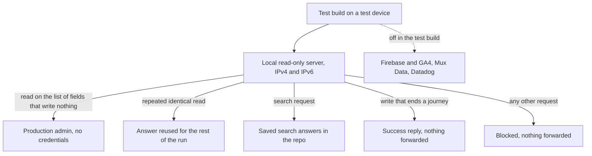
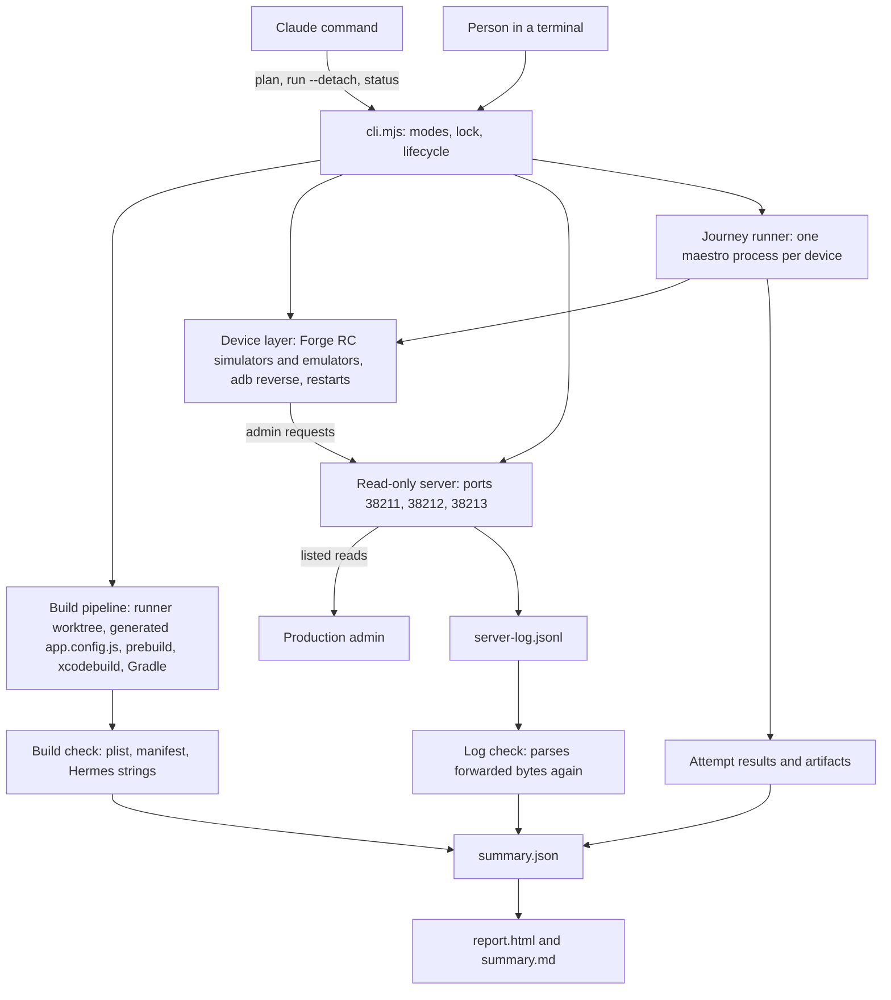
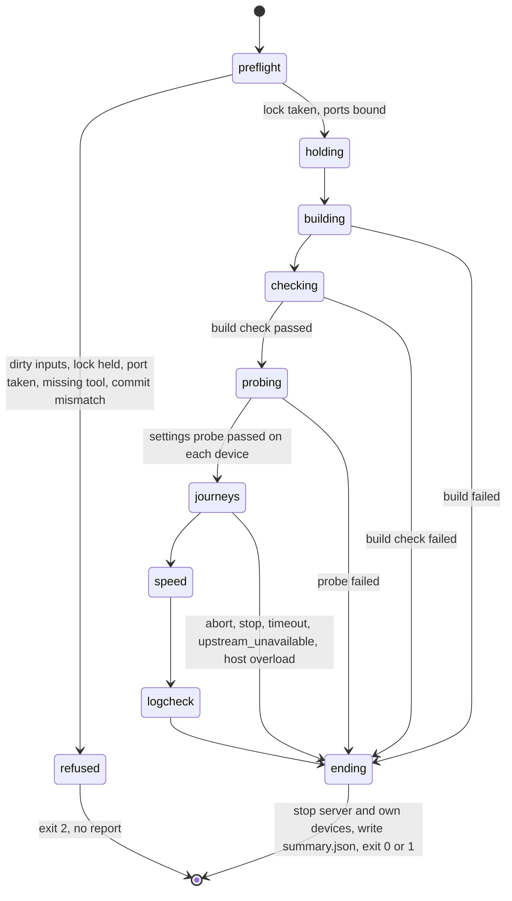
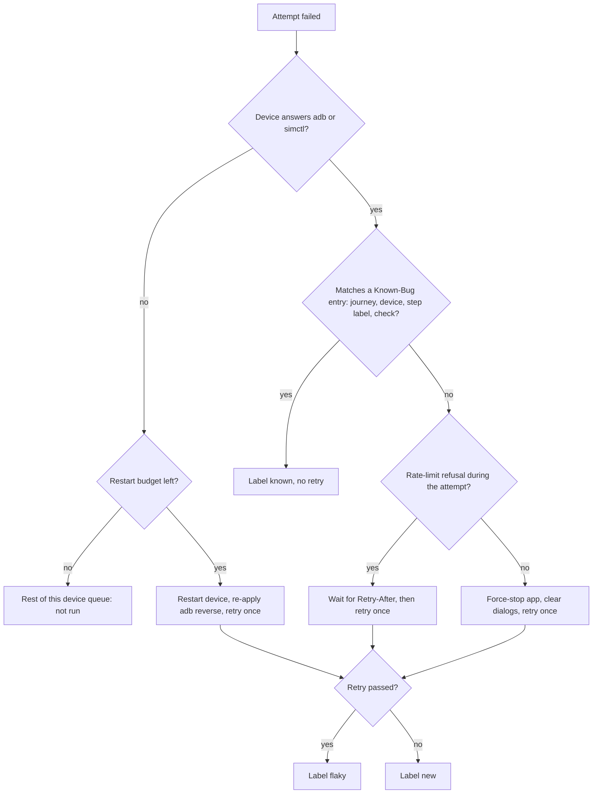
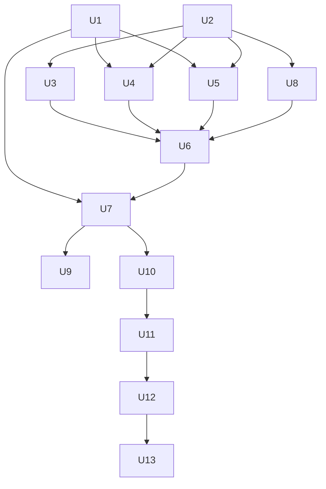

# Mobile Release Check Runner - Plan

## Goal Capsule

- **Objective:** Before a TestFlight build or an over-the-air update goes out, the mobile owner or a QA engineer runs one command on their own Mac and gets one report. The report shows if the release works on a small iPhone, a large iPhone, an iPad, an Android phone, and an Android tablet.
- **Means:** A runner in `apps/mobile/release-check/` builds the app in its own worktree outside the repo, runs fixed Maestro journeys on its own test devices behind a local read-only server, and writes a local report. A repo Claude command asks for consent and starts the runner (KTD1, KTD2, KTD7, R1, R3).
- **Product authority:** The mobile owner (urim) owns the runner, the journeys, the saved search answers, the test settings list, the Known-Bug List, the Not-Tested List, and the release decision. QA engineers run the check and share the report. `apps/admin` does not change. This plan covers the runner core only; later areas are context (see How This Work Fits Together).
- **Execution profile:** U1 is a spike on the mobile owner's Mac and comes first, because four device-level facts decide U4, U5, and U7. U2, U8, and U3 need no devices and can run beside the spike. The device units (U4 to U7, U9, U10) follow, then the journeys (U11), the command and documents (U12), and the first full release run (U13).
- **Stop conditions:** Stop and ask the mobile owner when a U1 check fails, when the fingerprint check in the Verification Contract shows a changed runtime version, when the app needs a production read that is not on the read-only field list and that may write, or when evidence shows that a session-settled decision cannot work.
- **Who finishes:** `ce-work` implements U1 to U12. The mobile owner runs the device checks, fills the production values in the test settings list (this needs an Expo login), records the saved search answers, files tickets for the known bugs, and runs U13. Only the mobile owner merges.
- **Open blockers:** None blocks planning. Before the first release run, the mobile owner fills the test settings list from the EAS production environment and files tickets for the known bugs that the journeys hit (U13).

---

## Product Contract

### Summary

A test runner is stored in the repo, and each person runs it on their own Mac. A repo Claude command asks for consent. Then the runner builds the app from the current commit, runs 25 or more fixed journey scripts on five dedicated test devices, and writes one local report. The app reads live production content through a local read-only server that never forwards a write, and every failure fails the run.

### Problem Frame

No automatic check runs the native mobile app. CI runs lint, unit tests, and `expo-doctor`, and no job builds a native app or starts a simulator or emulator (`.github/workflows/ci.yml`). Release checks are done by hand, on one simulator at a time. Roadmap tickets record this practice, for example `docs/roadmap/platform/feat-553-mobile-native-bible-reader.md` and `docs/roadmap/platform/feat-669-mobile-myanmar-ui-text-clipping.md`.

A check on one device misses problems that occur on other form factors. On 2026-10-15, five agents tested a local release build on five devices at the same time. They found 66 problems and no crashes. Several problems occurred only on some form factors: the previous video stays on screen after navigation on three iOS devices, the Android tablet player covers the Language and Subtitles sheets, and the iPad mini player covers the top tab bar.

A test run must not put data into production. The mobile owner is adding Firebase Analytics with GA4 and Mux Data, which feed BigQuery and Power BI. A release build with no settings sends its admin traffic to production (`apps/mobile/src/lib/adminEndpoint.ts`). The app then writes search events, search traces, recommendation events, push registrations, watch progress, and feedback there.

The mobile owner is not the only person who runs the check. QA engineers run it on their own Macs, with their own Claude subscriptions, and most of them do not run local admin.

### Actors

- A1. Mobile owner: runs the check, records the saved search answers, keeps the test settings list, the Known-Bug List, and the Not-Tested List, decides the release, and tells the QA engineers the decision.
- A2. QA engineer: runs the check on their own Mac, then reads and shares the report.
- A3. Claude command: asks for consent, starts the runner, and summarizes the report.
- A4. Runner: builds the app, manages the test devices, runs the journeys and checks, and writes the report.
- A5. Read-only server: forwards listed reads to production admin, never forwards a write, and answers search from saved answers.

### Key Decisions

- **A release check, not a check before each merge.** The result supports the decision to send a TestFlight build or an over-the-air update, so a long run is acceptable. (session-settled: user-directed — chosen over a short check before each mobile PR merge and over an ad hoc health check: the owner wants the result before a release goes out.)
- **The runner core only.** Screenshot baselines, fault and race hunting, and agent exploration are later plans. (session-settled: user-directed — chosen over the runner core plus regression baselines: the owner wants the core first.)
- **A limited number of devices at the same time, and a separate speed pass.** Governs R9, R10. (session-settled: user-directed — chosen over all five devices at the same time and over one device at a time: five devices at once overloaded the Mac in the 2026-10-15 pass, froze an emulator, and inflated the speed numbers.)
- **A local release build from the current commit.** A TestFlight build cannot run in a simulator, and it sends data to production. Governs R8. (session-settled: user-approved — chosen over testing the TestFlight or EAS build itself: the store build cannot run on the test devices.)
- **Live production reads through a read-only server.** The data source does not control analytics; the build does, and the server never forwards an admin write. Governs R12, R13. (session-settled: user-approved — chosen over recorded data: recorded data adds no analytics safety and goes out of date.)
- **Check each build before the run and the server log after it.** Governs R17, R18. (session-settled: user-directed — chosen over an added network block on the Android emulators and over trust in the build settings alone: a wrong env file can put a key or the production channel into a test build.)
- **Search from saved answers in the repo.** Governs R14. (session-settled: user-directed — chosen over a run that requires local admin and over a run that skips search when local admin is down: QA engineers do not have local admin.)
- **Every screen and sheet that a signed-out viewer can reach.** Governs R19. (session-settled: user-directed — chosen over a starter set of about 10 journeys and over a smoke set of about 4: the owner wants every screen and sheet checked before a release, not a sample.)
- **Fixed scripts plus a screen list check.** Claude writes the scripts during the build of the runner; a run does not need Claude. Governs R20, R22. (session-settled: user-directed — chosen over fixed scripts alone and over plain-English journeys that Claude runs each time: each run must give the same result, and coverage must stay complete when screens are added.)
- **Every failure fails the run.** Governs R26. (session-settled: user-directed — chosen over a run that fails only on new problems and over a report with no overall result: the owner accepts a red run until each known bug is fixed.)
- **A local HTML report.** Governs R29, R30. (session-settled: user-directed — chosen over a published private web page and over a post to a team tool: the report stays on the person's Mac, and the person shares a zip or the summary.)
- **The runner is a plain script, and the Claude command only wraps it.** Two people who run the same commit get the same result. Governs R3. (session-settled: user-approved — chosen over a run that Claude drives: the result must not depend on a Claude session.)
- **Recommendations are off in the test build.** Recommendations cannot work without writes, so the For You shelf goes on the Not-Tested List. Governs R23, R33. (session-settled: user-approved — chosen over recommendations on with every write blocked: the shelf would fail on each run.)
- **A journey that ends with a write gets a success reply.** The journey can then check the success screen, and production receives nothing. Governs R15. (session-settled: user-approved — chosen over an error reply: an error reply leaves the success screen untested.)
- **The test build copies production's settings that are not secret.** Production's settings decide what a viewer sees: a release build hides sign-in and the Explore tab unless their flags are set, and Android needs its own Explore flag. Production leaves sign-in unset, so the journeys test a signed-out viewer, and a sign-in would write to production auth. Production's values live in the EAS dashboard, which QA engineers cannot read, so a committed list carries them. Governs R17, R19, R33.
- **The analytics protection belongs to the test build.** The test build turns Firebase Analytics off permanently in its native settings and carries no analytics keys. The GA4 plan's channel gate and the Mux Data plan's key rule are a second layer, because the GA4 plan has a fallback in which Firebase collection starts on. Governs R16, R17, R34.
- **Read-through cache writes are allowed.** Some forwarded reads make admin fill a read cache, for example the Bible passage text that admin fetches from YouVersion and saves. These are the same cache fills that any viewer's read causes, and they are not analytics or user data, so the runner forwards them and lists each one. Governs R13. (session-settled: user-directed — chosen over blocking those reads: blocking them would leave the Bible passages on the watch page untested, and the cache fills match a real viewer's read.)
- **The mobile owner makes the release decision.** The report makes no decision, and the owner tells the QA engineers. Governs R32.

### Requirements

**Start and consent**

- R1. One repo Claude command starts a release check, and it waits for the person's yes before it builds, starts, or installs anything.
- R2. The consent message shows the commit, the five test devices, the other simulators and emulators that are running, the estimated run time, and what the run builds, starts, installs, and stops, including the one-time setup downloads and their size when setup has not run.
- R3. The runner runs without Claude; the Claude command only asks for consent, starts the runner, and summarizes the report.
- R4. A one-time setup step checks the Mac for the required tools, creates the five test devices, and names each missing item with the way to get it.

**Portability**

- R5. All runner code, journey scripts, saved search answers, the test settings list, the Known-Bug List, and the Not-Tested List are in the repo, and nothing depends on one person's paths.
- R6. A test build and a run need no secret keys.

**Devices and builds**

- R7. The runner uses its own named test devices for five form factors (a small iPhone, a large iPhone, an iPad, an Android phone, and an Android tablet), and it never uses or stops another simulator or emulator on the Mac.
- R8. The runner makes one release build for each platform from the current commit, and it stops before the build and names the files when the build inputs have uncommitted changes.
- R33. Each test build takes its settings from a committed test settings list: production's values for every setting that is not secret, plus the test values (the local read-only server address, recommendations off, and no analytics keys); the mobile owner updates the list when production's settings change.
- R9. The runner sets the number of devices that run at the same time from the Mac's free memory and current load, checks both again before each queued device starts, and queues the other devices.
- R10. A separate speed pass runs one device at a time and measures cold launch time, time to Home content, time to the first video frame, and peak memory.
- R11. When a test device stops answering the device tools, the runner restarts it and continues, and the report shows the restart; an app that stops responding on a device that still answers is a journey failure.

**Production safety**



- R12. During a run, the app sends every admin request to a local read-only server, which accepts connections on both IPv4 and IPv6 loopback and which the runner starts at the start of the run and stops at the end.
- R13. The read-only server forwards to production admin, without credentials, only queries whose fields are all on a committed list of fields that write nothing except the read caches that a viewer's read also fills, and it forwards no other request.
- R35. The read-only server answers a repeated identical read from its copy of the first answer for the rest of the run, except during the speed pass.
- R14. The read-only server answers search requests from saved answers in the repo; the mobile owner records them from local admin, and the record step saves every search that the app sends during the search journeys.
- R15. When a journey ends with a write, for example "Send" on the feedback form, the read-only server replies with success and does not forward the write.
- R16. No test run sends data to Firebase Analytics, GA4, Mux Data, or Datadog.
- R34. The test build turns Firebase Analytics off permanently in its native settings, so that no install can send an automatic event before the app starts.
- R17. Before the journeys start, the runner reads each built app and stops the run if a setting differs from the test settings list, if it finds a Datadog token, a Mux Data env key, or the production update channel, or if Firebase Analytics is not off permanently.
- R18. After the run, the runner reads the read-only server's log and fails the run if a test device sent no traffic through the server, if a forwarded request has a field that is not on the list, or if a write or a search request reached production.

**Journeys and coverage**

- R19. The journeys cover every screen and sheet that a signed-out viewer can reach under the test settings list, and each journey runs on every test device of each platform that shows its screens.
- R20. Each journey is a fixed script in the repo, and each run follows the same steps.
- R21. A journey picks content by position where it can, and a journey that needs specific content names that content in its script.
- R22. The screen list check reads the app's screens and sheets from the code, and it fails the run when a screen or sheet that a platform shows has no journey on that platform and is not on the Not-Tested List.
- R23. The Not-Tested List names each screen, sheet, or journey step that the journeys leave out on purpose, with its platforms and a reason; it starts with sign-in, the Account screen, signed-in My Watch, and the For You shelf.
- R24. A sheet that is not its own screen in the code goes on the screen list by hand.
- R25. The work may add `testID` values to app screens where a journey needs a stable target.

Starter journeys, which come first within R19:

- Cold launch until Home content shows.
- Open a video and play it, then pause, seek, and close.
- In the player, change the language and turn subtitles on.
- Shrink the player to the mini player, change tabs, expand it, and close it.
- Open video A, go back, open video B, and check that video B shows.
- Play a series episode, then go to the next episode.
- Open an Experience page from a deep link and scroll through its blocks.
- Search for a word and open a result.
- Swipe through five clips in the Explore feed.
- Open a Bible passage and change the chapter.

**Results and report**

- R26. Every failure fails the run: a journey failure, a crash, a known bug, a flaky journey, a screen list gap, a failed production-safety check, a build or setup failure, and an early stop.
- R27. The runner runs a failed journey one more time unless the failure matches a Known-Bug List entry, and the report labels a journey "flaky" when it passes on its second try or only after a device restart.
- R28. Each Known-Bug List entry names the journey, the devices, the failing step, the check, and its ticket; the report labels a failure "known" only when all of them match, and it tells the reader to remove an entry whose journey now passes.
- R29. The runner writes a local report folder with an HTML page that opens with the run summary (R36) and then shows each journey on each device in this order: new failures, flaky journeys, known failures, and passes.
- R36. The run summary shows the tested commit, the overall result, the count of failures for each label, the results of the build check and the log check, the screen list gaps, each admin rate-limit refusal with the failure it caused, and the Not-Tested List.
- R37. Each failure shows its label, a screenshot, the step times, any crash or device restart, and the steps that did not run after it; the page also shows the speed pass numbers.
- R38. Every run ends the same way, also after an early stop or an abort by the person: the runner stops its read-only server and its own test devices, writes the report with the stop reason and the completed steps, and ends with a fail.
- R30. After the run, the Claude command opens the report page and writes a short summary in chat.
- R31. Speed numbers are information only, and they do not decide pass or fail in this version.
- R32. The report gives no release decision.

### Key Flows

- F1. A QA engineer runs a release check.
  - **Trigger:** A TestFlight build or an over-the-air update is ready to go out.
  - **Actors:** A1, A2, A3, A4, A5
  - **Steps:** The mobile owner names the release commit, and the QA engineer checks it out. The QA engineer starts the Claude command. The command shows the consent message, and the QA engineer says yes. The runner checks the setup and the working tree, builds the app for both platforms with the test settings list, and checks each build. It starts the read-only server and the test devices. It runs the journeys with as many devices at a time as the Mac's free memory and load allow, and it runs each failed journey again unless the failure is a known bug. It runs the speed pass, checks the server log, stops the server and its test devices, and writes the report. The command opens the report and summarizes it.
  - **Outcome:** One report with an overall pass or fail for the named commit. The QA engineer shares the report or its summary, and the mobile owner decides the release.
  - **Covered by:** R1, R2, R8, R9, R10, R12, R17, R18, R26, R27, R29, R30, R33, R38
- F2. The mobile owner records saved search answers.
  - **Trigger:** A search journey changes, or a saved answer names a video that is no longer in production.
  - **Actors:** A1, A4
  - **Steps:** The mobile owner starts local admin and runs the runner's record step. The record step runs the search journeys against local admin and saves every search that the app sends, including the searches that the app makes by itself. The mobile owner commits the saved answers.
  - **Outcome:** Search journeys run without local admin on every Mac.
  - **Covered by:** R14
- F3. A screen is added to the app.
  - **Trigger:** A change adds a screen or a sheet with no journey.
  - **Actors:** A1 or A2, A4
  - **Steps:** The screen list check fails the run and names the screen. Someone asks Claude to write a journey for it, or adds it to the Not-Tested List with a reason.
  - **Outcome:** Coverage stays complete.
  - **Covered by:** R22, R23

### Acceptance Examples

- AE1. **Covers R17.** **Given** a build that carries a Datadog token from a wrong env file, **when** the run starts, **then** the runner stops before the first journey and names the token.
- AE2. **Covers R13, R15, R18.** **Given** the journey that sends feedback, **when** the app sends the feedback write, **then** the read-only server replies with success, production receives nothing, and the log check passes.
- AE3. **Covers R13, R14.** **Given** a search journey that uses a word with no saved answer, **when** the journey runs, **then** the read-only server does not forward the search, the journey fails, and the report says to record an answer for that word.
- AE4. **Covers R22, R23.** **Given** a new screen with no journey that is not on the Not-Tested List, **when** the run finishes, **then** the run fails and the report names the screen.
- AE5. **Covers R26, R27, R28.** **Given** the journey for the previous-video bug fails on the iPad at the step and check that its Known-Bug List entry names, **when** the run finishes, **then** the report labels the failure "known" with its ticket, the runner does not retry it, and the run fails. **Given** the same journey fails on the iPad at a different step, **then** the failure gets no "known" label. **Given** a journey that fails and then passes on its second try, **then** the report labels it "flaky", and the run fails.
- AE6. **Covers R11, R27.** **Given** the Android tablet emulator stops answering the device tools during a journey, **when** the runner detects it, **then** the runner restarts the emulator, runs the journey again, and shows the restart; a pass on the second try is labeled "flaky", and the run fails. **Given** the app stops responding while the emulator still answers, **then** the journey fails, and the runner does not restart the emulator.
- AE7. **Covers R7.** **Given** another session's simulator is running on the Mac, **when** the run starts and ends, **then** the runner does not use that simulator and does not stop it.
- AE8. **Covers R9.** **Given** a Mac with less free memory than the mobile owner's Mac, **when** the run starts, **then** fewer devices run at the same time, and the run still covers all five test devices.
- AE9. **Covers R17, R34.** **Given** a build that contains the Firebase Analytics SDK without the permanent off setting, **when** the run starts, **then** the runner stops before the first journey and names the missing setting.
- AE10. **Covers R12, R18.** **Given** a test device whose app sends its admin traffic to a different server, **when** the run finishes, **then** the log shows no traffic from that device, and the run fails.
- AE11. **Covers R8.** **Given** uncommitted changes in the build inputs, **when** the run starts, **then** the runner stops before the build and names the changed files.
- AE12. **Covers R38, R30.** **Given** the person aborts a run during the journeys, **when** the runner stops, **then** it stops its read-only server and its own test devices, writes a report with the stop reason, and the Claude command opens that report.
- AE13. **Covers R19, R22, R33.** **Given** the test settings list hides the Explore tab on Android, **when** the run finishes, **then** the Explore journey runs only on the iOS devices, the screen list check counts no Explore gap on Android, and the summary names the skipped platform.

### Success Criteria

- Two people who run the same commit on two Macs with the same device pins (KTD15) get the same result for each journey, apart from journeys labeled "flaky".
- A QA engineer with a fresh clone and the required tools completes the setup step and a full run without help from the mobile owner.
- A full run finishes with nobody at the Mac.
- Every run log shows traffic from each test device, and no run log shows a write or a search request that reached production.

### Scope Boundaries

Deferred for later:

- Regression baselines: screenshot comparison, and reference speed numbers with limits.
- Fault and race hunting: network loss, a slow network, and interruptions. The 2026-10-15 pass showed a player that stays stuck after a network drop.
- Agent exploration of the release build with Claude.
- Signed-in journeys, the sign-in flow, and the For You shelf.
- A check that analytics events fire correctly, in a test analytics environment.
- A test of the player with Mux Data monitoring on, through the Mux test environment, and of the Datadog startup path. The release ships both, and a pass does not cover them.
- Physical devices, cloud device farms, and runs in CI.
- Report sharing through a published page or a team tool.

Outside this work:

- A test of the TestFlight or EAS build itself.
- A hosted read-only server.
- An automatic block on a TestFlight upload or on `update:production`.
- Any change to `apps/admin`.

<!-- ce-section: work-relationships -->

### How This Work Fits Together

This plan covers the runner core. The list below is the current understanding of the later areas, not a committed roadmap.

- Regression baselines. Depends on this runner's journeys and report.
- Fault and race hunting. Depends on this runner and its read-only server, which can add delays and failures.
- Agent exploration of a release build. Can proceed independently of this plan, and shares its test devices and read-only server.

### Dependencies / Assumptions

- Maestro is the journey tool (KTD7). It drives iOS simulators and Android emulators from one script. The runner pins version 2.11.0; the mobile owner's Mac has 2.4.0 and needs an upgrade.
- QA engineers use Apple silicon Macs with Xcode and the Android SDK. The first setup downloads several GB of device images and build caches.
- A full run takes about 2.5 to 3 hours on an M4 Pro with 48 GB, and longer on a smaller Mac. The iOS lane is the longest, because only one iOS simulator runs at a time (KTD6).
- The other plans' analytics rules are a second layer, not the protection that the runner depends on (R34). The GA4 plan turns Firebase collection on only in production-channel builds, and its fallback starts collection on in native code (`docs/plans/2026-10-19-1023-feat-mobile-ga4-analytics-plan.md`, KTD3). The Mux Data plan starts no monitoring without an env key (R24 and R25 in `docs/plans/2026-10-20-1530-feat-mobile-mux-data-plan.md`, on the Mux Data branch). Firebase's own documentation says that debug-device events still reach the BigQuery export, so only permanent deactivation keeps test events out.
- Datadog RUM starts only when both `EXPO_PUBLIC_DATADOG_CLIENT_TOKEN` and `EXPO_PUBLIC_DATADOG_APPLICATION_ID` are set (`apps/mobile/src/lib/datadog.ts`).
- Admin limits an anonymous caller to 60 field nodes per minute for each query field, for each IP address; each alias counts, also a field under `@skip`. All test devices behind one Mac share that limit (`apps/admin/src/graphql/plugins/rate-limit.ts`). R35 and the server's pacing (KTD8) keep the count under it.
- Some production calls do not go through the read-only server, so R18 cannot see them: the auth session read at `auth.jesusfilm.org` (`apps/mobile/src/lib/authSession.ts`) and the content reads from `bible.helloao.org`, `image.mux.com`, and `stream.mux.com`. They are reads. The Expo push token read is avoided because journeys deny notifications (KTD12).
- Production content changes. A journey that names specific content, and a saved search answer, fail when editors remove that content (R21, F2).
- The iOS simulator could not finish a download in the 2026-10-15 pass. That build was unsigned, which is a possible cause, and U1 checks a signed simulator build. If downloads still fail, the iOS download steps go on the Not-Tested List.
- The 2026-10-15 findings have no tickets yet. Each Known-Bug List entry needs a ticket (R28, U13).

### Sources / Research

- `apps/mobile/src/lib/adminEndpoint.ts:84-89` — a release bundle falls back to `https://admin.jesusfilm.org/api/graphql`, so that address is in every bundle; `:63-67` — the loopback rewrite to `10.0.2.2` is dev-only, so an Android emulator needs `adb reverse` to reach a local server.
- The app's writes: `apps/mobile/src/lib/queries.ts` (`RecordWatchSearchEvent`), `apps/mobile/src/lib/feedbackQueries.ts` (`SubmitFeedback`), `apps/mobile/src/lib/watchProgressQueries.ts` (`UpsertMyWatchProgress`), and the shared operations in `packages/admin-graphql/src/operations/` (`recommendations.ts`, `user-recommendations.ts`, `push.ts`).
- Queries that write: `apps/admin/src/graphql/queries/watch-search.ts:471-480` writes a search trace after each successful search, and the recommendation delivery services write `recommendationRequest` rows (`apps/admin/src/services/recommendations/user-delivery.service.ts`).
- `apps/mobile/src/lib/explore/availabilityState.ts` — a release bundle shows Explore only when `EXPO_PUBLIC_EXPLORE_ENABLED` is on, and Android also needs `EXPO_PUBLIC_EXPLORE_ANDROID_ENABLED`.
- `apps/mobile/src/hooks/useCategoryThumbnails.ts` — Discover sends one search for each browse topic when it opens.
- `apps/mobile/src/lib/recommendations/enabled.ts` — recommendations stay on unless the value is `false` or `0`.
- `apps/mobile/src/lib/signInGateState.ts` — a release bundle shows sign-in only for `1` or `true`.
- Sheets that are routes: `apps/mobile/app/watch/language.tsx`, `apps/mobile/app/watch/subtitle.tsx`, and the Bible reader sheets in `apps/mobile/app/_layout.tsx:553-563`. A sheet that is not a route: `apps/mobile/src/components/library/DeleteConfirmSheet.tsx`.
- `apps/mobile/.gitignore:11-12` — `ios/` and `android/` are prebuild output and are not committed, so test-build native settings are applied at prebuild time.
- `.claude/commands/build-android.md` — the format of a repo Claude command: plain markdown, no frontmatter, `$ARGUMENTS`.
- `docs/solutions/developer-experience/mobile-write-path-smoke-via-fake-admin-proxy.md` — an earlier local proxy in front of admin for simulator smoke tests. It records that the iOS simulator resolves `localhost` over IPv6, so a proxy on `127.0.0.1` can sit idle while the app reaches local admin.
- `docs/solutions/developer-experience/mobile-dev-build-verification-false-signals.md` — a Debug build can render differently from a Release build, so the check tests release builds.
- The 2026-10-15 spike, not committed, proved the local release build: `EXPO_NO_DOTENV=1`, the admin address passed explicitly, over-the-air updates off in the native config, cleartext HTTP allowed on Android for the local server, the Gradle heap and Metaspace raised, and the `lintVital*` tasks skipped. The same pass measured the host limits: with five test devices and other sessions' simulators, the load average reached 390 to 1000 on 12 cores, and one emulator stopped responding for 5 minutes.

---

## Planning Contract

Product Contract preservation: changed: the first Success Criteria item now names the same device pins (KTD15), because the iOS runtime, emulator image, keyboard setting, and time zone change results; the run-time estimate in Dependencies / Assumptions is now 2.5 to 3 hours (KTD6); the rate-limit line in Dependencies / Assumptions now counts field nodes, not requests, as admin's rate limiter does; R13 now allows the read caches that a viewer's read also fills, by the mobile owner's decision on 2026-10-21 (Key Decisions); the Outstanding Questions are resolved by KTD1 to KTD19 and removed. No R, F, or AE changed.

### Key Technical Decisions

- KTD1. **The runner lives in `apps/mobile/release-check/` as plain JavaScript.** A `.mjs` entry (`cli.mjs`) loads CommonJS helpers in `lib/` with `createRequire`, and jest tests sit in `__tests__/`. Only there does `graphql` resolve, the mobile jest, lint, and typecheck jobs already cover it, and `.mjs` and `.js` avoid the mobile tsconfig's missing Node types. The runner adds no script to `apps/mobile/package.json`, because that file's `scripts` block is a fingerprint input; everyone starts it as `node apps/mobile/release-check/cli.mjs <mode>`.
- KTD2. **Builds happen in one runner-owned git worktree outside the repo, reset to the tested commit for each run.** `expo prebuild` cannot write to another folder and deletes the existing native folders by default, so a build in `apps/mobile` would destroy the developer's own `ios/` and `android/`. The worktree lives under the runner home (`~/Library/Caches/forge-release-check/`, or `FORGE_RELEASE_CHECK_HOME`), keyed by the repo's common git folder, and gets `git worktree prune` before a re-create. It has no ignored env files, and Metro in the developer's checkout does not crawl it. The run also reads its journeys and lists from this worktree, so a branch switch in the developer's checkout during a run changes nothing (R5, R8).
- KTD3. **The test settings list is a committed JSON file with three classes.** `apps/mobile/release-check/config/test-settings.json` puts every `EXPO_PUBLIC_*` key into one class: copied from production, set to a test value, or must be unset. It also holds the fixed server ports (KTD6) and the SHA-256 digests of the known Mux Data env keys (KTD5). A jest guard reads every key in `apps/mobile/src/env.ts`, plus `EXPO_PUBLIC_UI_PSEUDO_LOCALE` and `EXPO_PUBLIC_USE_RN_FETCH`, and fails on an unclassified key. Thus a new key from the GA4 or Mux Data work needs a decision before a release check can pass. An owner-only `check-settings` mode compares the production class with `eas env:list --environment production` (R33).
- KTD4. **A generated `app.config.js` in the build worktree sets the test-only native settings.** It receives `app.json` and returns `updates.enabled: false` with no request headers (so the build has no update channel), `android.usesCleartextTraffic: true` merged into the existing `expo-build-properties` entry, `ios.infoPlist.FIREBASE_ANALYTICS_COLLECTION_DEACTIVATED: true`, and a runner-owned config plugin that adds the Android `firebase_analytics_collection_deactivated` meta-data with `tools:replace="android:value"`. That attribute is necessary because `@react-native-firebase/analytics`, which the GA4 plan adds, declares the same meta-data with the value `false` in its library manifest, and Android's manifest merge fails on two values. When the worktree contains `apps/mobile/firebase.json`, the runner also sets `analytics_collection_deactivated: true` in that worktree copy. The keys apply even while the app has no Firebase Analytics SDK. Nothing in `app.json`, `eas.json`, or `apps/mobile/plugins/` changes, so the production fingerprint stays the same (R34).
- KTD5. **The build check reads the built artifacts, and a first probe journey checks the short flags.** The check reads the built `Info.plist` and `Expo.plist`, the APK's merged manifest, and the Hermes bundle's string table. The string table proves unique values: the proxy URL is present, and no Datadog client token (`pub` plus 32 hex characters) is present. A Mux Data env key has no unique shape (any `^[a-z0-9]+$` string), so the check hashes each string-table entry of that shape and stops on a match with a digest in the test settings list (KTD3). Hermes bytecode cannot prove short values such as `"1"`, so a `settings-probe` journey runs first on each device and checks their visible effects: the Explore tab per platform, the disabled "Sign in · coming soon" card, no For You shelf, and a Home body from the live Experience (`home-body-live`), not the frozen fallback. A failed probe stops the run before the other journeys. Governs R17. (session-settled: user-directed — chosen over an added network block on the Android emulators and over trust in the build settings alone: a wrong env file can put a key or the production channel into a test build.)
- KTD6. **One iOS simulator runs at a time, next to up to two Android emulators, and the server traces each request to a device.** iOS simulators share the Mac's loopback, so two at once would make their traffic impossible to tell apart, and Maestro's own guide calls local parallel iOS runs flaky. The test build bakes one port (38211). The iOS simulator uses it directly, and each emulator gets its own host port through `adb -s <serial> reverse tcp:38211 tcp:<host-port>` (38212 for the phone, 38213 for the tablet). A port identifies a lane, not a device: the server runs in the runner's own process, the runner tells it which iOS device the lane starts, and the runner shuts down the previous simulator before the next one boots, so each log line carries a device ID. The runner binds all three ports on `127.0.0.1` and `::1` right after consent and holds them through the builds, so no other process can take them, and the app cannot reach any other server; the server starts to answer when the devices start (F1). The free-memory and load gate (R9) still decides how many lanes run. Governs R9. (session-settled: user-directed — chosen over all five devices at the same time and over one device at a time: five devices at once overloaded the Mac in the 2026-10-15 pass, froze an emulator, and inflated the speed numbers.)
- KTD7. **Maestro drives the journeys, with one `maestro test` process for each device.** Maestro tests the release binary without app instrumentation, runs the same YAML on both platforms, and is Apache 2.0. One process per device gives a separate output folder, JUnit file, and retry per device; a mixed iOS and Android `--shard-all` run is unproven. iOS processes get their own `--driver-host-port`. The runner sets `MAESTRO_CLI_NO_ANALYTICS`, `MAESTRO_CLI_ANALYSIS_NOTIFICATION_DISABLED`, and `MAESTRO_DISABLE_UPDATE_CHECK`, gives each child an empty stdin, and never passes `--analyze` or a cloud command. Setup requires the pinned version 2.11.0.
- KTD8. **The read-only server parses each request with `graphql` and forwards only operations whose root fields are all on the read-only list.** A committed table (`config/operations.json`) puts every root field into one class: read-only (`experienceBySlug`, `watchSetting`, `video`, `videoBySlug`, `videoDub`, `watchHomeVideos`, `watchLanguageInventory`), saved answer (`watchSearch`), success reply (`submitFeedback`), or blocked. The table also has a `writesOnRead` list of nested field coordinates whose resolvers fill a read cache; it starts with `BibleCitation.passage` (the YouVersion passage cache in `apps/admin/src/services/scripture-passage.service.ts`), each entry names its admin source, and a forwarded document may contain them (R13). The server reads the field name, not the alias, and refuses a document with more than one operation or an unknown operation name. It stores only answers that have `data` and no `errors`. It detects admin's rate-limit answer (HTTP 200 with `extensions.http.statusCode: 429`) and reads admin's `Retry-After: 1m` as 60 seconds. Admin counts its limit per field node, and one `VideoThumbnails` request can hold 30 aliased `video` fields, so the server paces forwards for each root field to stay under 60 field nodes per minute; it holds a request for at most 10 seconds, below the app's 15-second request time limit, and then answers with a rate-limit error. After 5 upstream failures in a row, it ends the run with the stop reason `upstream_unavailable`. It logs a digest of the exact forwarded bytes, so the log check can parse them again with its own code and does not trust the server's decision. A jest guard collects every document that the app exports, including the runtime-built `VideoThumbnails` document in `apps/mobile/src/hooks/useVideoThumbnails.ts`, and fails on a root field that the table does not classify and on any other app source file that imports `parse` from `graphql`. Governs R12, R13, R35. (session-settled: user-approved — chosen over recorded data: recorded data adds no analytics safety and goes out of date.)
- KTD9. **A success reply is built from admin's schema.** The server executes the journey's own document against `apps/admin/schema.graphql` (read only) with a stub resolver, so the reply matches the selection set exactly. In this version only `submitFeedback` gets a success reply, and its value is `{ accepted: true, refusal: null }`. Governs R15. (session-settled: user-approved — chosen over an error reply: an error reply leaves the success screen untested.)
- KTD10. **Saved search answers are keyed on the search input and on the search document.** `config/search-answers.json` holds one entry per `query`, `limit`, `offset`, and language, and it records a digest of the current `WatchSearch` document text; `check-lists` fails when the document changes. The `record-search` mode runs the search journeys on one device per platform. Its server forwards `watchSearch` only to an admin URL on `localhost` or `127.0.0.1` and refuses any other host. It checks each `VIDEO` result through a forwarded `videoBySlug` read and each `EXPERIENCE` result through a forwarded `experienceBySlug` read in the answer's language, refuses answers in which a result's own check returns null, and replaces the whole file in prettier format. During a run, a search for a prefix of a saved query gets an empty, schema-shaped answer that is logged, so typing speed cannot change a result. Any other search with no saved answer fails its journey with the class `missing_search_answer`. Governs R14. (session-settled: user-directed — chosen over a run that requires local admin and over a run that skips search when local admin is down: QA engineers do not have local admin.)
- KTD11. **A journey covers a screen only by asserting the screen's root `testID`.** Each route screen and each sheet gets one root `testID` (`screen-<route>`, for example `screen-watch-language`). The screen list check builds the screen list from the route files in `apps/mobile/app/` (without layouts, `+native-intent`, and tests), `IN_APP_SHEET_ROUTE_PATTERNS` and `NonRouteSheetId` in `apps/mobile/src/lib/miniPlayer/suppression.ts`, and a hand list for alerts and action sheets (`config/screens.json`). Statically, each screen needs a journey that asserts its `testID` on each platform that shows it. At run time, a journey that failed before its assertion leaves that screen marked "not reached" in the summary. A reach entry names the settings key that hides a screen on a platform, so the Explore case in AE13 needs no hand edit. Governs R19, R20, R22. (session-settled: user-directed — chosen over fixed scripts alone and over plain-English journeys that Claude runs each time: each run must give the same result, and coverage must stay complete when screens are added.)
- KTD12. **Journeys follow three safety rules.** First, a journey never taps a control that opens an external URL, such as the More rows for jesusfilm.org pages, the beta signup link, or partner links; it asserts that the control is visible, and the step goes on the Not-Tested List. Those pages send production web analytics that neither safety check can see. Second, `openLink` accepts only `forgemobile://` links, and `check-lists` rejects any other scheme in a journey file. Third, every `launchApp` denies the notification permission, so no test device registers for push in production Firebase or Expo. Journeys assert structure, for example "a tile opens a watch page that plays", and not the identity of content, because Home rotates by date and Explore shuffles. A journey that asserts Home content also asserts `home-body-live`, because the app shows a frozen fallback Home with the same structure when the live Experience fails (`apps/mobile/src/lib/watchHome/fallbackConfig.ts`) (R16, R21).
- KTD13. **The command-line contract and a run folder are the only interface for people and agents.** Modes: `plan [--json]`, `setup [--check]`, `run`, `status`, `stop`, `recover`, `check-lists`, `check-screens`, `check-build`, `check-log`, `check-settings`, `record-search`, and `session up|try|down`. Exit codes: 0 means the selected scope passed, 1 means a run started and failed, and 2 means a refusal before any side effect. A refusal writes no report; a run starts at its first side effect, so R38 covers every run that started. A release result is `scope: "release"` with `result: "pass"` in `summary.json`, never exit 0 alone. One lock for each Mac user covers `run`, `session`, `record-search`, and `setup`; it holds the pid, the process start time, the mode, and the run ID, and `plan` reports a stale lock. `run --detach` makes the runner start its own detached child and exit, because a full run outlasts a tool call. The runner holds a `caffeinate` power assertion for its own pid. Each journey attempt, each phase, and the whole run have time limits that end through R38 with the stop reason `timeout`. Every child runs in its own process group and stops on every exit path. Governs R3. (session-settled: user-approved — chosen over a run that Claude drives: the result must not depend on a Claude session.)
- KTD14. **Failure classes and retries.** Each failed attempt gets one class: `assertion_failed`, `selector_not_found`, `app_crashed`, `app_unresponsive`, `device_unresponsive`, `driver_failed`, `rate_limited`, `request_blocked`, `missing_search_answer`, or `memory_pressure_kill`. A failure that matches a Known-Bug entry (journey, device, step `label`, and check) gets no retry. A device restart counts as the one retry, so a pass after it is "flaky". A `rate_limited` failure waits for the `Retry-After` time before its retry. Each device gets two restarts per run; after that, the rest of its queue is "not run". After each failed attempt, the runner force-stops the app and clears system dialogs. Known-Bug entries match a step `label`, never a step index, so a new step before the failing step does not change the match. Governs R11, R26, R27, R28. (session-settled: user-directed — chosen over a run that fails only on new problems and over a report with no overall result: the owner accepts a red run until each known bug is fixed.)
- KTD15. **Setup creates pinned, runner-owned devices, and the runner never touches shared device services.** The devices are named with the prefix `Forge RC`: three iOS simulators (iPhone SE, iPhone 17 Pro Max, iPad Pro 13-inch) on one pinned iOS runtime, and two AVDs (`forge_rc_phone` on a Pixel 7 profile, `forge_rc_tablet` on a Pixel Tablet profile) on one pinned `google_apis` arm64 image revision. A `google_apis` image has Play services but no Play Store, so nothing updates Play services during a run. The pins are the locale `en_US`, a fixed time zone for the emulators (`-timezone`), the hardware-keyboard setting, the GPU mode, and 4096 MB of memory. `summary.json` records every pin and the Mac's time zone. Emulators cold-boot with `-no-snapshot-load` at the start of each run. The runner uses the SDK's own `adb`, never restarts the adb server or CoreSimulatorService, re-applies `adb reverse` before each journey, and filters crash reports by the runner's device IDs (R4, R7).
- KTD16. **`summary.json` is the single source for every output.** The runner validates it against a committed JSON Schema with a `schemaVersion`, writes it last with an atomic rename, and renders `report.html` and `summary.md` from it alone. Every path in the run folder is relative, so a zipped folder opens on another Mac. No output holds a secret value; a finding names the setting, not its value. The summary also lists proposed actions (for example `write_journey`, `record_search_answer`, `remove_known_bug`, or a proposed Known-Bug entry); the runner never applies them, and the mobile owner approves list changes through a commit. The runner home keeps the last 5 run folders (R29, R36, R37).
- KTD17. **The Claude command stays thin.** `.claude/commands/release-check.md` maps `$ARGUMENTS` to an allowlist of modes: `plan` (the default), `run`, `status`, `stop`, and `setup`. It shows the `plan` text, asks for a yes only when the plan predicts no refusal, and binds the yes to the exact command line it showed with `--expect-commit <sha>` (and `--allow-setup` only when the plan listed downloads). It starts `run --detach`, waits for `summary.json` with the harness's own wait mechanism, opens `report.html`, and prints `summary.md` and the counts. It gives no release decision and never edits a list (R1, R30, R32).
- KTD18. **Journeys are written and repaired only through a one-device authoring session.** `session up --device <name>` boots one runner device, installs the checked test build, and starts the read-only server. `session try <journey>` runs Maestro with that device ID and the runner's Maestro settings. `session down` runs the log check and stops everything. The command and `apps/mobile/CLAUDE.md` tell agents never to call `maestro` directly and never to touch a `Forge RC` device, because a bare Maestro call can run on another session's build and send real feedback or searches. The rule starts when U10 lands; the two bootstrap journeys that U7 writes come before it, and U11 checks them again through `session try`.
- KTD19. **The speed pass measures fresh installs on one device at a time.** Each device gets three cold launches with notifications denied and answer reuse off; the summary shows the median, minimum, and maximum. Cold launch time comes from `am start -W` on Android and from the launch-to-first-screen step time on iOS. Time to Home content and time to the first video frame come from Maestro step times on the `screen-home` root `testID` and on a player state `testID`. Peak memory comes from sampled `dumpsys meminfo` on Android and from the simulator app process's resident memory on the Mac (R10, R31).

### High-Level Technical Design

The runner has six parts, and the read-only server is the only path from a test device to production admin.



A run moves through these states. Every state after `refused` ends through the same end path (R38).



Each failed journey attempt goes through this decision before the next attempt.



The lanes run like this. The iOS lane is serial; each Android emulator is its own lane; the gate checks free memory and load before each queued device starts.

| Lane           | Devices, in order                                        | Server port seen by the server |
| -------------- | -------------------------------------------------------- | ------------------------------ |
| iOS            | iPhone SE, then iPhone 17 Pro Max, then iPad Pro 13-inch | 38211                          |
| Android phone  | `forge_rc_phone`                                         | 38212 (through `adb reverse`)  |
| Android tablet | `forge_rc_tablet`                                        | 38213 (through `adb reverse`)  |

The command-line modes, and whether each one may cause side effects:

| Mode                                                                                                                               | Purpose                                                                                                              | Side effects              | Takes the lock |
| ---------------------------------------------------------------------------------------------------------------------------------- | -------------------------------------------------------------------------------------------------------------------- | ------------------------- | -------------- |
| `plan [--json]`                                                                                                                    | The consent text: commit, dirty inputs, devices, other devices, downloads, memory, load, estimate, exact run command | None                      | No             |
| `setup [--check]`                                                                                                                  | Check tools and pins, create devices, warm build caches                                                              | Yes (not with `--check`)  | Yes            |
| `run [--yes] [--expect-commit] [--allow-setup] [--detach] [--journey] [--device] [--platform] [--skip-speed-pass] [--reuse-build]` | A release run, or a partial run with `scope: "partial"`                                                              | Yes                       | Yes            |
| `status` / `stop` / `recover`                                                                                                      | Read the live state, end a run through R38, clean up an orphan run                                                   | `stop` and `recover` only | No             |
| `check-lists`, `check-screens`, `check-build <app>`, `check-log <log>`, `check-settings`                                           | Fast checks with no devices                                                                                          | None                      | No             |
| `record-search`                                                                                                                    | Record saved search answers from local admin (F2)                                                                    | Yes                       | Yes            |
| `session up` / `session try <journey>` / `session down`                                                                            | One-device authoring                                                                                                 | Yes                       | Yes            |

### Output Structure

```text
apps/mobile/release-check/
  cli.mjs
  README.md
  config/
    test-settings.json
    operations.json
    search-answers.json
    known-bugs.json
    not-tested.json
    screens.json
    devices.json
  schema/
    summary.schema.json
  build/
    withFirebaseAnalyticsDeactivated.js
  lib/
    contract.js
    lists.js
    lifecycle.js
    lock.js
    server/
    build/
    devices/
    journeys/
    report/
    speed.js
  journeys/
    settings-probe.yaml
    cold-launch-home.yaml
    ...
  __tests__/
.claude/commands/release-check.md
```

### Assumptions

- Maestro drives a React Native release build on the new architecture on both platforms. The 2026-10-15 spike is the only evidence so far, and U1 checks it again with 2.11.0.
- The Hermes string table shows a unique marker URL in a release bundle. U1 checks it before KTD5 depends on it.
- `adb reverse` can map one device port to a different host port on two emulators at once. U1 checks it.
- The mobile owner can read production's values with `eas env:list --environment production`.

### Sequencing

U1 runs first on the mobile owner's Mac. U2, U8, and U3 have no device work and can run beside it. U4 and U5 follow U1. U6 joins the parts into a run. U7 adds journey execution, U9 the speed pass, and U10 the authoring session and the record step. U11 writes the journeys through the U10 session. U12 adds the command and documents. U13 is the mobile owner's first full release run.



### System-Wide Impact

- **The mobile package:** new tests under `apps/mobile/release-check/__tests__/` run in the existing mobile jest job, and new files go through mobile lint and typecheck. Root `testID` props are JavaScript-only changes. The fingerprint must not change (Verification Contract).
- **Production admin:** it receives only listed reads, reused within a run. All devices on one Mac, and all people behind one office address, share one anonymous rate-limit bucket.
- **Other sessions on the same Mac:** the `Forge RC` prefix, the lock, and the held ports keep the runner off their devices and ports. A run uses a lot of memory and CPU, and the gate (R9) reduces lanes when other sessions are busy.
- **The developer's checkout:** the runner never writes to `apps/mobile/ios`, `apps/mobile/android`, or any env file. Its worktree and run folders live in the runner home.
- **The GA4 and Mux Data plans:** when they add an `EXPO_PUBLIC_*` key, the settings guard (KTD3) fails until the key is classified. Firebase Analytics is already deactivated in the test build (KTD4), and the `tools:replace` attribute keeps the Android manifest merge working after the GA4 SDK lands, so the order of the merges does not matter.

### Risks & Dependencies

| Risk                                                               | Effect                               | Mitigation                                                                                                                                   |
| ------------------------------------------------------------------ | ------------------------------------ | -------------------------------------------------------------------------------------------------------------------------------------------- |
| Maestro cannot hold a stable release-build session on one platform | Journeys fail for tool reasons       | U1 checks it first; `driver_failed` is its own class; Maestro version pinned                                                                 |
| A run outlasts the Claude session that started it                  | The command cannot report the result | The run detaches itself (KTD13), and `status` reads `summary.json` from a later session                                                      |
| Emulators degrade over hours (black video, slow playback)          | False failures                       | Cold boot each run, uptime and load recorded next to each failure (KTD15)                                                                    |
| The rate-limit bucket refuses reads                                | Rate-limit failures                  | Answer reuse (R35), per-field pacing under 60 field nodes per minute (KTD8), `Retry-After` wait (KTD14), refusals named in the summary (R36) |
| A new production query writes on the server                        | A forwarded write                    | The read-only list and the jest guard (KTD8); the log check parses forwarded bytes again                                                     |
| Metro reuses an old inlined env value                              | A wrong flag in the test build       | A fresh Metro cache for each build, plus the settings probe (KTD5)                                                                           |
| A QA engineer's shell or Gradle settings leak into the build       | A wrong build                        | The child environment is built from an allowlist; Gradle memory settings passed on the command line (U4)                                     |

### Alternatives Considered

- **Detox, Appium, or native XCUITest and Espresso.** Detox needs a second test APK and native Gradle edits on Android. Appium adds a server and per-session ports. XCUITest and Espresso need test targets in prebuild output and two code bases. Maestro tests the release binary from one YAML file (KTD7).
- **Parallel iOS simulators with traffic traced by the peer process.** The server would look up the simulator that owns each connection. It needs a spike and more code, and Maestro calls parallel iOS runs flaky. One iOS lane costs about an hour of run time and needs neither (KTD6).
- **A build in `apps/mobile`, or a test plugin registered in `app.json`.** The first destroys the developer's native folders. The second moves the production fingerprint (KTD2, KTD4).
- **A runner in the root `scripts/` folder.** `graphql` does not resolve from the root, and each root script needs its own CI job (KTD1).

### Scope Boundaries (planning)

Considered and not built:

- **Shared upstream calls for concurrent identical reads.** Answer reuse (R35) already removes most repeats. Build it if summaries show rate-limit refusals from concurrent first reads.
- **A share bundle with only the failure screenshots.** The person can zip the run folder. Build it if reports are too large to share.
- **Per-connection peer-process tracing.** The held ports and one iOS lane make it unnecessary. Revisit if the iOS lane must run in parallel.
- **A runner MCP server.** The command-line contract covers the command and later agents. Revisit if a later agent cannot work through it.

### Deferred to Implementation

- The exact device type and runtime identifiers for the pins come from `xcrun simctl list` and `sdkmanager --list` on the mobile owner's Mac during U5.
- The player state `testID` that marks the first video frame is chosen in U9 from the player's current state hooks.
- Whether Maestro's step `label` reaches its JUnit or debug output is checked in U1; if not, the journey runner reads labels from `commands.json`.
- Whether a signed iOS simulator build finishes a background download is checked in U1.
- Whether a signed-out cold launch calls `auth.jesusfilm.org` is checked in U1 and recorded in the README.
- Whether other nested resolvers on the forwarded reads fill a cache or write (for example the image blur data for Experience media-collection blocks, `apps/admin/src/graphql/types/blocks.ts`) is checked by reading admin's resolvers during U2; each one goes on the `writesOnRead` list with its source, or its field goes to the blocked class.

### Sources & Research

- `apps/mobile/release-check` placement and test pattern: `apps/mobile/scripts/i18n/` (thin `.mjs` entry, CommonJS helpers, jest child-process tests), and `apps/mobile/scripts/i18n/__tests__/webScriptChain.test.js` (a real HTTP server on `127.0.0.1:0` inside jest).
- Guards to model: `apps/mobile/src/lib/recommendations/__tests__/operations.contract.guard.test.js` (loads documents and validates them against `apps/admin/schema.graphql`), `apps/mobile/app/__tests__/screenOrientationOption.guard.test.js` (file-count floor), and `apps/mobile/app/__tests__/moreRouteRows.guard.test.js` (positive control).
- Config plugin pattern: `apps/mobile/plugins/withAndroidAppName.js` and its test (a pure transform, a no-op outside prebuild).
- Fingerprint inputs: `docs/solutions/architecture-patterns/kill-switch-reach-follows-its-slowest-artifact-channel.md`; `@expo/fingerprint` hashes `app.json`, config plugins, `eas.json`, and `apps/mobile/package.json` `scripts`.
- Env handling: `docs/solutions/mobile/expo-env-file-handling.md` and `docs/solutions/runtime-errors/metro-env-inlining-eas-update-white-screen-20260410.md`.
- Emulator degradation: `docs/solutions/developer-experience/android-emulator-gfxstream-session-degradation-black-video.md` and `docs/solutions/developer-experience/android-emulator-plays-video-slower-than-its-reported-rate.md`.
- Single-predicate risk: `docs/solutions/best-practices/single-upstream-predicate-bounding-irreversible-blast-radius-20260812.md`.
- Maestro: device selection and sharding (https://docs.maestro.dev/maestro-flows/flow-control-and-logic/specify-and-start-devices), parallel limits (https://maestro.dev/insights/parallel-testing-android-ios), 2.6.0 parallel iOS and `--driver-host-port` (https://maestro.dev/blog/maestro-cli-v2-6-0), reports (https://docs.maestro.dev/maestro-flows/workspace-management/test-reports-and-artifacts), `launchApp` (https://docs.maestro.dev/api-reference/commands/launchapp).
- Firebase: permanent deactivation on iOS (https://firebase.google.com/docs/analytics/ios/configure-data-collection) and Android (https://firebase.google.com/docs/analytics/android/configure-data-collection); debug events in the BigQuery export (https://firebase.google.com/docs/analytics/debugview).

---

## Implementation Units

| U-ID | Title                               | Main files                                                                                                             | Depends on     |
| ---- | ----------------------------------- | ---------------------------------------------------------------------------------------------------------------------- | -------------- |
| U1   | Spike the device-level facts        | `apps/mobile/release-check/README.md`                                                                                  | —              |
| U2   | Contract, lists, and guards         | `cli.mjs`, `lib/contract.js`, `lib/lists.js`, `config/*.json`, `schema/summary.schema.json`                            | —              |
| U3   | Read-only server and log check      | `lib/server/`                                                                                                          | U2             |
| U4   | Test build pipeline and build check | `lib/build/`, `build/withFirebaseAnalyticsDeactivated.js`                                                              | U1, U2         |
| U5   | Device layer and setup              | `lib/devices/`, `config/devices.json`                                                                                  | U1, U2         |
| U6   | Run lifecycle and modes             | `lib/lifecycle.js`, `lib/lock.js`, `cli.mjs`                                                                           | U3, U4, U5, U8 |
| U7   | Journey execution and results       | `lib/journeys/`, `journeys/settings-probe.yaml`, `journeys/cold-launch-home.yaml`, `HomeScreen.tsx`, `VideoPlayer.tsx` | U1, U6         |
| U8   | Summary and report                  | `lib/report/`, `schema/summary.schema.json`                                                                            | U2             |
| U9   | Speed pass                          | `lib/speed.js`                                                                                                         | U7             |
| U10  | Authoring session and record step   | `lib/session.js`, `lib/server/record.js`, `journeys/search-open-result.yaml`                                           | U7             |
| U11  | Screen test IDs and journeys        | `apps/mobile/app/**`, `apps/mobile/src/components/**`, `journeys/*.yaml`, `config/not-tested.json`                     | U10            |
| U12  | Claude command and documents        | `.claude/commands/release-check.md`, `README.md`, `apps/mobile/CLAUDE.md`                                              | U11            |
| U13  | First full release run              | `config/test-settings.json`, `config/known-bugs.json`, `config/search-answers.json`                                    | U12            |

### U1. Spike the device-level facts

**Goal:** Prove, on the mobile owner's Mac, the device-level facts that U4, U5, and U7 depend on, before code depends on them.

**Requirements:** R11, R17, R34, KTD5, KTD6, KTD7, KTD12

**Dependencies:** None

**Files:**

- Create: `apps/mobile/release-check/README.md` (a "Verified facts" section with the date, tool versions, and the result of each check)

**Approach:**

1. Build one release app per platform in a throwaway worktree with a unique marker in `EXPO_PUBLIC_ADMIN_GRAPHQL_URL`, and confirm that the marker is in the Hermes string table.
2. With Maestro 2.11.0, run one flow per platform that uses `launchApp` with `clearState` and `permissions: { notifications: deny }`, an `assertVisible` on an existing `testID`, and a step `label`; record where the label shows in the output.
3. Map `tcp:38211` on two emulators to host ports 38212 and 38213 with `adb reverse`, and confirm that each request arrives on the right host port.
4. Record whether a signed-out cold launch calls `auth.jesusfilm.org`, and whether an ad-hoc signed simulator build finishes a background download.
5. Count the field nodes per root field per minute that a cold launch and the starter journeys send from one device, so the pacing limit in KTD8 rests on a measured rate.

**Execution note:** This is a spike. Keep its code outside the repo, and commit only the README record.

**Patterns to follow:** The local release build recipe in Sources / Research of the Product Contract.

**Test scenarios:** Test expectation: none -- a spike that records facts; the checks below are its outcome.

**Verification:** The README records a pass or fail for each of the five steps. A failed step stops the work and goes to the mobile owner (Goal Capsule stop conditions).

### U2. Contract, lists, and guards

**Goal:** Define the command-line contract, the committed lists, and the guards that keep the lists complete, with no device work.

**Requirements:** R5, R6, R13, R22, R23, R24, R28, R33, KTD1, KTD3, KTD8, KTD11, KTD12, KTD13

**Dependencies:** None

**Files:**

- Create: `apps/mobile/release-check/cli.mjs`, `apps/mobile/release-check/lib/contract.js`, `apps/mobile/release-check/lib/lists.js`
- Create: `apps/mobile/release-check/config/test-settings.json`, `operations.json`, `known-bugs.json`, `not-tested.json`, `screens.json`, `search-answers.json` (empty), `devices.json`
- Create: `apps/mobile/release-check/schema/summary.schema.json`
- Test: `apps/mobile/release-check/__tests__/contract.test.js`, `lists.test.js`, `envKeys.guard.test.js`, `rootFields.guard.test.js`

**Approach:**

1. `cli.mjs` checks the Node version and that `apps/mobile/node_modules` exists before it loads any helper, then maps modes to handlers and exit codes (KTD13). Unknown modes and flags are refusals with exit 2 and a corrected example, as in `.claude/commands/work.md`.
2. `lists.js` loads and validates every list. `check-lists` rejects a journey `openLink` with a scheme other than `forgemobile://` (KTD12), a Not-Tested or reach entry that names a missing screen, a Known-Bug entry without a ticket or step label, and a saved-answer file whose document digest differs from the current `WatchSearch` text (KTD10).
3. The env-key guard reads `apps/mobile/src/env.ts` and the two extra keys and requires each key in exactly one class of `test-settings.json` (KTD3).
4. The root-field guard collects every document from `apps/mobile/src/lib/queries.ts`, `feedbackQueries.ts`, `watchProgressQueries.ts`, `recommendations/operations.ts`, and `push/operations.ts`, plus the document that `videoThumbnailsDocument(1)` in `apps/mobile/src/hooks/useVideoThumbnails.ts` returns, and requires each root field in exactly one class of `operations.json` (KTD8). It fails when any other app source file imports `parse` from `graphql`.
5. Seed `not-tested.json` with sign-in, the Account screen, signed-in My Watch, and the For You shelf (R23).
6. Seed the `writesOnRead` list in `operations.json` with `BibleCitation.passage` and its admin source, and validate in `check-lists` that each entry names a source file that exists (KTD8).

**Patterns to follow:** `apps/mobile/src/lib/recommendations/__tests__/operations.contract.guard.test.js`; `apps/mobile/scripts/i18n/check-pending-gate.mjs` with its CommonJS helpers; `apps/mobile/app/__tests__/moreRouteRows.guard.test.js` for a positive control.

**Test scenarios:**

- An unknown mode exits 2 and prints the allowed modes with one corrected example.
- `check-lists` passes on the seeded lists.
- A journey file with `openLink: https://www.jesusfilm.org/` fails `check-lists` and names the file.
- A Not-Tested entry for a screen that no longer exists fails `check-lists`.
- A Known-Bug entry with no ticket fails `check-lists`.
- The env-key guard fails when a fixture `env.ts` adds `EXPO_PUBLIC_NEW_FLAG` that the list does not classify, and passes when the key is added to one class.
- The env-key guard fails when one key appears in two classes.
- The root-field guard fails when a fixture document adds a query field that `operations.json` does not classify, and its positive control finds at least the six read-only fields.
- `watchSearch` and `userRecommendations` are never in the read-only class (a direct assertion).
- The guard classifies the `video` field from the runtime-built `VideoThumbnails` document as read-only.
- The guard fails on a fixture source file that imports `parse` from `graphql` and is not on its known list.
- `summary.schema.json` accepts a minimal valid summary and rejects one without `scope`.

**Verification:** The guards run in the mobile jest job and fail on an unclassified key or field. `check-lists --json` returns a machine-readable result.

### U3. Read-only server and log check

**Goal:** Build the read-only server that is the only path from a test device to production admin, and the independent log check.

**Requirements:** R12, R13, R14, R15, R18, R35, R36, AE2, AE3, AE10, KTD6, KTD8, KTD9, KTD10

**Dependencies:** U2

**Files:**

- Create: `apps/mobile/release-check/lib/server/server.js`, `classify.js`, `forward.js`, `answers.js`, `successReply.js`, `log.js`, `logCheck.js`
- Test: `apps/mobile/release-check/__tests__/server.test.js`, `classify.test.js`, `logCheck.test.js`

**Approach:**

1. Bind each configured port on `127.0.0.1` and `::1`; refuse to start when either family is taken (KTD6). The server runs in the runner's process and takes the active iOS device ID from the runner, so each log line on port 38211 carries a device ID.
2. Parse each body with `graphql`, read root field names (not aliases), and route per `operations.json` (KTD8). Forward listed reads without an `Authorization` header and log each request as one JSONL line with the port, the operation, the route, and a digest of the forwarded bytes.
3. Reuse a stored answer only when it had `data` and no `errors`; skip reuse in speed-pass mode (R35).
4. Answer `watchSearch` from `search-answers.json`, with the prefix rule and `missing_search_answer` (KTD10); answer `submitFeedback` with a schema-shaped success (KTD9); block everything else with the shape `{ errors: [{ message, extensions: { code: "BLOCKED" } }] }`.
5. Record rate-limit answers, read `Retry-After: 1m` as 60 seconds, pace forwards for each root field under 60 field nodes per minute with a 10-second hold limit (KTD8), and report `upstream_unavailable` after 5 upstream failures in a row.
6. `logCheck.js` reads the log with its own code: it parses each forwarded document again from the logged bytes and checks it against the read-only list, counts traffic per device ID, and reports any forwarded write or search (R18).

**Execution note:** Write the classifier test-first with real documents from the app, including an aliased field and a document with a leading comment.

**Patterns to follow:** `apps/mobile/scripts/i18n/__tests__/webScriptChain.test.js` (a real server on `127.0.0.1:0`); `docs/solutions/developer-experience/mobile-write-path-smoke-via-fake-admin-proxy.md` (log every request, the blocked shape, real-schema answers); `docs/solutions/best-practices/single-upstream-predicate-bounding-irreversible-blast-radius-20260812.md`.

**Test scenarios:**

- A `GetVideoBySlug` document reaches a fake upstream server with no `Authorization` header, and the log line names `videoBySlug`.
- An aliased `englishExperience: experienceBySlug` with `@skip` classifies as read-only.
- A document with a leading `# comment` and `mutation SubmitFeedback` classifies as a success reply, not as a read.
- A `RecordWatchSearchEvent` mutation gets the blocked shape, and the fake upstream server receives nothing.
- `UserRecommendations` is blocked, and the fake upstream server receives nothing.
- A body with two operation definitions is blocked.
- Covers AE2. A `SubmitFeedback` document gets `{ data: { submitFeedback: { accepted: true, refusal: null } } }`, and the fake upstream server receives nothing.
- Covers AE3. A `watchSearch` for a word with no saved answer gets an error with the class `missing_search_answer`, and the fake upstream server receives nothing.
- A `watchSearch` for a prefix of a saved query gets an empty, schema-shaped answer, and the log marks it as a prefix answer.
- A second identical read in normal mode does not reach the fake upstream server; in speed-pass mode it does.
- An upstream answer with `errors` is not stored, and the next identical read reaches the fake upstream server again.
- A fake upstream answer with HTTP 200 and `extensions.http.statusCode: 429` is passed through and logged as a rate-limit refusal.
- Five failed upstream calls in a row raise `upstream_unavailable`.
- With 70 aliased `video` field nodes requested within one minute, no upstream minute receives more than 60, and a request that would wait more than 10 seconds gets a rate-limit error instead of a forward.
- An upstream `Retry-After: 1m` header parses to 60 seconds.
- Binding fails with a named error when a test listener already holds the `::1` side of the port.
- Covers AE10. `check-log` fails when one of the three iOS device IDs on port 38211 has no traffic, even when the other two have traffic.
- `check-log` fails on a log line whose forwarded bytes parse to a field that is not on the read-only list, even when the line's own route field says "read-only".
- A forwarded `GetVideoBiblePassages` document that selects `bibleCitations { passage }` passes the server and `check-log`, because `BibleCitation.passage` is on the `writesOnRead` list.

**Verification:** The server tests run in the mobile jest job. A fake upstream server records zero requests for every blocked, answered, and success-reply case.

### U4. Test build pipeline and build check

**Goal:** Produce one checked release build per platform from the tested commit, without touching the developer's checkout or the production fingerprint.

**Requirements:** R6, R8, R16, R17, R33, R34, AE1, AE9, AE11, KTD2, KTD3, KTD4, KTD5

**Dependencies:** U1, U2

**Files:**

- Create: `apps/mobile/release-check/lib/build/worktree.js`, `env.js`, `appConfig.js`, `buildIos.js`, `buildAndroid.js`, `artifactCheck.js`
- Create: `apps/mobile/release-check/build/withFirebaseAnalyticsDeactivated.js`
- Test: `apps/mobile/release-check/__tests__/buildEnv.test.js`, `appConfig.test.js`, `withFirebaseAnalyticsDeactivated.test.js`, `artifactCheck.test.js`, `dirtyInputs.test.js`

**Approach:**

1. The dirty-input check runs `git status --porcelain` on the build inputs: `apps/mobile/**`, `packages/admin-graphql/**`, `packages/watch-url-policy/**`, `pnpm-lock.yaml`, the root `package.json`, and `patches/**`. Changed files make a refusal (R8).
2. `worktree.js` creates or resets the runner worktree at the commit, then runs `pnpm install --frozen-lockfile --filter @forge/mobile...` (not offline).
3. `env.js` builds the child environment from an allowlist: `PATH`, `HOME`, the toolchain variables, `EXPO_NO_DOTENV=1`, a per-build `TMPDIR` for a fresh Metro cache, and the values from `test-settings.json`; it strips every other `EXPO_*` value. The same values go into the worktree's `ios/.xcode.env.local`.
4. `appConfig.js` writes the generated `app.config.js` (KTD4). The config plugin is a pure transform with a no-op outside prebuild.
5. The builds run `expo prebuild --clean`, `pod install`, `xcodebuild` with a cached derived-data path, and Gradle with `--no-daemon`, the memory settings passed as `-Dorg.gradle.jvmargs`, and the `lintVital*` tasks skipped. A failed build on either platform stops both.
6. `artifactCheck.js` reads the `.app` and `.apk` (KTD5) and returns named findings with no secret values.

**Execution note:** Mostly build orchestration; unit-test the pure parts, and prove the rest with a real build on both platforms.

**Patterns to follow:** `apps/mobile/plugins/withAndroidAppName.js` and its test; the spike recipe in Sources / Research.

**Test scenarios:**

- Covers AE11. A fixture repo with a changed file under `apps/mobile/` makes the dirty check list that file, and a changed file under `apps/web/` does not.
- The build environment excludes `EXPO_PUBLIC_DATADOG_CLIENT_TOKEN` when the parent shell sets it.
- The build environment contains each "copied from production" and "test value" key from the list, and no "must be unset" key.
- The generated config sets `updates.enabled` to false, sets no `updates.requestHeaders`, merges `android.usesCleartextTraffic` into the existing `expo-build-properties` entry without a second entry, and sets the iOS deactivation key.
- The config plugin adds the Android meta-data once with `tools:replace="android:value"` and declares the `tools` namespace, and a second application changes nothing.
- When the worktree has `apps/mobile/firebase.json`, the build sets `analytics_collection_deactivated: true` in that copy, and the developer's own file does not change.
- The artifact check, given a fixture string table that contains a planted Mux-shaped key whose SHA-256 digest is in the test settings list, returns a finding that names the Mux Data key and does not contain the planted value.
- Covers AE1. The artifact check, given a fixture string table that contains `pub` plus 32 hex characters, returns a finding that names `EXPO_PUBLIC_DATADOG_CLIENT_TOKEN` and does not contain the planted value.
- Covers AE9. The artifact check, given a fixture `Info.plist` without `FIREBASE_ANALYTICS_COLLECTION_DEACTIVATED`, returns a finding that names the key.
- The artifact check fails when the string table lacks the proxy URL, and it does not fail on `localhost:3003` or `admin.jesusfilm.org`.
- The artifact check fails when `Expo.plist` has an update channel header or `EXUpdatesEnabled` is true.

**Verification:** A real build of both platforms passes `check-build`. `git status` in the developer's checkout shows no change after a build. The fingerprint check in the Verification Contract shows no change.

### U5. Device layer and setup

**Goal:** Create, boot, and control the five runner-owned devices with pinned settings, and never touch another session's devices.

**Requirements:** R4, R7, R9, R11, AE6, AE7, AE8, KTD6, KTD14, KTD15

**Dependencies:** U1, U2

**Files:**

- Create: `apps/mobile/release-check/lib/devices/inventory.js`, `ios.js`, `android.js`, `gate.js`, `setup.js`
- Modify: `apps/mobile/release-check/config/devices.json` (the pins)
- Test: `apps/mobile/release-check/__tests__/inventory.test.js`, `gate.test.js`, `setup.test.js`

**Approach:**

1. `inventory.js` lists every simulator and emulator, marks the `Forge RC` ones as owned, and lists the others for the consent text (R2, R7).
2. `setup.js` checks Xcode, the Android SDK, Java 17, and Maestro 2.11.0; detects the SDK license prompt, the AVD hardware-profile question, and the Xcode first-launch step, and prints the command the person runs once; creates the devices with the pins (KTD15); and warms the build caches with one throwaway build inside the setup consent.
3. `ios.js` and `android.js` boot, install, launch, terminate, reverse ports, probe liveness, and restart one device. Every `adb` call uses `-s <serial>` and the SDK's own `adb`; device loops do not read from a pipe.
4. `gate.js` decides if a queued device may start from free memory, the load average, and the one-iOS-lane rule (KTD6), and checks again before each device. The runner shuts down the previous iOS simulator before the next one boots. It refuses in `plan` below a floor of one emulator plus one simulator, and during a run it waits up to a limit, then ends with `host_overload`.

**Patterns to follow:** `.claude/commands/build-android.md` (`-s <serial>`, device loops on a separate descriptor, the launcher intent).

**Test scenarios:**

- Covers AE7. The inventory marks a simulator named `Forge RC iPhone SE` as owned and one named `iPhone 17 Pro` as foreign, and the stop list for the end path contains only owned devices.
- The gate allows the iOS SE and both emulators on a fixture with enough free memory and low load, and holds the second iOS device until the first finishes.
- Covers AE8. On a fixture with less free memory, the gate allows one emulator and one simulator, and the remaining devices wait.
- The gate ends the run with `host_overload` when a queued device waits past the limit.
- Setup with `--check` on a fixture where Maestro reports 2.4.0 names the version and the upgrade command, and makes no device.
- Setup on a fixture where a `Forge RC` device exists with the wrong runtime names the mismatch.
- Covers AE6. The restart helper, given a device that does not answer, restarts only that device and re-applies the reverse mapping; given a device that answers, it does not restart it.

**Verification:** `setup` on the mobile owner's Mac creates the five devices, and `plan` lists them as owned and the owner's other devices as foreign.

### U6. Run lifecycle and modes

**Goal:** Join the parts into a run with a consent text, a lock, held ports, a detached process, a stop path, and the same end for every started run.

**Requirements:** R1, R2, R3, R26, R38, F1, AE11, AE12, KTD13

**Dependencies:** U3, U4, U5, U8

**Files:**

- Create: `apps/mobile/release-check/lib/lifecycle.js`, `apps/mobile/release-check/lib/lock.js`
- Modify: `apps/mobile/release-check/cli.mjs`
- Test: `apps/mobile/release-check/__tests__/lifecycle.test.js`, `lock.test.js`, `exitCodes.test.js`

**Approach:**

1. `plan` computes the consent text with no side effect: the commit, the dirty inputs, the devices, the other devices, the setup downloads and their size, free disk space against a floor, memory, load, the lock state, a preflight read of production admin, the estimate (from the iOS lane), and the exact run command.
2. `run` refuses without `--yes` when stdin is not a terminal, refuses when HEAD differs from `--expect-commit`, and downloads setup images only with `--allow-setup`.
3. After the refusal checks, `run` takes the lock, binds the ports, starts `caffeinate` for its own pid, and runs the phases in the order of the state diagram. `--detach` starts the same run as a detached child and prints the run ID.
4. Each phase writes `status.json` (heartbeat at least every 30 seconds) and appends to `events.jsonl`. `stop` checks the pid and its start time against the lock and sends SIGTERM. `recover` cleans up an orphan run's own devices and server and writes a report with `runner_killed`.
5. The end path stops every child process group, the server, and the owned devices, then writes `summary.json` through U8.

**Test scenarios:**

- Exit 0 only when a non-empty scope passed, with stubbed phases.
- Exit 1 for each failure kind in R26, an abort, a time limit, and a runner error, with stubbed phases.
- Covers AE11. Exit 2 for dirty inputs, a held lock, a commit mismatch, and a missing tool, and the stubbed build, device, and server layers record zero calls.
- A journey selection that matches nothing is a refusal, never exit 0.
- Covers AE12. SIGTERM during the stubbed journeys phase gives `summary.json` with `stopReason: "aborted"` and stop calls for owned devices and the server only.
- A lock whose pid is dead shows as stale in `plan` and does not block the next run.
- A port that a test listener holds at consent time makes a refusal before any build call.
- `--detach` returns with a run ID while the child keeps running, and the child writes `summary.json` at the end.
- A time limit on the journeys phase ends the run with `stopReason: "timeout"`.

**Verification:** The exit-code and lifecycle tests pass with stubbed phases. The device-level lifecycle checks run in U7's verification, after U7 adds the first journeys.

### U7. Journey execution and results

**Goal:** Run journeys on each device with Maestro, classify each attempt, apply the retry rules, and record screen reach.

**Requirements:** R19, R20, R22, R26, R27, R28, F3, AE4, AE5, AE6, AE13, KTD5, KTD7, KTD11, KTD14

**Dependencies:** U1, U6

**Files:**

- Create: `apps/mobile/release-check/lib/journeys/maestro.js`, `results.js`, `classify.js`, `knownBugs.js`, `retry.js`, `screens.js`
- Create: `apps/mobile/release-check/journeys/settings-probe.yaml`, `apps/mobile/release-check/journeys/cold-launch-home.yaml` (bootstrap journeys)
- Modify: `apps/mobile/src/components/home/HomeScreen.tsx` (`screen-home`, and `home-body-live` or `home-body-fallback` by body source), `apps/mobile/src/components/watch/VideoPlayer.tsx` (a player state `testID` for the first video frame)
- Test: `apps/mobile/release-check/__tests__/journeyClassify.test.js`, `knownBugs.test.js`, `retry.test.js`, `screens.test.js`

**Approach:**

1. `maestro.js` builds one `maestro test` call per device and journey: the device ID, the app ID, its own output folder and JUnit file, `--driver-host-port` on iOS, and the Maestro environment settings (KTD7).
2. `results.js` reads the JUnit file and `commands.json` for the failing step label, the step times, and the screenshot.
3. `classify.js` gives each failed attempt one class (KTD14), using device liveness, Maestro driver errors, the server log for rate-limit refusals in the attempt window, and crash reports filtered by device ID.
4. `retry.js` applies the decision in the failure diagram (KTD14), and `knownBugs.js` matches entries on journey, device, step label, and check.
5. `screens.js` builds the screen list (KTD11), runs `check-screens` per platform, and marks screens "not reached" from the attempt results. The `settings-probe` journey runs first on each device, and a failure stops the run before other journeys (KTD5).
6. Write the two bootstrap journeys directly with Maestro on a `Forge RC` device, because the authoring session does not exist yet (KTD18); U11 checks them again through `session try`.

**Test scenarios:**

- A JUnit fixture with a failed `assertVisible` on `screen-watch-language` gives `assertion_failed` with the step label.
- A Maestro output fixture with a driver connection error gives `driver_failed`.
- A failed attempt whose window contains a rate-limit line in the server log gives `rate_limited`.
- Covers AE5. A failure at the step and check that a Known-Bug entry names gets "known" and no retry; a failure in the same journey at another step gets no "known" label.
- Covers AE5. A failure that passes on its retry gets "flaky".
- Covers AE6. A pass after a device restart gets "flaky"; a third failure on the same device after two restarts marks the rest of its queue "not run".
- A Known-Bug match still holds after a new step is added before the labelled failing step.
- Covers AE4. `check-screens` fails on a fixture route `apps/mobile/app/new-screen.tsx` with no journey and no Not-Tested entry, and names it.
- Covers AE13. With Explore hidden on Android by the settings list, `check-screens` reports no Explore gap on Android, and the Explore journey is scheduled on iOS devices only.
- `check-screens` keeps a file-count floor, so an empty scan fails.
- A failed settings probe on one device stops the run before any other journey starts.

**Verification:** A partial run on the mobile owner's Mac (`run --journey settings-probe,cold-launch-home --yes`) ends with a report and classified results, a deliberately broken selector shows as `selector_not_found` with its screenshot, and a `stop` during a second partial run ends it through the same end path.

### U8. Summary and report

**Goal:** Assemble `summary.json` as the single source, validate it, and render `report.html` and `summary.md` from it.

**Requirements:** R29, R30, R31, R32, R36, R37, KTD16

**Dependencies:** U2

**Files:**

- Create: `apps/mobile/release-check/lib/report/summary.js`, `renderHtml.js`, `renderMarkdown.js`, `retention.js`
- Modify: `apps/mobile/release-check/schema/summary.schema.json`
- Test: `apps/mobile/release-check/__tests__/report.test.js`, `apps/mobile/release-check/__tests__/fixtures/summaries/`

**Approach:**

1. `summary.js` collects identity (run ID, commit, digests of build inputs and lists, tool versions, device pins), outcome, counts per label, each journey on each device, checks, server counts and rate-limit refusals, the Not-Tested List as used, stale Known-Bug entries, speed numbers marked as information only, and proposed actions.
2. The renderers read only `summary.json`. The page opens with the summary (R36), then lists new failures, flaky journeys, known failures, and passes (R29), with relative links to screenshots. It shows no release decision (R32).
3. A partial run's headline and `summary.md` say that it is not a release result.
4. `retention.js` keeps the last 5 run folders and `latest.json`.

**Test scenarios:**

- Fixture summaries for a pass, each label, each stop reason, an abort, and a recovered orphan validate against the schema.
- The counts per label are the same in `summary.json`, `report.html`, and `summary.md`.
- The page lists a new failure before a flaky journey, and a flaky journey before a known failure.
- A partial-scope summary renders the "not a release result" headline.
- No rendered file contains `/Users/`, and a planted secret value in a fixture finding does not appear in any output.
- The page contains no "ship" or "do not ship" wording.
- Retention deletes the sixth-oldest run folder and keeps `latest.json` on the newest.

**Verification:** The report fixtures render with relative links that open from a copied folder.

### U9. Speed pass

**Goal:** Measure the speed numbers on fresh installs, one device at a time, as information only.

**Requirements:** R10, R31, R35, KTD19

**Dependencies:** U7

**Files:**

- Create: `apps/mobile/release-check/lib/speed.js`
- Create: `apps/mobile/release-check/journeys/speed-cold-launch.yaml`, `speed-first-frame.yaml`
- Test: `apps/mobile/release-check/__tests__/speed.test.js`

**Approach:** Run three cold launches per device on a fresh install with notifications denied and answer reuse off, and report the median, minimum, and maximum (KTD19). The speed pass runs after the journeys, with no other device running, and its journeys use the `screen-home` and player state `testID`s that U7 adds.

**Test scenarios:**

- `am start -W` output with `TotalTime: 2143` parses to 2143 ms.
- Three samples of 2.1 s, 2.4 s, and 2.0 s give a median of 2.1 s, a minimum of 2.0 s, and a maximum of 2.4 s.
- A sample set with one failed launch reports two samples and names the failure, and the run result does not change because of it (R31).
- The speed pass puts the server in speed-pass mode, so a second identical read reaches production.

**Verification:** A run on the mobile owner's Mac shows the four numbers for each device in the report.

### U10. Authoring session and record step

**Goal:** Give Claude and the mobile owner a safe one-device session for writing journeys, and the record step for saved search answers.

**Requirements:** R7, R14, F2, KTD10, KTD18

**Dependencies:** U7

**Files:**

- Create: `apps/mobile/release-check/lib/session.js`, `apps/mobile/release-check/lib/server/record.js`
- Create: `apps/mobile/release-check/journeys/search-open-result.yaml` (written through the session)
- Test: `apps/mobile/release-check/__tests__/session.test.js`, `record.test.js`

**Approach:**

1. `session up --device <name>` refuses a device without the `Forge RC` prefix, boots it, installs the checked build, and starts the server; it prints the device ID, app ID, port, and log path as JSON.
2. `session try <journey>` always passes the session device ID and the Maestro settings, and appends to the session log. `session down` runs the log check and stops the device and server.
3. Write the starter search journey through `session try`, then record its answers.
4. `record-search` runs the search journeys on one device per platform with the server in record mode (KTD10), checks each result through production by its type, replaces `search-answers.json`, and formats it with prettier.

**Test scenarios:**

- `session up --device "iPhone 17 Pro"` refuses because the name has no `Forge RC` prefix.
- The command line that `session try settings-probe` builds contains the session device ID and the Maestro environment settings, and no `--analyze`.
- `session down` runs the log check and fails when the session log has a forwarded write.
- `record-search` refuses an admin URL of `https://admin.jesusfilm.org/api/graphql` and accepts `http://localhost:3003/api/graphql`.
- A recorded `VIDEO` result whose slug returns `videoBySlug: null` from the fake production server is refused and named.
- A recorded `EXPERIENCE` result passes when the fake production server answers its `experienceBySlug` read, and no `videoBySlug` read is made for it.
- `record-search` writes a file that passes `prettier --check`, and a second record replaces the file instead of appending.

**Verification:** The mobile owner records answers for the starter search journey, and a partial run of that journey passes without local admin.

### U11. Screen test IDs and journeys

**Goal:** Add a root `testID` to every screen and sheet, and write the settings probe, the ten starter journeys, and journeys for every other screen and sheet that a signed-out viewer can reach.

**Requirements:** R19, R20, R21, R23, R24, R25, KTD11, KTD12, KTD18

**Dependencies:** U10

**Files:**

- Modify: each route file under `apps/mobile/app/` and each sheet component in `IN_APP_SHEET_ROUTE_PATTERNS` and `NonRouteSheetId` (a root `testID="screen-<route>"`)
- Create: the remaining starter journeys and the other screen and sheet journeys under `apps/mobile/release-check/journeys/`
- Modify: `apps/mobile/release-check/config/not-tested.json`, `screens.json`
- Test: `apps/mobile/app/__tests__/screenRootTestId.guard.test.js`

**Approach:**

1. Add the root `testID`s, and a stable `testID` on each control that a journey taps.
2. Write each journey through `session try` only (KTD18), with step labels, `launchApp` with notifications denied, structure assertions, and `forgemobile://` links only (KTD12). Run the U7 bootstrap journeys and the U10 search journey again through `session try`.
3. Add Not-Tested entries for every control that opens an external URL (the More rows, the beta signup, partner and CTA links, the social buttons), the five-second "Become a beta tester" hold alert, the first-launch notification prompt, push and lapse-reminder notifications, casting (simulators and emulators have no cast receiver), and the last step of a share or an export (journeys open the system sheet and cancel), each with platforms and a reason. Add entries for picture-in-picture where a simulator reports it as not supported, and for iOS background downloads, the Explore 2x hold, and rotation or fullscreen when U1 or Maestro cannot support them.
4. Pin each journey to its platforms where production settings hide a screen (KTD11).
5. Write the journeys in the table below. Journeys 1 and 2 come from U7, and journey 19 comes from U10; U11 runs them again through `session try`. Each journey runs on all five test devices unless its row names platforms. Journeys marked ★ are the starter journeys (R19).

| #   | Journey                       | Steps                                                                                                                                                                                                        | Screens and sheets it covers                     |
| --- | ----------------------------- | ------------------------------------------------------------------------------------------------------------------------------------------------------------------------------------------------------------ | ------------------------------------------------ |
| 1   | `settings-probe`              | Checks the Explore tab per platform, the disabled "Sign in · coming soon" card, no For You shelf, and `home-body-live` (KTD5)                                                                                | Home, My Watch                                   |
| 2   | `cold-launch-home` ★          | Cold start until live Home content shows                                                                                                                                                                     | Home tab                                         |
| 3   | `home-hero-shelves`           | Swipes the hero pager, uses the selector rail, scrolls the shelves, opens a card                                                                                                                             | Home, watch page                                 |
| 4   | `home-mission`                | Scrolls to the mission section and opens the Mission screen; asserts the beta signup link is visible and never taps it                                                                                       | Home, Mission                                    |
| 5   | `play-video` ★                | Opens a video, plays, pauses, seeks, and closes                                                                                                                                                              | Watch page, player controls, scrubber            |
| 6   | `player-language-subtitles` ★ | Changes the language, turns subtitles on, and checks the subtitle text                                                                                                                                       | Watch Language sheet, Watch Subtitles sheet      |
| 7   | `player-settings`             | Opens player settings and changes the speed and the quality                                                                                                                                                  | Player settings sheet                            |
| 8   | `mini-player` ★               | Shrinks the player, changes tabs, expands it, and closes it                                                                                                                                                  | Mini player on each tab                          |
| 9   | `open-video-a-then-b` ★       | Opens video A, goes back, opens video B, and checks that video B shows                                                                                                                                       | Watch page                                       |
| 10  | `up-next-resume`              | Plays part of a video, then checks the "Resume at" offer and the Up Next row                                                                                                                                 | Watch page                                       |
| 11  | `watch-download`              | Opens the download sheet and starts a download; on iOS only when U1 proves that downloads work                                                                                                               | Watch download sheet                             |
| 12  | `share-video`                 | Opens the system share sheet and cancels it                                                                                                                                                                  | Watch page                                       |
| 13  | `series-next-episode` ★       | Plays an episode, then goes to the next episode                                                                                                                                                              | Series page                                      |
| 14  | `series-language-subtitles`   | Changes the series language and turns subtitles on                                                                                                                                                           | Series Language sheet, Series Subtitles sheet    |
| 15  | `series-download`             | Opens the series download sheet                                                                                                                                                                              | Series download sheet                            |
| 16  | `experience-deep-link` ★      | Opens an Experience with a `forgemobile://` link and scrolls through its blocks (hero, carousels, media collection, text, Easter dates, Bible quotes); asserts partner links are visible and never taps them | Experience page                                  |
| 17  | `experience-quiz`             | Opens the quiz, answers it, and closes it                                                                                                                                                                    | Quiz sheet                                       |
| 18  | `collection-autoplay`         | Opens a media collection, plays, and checks the advance to the next video                                                                                                                                    | Collection page, Experience video page           |
| 19  | `search-open-result` ★        | Types a word and opens a video result from the saved answers                                                                                                                                                 | Search tab, watch page                           |
| 20  | `search-experience-result`    | Opens an Experience result from search                                                                                                                                                                       | Search tab, Experience page                      |
| 21  | `discover-topics`             | Opens a browse topic card                                                                                                                                                                                    | Search tab (topics)                              |
| 22  | `explore-feed` ★              | Swipes five clips, taps the description, uses the 2x side hold, and opens a clip's full video; runs only on platforms where the test settings list shows Explore                                             | Explore tab                                      |
| 23  | `bible-chapter` ★             | Opens a passage and changes the chapter                                                                                                                                                                      | Bible tab, reader                                |
| 24  | `bible-sheets`                | Opens the passage picker, the translation picker, and the reader settings                                                                                                                                    | Reader passage, translation, and settings sheets |
| 25  | `bible-verse-select`          | Selects a verse, uses the verse slider, opens share, and cancels it                                                                                                                                          | Reader, selection bar                            |
| 26  | `bible-translation-download`  | Opens the translation download prompt and cancels it                                                                                                                                                         | Download alert                                   |
| 27  | `my-watch-signed-out`         | Checks the disabled sign-in card and the downloads rail                                                                                                                                                      | My Watch tab                                     |
| 28  | `downloads-library`           | Opens the downloads list, selects an item, opens the delete confirm sheet, checks the empty state, and opens export and cancels it                                                                           | Downloads screen, delete confirm sheet           |
| 29  | `more-and-feedback`           | Asserts the More links are visible and never taps them, then opens the feedback form and sends it (AE2)                                                                                                      | More, feedback sheet, feedback modal             |
| 30  | `tabs-navigation`             | Opens every tab, taps Home again to scroll to the top, and uses the Android back button on Android                                                                                                           | Tab bar (phone and iPad layouts)                 |

**Execution note:** Write the screen root `testID` guard first, then add the `testID`s until it passes.

**Patterns to follow:** `apps/mobile/app/__tests__/screenOrientationOption.guard.test.js` (a scan with a floor).

**Test scenarios:**

- The guard finds a root `testID` matching `screen-` in every route file except layouts, `+native-intent`, and tests, with a file-count floor.
- The guard fails on a fixture route file with no root `testID`.
- The existing mobile test suite still passes after the `testID` additions.
- `check-lists` passes on the full journey set, and `check-screens` reports no gap on either platform.
- `check-screens` marks each screen in the journey table's last column as covered by at least one journey on each platform that shows it.

**Verification:** A partial run of all journeys on one iOS simulator and one emulator reaches every screen on the screen list, apart from Not-Tested entries.

### U12. Claude command and documents

**Goal:** Give people and agents the thin repo command and the documents that a QA engineer needs without the mobile owner's memory notes.

**Requirements:** R1, R3, R30, R32, KTD17, KTD18

**Dependencies:** U11

**Files:**

- Create: `.claude/commands/release-check.md`
- Modify: `apps/mobile/release-check/README.md` (setup, modes, list ownership, the fixed ports, verified facts)
- Modify: `apps/mobile/CLAUDE.md` (one section: agents never call `maestro` directly and never touch `Forge RC` devices; the runner is the only way to drive them)

**Approach:** The command follows the `build-android.md` shape: a one-line summary, the `$ARGUMENTS` modes, numbered steps with stop conditions, and notes (KTD17). It states that a yes covers only the exact command line it showed.

**Test scenarios:** Test expectation: none -- instructions; the agent-parity check in the Verification Contract proves the command.

**Verification:** A new Claude session with only the command runs `plan`, gets a yes, runs a one-journey partial run, and reports counts that match `summary.json`.

### U13. First full release run

**Goal:** Fill the production values, seed the lists, and complete the first full release check on the mobile owner's Mac.

**Requirements:** R14, R28, R33, Success Criteria

**Dependencies:** U12

**Files:**

- Modify: `apps/mobile/release-check/config/test-settings.json`, `known-bugs.json`, `search-answers.json`

**Approach:**

1. The mobile owner runs `check-settings` against `eas env:list --environment production`, fills the "copied from production" values, and adds the SHA-256 digests of the production and test Mux Data env keys.
2. The mobile owner records the saved search answers (F2).
3. The first full run fails on known problems. The mobile owner files tickets for the 2026-10-15 findings that the journeys hit and adds Known-Bug entries from the proposed entries in `summary.json`.
4. A second full run ends with every failure labelled "known" or fixed, and the mobile owner reviews the report.
5. The mobile owner may delete the spike's old `Forge E2E` simulators and `forge_e2e_*` AVDs.

**Test scenarios:** Test expectation: none -- an operational run; its outcome is the verification below.

**Verification:** A full release run finishes with nobody at the Mac, its log shows traffic from all five devices and no forwarded write or search, and every failure in it has a label.

---

## Verification Contract

| Check                 | Command or action                                                                                                                              | Applies to  | Done when                                            |
| --------------------- | ---------------------------------------------------------------------------------------------------------------------------------------------- | ----------- | ---------------------------------------------------- |
| Mobile unit tests     | `pnpm --filter @forge/mobile test`                                                                                                             | U2–U11      | All suites pass, including the guards                |
| Mobile lint           | `pnpm --filter @forge/mobile run lint --max-warnings=0`                                                                                        | U2–U11      | No warnings                                          |
| Mobile typecheck      | `pnpm --filter @forge/mobile typecheck`                                                                                                        | U11         | Passes                                               |
| Formatting            | `npx prettier --check` on every new or changed `.md`, `.json`, and `.yaml` file                                                                | All         | Passes                                               |
| Fingerprint unchanged | `npx eas-cli fingerprint:generate --platform ios` and `--platform android` on `main` and on the branch, after `pnpm install --frozen-lockfile` | Whole PR    | Both hashes match `main`                             |
| Fast checks           | `node apps/mobile/release-check/cli.mjs check-lists --json` and `check-screens --json`                                                         | U2, U7, U11 | Both pass                                            |
| Build check           | `node apps/mobile/release-check/cli.mjs check-build <app>` on both real builds                                                                 | U4          | No findings                                          |
| Partial run           | `node apps/mobile/release-check/cli.mjs run --journey settings-probe,cold-launch-home --yes` on the mobile owner's Mac                         | U6, U7      | Report written, exit code matches the result         |
| Abort                 | `stop` during a partial run                                                                                                                    | U6          | Report with `aborted`; only owned devices stopped    |
| Agent parity          | A new Claude session uses `.claude/commands/release-check.md` for a one-journey partial run                                                    | U12         | Its counts equal `summary.json`; no release decision |
| Full release run      | The command with a yes, on the mobile owner's Mac                                                                                              | U13         | Success Criteria hold                                |
| Roadmap ID            | Scan every origin branch for `feat-783` again before the push                                                                                  | PR          | No other file claims `feat-783`                      |

---

## Definition of Done

- Every unit's Verification outcome holds, and the Verification Contract checks pass.
- The production fingerprint for both platforms is unchanged.
- No file in `apps/admin`, `app.json`, `eas.json`, `apps/mobile/plugins/`, or the `scripts` block of `apps/mobile/package.json` changed.
- The developer's checkout shows no change after a full run.
- Spike code, temporary scripts, and abandoned attempts are not in the diff.
- `docs/roadmap/platform/feat-783-mobile-release-check-runner.md` is set to `in-progress` when work starts and `complete` when U13 passes.
- After the merge, a `ce-compound` write-up records the Maestro setup and the release-build recipe in `docs/solutions/`, so QA engineers' sessions can find them.
