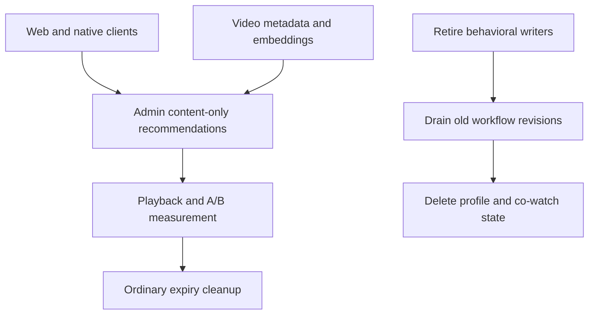

# Retire behavioral learning from recommendations

## Summary

Keep semantic and metadata recommendations, including precomputed content lists.
Remove viewer-profile personalization, co-watch and behavioral learning. Stop new
writes and consumption before removing their data and schema through normal
reviewed releases. The owner explicitly requested this change on October 29;
older requirements to preserve these features no longer apply.

---

## Requirements

- R1. Seeded recommendations use content semantics and metadata only, independent
  of old consent/profile credentials, viewing-mode affinity or co-watch grants.
- R2. Source-free surfaces use content/editorial pools without viewer histories.
- R3. Web and native clients cannot create or refresh viewer profiles. Remove
  personalization controls and clear obsolete cookies; retain native installation
  identity where required for push and operational playback.
- R4. Boot, feedback, replay, manual operators and CLI cannot restart behavioral
  learning. Existing durable scheduler replays terminate safely.
- R5. Retire viewer profiles, session links, projections, interest vectors,
  contribution lineage, behavioral affinity and co-watch graphs. Remove obsolete
  active controls and schema after all deployed readers/writers have stopped.
- R6. Preserve semantic embeddings, content metadata summaries, playback, language
  and publication eligibility, precomputed A/B evidence and daily expiry cleanup.
- R7. Reassess event retention without a behavioral learning consumer; report
  measured row and storage savings without claiming deletion shrinks allocation.

---

## Scope Boundaries

This does not remove video metadata summaries named content profiles, account
profiles, Grow learning progress, authentication, or push identity. It does not
create a warehouse or replace event delivery infrastructure. The existing
ClickHouse draft remains paused while its consumer requirements are revised.

## Context & Research

`delivery.factory.ts` wires profile, experiment, co-watch and viewing-mode
providers into both seeded and source-free serving. Profile status calls and
native bootstrap write profiles; playback and selection feedback can dispatch
projections. Instrumentation separately starts and recovers recurring profile
reconciliation/co-watch refresh workflows. Disabling only a UI or an environment
flag would leave these other writers active.

`RecommendationPrecomputedContentProfile` describes a video using transcript or
metadata. It is needed by the retained metadata/precomputed lane and is distinct
from `RecommendationProfile`, which describes a viewer. `WatchLearningProgress`
is explicit course progress, unrelated to recommendation background learning.

The profile erasure/retention code already handles shared evidence FK references.
The projection eligibility FK-unlink learning and storage semantic/physical proof
learning require native database validation and distinct physical-capacity proof.

---

## Key Technical Decisions

| Decision                                                                        | Reason                                                          |
| ------------------------------------------------------------------------------- | --------------------------------------------------------------- |
| Permanently remove learner providers and creation, rather than add another flag | Old environment settings cannot re-enable retired behavior      |
| Preserve compatible public receipts during client rollout                       | Cached Web and installed native clients must not break playback |
| Keep content-only precomputation and A/B accounting                             | These measure retained recommendations without viewer interests |
| Deploy writer retirement before destructive migration                           | Admin predeploy runs before the old HTTP/worker revisions stop  |
| Inspect sizes before claiming savings                                           | Raw events may dominate storage even after profiles are removed |

---

## Implementation Units

### U1. Remove behavioral serving dependencies

**Goal:** R1–R2. Content-only seeded and source-free recommendations.
**Dependencies:** None.
**Files:** `apps/admin/src/services/recommendations/delivery.factory.ts`,
`delivery.service.ts`, `delivery.types.ts`, `user-delivery.service.ts`, their tests,
`recent-context.service.ts`, `precomputed/public-watch.ts` and
`precomputed/private-watch-test.ts`.
**Approach:** Remove profile authorization/retrieval, behavioral experiment and
co-watch/affinity providers. Eliminate per-viewer recent-history reads and profile
ranking; retain semantic/curated retrieval and content-list experiment allocation.
Keep historical evidence interpretable; do not relabel old observations.
**Test scenarios:** Old credentials cannot trigger a profile query or change a
slate; all co-watch authority states still yield content-only candidates;
source-free language filters, empty supply and no fabricated cards remain correct;
precomputed control/challenger allocation and click denominator are unaffected.
**Verification:** No retained production serving path reads a viewer projection,
profile link, behavioral affinity or co-watch graph.

### U2. Retire profile creation and consumer controls

**Goal:** R3 and R6. Eliminate renewed viewer-profile state across callers.
**Dependencies:** U1.
**Files:** `apps/admin/src/services/recommendations/profile.service.ts`,
`viewer-identity.service.ts`, `apps/admin/src/graphql/mutations/recommendation-profile.ts`,
`apps/web/src/app/api/recommendations/profile/route.ts`,
`apps/web/src/components/recommendations/RecommendationConsentShell.tsx`,
`RecommendationCookieSettings.tsx`, `RecommendationPersonalizationControl.tsx`,
`apps/web/src/lib/recommendation-session.ts`, TV `SettingsScreen.tsx` and corresponding tests.
**Approach:** Keep compatibility receipt shapes while returning retired,
non-personalized state. No profile creation even for stale grant/reset calls.
Clear retired cookies only after successful erasure transition; ordinary delivery
ignores and retains them until bulk retirement is confirmed. Stop profile polling/UI. Preserve push deletion behavior
and bounded native playback sessions independent of personalization.
**Test scenarios:** Status/grant/reset cannot create, renew or activate profiles; old native handles
still support playback/push; deletion still unlinks push identity; no misleading
personalization choices remain visible; stale Web responses cannot restore cookies.
**Verification:** New requests create no viewer interests or consent-linked profiles.

### U3. Stop background learners and mutable authority

**Goal:** R4. All dispatch paths and durable replays stop learning.
**Dependencies:** U1–U2.
**Files:** `apps/admin/src/instrumentation.ts`,
`apps/admin/src/workflows/recommendationProfileProjection.ts`,
`recommendationProfileReconciliation.ts`, `recommendationCowatchRefresh.ts`,
`apps/admin/src/services/recommendations/profiles/job.ts`,
`profiles/reconciliation.job.ts`, `cowatch/refresh.job.ts`,
`playback-outcome-consumer.ts`, `episode.service.ts`, `evidence.service.ts`,
`apps/admin/src/app/api/recommendations/cowatch-refresh/route.ts`,
`apps/admin/src/app/api/recommendations/cowatch/route.ts`, their tests and operator
CLI/dashboard paths discovered through the dispatch inventory.
**Approach:** Remove boot/recovery hooks and feedback dispatch. Keep terminal
workflow compatibility until old durable runs are drained. Retire operator starts
at the underlying service boundary as well as HTTP/CLI surfaces. Preserve expiry,
playback finalization and current A/B measurements.
**Test scenarios:** Worker boot starts kept schedulers only; stale profile and
co-watch workflows terminate without new sleep/learning; old API/CLI calls cannot
publish a graph; playback outcomes remain available for measurement.
**Verification:** Deployed HTTP and workers stop creating behavioral rows; old
workflow ledgers terminal and no learned candidate contribution after cutover.

### Release gate between U3 and U4

Release A retires the readers, writers and dispatchers while retaining the schema.
Before release B can run its predeploy migration, record the actual revision of
**every Admin HTTP and worker replica**, plus the status of the old durable runtime
runs and their business ledgers. A terminal ledger alone is insufficient proof
that a runtime stopped. Do not allow old images to return through rollback or
scheduler recovery after release B. Both Railway services run migrations before
old processes stop, so a schema drop cannot accompany release A.

Retain `recommendation_viewer`: it authenticates native installation credentials
and supports playback/push; it is not a learned viewer profile. Preserve existing
GraphQL token/status fields for installed clients. Cached Web receipts must remain
valid without issuing new profile or consent credentials. Historical reset,
withdrawal and deletion credentials may fence/erase old state; this is required
privacy work rather than renewed learning.

### U4. Drain retired behavioral rows

**Goal:** Satisfy R5's retired-data and active-control portion, plus R6–R7's
preservation and measurement obligations. R5's obsolete-schema removal is
deferred to feat-905; U4 alone does not complete all of R5.
**Dependencies:** U1–U3 deployed and verified; inventory of every retained FK reader.
**Files:** `apps/admin/prisma/migrations/0164_retire_behavioral_recommendation_rows/migration.sql`,
`apps/admin/src/services/recommendations/behavioral-retirement-cleanup.ts`,
`apps/admin/src/scripts/retire-behavioral-recommendations.ts`, their native tests,
and retained `retention.service.ts`/`retention-health.service.ts` checks.
**Approach:** Inventory table sizes and external references. Release B leaves
the retired schema in place and supplies a dedicated bounded row-drain operator.
Detach three retained historical references explicitly, then delete only the
19 retired direct-delete tables' rows with durable per-batch accounting. Preserve
historical A/B rows and all other retained evidence. No broad CASCADE into kept
data. Retain necessary operational raw events until remaining consumer/expiry
inventory proves they are no longer needed. Keep ordinary retention separate.
**Test scenarios:** A database containing profiles, session and durable projections,
co-watch generations, linked historical requests and active precomputed visits
drains with retained playback/A/B rows intact; old native create/update-status/
delete, selection/playback and push-unlink flows continue; ordinary retention
still runs; no retired profile/graph rows reappear on ordinary traffic.
**Verification:** Applied migration checksum, actual HTTP/worker revisions,
CLI completion followed by fresh exact zero counts for all 19 tables after the
last profile deletion, three retained references detached, and retained-lane
smoke. If the fresh read is nonzero, perform another bounded source-bound drain
and repeat the zero check before accepting U4. This proves bounded observed
database state under the deployed source, not eternal zero; no fixed wait,
activity gate or extra clean days are required. Relation allocation and
filesystem free space are reported separately; reusable pages were unmeasured
in U4 and belong to feat-905's physical follow-up. Rollback
after deletion requires a forward code fix or explicit data restoration, never
resurrecting old workers.

### U4 follow-up. Remove physical schema after the row drain

[Feat-905](../roadmap/content-discovery/feat-905-retired-behavioral-schema-removal.md)
owns later table/index/code removal through its own reviewed normal release.
Its dependency is accepted U4 row and reference evidence, including a fresh
all-19-table zero read after CLI completion and the last profile deletion,
not merely a merged operator or an empty fixture.
U4 does not claim physical file recovery.

### U5. Reconcile product and operational documentation

**Goal:** R1–R7. Active instructions match the simplified product.
**Dependencies:** Verified U1–U3 release and U4 evidence for final closeout;
pending release/row-drain states may be documented explicitly beforehand.
**Files:** `CONCEPTS.md`, `docs/analytics-and-recommendation-policy.md`,
`docs/operations/user-recommendations.md`,
`docs/reports/2026-10-02-recommendation-roadmap-closeout.md`,
`docs/roadmap/content-discovery/feat-902-semantic-metadata-only-recommendations.md`,
relevant active profile/co-watch roadmap/operations docs and a new solution entry.
**Approach:** Add dated supersession to historical requirements that still contain
live operating instructions. Keep original history. Record retained raw consumers
and which parts of ClickHouse PR #2950 are obsolete versus independently useful.
**Test expectation:** Documentation checks and cross-reference review; no runtime tests.
**Verification:** No active instruction asks operators/agents to restore retired
learners. The bounded runtime/data result is independently accepted. See the
accompanying documentation PR and root [#2541](https://github.com/JesusFilm/forge/pull/2541)
for exact-head review, CI, merge and normal-deployment receipts.

### October 29 U4 production evidence — independently accepted

The D operator returned `complete` at 07:18:45 UTC. The 07:20 durable
reconciliation matched **3,088,917 direct deletes**, **18,055 detached-reference
updates** and **31,080 batches**; a later read found all 19 retired tables
and all three historical reference categories at zero. Actual source roles,
retained-lane presence, natural serving and dated capacity were observed.
The [retirement report](../reports/2026-10-29-behavioral-recommendation-retirement.md)
holds their precise receipts and limits. Feat-902 is complete for the
independently accepted bounded cutover and U4 row drain. See the accompanying
documentation PR and root [#2541](https://github.com/JesusFilm/forge/pull/2541)
for exact-head review, CI, merge and normal-deployment receipts. Row DELETE does not prove physical
filesystem recovery. Reusable pages were **unmeasured**; feat-905 owns later
physical measurement and schema removal.

---

## System-Wide Impact

Delivery errors keep their existing bounded fallbacks; removed personalization is
not reported as an operational outage. Historical A/B results remain historical.
Source-free surfaces become editorial recommendations and should not imply they
are personalized. Deleting profile state cannot delete unrelated push installs or
explicit course progress. Content embedding generation is still required.

## Operational Notes

The owner explicitly authorized deleting old production rows related to profiles
and co-watch on October 29. This authorizes the scoped data cleanup after release A
verification; it does not include unrelated playback, native identity, precomputed
content summaries or current A/B evidence. Do not request routine permission again.

Start from current main `47ac32a738a82403bd7ca78fe48498d3b7289297` in the isolated
retirement worktree. Preserve the primary checkout and paused migration work.
Review code and native database tests before each normal merge. Production
verification must precede destructive schema retirement. Do not count fixture
success as deployment or storage reclamation. Final row counts and savings remain
implementation-time measurements, not estimates promised by this plan.
