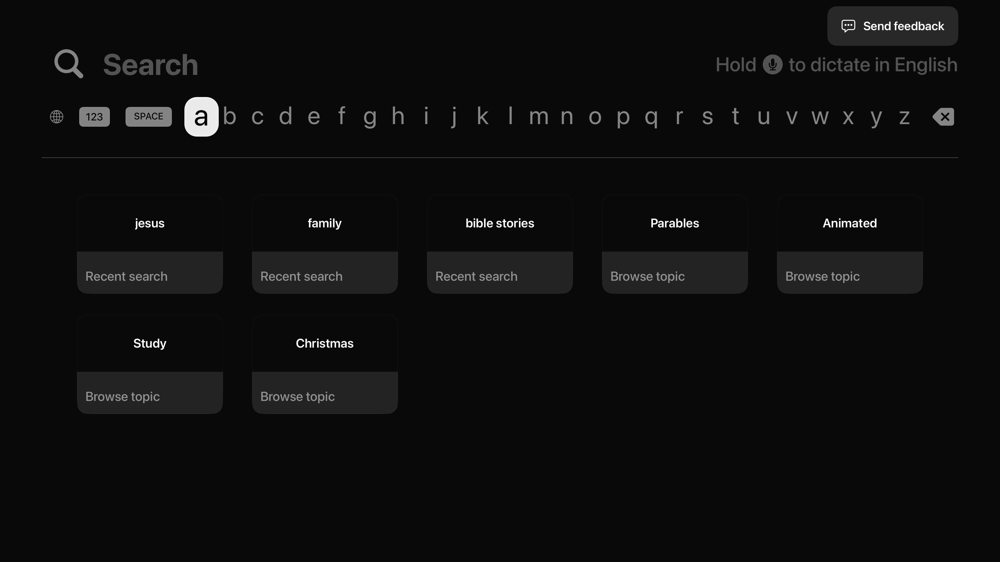
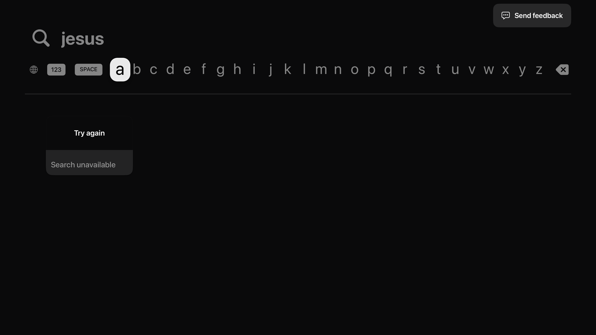
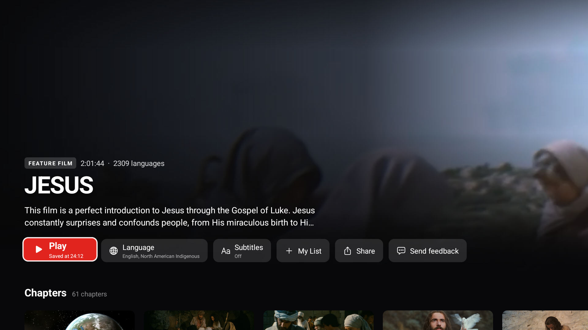
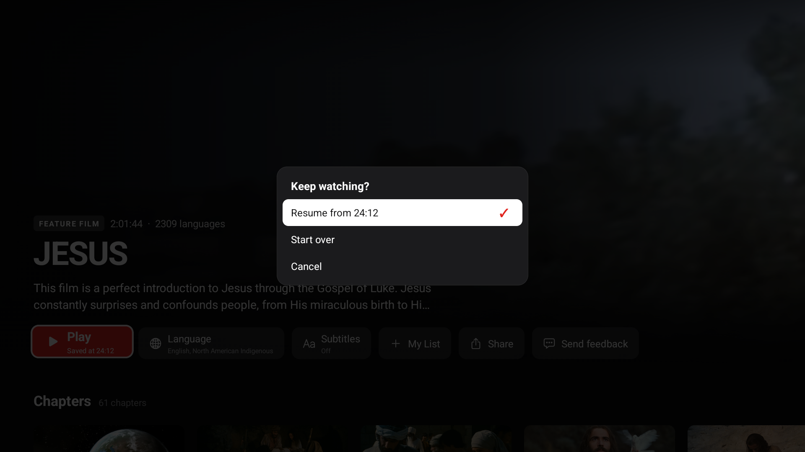

# Watch TV shortlist validation — 29 October 2026

Initial candidate application: `c19459c65`; comparison main: `c2f0a0e52`.
The owner's Android Back issue is repaired and verified at `d0377137` (feat-903).
Merge readiness remains in progress because a sampled duplicated video frame
requires investigation. Later main `34f5be683` is integrated; it changes no TV
application code or TV dependency inputs.

## Static checks and review

An independent GPT-6 Astra reviewer found no actionable defect in the final
shortlist diff. After merging current main, TV strict lint (`--max-warnings=0`),
typecheck, all 194 Jest suites / 2,440 tests, and formatting of every PR file
passed. The merge hooks also passed full-repository formatting. Local Node was
24.22.0, one patch below the repository's 24.22.1; pinned pnpm was 9.12.3.

Exact commands and the audit of 27 earlier evidence artifacts are retained in
the integration worktree's `.local-tools/merge-readiness-review.json`.
The earlier development harness passed bounded native UI/performance checks;
it is historical evidence, not a new whole-source runtime certification.

## Packaged Android comparison

Both APKs were built from their recorded Git revisions using the same generated
native project, Release configuration, Hermes, ARM64 target, environment and
existing debug signing certificate. Every packaged native library matches
byte-for-byte. These are QA APKs, not store distribution builds.

| Build     | SHA-256                                                            |
| --------- | ------------------------------------------------------------------ |
| Main      | `a1d8b24265b6ca78079f3976034ba6161dd5d927840a5b2af30d5fdf83dbe127` |
| Candidate | `8e1f042af366a85511545542424528c38c79768a7ae4b174b4693f4b05d6a282` |

Target: Google TV ARM64 Android 14, `emulator-5562`. An emulator snapshot preserved
the same existing data/cache before each upgrade install. Both used JESUS,
English North American Indigenous, subtitles Off, and the existing 22:41 saved
position. Each observation window was 60 seconds. Recordings decoded successfully
at 60.050 and 60.007 seconds respectively; fresh screenshots were captured at
5, 15, 30 and 60 seconds. No UIAutomator hierarchy was used as playback proof.

- Both builds reached moving video within the observation window. Neither
  captured application log contains a playback exception, HTTP 503, decoder
  initialization failure or fatal application exception during that trial.
- Main paused at 24:04 without advancing across two captures, then advanced to
  24:09 after Play. Remote Back from visible controls returned to details.
- Candidate paused at 24:06 without advancing, then advanced to 24:12. Remote
  Back returned to details with Saved at 24:12; its chooser showed Resume from
  24:12, and selecting it subsequently reached moving playback at 24:18.
- Candidate's 30-second sample contains a rectangular duplicated/scaled video
  frame, also present in the decoded recording. Baseline sampled frames do not.
  Its origin is unresolved; a second matched comparison is planned. Moving
  playback does not establish artifact-free rendering.
- The earlier HTTP 503, emulator decoder and preparation/failure captures remain
  retained. They were not reproduced in this first matched pair. No application
  fix or confirmed root cause is claimed from a successful retry alone.

Raw APKs, recordings, screenshots, scripts, logs and build comparison are retained
in the owned build worktree at
`/Users/up/.codex/worktrees/tv-streaming-ux/tv-app/.local-tools/merge-readiness-20261029/`.
The original unverified universal APK remains separately identified; the new
ARM64 result does not certify that older artifact or physical Chromecast playback.

## Android Back repair

The owner reported both exit paths. The agent reproduced hidden remote Back
only revealing controls and focused on-screen Back disappearing after 3.5 seconds.
The repair dismisses on one remote Back, consumes both key events, and keeps the
focused exit control visible. Scrub cancellation and dialog behavior remain.

The rebuilt Release QA APK has both ARMv7 and ARM64 libraries and preserves the
existing signing certificate. Its JavaScript is byte-identical to the earlier
candidate; only native Back behavior changed. Source `cd8e5dfbc` has the same Git
tree as integration `d0377137`. SHA-256:
`8825c6672104f67320e31f39ab5d40d058751c44fea768a31dc899bcf181459b`.

- 17 native unit tests and 16 relevant existing Jest checks passed.
- One remote Back from hidden controls returned to details; reentry offered the
  saved 27:08 position after the previous 26:49 start.
- During active playback, Back remained visibly focused while time advanced
  27:17 to 27:32 across a wait longer than six seconds. Select then returned to
  details with Play focused.
- An independent review confirmed scrub Back still cancels the preview before
  exit and native dialogs retain their own Back handling. Those paths were not
  newly exercised after this repair.

A later QA failure was traced to emulator clock drift after snapshot restoration:
OCSP certificate validation rejected an out-of-date response. Synchronizing the
emulator clock to the host restored playback with the same unchanged candidate;
certificate checks were never bypassed. This explains that specific later failure,
not every earlier HTTP 503 or decoder error.

## UI examples

Apple screenshots below come from the earlier native simulator checks of the
unchanged shortlist UI. Android examples come from the current packaged build.

## Limits retained

Physical Chromecast installation is deferred. Audible playback, physical Siri,
screen-reader speech, and hour-plus saved-position live layout were not checked.
Bounded prior UI measurements do not close the strict whole-startup gate in
feat-889. Restart placement, hero height and unsupported metadata labels retain
their reviewed existing behavior.
